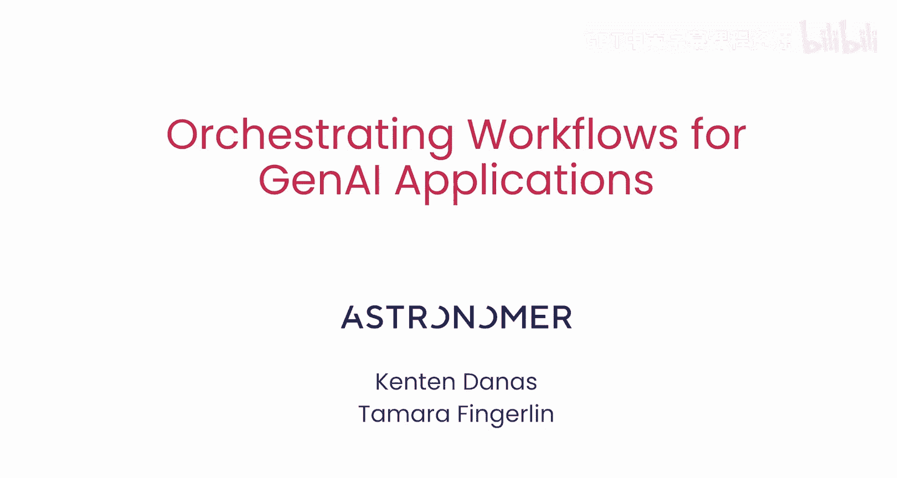
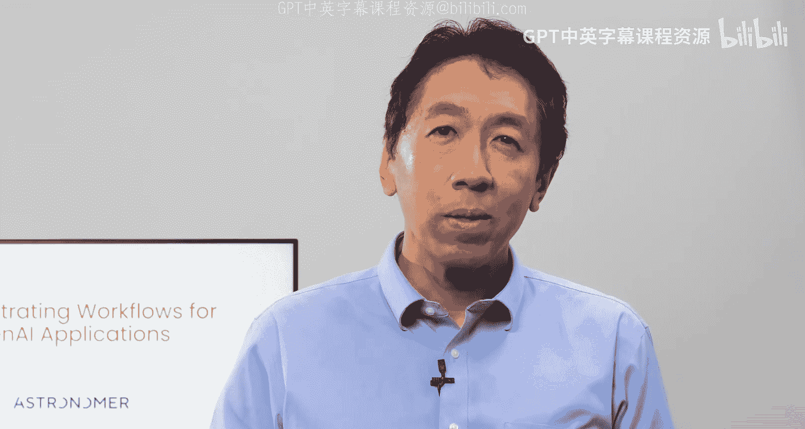
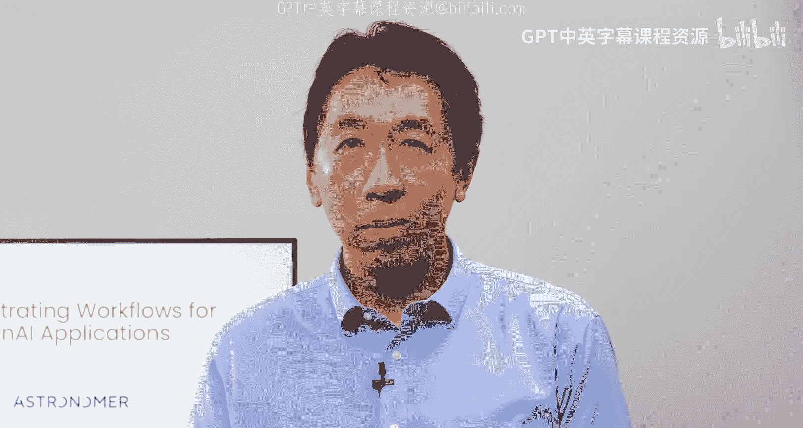
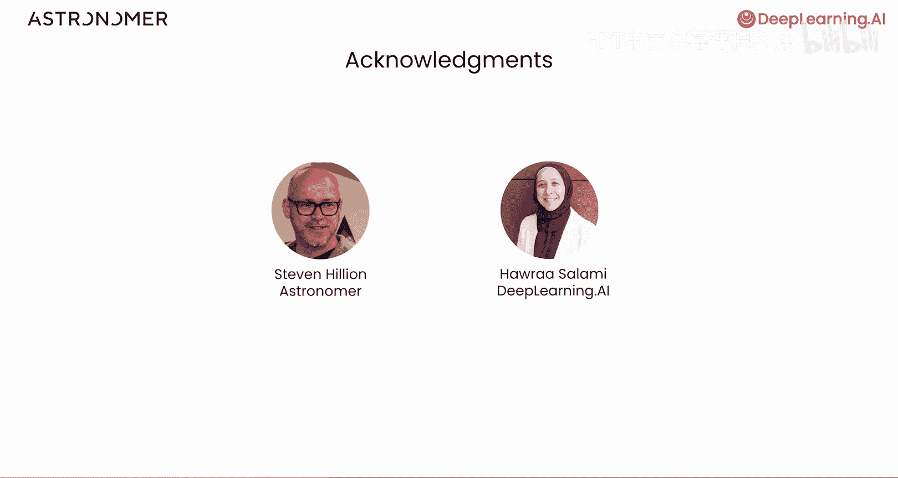
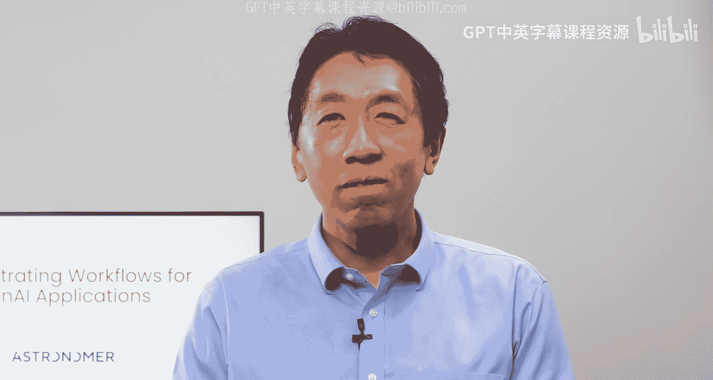

# 吴恩达《为生成式 AI 应用编排工作流｜Orchestrating Workflows for GenAI Applications》中英字幕 - P1：1.intro.zh_en - GPT中英字幕课程资源 - BV16BMwzyEVW

Welcome to orchestrating Workflows for Gen applications built in partnership with astronomer In this course youll build a red pipeline that ingests descriptions of books from text files then computes embeddings for the descriptions and store the embeddings in a vector database you automate the pipeline using airflow which is an orchestration tool that ensures that the steps are executed in the correct order。

 and also the pipeline is triggered at the right time I'm delighted that your instructors to this course are Kenten Dens developer relations senior manager as well as Tamara Fingngelin who is developer advocate at astronomer。

😊。

Thanks， Andrew， we're excited to work with you on this course。

To move your proof of concept from development or production。

 you need to transform your logic into an automated pipeline consisting of multiple steps where each step represents one operation。

😊，Say for example， you have access to a list of files containing proudly reviews and you've written a large bucker code that summarizes each review for each product。

To automate this work though you can break the logic into a sequence of steps。

 such as first find the location of the review text files for each product。

 then second aggregate to feedback across reviews for each product third summarize the reviews for each product using an LM and then finally extract sentiments from the summaries again using an LOM。

This approach helpss you easily identify failure points across the pipeline and recover from them。

For many Gen AI pipelines， failures can occur due to API rate limits or the API returning other errors。

 which can happen if the LLM has to process large volumes of product reviews In this course。

 you'll learn how you can configure retries for your tasks。

 So your pipeline can wait for a little bit before trying again。

 You will also learn how you can process large data in parallel。 For example。

 at the summarization step。 Instead of creating summaries of all products in one step。

 you can process the reviews of each product in parallel。 And finally。

 you will also learn how the pipeline can be triggered whenever new data becomes available or gets updated like a new set of product review pairs。

 You will apply all these practices to your ragg example。

 You will start with a Jupyidter notebook that contains a rag prototype ingesting and embedding book descriptions。

After learning basic Affflow syntax， you will turn that prototype into an AFO pipeline that runs manually。

😊，After that， you will schedule it to run automatically， make it adapt to your data at runtime。

 and even add automatic retries and notifications in case of failure。In the final lesson。

 you'll learn how Lflow is used to orchestrate GenI workflows in real life。

Many people have worked to create this course I like to thank from astronomer Stephen Hoian。😊。

And from De Blada AI Harra Salami had also contributed to this course the process of turning a Jupiter notebook to runable production software is an important skill for any AI developer in the next video you go through this entire process and see how to do yourself one of the non-intuitive aspects for many developers doing for the first time is that the process of breaking down the workflow into steps usually ends up with a larger number of smaller individual steps than you might expect and gaining intuition on how to do this will make your applications run faster and more reliably so please gone to the next video to learn about this。

