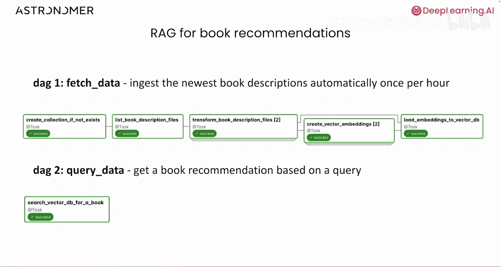
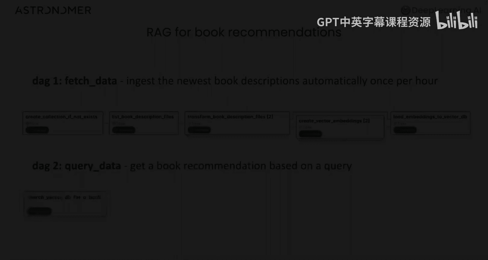

# 吴恩达《为生成式 AI 应用编排工作流｜Orchestrating Workflows for GenAI Applications》中英字幕 - P2：2.from-notebook-to-pipeline.zh_en - GPT中英字幕课程资源 - BV16BMwzyEVW

In this first lesson， you will learn how to orchestrate GenI applications。

 specifically retrieval augmented generation or wreck。

 you'll explore some of the best practices for turning notebook prototypes into production pipelines。

 what airflow is and some of its terminology such as dags and tasks。 Let's go。First。

 let's talk about what orchestration is and why it's important In other courses at deep learning。

 you have probably developed GenI applications using Jupyter notebooks Notebooks are great for development because you can easily run and test code for different parts of your application。

 allowing for quick feedback and experimentation。 It's easy to incorporate any number of Python packages and tools。

But once you have your code ready， you will likely want to run it automatically to power your JenI application in production。

This is not easily done in a notebook。 You need additional features for when your code runs automatically。

 like observability， so you know what succeeded， what failed and when your pipelines ran。

You also need a robust system that can manage running lots of tasks at the same time。

 different resource needs and notifications for when things go wrong。

This can all be accomplished with an orchestration tool used to run data pipelines based on your notebook code。

To give an example of what this might look like， let's say you have a prototype where you take some text input。

 generate embeddings from it， and load those into a vector database。In your notebook。

 you might have three cells where you've written and tested the code to work with a local subset of the text data and load it into a vector database instance。

 Now， you can turn this notebook prototype into a pipeline。

Each of your notebook cells becomes a step in your pipeline that can run automatically and be pointed towards production data。

Your pipeline has three steps， get text， embed data， and load to DB。

And in addition to running the code for each step automatically。

 it will also manage dependencies since you need to get the data before you can load it into your database。

Your pipeline will also contain logic you define for what happens if something fails。

 like does it retry， do you get notified somehow， or do downstream steps still run if an upstream step has failed？

All of these extra features are required for automating your notebook。

 code and production and are provided by an orchestration tool。

You'll notice on this slide our pipeline has this pinwheel logo on it。 This is the airflow logo。

 and airflow is the orchestrator we're going to use in this course。

 Apache airflow is an open source tool for authoring， scheduling and monitoring data pipelines。

It is the standard for programmatic workflow orchestration and is hugely popular around the world。

In airflow， your data pipelines are written in Python。

 which means airflow can integrate with nearly any tool in the data ecosystem。

Airflow's architecture is set up to make it infinitely scalable。

 whether you need to run one pipeline or thousands。

And it has a rich set of features that make it dynamic and observable。

The project is maintained by a vibrant open source community and new features are being added constantly。

When using airflow， there are a couple of concepts you should know。 The first is a dag。

 The name Dg comes from a mathematical term， but in airflow。

 you can think of it simply as a data pipeline， or in some cases， part of a data pipeline。

Within DAGs， you have tasks which represent one unit of work in your pipeline。

Airflow also has a rich UI that shows you an overview of current and past runs of your pipeline you will get to explore the airflow UI in this course。

Let's dive deeper into the concept of dags by looking back at our previous example in this case。

 where you have turned your prototype notebook into a pipeline。

 you would have one dag with three tasks，1 to get the text input data。

 one to create the embeddings and one to load those embeddings into your vector database。 in airflow。

 your dag has a name。 Maybe my awesome pipeline。 and would be given a schedule for when it should run。

 say every day at midnight。Every task contains the Python code you developed in your notebook。

 You would also define dependencies so that your three tasks run in order。

 There's no use running the tasks to load data into the database。 If that data isn't ready yet。

 Note that this is just one example of a dag in airflow。 You might have dags that are simple。

 like this one， or they can also be more complex。 Airflow is very flexible。

 And if you can write logic in Python for your use case， you can turn it into an airflow dag。

Because airflow is so flexible， it is commonly used as an orchestrator for many different use cases。

 including orchestrating Gen Ai pipelines。 In this course。

 we will cover how to orchestrate retrieval augmented generation or rag pipelines。

 but you can also orchestrate other types of GenI pipelines。

 One common use case is inference execution， which is generally the process of running a trained machine learning model on input data and collecting the results。

Batch inference is one type of inference execution。

 which is a method of generating predictions from a trained ML model on a large set of input data all at once。

 so the data is provided in batches。In Airflow， you might run a nightly batch stag that scores all customers on their likelihood of churning based on the latest daily customer activity and profile data。

Another type of inference execution is ad hoc inference or asynchronous processing。

 meaning you feed data to your model to get results as soon as the data arrives while airflow is not used for streaming。

 it can be used for asynchronous pipelines in some cases。 For example。

 you might have a web application that services personalized product recommendations when a user creates a profile the information is sent to airflow。

 which manages getting the results from the trained model。

 Airflow can also be used to manage automated model training， retraining and fine tuning。 General。

 any python based notebook can be turned into an airflow dag and pipeline。

When designing pipelines in airflow for Geni orchestration or any use case。

 there are a couple of best practices you should keep in mind。

 Following these guidelines will help ensure Airflow's flexibility will make your life easier。

 not cause you problems in production。 The first best practice is atity。

 This means you should create your pipeline such that your tasks are atomic。

 Each accomplishing a single unit of work。 The second is item potency。

 This means that you design your pipelines in such a way that if you run a dag or task multiple times with the same input。

 It will always lead to the same output。Note that with GenAI pipelines this won't always be possible and that's okay。

This is a general guideline to follow when it makes sense， not a hard requirement in every situation。

And the third best practice is to use software development best practices。

Because Airflow pipelines are Python code， you can treat them like any other piece of software and use version control。

 CICD， and automated testing。The first two best practices are nuanced and might be new to you at this stage。

 so let's take a look at them in more detail。Atomicity in the context of data orchestration is the principle that every task should represent an atomic unit of work。

 Since tasks and airflow are Python code， you can define them however you want。

 You can put your entire notebook into one task that does everything for your pipeline。

 but pipelines rarely have one logical step in the previous example。

 we discussed a pipeline with three steps。 Getting text data generating embeddings and loading them to a vector database。

 If you put all of that logic into one task， What happens if it fails to connect to the database。

You would have to rerun all your code， even though everything went fine with getting the text data and generating the embeddings。

 This is both inefficient and difficult to manage。 It would take extra effort on your part to even figure out what part of the task failed。

By breaking this logic into three separate tasks， one for each step。

 you get better observability and can recover more easily from failures by rerunning only the task that needs to be rerun。

 General， there isn't much downside to having a higher number of tasks in airflow dags。

 and it is always preferable to keep your tasks atomic。

Item potency is another best practice that can help you recover more quickly when something goes wrong。

An item potent and task means you get the same output for the same input。 For example。

 let's say you have a task with logic that uses the current date。

 If you design the task using a function like date time now。

 the task will use the current date and time whenever it is run。

So if you have a dag that processes daily data and on Monday you realize that Fridays run failed。

 if you rerun your task， you will not be using Monday's date， you will use Fridays。

 and you'll process the wrong data in this particular example， you can use airflow's context。

 which allows you to access information that airflow is using when running your pipelines。

This allows you to get the date that corresponds to the date the DAG was scheduled。

 even if that date is now in the past。As we mentioned before， sometimes with Gen Ai pipelines。

 it doesn't make sense for every task or dag to be item potent。

 There are cases where you expect a different output for the same input。 That is totally fine。

 The important part is that you know what item potency is and when it makes sense to use it in your dag design。

Now that you have some background on airflow concepts。

 you can start trying it yourself in the rest of this course。

 you will learn how to create a RAG application for book recommendations and turn your notebook code into airflow tags。

You'll create one dag which fetches the data that ingests new book descriptions automatically。

 creates vector embeddings and loads them into a vector database。

 and you'll create a second Dg that searches your vector database for a book recommendation based on a query you provide。

