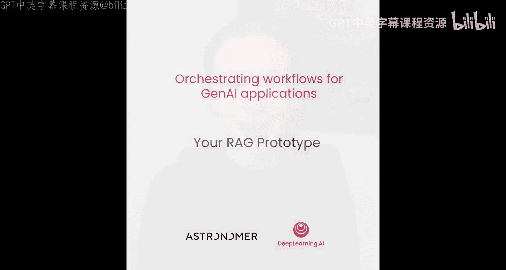
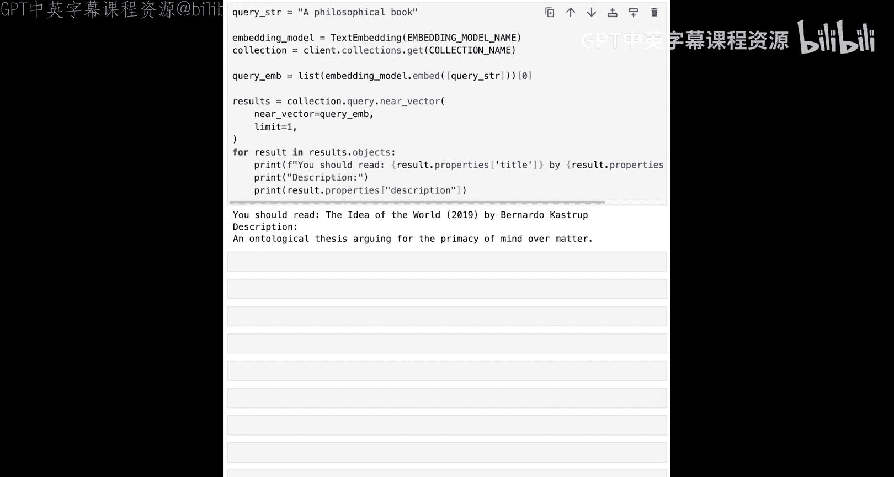

# 吴恩达《为生成式 AI 应用编排工作流｜Orchestrating Workflows for GenAI Applications》中英字幕 - P3：3.your-rag-prototype.zh_en - GPT中英字幕课程资源 - BV16BMwzyEVW

In this lesson， you will explore your prototype notebook。

 which you'll turn into a pipeline later in the course。

The notebook contains a fully functional rack prototype。

 ingesting and embedding book descriptions and offering you the ability to query them for a book you'd like to read。

 Let's dive into the code。 So let's build your rack prototype application。

 you'll use this prototype to learn how to translate a notebook into a pipeline consisting of two das。

 and after this course， you'll be able to use airflow to orchestrate other types of AI application notebooks you've built。

 So don't worry if you aren't that familiar with Rag or are looking to orchestrate a different type of workflow。

 The principles will hold true for any pipeline in an AI application。😊。

First， you need to add the libraries used in his notebook， OS and Jason to interact with files。

 as well as Jason from Ipyython to display Jason dictionaries in a structured format in the notebook。

And text embedding from Fast embed to create vector embeddings of book descriptions。

 including the one of your favorite book， those vector embeddings will need a vector database home because Airflow can orchestrate any Python code。

 you can use it with any library interacting with your favorite AI tooling。

 including a wide variety of vector databases。In this example， you lose a deviate vector database。

 Lastly， you import a helper function to suppress verbose logging。 Next。

 a few variables are needed in several location throughout the rag application。

The name of the collection in Vivi8， where you'll store your embeddings， books in this example。

 the folder， where your book descriptions are stored。

 there are already descriptions waiting to be ingested in include s data and the embedding model used in this example。

 the popular and lightb BteBa Nv1。5 which is optimized for semantic search and retrieval in a notebook environment。

 you often work with local or embedded versions of tools This is true here as well you create and connect to an embedded VviA database persisted at temp s Viviate。

😊，Pas the video and run the cell to create your Viviate instance and confirm that the client is ready。

 Later， when you translate this notebook into airflow Ds。

 you connect to a Viviate instance running in darker instead。😊，Next。

 you'll create a collection in your Viiate instance。

 A collection in Viiate is a set of objects that share the same data structure。

 like a set of product descriptions， support tickets or in our case book descriptions。

 The code in the cell uses the Viiate client you instantiated previously to first list all collections that already exist in this instance。

 The next slide fetches the names of those collections。

 and the if statement checks if the name of the collection you want to create already is in the list of existing collection names。

 If it is not， you create the collection using the dot create method and store a reference to that new collection in the variable called collection。

😊，If the collection does already exist in this Viviiate instance。

 then you can just retrieve it using the dot get method and assign it to the collection variable to interact with it later in the notebook。

 Vivi8 is ready and hungry for some data。 They are already a couple of descriptions of good books stored in text files in the book description folder。

😊，Running the cell， you can see that there currently are two files in this folder。

 each containing the data for several books。Let's add a third file， including books that you love。

The format is simple， and in teacher index， then free colons as a separator。

 the book title and in smooth brackets， the releaseier of the book， and after another separator。

 the offer and lastly the description of the book。😊，I LED two of my own favorite books。

 The idea of the world by Bernardo Kasstrop and exploring the world of lucid dreaming by Stephen Lebert。

The next two lights， write the new book descriptions to a file in the same book description folder。

You can pause the video here and add your own favorite books。 You can add as many as you'd like。

 Just make sure to follow the described format and that each book is on a new line。😊，Awesome。

 now you just need to get this data from the text files， embed the text。

 and then load the embeddings to Viviiate。😊，For the first step。

 you loop through the list of description files and read each file using dot read liness。

 This method creates a list where each element in the list is one line in the file containing the data about one book each。

😊，Next， we use the free colon and separator to gather the book titles。

 offers and the description texts and format them into one dictionary per book。

 The list of book dictionaries for each file gets stored in a big list called list of book data。

You can use the Json function from ipyython to display the content of that list in an Expable structured format。

 Feel free to pause the video to check that your book data was correctly added。

 in a rack application。 vector embeddings are used to make semantic search searching for similar texts based on an input possible。

 Many AI apps you interact with every day use rack to give you better answers。 For example。

 a chatbot on an ecommerce-commer platform most likely has access to the vector embeddings of uptodate proprietary product descriptions of all products sold and therefore can give you more accurate shopping recommendations than a general purpose chatbot。

 The same principle is implemented in this prototype。 So let's embed the book descriptions next。😊。

You instantiate the embedding model using text embedding from Fast embed and then iterate for the list of book data to get the description of each book that embed is the method that creates the vector embeddings。

The list function is used to make sure the embeddings are converted from a generator object to a Python list。

😊，Next， you can zip the list of embeddings and the list of text form book data together and insert the data into the VVA database。

 the combined data for each book title， offer description。

 as well as the vector embeddings are defined as one data object to be put into the VVA collection。

Viviiate supports batch inserts for data objects with the dot insert many method。

You are now all set to get a book recommendation。 I would like to read the philosophical book。

 This query string is embedded using the same embedding model to perform a near vector search for the book with the description matching the query string most closely。

😊，Running the cell， I get my recommendation for the idea of the world， Def a very philosophical book。

😊，Pass the video and try out different queries， experiment if you can get a recommendation for one of your own favorite books you've added previously。

😊，All right， you are in a familiar situation， you have a working prototype of an AI application。

 in this case， a rack type application that can give book recommendations which would be very useful to integrate into a chatbot on a website for a bookstore in a real life situation you'd need new books to be regularly added to the database。

 ideally automatically and with observability over whether the operations were successful。

 protection against transient issues like great limits of APIs and alerts if something goes wrong。

This is where orchestration comes into play You have your prototype。

 let's turn it into a pipeline in AFflow In the next lesson you'll learn how to create basic EFflow pipelines and interact with them in the EFflow UI before using the code from this notebook to build your rack pipeline。

