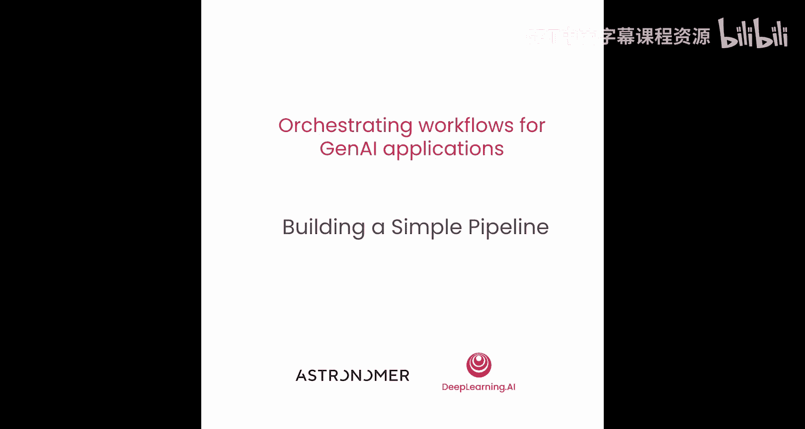
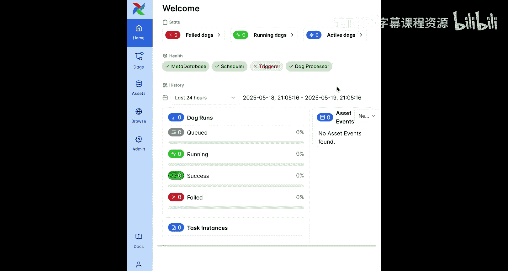
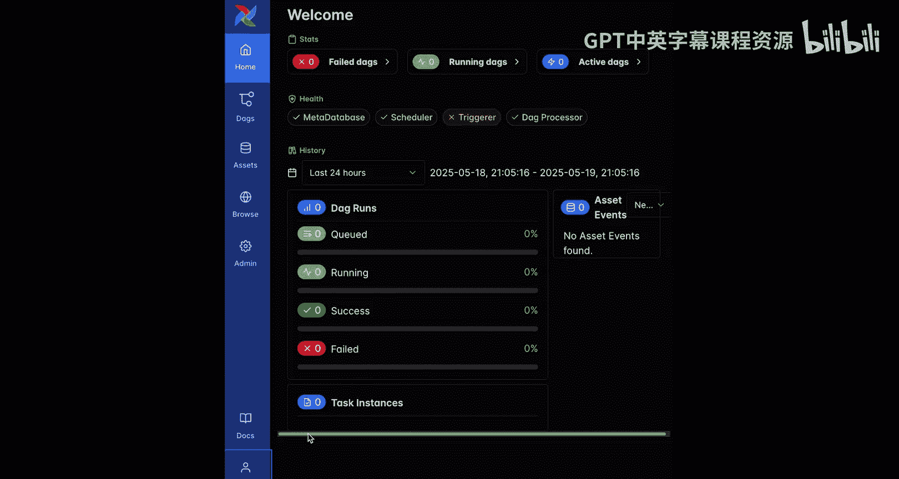
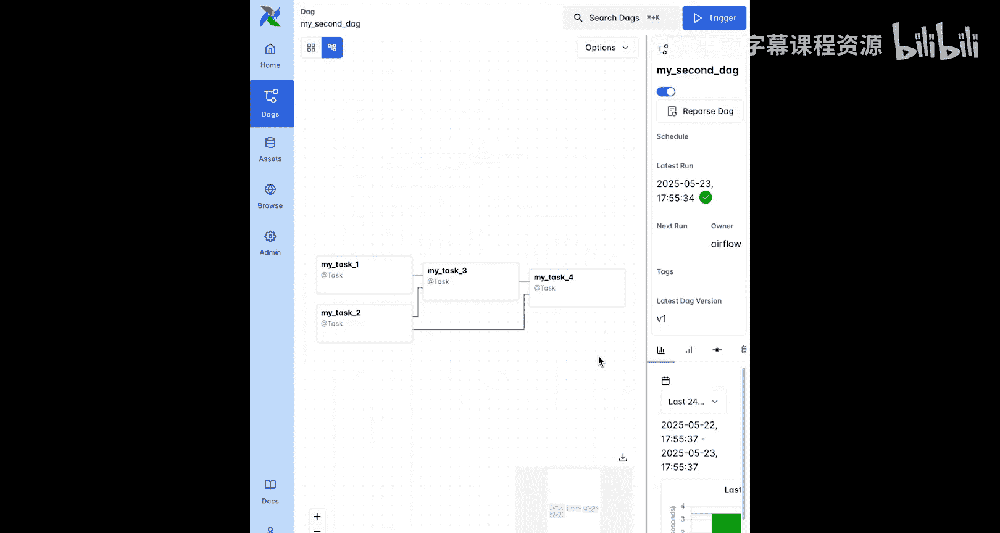

# 吴恩达《为生成式 AI 应用编排工作流｜Orchestrating Workflows for GenAI Applications》中英字幕 - P4：4.building-a-simple-pipeline.zh_en - GPT中英字幕课程资源 - BV16BMwzyEVW

In this lesson， you will build your first pipeline。

 a simple airflow deck using just three airflow specific modules。Once you've built it。

 you will explore and run your Dg manually in the Outflow user interface， let's get to it。😊。

For this and the following lessons， you have a fully functional airflow environment available to you。

Run this first cell to get the link to your Aflow environments UI When you click the link。

 it will open the Aflow UI in a new tab where you can log in with Aflow as the username and password。

Once you've logged in， you land on the home page of your air flow environment。

 This page contains a couple of quick links， as well as the current health status of the different components of the air flow environment。

 Note that the triggeral component is not running in the sandbox since we do not need it for this course。

Lastly， the homeage shows recent history of runs of das and tasks in your airflow environment。

 For now， these stats are still empty。 A little bonus tip。

 When you click on the user button in the bottom left corner。

 you can switch the UI to dark mode if you prefer to do so。

 because it is easier to follow in a video will stick to light mode for the course。

Great， you have a running Fflow environment。 Let's briefly go over the Fflow components that make it possible for you to run pipelines。

 The components running in this environment are the Fflow metadata database。

 which is where all information important for Fflow's functioning。

 such as the status of tasks are stored the scheduler， which is the heart of Fflow。

 which makes sure all the acts and tasks run in the correct order。 the API server。

 which accomplishes several tasks， the two most important for you right now。

 being that it serves the Fflow Ui for you to interact with and acts as the interface between workers and the Fflow metadata database Work are the Fflow components that actually run your task code in Fflow free。

 they cut't directly interact with the metadata database anymore like an Fflow2 and use the task execution interface of the。

😊，PI server instead。 and lastly， one component that is running in this environment is the Dg processor。

 It parses your Dg files and writes a serialized version to the Aflow metadata database。

Let's add a first eflow deck for the D processor to parse and then add to your environment。😊。

The simplest way to add DAs to airflow is by defining them in individual Python files in a specified location among your Aflow project files。

 usually in a top level folder called DAs in this notebook environment。

 you can use cell magic to write the contents of one notebook cell to a Python file in the DAX folder of your Aflow project。

 the magic command used is called write file。 This command is specific to the learning environment here in a regular Fflow project。

 you would create a new Python file in the DAX folder and then add your code to it directly。😊。

In airFflow， pipelines are represented by DAs， and a DAC can be created by writing a regular Python function and decorating it with the add DAC decorator imported from airflow。

 SDK。Every task instantiated in the context of this function is automatically added to the D。

 Right now， the deck is empty。 Let's add a task。You can turn any Python function into an outflow task by using the Add task Decator。

My task1 is a very simple function that just returns a small dictionary。

 You can use add task to turn this function into an Aflow task and then assign the output of the called task function to an object to use it downstream。

Next， you can define my task too in the same way。This task accepts one argument called Mic and prints the value of one key in the dictionary when calling this task function。

 you can pass in the output of the first task to Mict。

 so the second task will print eflow to the logs。Feel free to change the value of my word in this dictionary to a word of your choice。

 Let's run this cell to save this Dg in the Dx folder。

 Fflow's D processor component automatically checks the DAx folder for new DAs and adds them to the F flow U I in this environment。

 It does。 So every 30 seconds。 So let's check back in the Flo Ui。 Within the next 30 seconds。

 we should see our Dg show up。😊，In the FffL UI， you can see all your DAs on the DAX page。

 which you can access using the second button in the sidebar。And there it is your first stack。

 click on the D name to get to the DAC overview page from here。

 you can access all the information about your D from its structure overrun history to all logs of tasks that have run。

😊，It looks a little empty right now。 Let's manually run this stack。😊。

Click on the blue trigger button in the top right corner and then on trigger to create a manual run of yourda。

 make sure the unpas My first stack on trigger checkbox is selected as pause stacks cannot run。

Pass the video now and run your first stack。 You can run it as many times as you want。

 Let's create at least three runs。😊，Nice， you now have some Dg run history。

 Each of the bars represents one previous run of this Dg and each square， a task instance。

 one run of a task in those stag runss。 you can access the logs of your tasks by clicking on the squares。

 here you can see that this run of my task2 printed eflow to the logs。

Aside from this overview of previous Dg runs called the Fflow grid。

 you can also see the graph of your Fflow Dg in the UI。

 clicking on the graph icon below the Dg ID you can see the two tasks in this Dg by default DAs are read from left to right In this case。

 my task one needs to complete successfully before my task2 can run。But in the options menu。

 you can change this behavior。 for example， if you prefer to see the tasks from top to bottom。

Let's add a third task to the stack that runs as soon as My taskask one has completed successfully。😊。

Back in your notebook， you can add another task， I'll just call it my task free and add one simple print statement。

Now， how can you make this task run after my task1。In the case of MyTask 1 and MyTask2。

 FffL automatically inferred the dependency based on the result of myTask 1 being used in myT 2。

But my task free does not take any arguments。 You'll have to define the dependency， explicitly。

To do so， input the chain function from the Flu SD SDK chain defines explicit dependencies here between my task one and myT3。

After running the cell， the DAG file is updated in the DAX folder and within the next 30 seconds the DAC will be updated in the Fflow UI。

You can call your task any name you'd like the name of the function that you decorate with Add task will be the name of the task inside of Aflow。

Also， feel free to run more than a simple print statement in your function。

 Aflow can execute any Python code。😊，Awesome， let's explore the free task deck in the Fflow Ui together。

😊，You can now see that the third task was added。 It depends on my task 1 and runs in parallel to my task 2。

 This is one of the great advantages of airflow。 You can run many tasks in parallel as soon as their requirements are met。

 You can also see that the latest stackg version got updated to B 2。😊。

Aflow automatically keeps track of structural changes to your D。

 This feature called DAG versioning was added in airflow free。

You can look at past versions of your D graph by selecting them in the options menu。 Additionally。

 the code tab， where you can view but not edit the code of your Dg also lets you look at the code of previous stackg versions。

All right， now you know everything you need to turn your Python code into tasks in an airflow deck。

 let's practice by adding a second tag to this environment。Here's the code of the second deck。

 And here's the name of the add tag decorated function， which represents the D I D。

 It is important that the D I D of all of your Ds in an affluent environment is unique。Beyond that。

 you are free to create your own bag with as many tasks as you'd like。

 I chose to create a da with four tasks that does a little math。😊。

Note that the chain function in this tag defines a slightly more complex dependency structure。

 The first element passed to the chain function is a list containing two objects that each reference a task。

 The second element is a single task。Two dependencies are created。

 one between my task 2 and my taskask 4 and another one between my task free and my task4。

These two dependencies are added to the dependencies already inferred by airflow based on data being passed between tasks。

 My taskask 1 and my task 2 are upstream of my task free due to inferred dependencies Note that you can also define dependencies between two lists of tasks as long as the lists are of the same length。

 and that you can add as many arguments to the chain function as you need。Once you are ready。

 run the cell to save the file to the DAX folder and after 30 seconds max。

 it will show up in the FL UI where you can create as many D runss as you'd like and explore the DAC。

😊，If you make structural changes such as adding or renaming a task in between runs。

 you will create several versions of your D。 All right。

 I'll leave you to experiment once you feel confident in creating the simple DAs。

 you can go to the next lesson where you will take the code from the GenI workflow prototype in the previous lesson and turn it into two airflow Ds。

