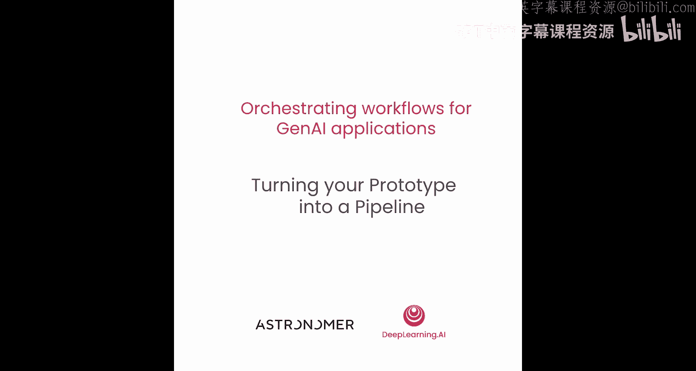
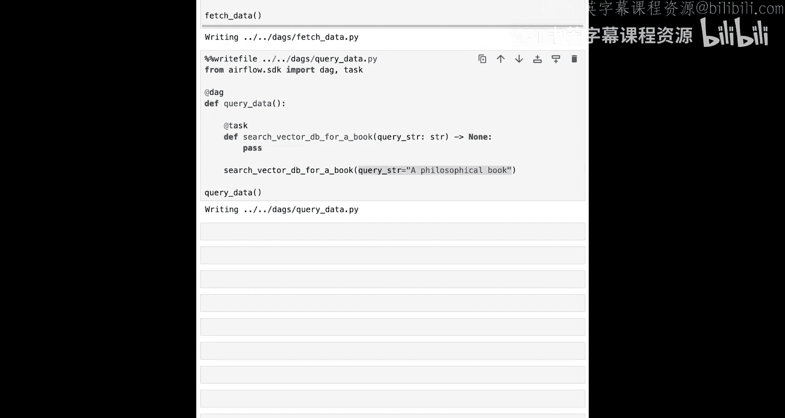
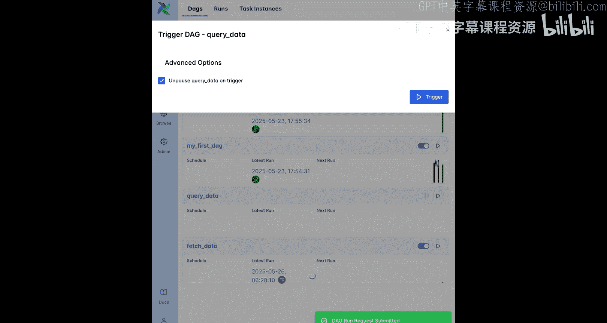
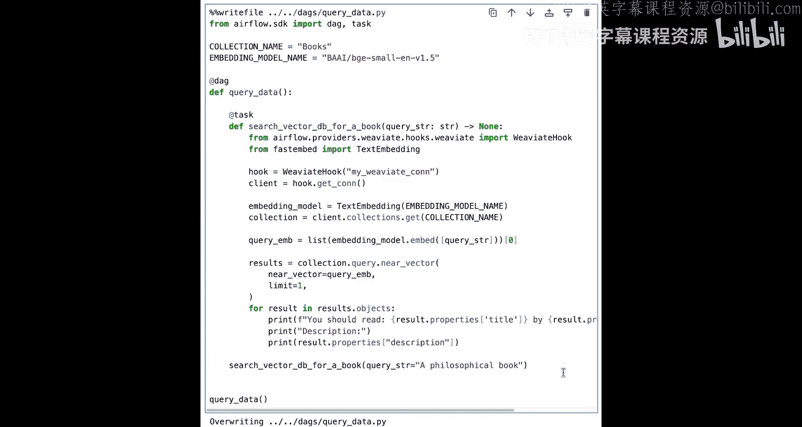

# 吴恩达《为生成式 AI 应用编排工作流｜Orchestrating Workflows for GenAI Applications》中英字幕 - P5：5.turning-your-prototype-into-a-pipeline.zh_en - GPT中英字幕课程资源 - BV16BMwzyEVW

Now that you know how to write airflow Ds， this lesson is all about how to turn your GenI prototype in a Jupyter notebook into an airflow pipeline。

 you'll write two DAs， the first one to ingest embed and load embeddings into a vector database and the second one to query that database for a book you like with that。

 let's get coding。

Like in the last lesson， you can run the first cell to get the link to your AFflow environmentvi's UI and log in with AirFflow as the username and password。

Using the same magic command right file， you can add your two Ds。

 the first one which will ingest embed and load the book descriptions to the Viviate vector database。

 is called Fech Data， the second one which queries the vector database is calledque data。

Like in the last lesson， you are using the DAAC decorator to create the DAs and then fill them with tasks created using the Add task decorator。

The first step when writing a pipeline is to define your DA structure。 That is。

 decide what actions the individual tasks will perform in what order and create them as empty tasks。

 The important principle to remember from lesson one here is to try to make tasks as atomic as possible to more easily recover from the point of failure if something goes wrong。

The ingesting， embedding and loading part of the Iraq prototype can be expressed as five tasks。

The first one creates the collection in the vector database in case it does not exist yet。

Another task lists the book description files available to the pipeline。Again。

 another task transforms those files into a list of dictionaries。

One task creates the vector beddings。And the final task loads those embeddings into the vector database。

Most of those tasks use the output of their previous task as an input。 For example。

 the task that creates the vector embeddings gets the transformed book data from the upstream Trans book description files task。

 The only exception is the create collection， if not exists task。

 It is not embedded in the dependency structure yet。

 You can use the chain function to decide how this task relates to the others in the D。

One logical location for it， since it prepares the vector database。

 is right before embeddings are loaded into that database。

It has only one task called Search vectorctor DB for a book for this first iteration of the deck。

 you can hard code the input to the query string argument。

Pas the video and run the two cells containing the structure Ds to write the files to the DAX folder。

Check out the DAs in the FluUI to run them manually。

Remember that it can take up to 30 seconds in this environment for a new deck to show up。

Awesome， you saw the tasks complete successfully， but they aren't actually doing anything yet。

 Let's change that。😊，Next we'll fill in the code for each task。

 this code will look very familiar from lesson2， and most of the time you can use the same code from your prototype notebooks in your airflow tasks with some minor modifications。

Here I'll call out the modifications for each task。

Variables used in several tasks can be declared at the top level of the deck to ensure consistency for this D。

 you will define free variables， the collection name， the book description folder。

 and the name of the embedding model。Note that the code at the top level of DG files gets passeded every time the DAX folder is par for changes by default。

 that is every 30 seconds。This means you should avoid code that takes a long time to run or makes connections to external systems at the top level of the deck。

 Imagine running a costly query against your database every 30 seconds。 Let's avoid that。

For the Create collection if not exists task， what you need to change is the kind of VA database you use。

😊，The notebook uses an embedded VVA database， which is great for prototyping， but in production。

 you want to connect to a hosted database either on premise or in the cloud。😊。

You can make this connection by using an airflow hook in Airflow。

 hooks are classes that can connect to external services。 For example， AWs， Google Cloud。

 all like here， weviate they are available as part of airflow provider packages。

 Here we import the Vivi hook from the Viviate provider package which was installed in the airflow environment already the connection is created by using connection credentials stored safely inside Airflow as a connection object referenced using a connection I string。

 In our example， the connection ID is my Viviiate con。

 and we've already created this connection for you as an environment variable。😊。

For more information on how you can set up Viviate as well as Airflow。

 make sure to check the resource section at the end of this lesson and the optional video at the end of this course。

The rest of this task uses the exact same code as in the notebook to check whether the collection we want to use already exists and creates it if it does not exist yet。

The next two tasks， list book description files and transform book description files use the exact same code as in the related notebook cells as well。

There are only two modifications needed First， you need to import the packages use their task at the start of the task function。

 and secondly， you need to return the value that you want to use in the next task。 For example。

 the list book description files task rets the list of book descriptions。

 which the transform book description files task， then uses as an input。

Creating the vector embeddings also uses almost the same code as in a notebook cell with one small change。

 By default， only some data types can be passed between airflow tasks。 For example。

 data that is Json's serializable or pandas data frames For this reason。

 the embeddings are cast to floats before being passed to the next task to ensure Json's serializability。

In a production environment， when passing larger amounts of data between tasks。

 you'd use a cloud storage solution。 For example， Amazon as free。

 This can be accomplished either by explicitly writing the file to cloud storage from within the task code or by changing the FL configuration to automatically store data passed between tasks in a third location。

The last task of the fetch data deck loads the embeddings to viiate。

 other than adding the imports for all packages used in a task and using the Viviate hook to connect to Viiate the code is the same as in the notebook After running the cell to save it。

 the F U I shows the updated code in the code tab。 triggering a D run Now causes all book descriptions in the files in the include slash data folder to be ingested。

Embbedd it and load it into aviviate instance， running in a darker container alongside the local airflow environment。

Nice， now you just need to finish the query data deck to be able to run a near vector search on this data using an airflow deck。

 This tagg is simple。 It just has one task that runs the same code as the corresponding cell did in the notebook。

 The only change is that the media hook is used to establish the connection to the vector database with a manual run of the D。

 You can get a book recommendation printed to the task logs。😊。

Feel free to change the query string to the type of book you are looking for。This is fun。

 but in reality a pipeline like this would need to run automatically if you imagine you work at an online bookstore。

 the list of available books would change frequently and the Dg would need to run regularly to create and add new book embeddings。

😊，Scheduling Pis is one of the core features of airflow and what we'll cover in the next lesson。

