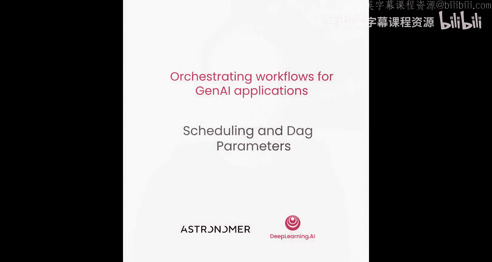
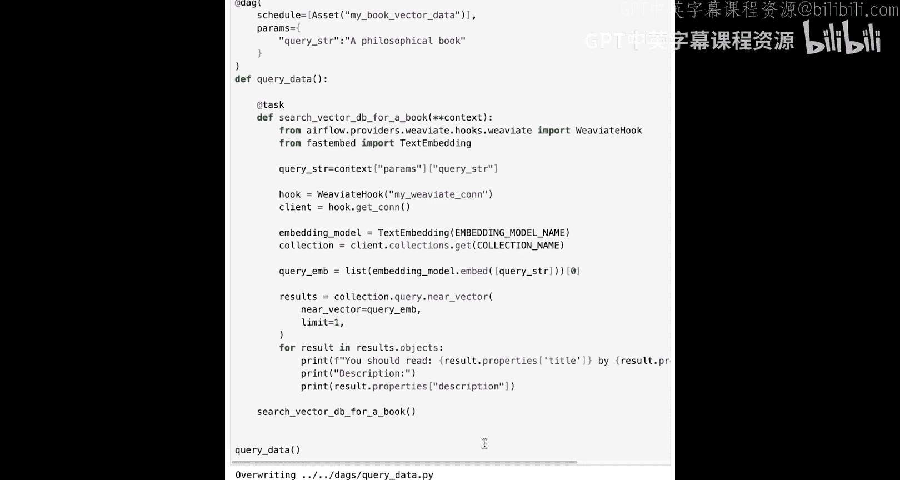
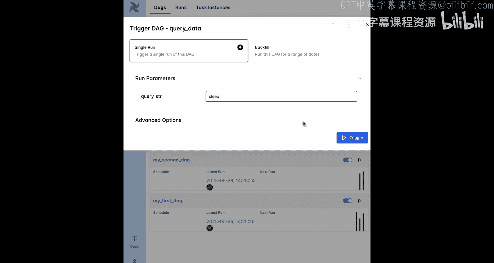
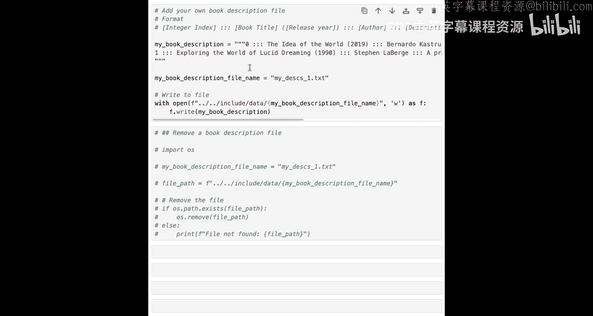

# 吴恩达《为生成式 AI 应用编排工作流｜Orchestrating Workflows for GenAI Applications》中英字幕 - P6：6.scheduling-and-dag-parameters.zh_en - GPT中英字幕课程资源 - BV16BMwzyEVW

In this lesson， you will schedule the two das that you've written previously to run automatically。

 One of the Ds will run on a time based schedule once every hour。

 The other DAC will run on a data aware schedule as soon as new embeddings are ingested into the vector database。

😊。

Let's go。Running DAs manually from the Flu Ui is great when developing them and for ad hoc workflows。

 but most of the time you want your pipelines to run automatically。

 If you imagine you work at a bookstore， new books will be added all the time and you'd want the pipeline to run to create embeddings from descriptions of newly added books so your customers can find them。

😊，Scheduling Pis is one of the core functions of airflow。

 and there are many different options available to you。Before we update the DAs first。

 make sure that the DAs from the previous lesson are already in your Fflow UI。

 Since your lab environment resets after 120 minutes。

 there is a chance that the Fflow UI does not contain the DAX fetch data and query data as shown in this UI。

If this is the case， then make sure to pause the video and run the cells that are provided to you under Section 5。

2 in your notebook。 You should then see these two Ds in the Fflow Ui。

 make sure to trigger them before proceeding to the scheduling section。 Also， for this lesson。

 you don't need to worry about my first D and my second Dg。

We'll go over the two most common types of schedules， Chron based and dataware。

 You could find a link to a guide covering all scheduling options in the resources section at the end of this notebook。

In Effflow， you can schedule each D by adding D parameters to the addd decorator。

 Let's schedule the Dg that fetches the book data to run automatically at the top of every hour to do so。

 You need to add the schedule argument to the adddag decorator and set it to the Ch string for one hour。

 which is 0， followed by four stars。Or you can use the airflow shorthand for this cr string。

 which is at hourly。You also need to give your Dg a start date。 After this date。

 the dag can run based on its schedule。 Always make sure your Dg's start date is in the past。😊。

After running the cell to save the change to the DAX folder。

 you can see the schedule displayed in the Ala Ui， both in the DAX list and on the individual D。

 Note that the change of the DX schedule is a structural D change and therefore creates a new Dg version。

😊，Now， as long as the dag is unpaed。 That is the blue toggle is set to on。

 it will automatically run at the top of every hour。 Time based schedules are very useful。

 but often you don't know exactly when you want the dag to run。

 just that it should run based on the right data being ready。😊，In our case。

 let's make sure the query Datad runs as soon as the embeddings are loaded to the vector database。😊。

This is where data aware schedules based on airflow assets come in handy。

An asset in airflow is an object that represents a real or abstract data object anywhere in your pipeline。

It can represent a file in cloud storage， a table in a relational database， or in our case。

 a whole collection inviiate。 you， as the gag offer。

 decide which task update which assets by assigning them to the task outlets parameter。

 The task does not actually need to interact with the underlying data object。 but in this example。

 it does。 When this task completes successfully， an asset event will be created for the asset。

 The asset has been updated。A downstream D， in your case。

 query data can be scheduled on one or more assets， having received a new asset event。

 You could think of assets like little flags that you give your tasks to waive once they finish successfully。

 and the data were schedule， like telling a D to wait for the right combination of flags to have been raised。

Let's give the last task in the fetch data D and asset to update。

 You can add assets using the outlet's task parameter。 This parameter is available in any task。

 including traditional airflow operators set the outlets parameter to a list of assets that this task updates。

 In your case， the task loads and beddings to Viiate。 Let's call this asset My book Ve data。

Looking at the D graph in the Flo Ui， you can see the assets your D is connected to by opening the options menu and selecting external conditions in the dependencies field。

 the load embeddings to vector Db task in the Fe data D now updates the MyBook vector data asset。

 Great， now let's schedule the query data deck based on updates to this asset。😊。

In the add tag decorator of the query data tag， add the schedule argument and set it to the asset this tag should be waiting for。

 Make sure that you use the exact same name。 My book vector data as in the asset added to the fetch data deck。

 The name is used to identify the asset and connects the upstream D。

 which updates it to the downstream deck scheduled on it。 This connection is visible in the Fflow Ui。

😊，If you click on the assets button， you can see the My book vector data asset in the assets list。

 Click on it to open the asset graph。 It shows all the Ds this asset is connected to from this view。

 you can pause and unpause the Ds and navigate directly to the associated Ds by clicking on their name。

😊，You can also manually create an asset event using the blue button in the top right corner of the screen。

 The two options available are materialize， triggering the D upstream of the asset to run。

 And if the load embeddings to vector Db task is successful， create an asset event or manual。

 which just creates the asset event that causes the downstream deck to run。

The latter option is very useful when developing to test your asset schedules。😊。

Note that asset events can also be created from outside of airflow using the airflow REest API。Nice。

 U2 Ds are now linked together through a data aware dependency when writing complex eflow pipelines。

 it is common to have many Dgs linked by many assets so that they all run as soon as the relevant data has been updated like dominoes。

There are many more D parameters other than schedule。 you can use to modify the behavior of Udas。

 You can find a link to a full list in the resources section。

 One more Dc parameter that is useful for your query data deck is the Pars parameter。

 It allows you to modify the form shown when manually triggering a Dg to ask for a specific input。

 Let's use this parameter to allow our users to input a different value for the query string parameter。

 Whenever they manually run the D in the Flu Ui。😊，In the add D decorator。

 you can add Pars as a parameter and set it to the dictionary of Pars where you include a default value for each input。

 When running the Dg manually， your users will be able to overwride this default value。😊。

The values from your ParMS dictionary are stored in the airflow context。

 a dictionary containing information about your airflow diagram that can be accessed inside of airflow tasks。

To access the context， put star star context in the definition of your Fflow task In your case。

 this will replace the query string argument， but the Fflow context can also be used alongside any number of task arguments。

Inside the task function， use the PAs key on the context variable and index into it with your per name。

 in this case， query string。😊，The value for query stringing is then used by the rest of the task to perform the Ne vector search。

 make sure to also remove the hard coded value for query string from the task call。

After saving the changes， the FL UI now displays a field for the query string when manually running the deck。

I think I want to read a book about sleep。Let's use that as an input。

Checking the logs of the D run， you can see that the task now recommends a different book about lucid dreaming。

 perfect。If you want to add your own book file for this lesson with book descriptions to query against。

 run the Helper cell。😊，Awesome， your Ds are now scheduled and your query Datad includes a handy option for users to query for different books from the Fflow UI。

The DAs are almost ready for production in the next lesson will focus on how to parallelize this pipeline even more to make it more efficient and easier to troubleshoot。

