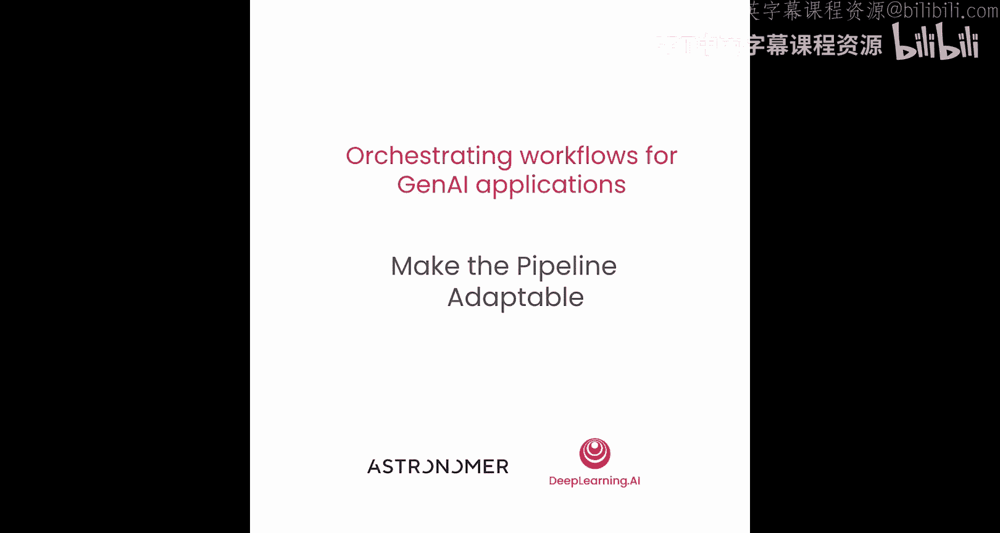
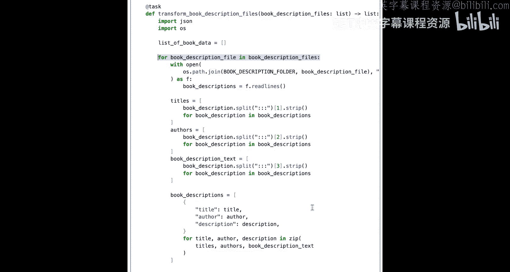
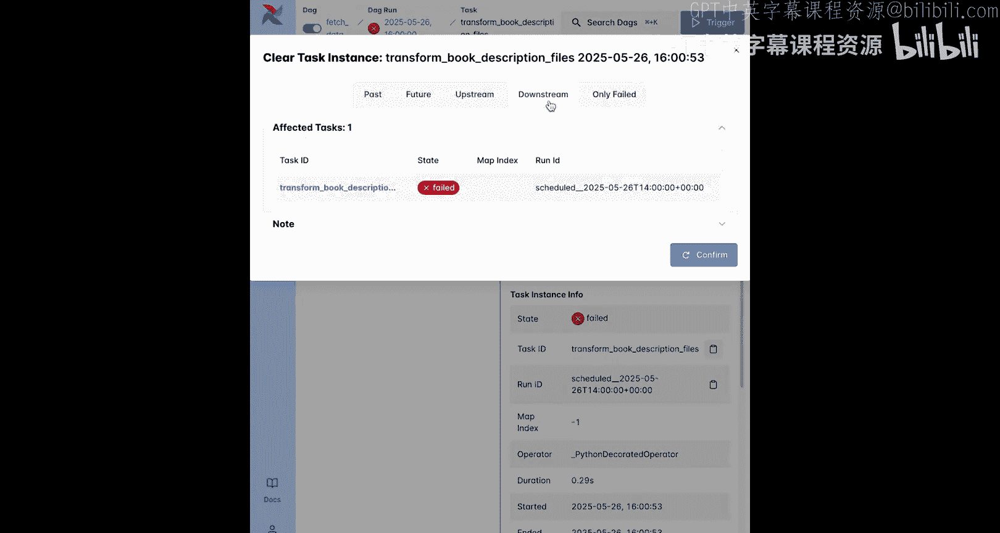
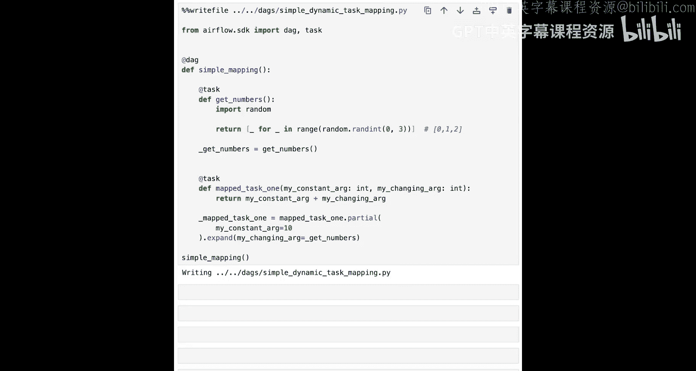
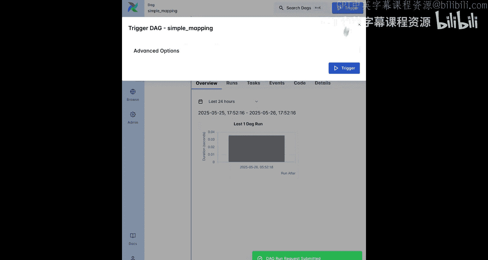
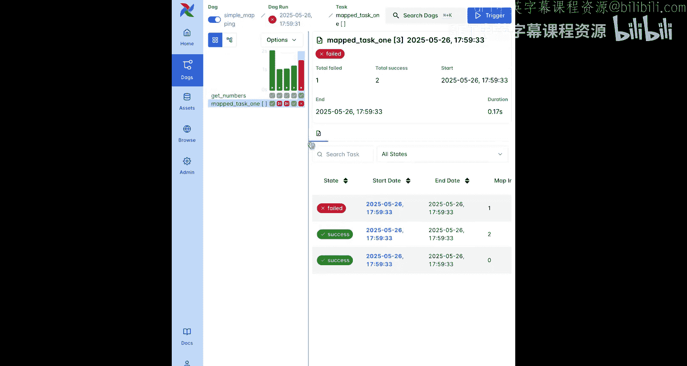
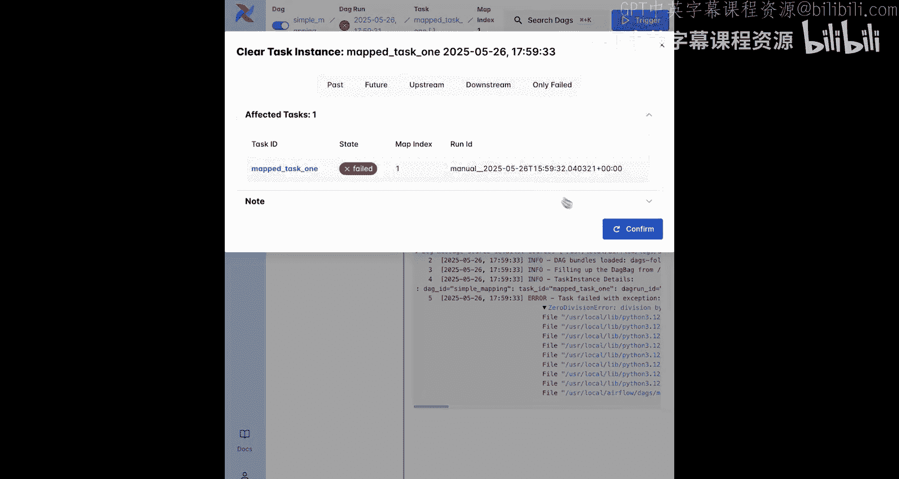
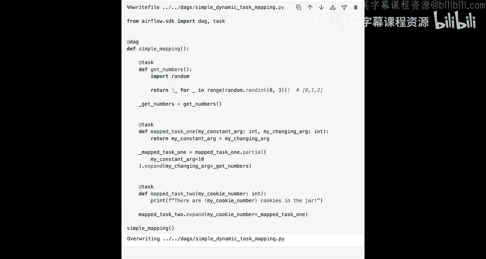
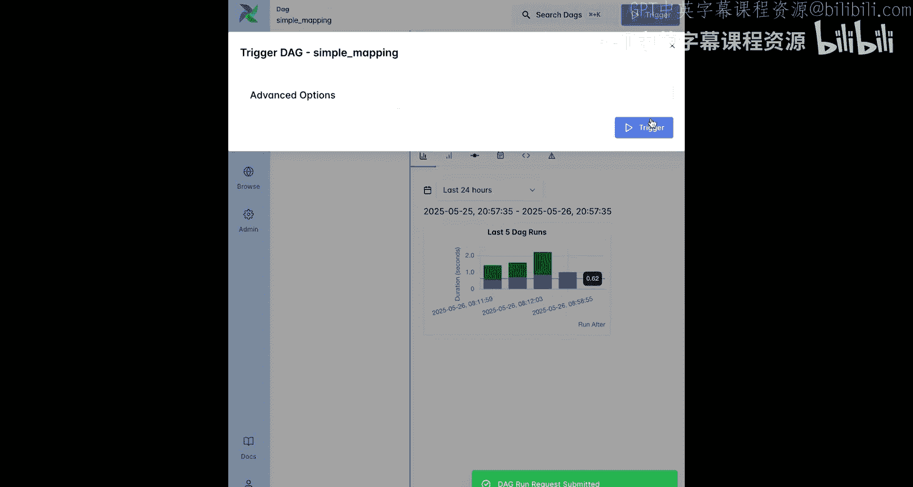
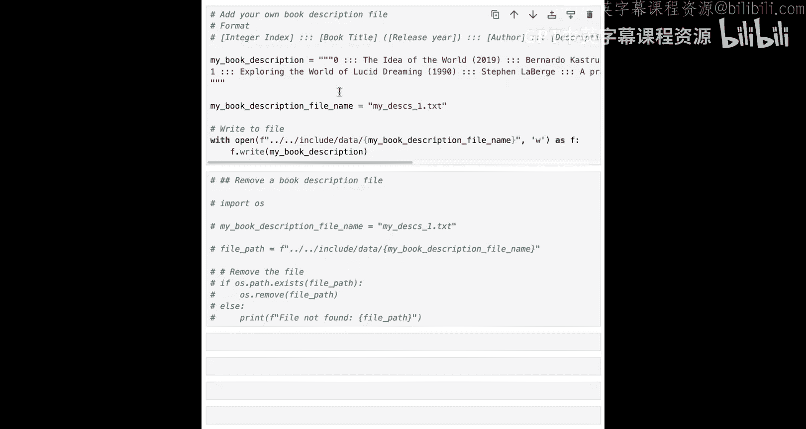

# 吴恩达《为生成式 AI 应用编排工作流｜Orchestrating Workflows for GenAI Applications》中英字幕 - P7：7.make-the-pipeline-adaptable.zh_en - GPT中英字幕课程资源 - BV16BMwzyEVW

In this lesson， you will take your Fffflow pipelines to the next level。

 using an advanced feature to make them adaptable to data at run time。 With this feature。

 you can create paralleled task instances for each book description file。

 making your pipeline easier to troubleshoot and more robust。 Let's dive in。😊。

When running the fetch data deck， you might have noticed that it is not fully atomic。

 All book description files are processed in the same task in a for loop。

 This worked fine when prototyping and developing。 But imagine an online bookstore that wants to add thousands of book descriptions every day provided in hundreds of book description files。

😊，If there is just one formatting error in one file。

 the for loop fails and the whole task fails and to recover needs to be rerun。

 processing all book description files again， even the ones that did not cause any issues。

Especially for tasks that involve interacting with AI models like embedding tasks or inference tasks。

 this can get expensive quite fast。Luckily， there is an eflow feature that can help here with dynamic task mapping。

 you can create a pipeline that adapts to your data at runtime。Specifically。

 you can say that you want to create a variable number of copies of a task。

 depending on input that is determined at the time the D runs。😊，In your case， in production。

 you never know how many new book description files need to be added every hour， it could be 1，2， 10。

 or even zero， and then you don't even need to run the rest of the deck in that hour。

So let's make your Fech data deck adapt to these changes and give it the ability to create a variable number of copies of the tasks that process the book descriptions。

😊，Dynamic task mapping is best learned by experimenting。

 so let's build a simple deck to play around with before modifying the Fe data deck。

Using the right file magic command， you can write a new file to your DX folder containing a new Dg called simple mapping。

 The first task in this deck called get numbers uses the random package to return a list of varying length。

There are four options for the return value of this task。 It can return an empty list。

 This mimics having no new book description files。 In that case。

 the downstream tasks should be skipped entirely， or it will return a list containing one。

2 of three integers。 It mimics having one， two of three new book description files to process。

You want to create one，2 or three parallel copies of all the tasks that process the output downstream。

 This action， turning a regular task into one for which airflow creates parallel copies is referred to as dynamically mapping a task。

 You can define a second task downstream of the get numbers task called mapped task 1。

 that is mapped over its output In this case， let's have one argument that is always the same called my constant arc。

 and one argument that changes in each copy called my changing arc。

 The return value is the sum of the two integer arguments。To tell Elo that this is a mapped task。

 you can use two special methods when calling the task。

 That partial is the method that contains all the arguments that stay the same for each copy of the task。

 Let's put in 10 for my constant arc。😊，The other method is called that expand。

 It contains the keyword argument that is changing in between tasks， which needs to be set to a list。

 In this example， the argument that changes is my changing arc and is set to the list that is returned by the get numbers task。

This means that for each element in the list returned by the get numbers task。

 there will be one copy of the task called Maped taskask 1。

 each copy processing one of the elements in the list as input to my changing arc。

 Since the get numbers task can return a list with one，2。

3 or0 elements for any given run of this tagg， there might be one，2。

3 copies of this task or0 copies which results in the task getting skipped entirely。

 Let's run this dag to see it in action。After running the notebook cell to save the file。

 the Dg appears in the Affla UI。 Let's create a bunch of manual runs。

Clicking on the square for the Maped task One task in one back in the grid view。

 you can see how many dynamically mapped task instances were created each time in the UI。

 depending on the output of the upstream task。Remember。

 what determines the number of mapped tasks is the number of elements in the list that is passed to the mapped parameter in the dot expand method in cases where that list was empty。

 the task was skipped entirely， which shows as a pink square in the gridview。

 you can access information about individual copies of the task by clicking on their start date。😊。

Nice， you can easily see how dynamic task mapping helps you troubleshoot in the AFlu UI。

 If one dynamically mapped task fails， you can directly examine its logs and rerun it if necessary without needing to rerun the other mapped task instances of that same task Once this is implemented for the fetch data deck。

 one malformatted book description will only fail the mapped task instance that processes the file containing that specific book description。

 not the whole processing task。😊。

Dynamic tasks also help to increase efficiency， especially when there is a large number of task copies。

Now that you have a grasp of simple dynamic task mapping。

 let's chain another dynamic task to the D in Fflow。

 you often have several steps processing data that you want to parallelize in the fetch data deck。

 you want one parallel task per book description file for the file transformation and description embedding。

 So two dynamically map tasks with the latter processing the output of its upstream task。

This is possible by passing in the output of the dynamically mapped task。

 which is equal to the list of return values of all its copies to the do expand method of the next task。

😊，You can add another task。 Let's call it mapped task 2 that takes at least one argument which can be mapped over。

 Let's call it my cookie number this time。 when calling the task， you can use the same methods again。

 dot partial and that expand。 if you don't have any arguments that stay the same for each task copy。

 Like in this case， you can omit that partial。Inside that expand。

 pass the return value of the previous map task to the argument you want to dynamically map over。

 Now， there will always be the same number of dynamically mapped tasks for both the mapped task 1 and Maped task 2 tasks。

You can confirm this in the Fflow UI by running the DAAC several times and checking the number of task instances across DAG runs。

Awesome， now you can dynamically map any outflow task in the fetchch data deck。

 the task that determines the number of dynamically mapped tasks is list book description files。

 It returns a list with all the book description files as elements。😊。

The tasks that will be dynamically mapped to process each book description file in a separate parallel copy instead of a loop are transform book description files and create vector embeddings。

 Each of these tasks only needs minor changes。For the Transform book description files task。

 the input changes from being the list of book description files to just being the name of one individual book description file。

Given that the input is now just one file， the loop iterating through the list of files can be removed。

 and you can change the return value from returning a list of lists to just return the book description list of all the books contained in one singular file。

😊，Finally， what actually turns the task into a dynamically mapped task is to use the dot expand method instead of calling the task directly。

You can adjust the next task， which creates the vector embeddings in the exact same way。😊。

Change the input from being the list of book data to just book data。Remove the for loop。

Adjust the return value。And you study expand in the function call。

All other code in the tasks can stay the same， and the downstream load embeddings to vector DB task does not need to be modified either。

😊，After running the cell to save the changes， you can create a manual run of the D in the airflow UI and click in the grid view on the squares of transform book description files and create vector embeddings tasks to see how many task instances were created。

 This number corresponds to the number of book description files currently available in your file location and include s data。

😊，To change the number of dynamickey map task instances in this D。

 you can add more book description files using the helper cell。😊。

Feel free to add as many files each containing the data for at least one book as you like。Great。

 you now have a solid understanding of dynamic task mapping to parallelze your airflow tasks。 Now。

 there is only one step left in getting this pipeline production ready。

 preparing for the event of a task failure。 Youll learn how to configure tasks to automatically retry and send you alerts if they fail in the next lesson。

😊。

