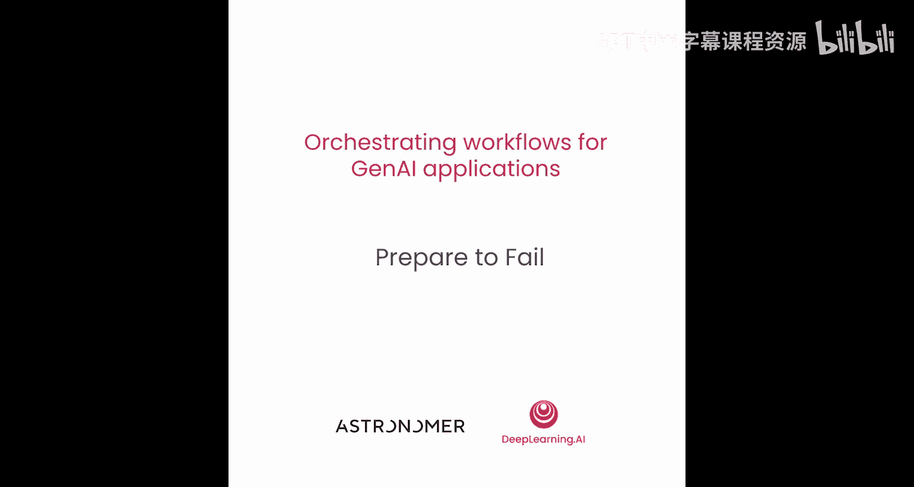
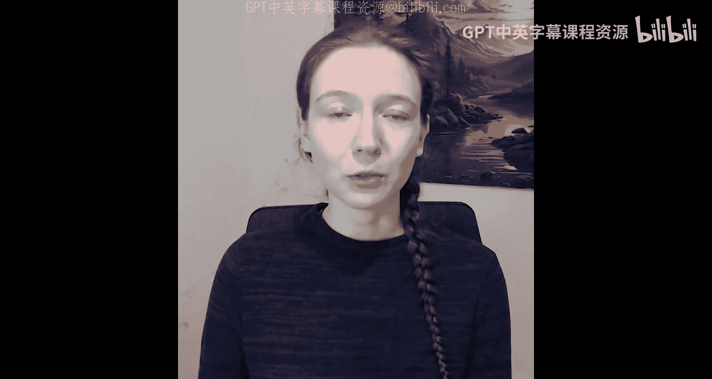
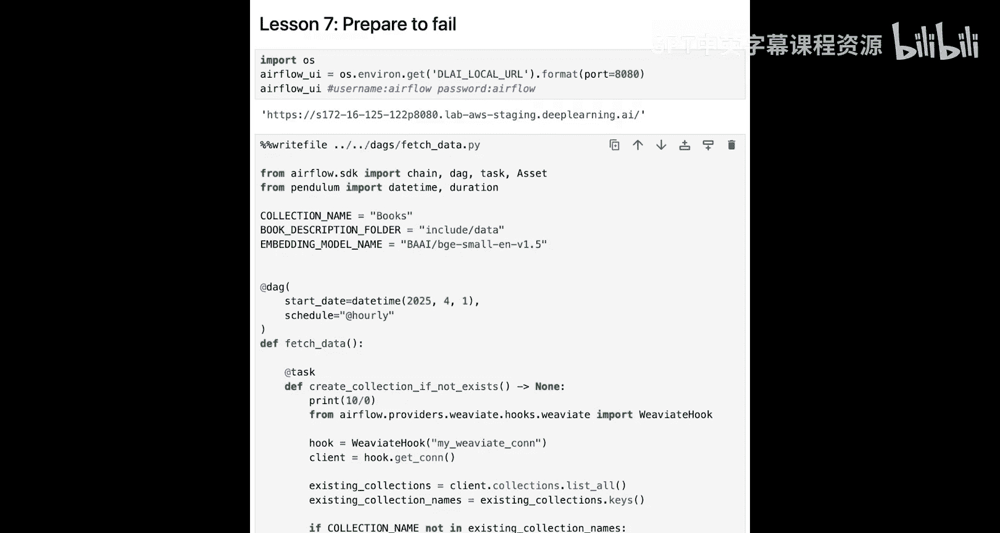
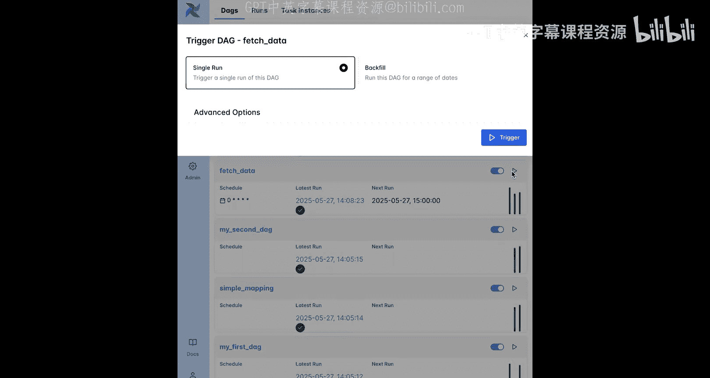
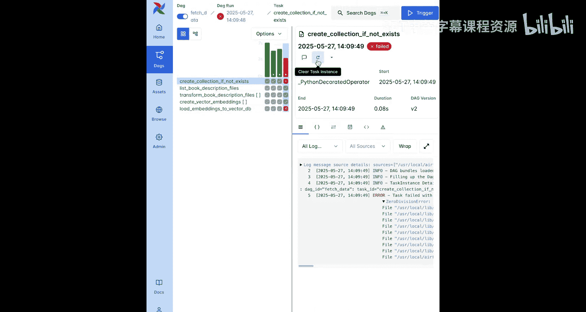
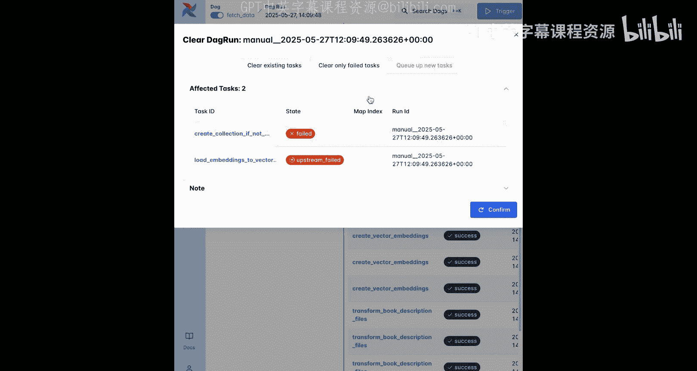
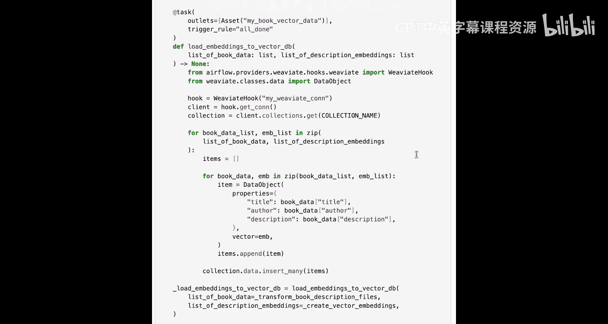
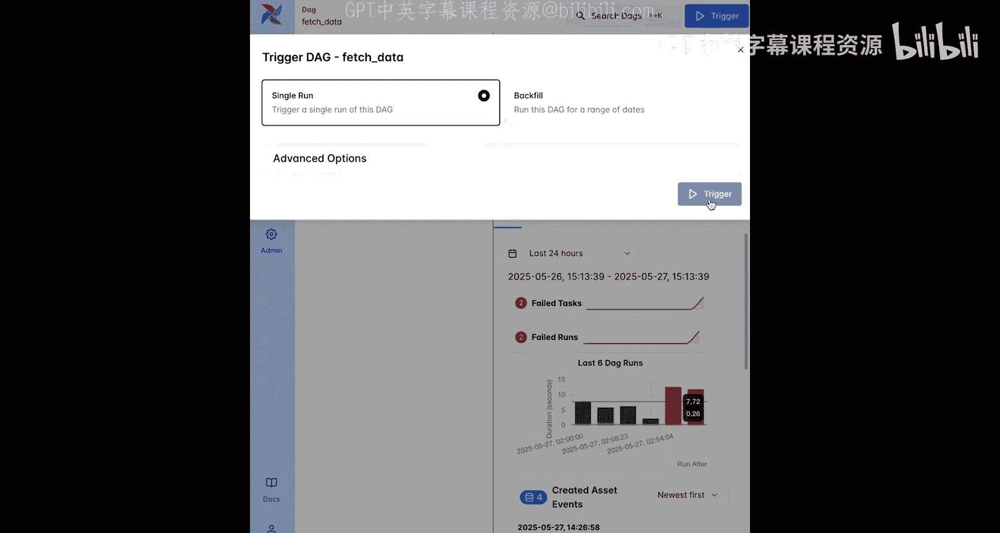
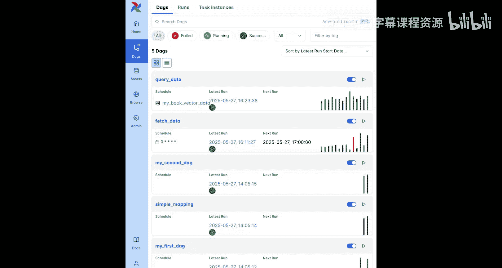
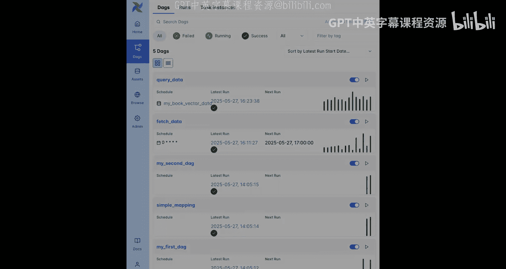

# 吴恩达《为生成式 AI 应用编排工作流｜Orchestrating Workflows for GenAI Applications》中英字幕 - P8：8.prepare-to-fail.zh_en - GPT中英字幕课程资源 - BV16BMwzyEVW

In this lesson you will make your pipeline more robust。

 youll add automatic retries to protect your tasks against transient failures and learn how to add notifications in case a DC or task fails Let's get to it。

First， let's cause a task to fail in the create collection， if not exists task。

 add a line that tries to print 10 divided by0。 This line will cause a zero division error in Python that fails the task。

 Any error or exception raised in an eflow task will fail the task and lines below the line causing the error will not be executed。

 This is the behavior， you know， from Python scripts and sells a notebook。

 After running the cell to overwrite the Dg file in the Ds folder。

 you can create a manual run of the D in the aflow Ui。

 The task failure of the create collection If not exists task causes the D run to fail。😊。

Clicking on the Dg name， you can see that the DAG overview page surfaces the  error log lines of recently failed tasks and provides a quick link to the full logs。

You can also see both in the grid view and in the graph view how the failed task caused its downstream task load embeddings to vector Db to be in the state of upstream failed。

 This means that this task did not run。 because not all of its upstream tasks were successfully completed。

😮，How can you recover from a failure， Let's fix the code error。

 Remove the print statement dividing by 0， run the cell to save the deck and then go back to the air flow Ui。

You can clear a task instance with the clear task instance button。

 which is displayed as just a forward curved  error If the sidebar is collapsed。😊。

Clicking this button， you get several options。 a common option to select is downstream。

 This means that you not only re attempt the failed task， but also all tasks downstream of it。

If you have many failed tasks in a complex stack， it is usually quicker to clear the whole dag run。

 Click on the red bar of the failed Dg run in the grid view and then on clear run or the forward curved arrow。

The menu that opens reattempts all tasks in the deck by default。

 but you can set it to clear only failed tasks as well。

 to only clear the tasks which are in the state of failed or upstream failed。

Great， you can now recover from a task failure。 But what if an issue is just transient。

 If an API is down Saturday night for a few minutes。

 it would be great if airflow could just try the task again after a while。

 instead of having to wait for you to clear the task manually on Monday。😊。

This is where automatic task retries come in。Retriice is a task parameter that determines for every task how many chances it gets before it fails。

You can set the wait time between retries using the retry delay parameter。 In some cases。

 it makes sense to wait hours before retrying and task again。

 Sometimes all that is needed are a few seconds to get past the rate limit， for example。In practice。

 this is one of the most powerful Aflow features and also one of the easiest to implement。😊。

A common strategy is to add a default number of retries to all tasks in a DAC。

 you can use the default Arc stack parameter to define default task parameters for all tasks in your DAC。

Setting default arcs to a dictionary containing retries 1 and retry delay duration 10 seconds gives each task in this tagg a second chance at succeeding if it fails at first。

 and it will wait 10 seconds before it makes its second attempt After saving the changes and re adding the print 10 divided by0 line to cause a task failure。

 You can see what happens if retries are set in the Fflow Ui。Running the stackg manually。

 the create collection， if not exists task does not fail immediately like before。 Instead。

 its status changes to up for retry， which shows as a yellow square with a forward curved arrow after 10 seconds。

 the task tries again。 In this case， hitting the same line causing a failure and then fails for good。

😊，If the issue would have been transient， like an API being unavailable or a rate limit having been hit。

 the second run might have been successful。Awesome， now。

 what if you have one task that should retry more or fewer times than the other tasks in the deck。😊。

No problem。 You can override all defaults defined in the default are dictionary at the task level by providing the same arguments to the individual at task decorator。

 for example， adding retries equals 5 and retry delay duration seconds equals2 gives this task5 extra chances after an initial failure。

 six attempts in total with two seconds in between them。😊。

Another common situation is that some tasks regularly fail。

 but you still want the tasks downstream of it to run。In this example。

 if the collection already exists in Viviate， then loading to it will still work。

 even if the create collection if not exists task fails。😊，By default。

 AL tasks require all their upstream tasks to be successful to run。

This is referred to as an airflow trigger rule， and the default one is called all success。😊。

There are many other trigger rules。 A handy one to make a task run。

 Even if some of its upstream tasks failed， is called all done。

 If you set the trigger rule of the load embeddings to vector D B task to all done。

 it will run as soon as all its upstream tasks have finished。

 no matter if the end state was success failed upstream failed or skippped。

 run the cell to save the D and then create a new dag run in the Lflow Ui。

 you can see that the load embeddings to vector D B task waits until all its upstream tasks finished。

 But then runs。 despite the create collection， if not exists task having failed。😊。

The D run itself is also marked as successful， despite containing a failed task。

The D run end state is determined only by the leaf tasks of the D graph。

 If they are all in a state of either success or skipped， the D run counts as a success。😊，Nice。

 you have full control now over what happens in case of task failures。There's just one piece missing。

For some crucial tasks and acts， you'd like to be alerted if they fail， for example。

 via an email or a slack message。You can add alerts to your deck using callback functions。

Callbacks exist at the D and at the task level for different situations。

 the most commonly used one is the unfail callback。

Let's add an unfailure callback to all tasks of your D。

 Do you remember the quickest way to define a task parameter for all tasks in a D。Correct。

 adding it to the default arc dictionary。😊，The callback parameter can be set to any function。

 This code runs as soon as any task fails。For this example。

 you can just print a message to the task logs in a real life situation you'd write code calling out to the messaging tool of your choice or use a prebuilt notifier class about which you can learn more at the links in the resources section。

Going back to the Lflow UI and creating another manual diagram run。

 you can see how after the task failure the callback function is executed。

 which prints align to the task blockss。If you want a callback function to only run if the whole da run fails。

 you could provide it to the on failure callback parameter of the dag itself。Awesome。

 now you know how to ensure you will be notified if a crucial task or DAC fails。Time for a vacation。

 right？ Well， what happens if you come back after two well deserved weeks traveling for Portugal and your Dron history contains several failures。

 and some das might have been missed entirely。Or sometimes you make changes to a Dg， for example。

 to add another feature to the training set of an ML model and want to rerun past stag runs to see how the improved model performs against historic data。

No worries。 in Affflow free， you can backfill any Dak that runs on a time based schedule for any dates in the past directly in the Aflow U I。

 After clicking the trigger button， select backfill and define your date range。

 as well as the behavior of the backfill。 Should only missing runs be filled in。😊。

Missing runs be filled in and arrow dag runs be rerun。

Or do you want to rerun all runs for that time period？In any case， after clicking Run backfill。

 the FL UI will show a banner as long as the backfill is in progress on which you can pause or stop the backfill as well。

Pause the video now。 Make sure to remove all error inducing test lines from your tasks。

 And after saving the deck， go to the airflow Ui to create a backfill job for the fetch data deck。

 Note that this tagg runs hourly。 So we recommend you only backfill for one or two days in the past to avoid creating a lot of D runs in the sandbox environment。

Wow， that was a lot， you now know all the basics of how to turn your GAI prototype notebooks into production ready airflow pipelines and can even use advanced features like dynamic task mapping。

In the next lesson， you'll learn more about GenAI workflows in real life。

 including real example pipelines。

