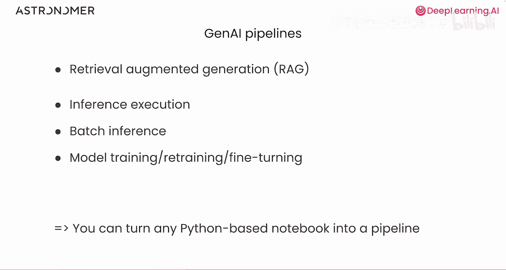
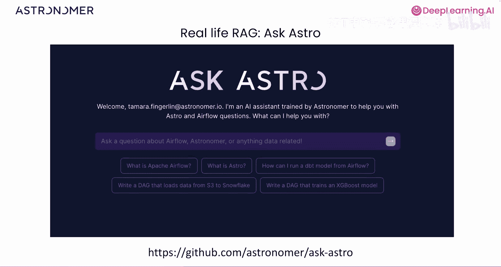
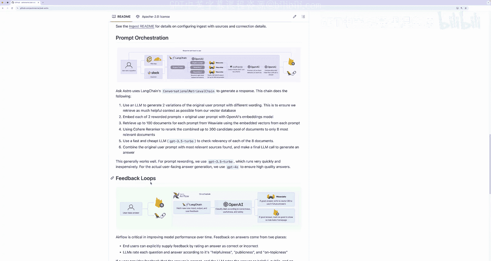
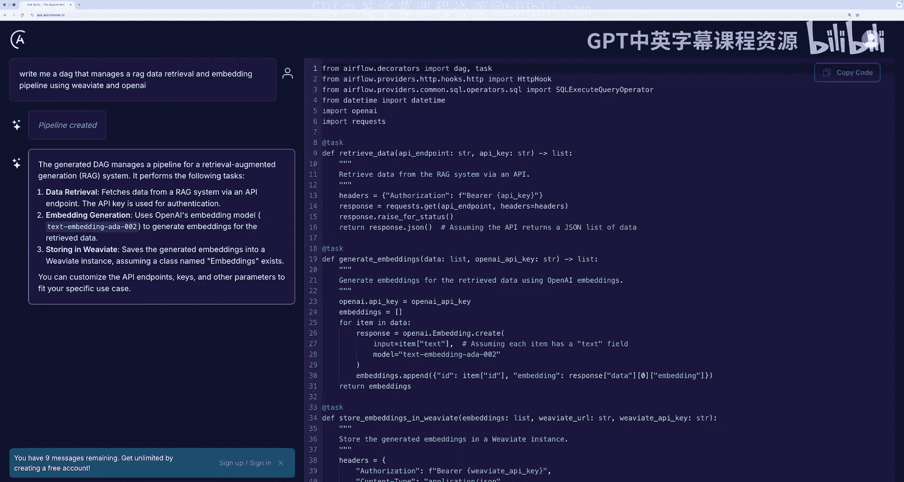
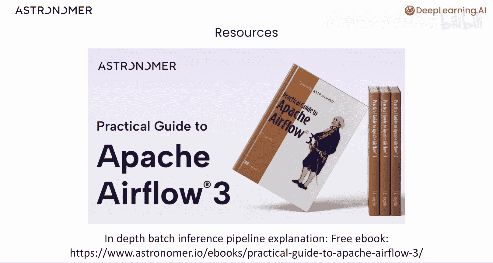

# 吴恩达《为生成式 AI 应用编排工作流｜Orchestrating Workflows for GenAI Applications》中英字幕 - P9：9.genai-pipelines-in-real-life.zh_en - GPT中英字幕课程资源 - BV16BMwzyEVW

Now that you have implemented your own RAG application using airflow for orchestration。

 we'll talk a little bit about what's next， we'll go through production considerations。

 examine astronomers， ask AstroRG implementation， and discuss additional use cases for JenI orchestration。

 let's get to it。As we have covered in this course。

 airflow is commonly used as an orchestrator for many different use cases。

 including different types of GenI pipelines。In this course。

 you learned how to orchestrate retrieval augmented generation or rag pipelines。

 but you can also orchestrate other types of Geni pipelines。Inference execution pipelines。

 which orchestrate the process of running a trained machine learning model on input data and collecting the results are commonly implemented with airflow。

This might be batch inference pipelines or another type of inference execution。

Airflow can be used to manage automated model training， retraining， and fine T your name。Remember。

 any Python based notebook can be turned into an airflow dag or pipeline。

Astronomer has built our own real world RAG application using airflow。

Ask Astro is an open source reference implementation of Andreen Horowitz's LLM application architecture。

It is a Q&A LLM application used to answer questions about airflow and astronomer。

There are several aspects to this open source Ra application data is retrieved from sources like Gitthub issues。

 airflow and Astrods and the airflow slack processed with length chain and embedded with open AI。

 and then stored an alleviate vector database。 This pipeline is orchestrated with airflow。

Airflow is also used to improve the model performance over time。

 Use can rate answers given in the application， and that data is processed with L chain and open AI on a schedule to update the data and weiate so that good answers are repeated and bad answers are not。

This ragG application is extremely useful for airflow developers。

 Ask Astro can help you write and update dags for any use case you are looking to implement。

As an example， we can write a query to say， writerite me a DAg that manages a RAG data retrieval and embedding pipeline using Weviate and Open AI。

Asgatro will write the Dg automatically for us， and we can take this， run it in airflow。

 and update it as needed。This is a real world example implementation of the information used in this course and will hopefully be a tool in your toolbox for further learning with airflow and GenI orchestration。

When you implement rag pipelines like the ones powering Ask Astro in production and at scale。

 there are several other things you might consider after you've written your pipelines。

You will likely need to ingest data from more sources than you worked with in this course。

 That is easily managed by airflow， either by creating more dags to run in parallel or in some cases。

 by using dynamic task mapping， like you learned about earlier。

You may need to do additional transformation of your source data like text chunking in selection or pre selection of documents。

Remember， as long as you can write a Python function to do it， you can turn it into an airflow task。

Data quality checks are also easy to implement an airflow and are important for keeping your application up to date。

You will likely use airflow for fine tuning and deployment of models and implementing user feedback pipelines。

 feedback helps make your RaG application perform better and can be automated with airflow using a pipeline like the example we just showed in Ask astro。

 We also want to briefly touch on other types of Geni pipelines that can be orchestrated with airflow。

 While we don't show inference execution or batch inference taggs in this course。

 They are commonly implemented with airflow。One example use case is automating a personalized newsletter service。

In this diagram， we have two airflow pipelines。One is a traditional ETL pipeline that gets the data needed for the newsletter。

 formats it and creates a template。 The second on the bottom is a batch inference pipeline that takes user input and personalizes the newsletter content for each reader by sending the user data in a prompt to an LLM and loading the results into the newsletter template。

This tag can be run as a batch inference tag， say daily。

 where it will process all new user information。But it can also run using online inference execution。

 meaning when a user inputs their information in a web form and indicates they want a newsletter right away。

 the pipeline sends a message to a message queue， which triggers the daAg in airflow via event driven scheduling。

This example could warrant a whole course in itself， so we only touch on it at a high level。

 but for now， you can take it as inspiration for other Geni orchestration that you can implement with Airflow。

Much like with our RaG application in this course， implementing batch or inference execution pipelines in production also comes with other considerations。

 You may use airflow for something significantly higher scale。

 like generating product descriptions for all new products on an e-commerce website。In this case。

 your airflow dags might look very similar to what you've seen here。

 but you will need to pay attention to scaling your airflow infrastructure。

 possibly using a managed service。You may also need to leverage additional scheduling capabilities rather than run your DAs daily。

 you may want them to run as soon as data is available so they can provide the back end for your JenI application。

An example of this would be a user requesting a personalized recipe based on their purchases from an online grocery store。

Event driven scheduling lets airflow kick off that pipeline as soon as the user inputs their request。

 There are also other packages outside of airflow that can help you implement your Gen AI pipelines。

For example， the Airflow AI SDK。Developed by astronomer is an open source package for working with LLMs from airflow based on pedantic AI。

You can call LLMs easily from your airflow tasks with the task。LllM decorator。

Or interact with and orchestrate AI agent calls。The repository contains detailed examples to help you get started。

Finally， this course has only scratched the surface of what you can do with airflow to orchestrate GenI pipelines。

A great resource for further reading is the Manning practical Guide to Apache Airflow 3。

 written by astronomer。This free ebook walks through everything you need to know about Airflow3 features。

 including an in depth batch inference pipeline explanation。

It's a great next step in your learning journey。

