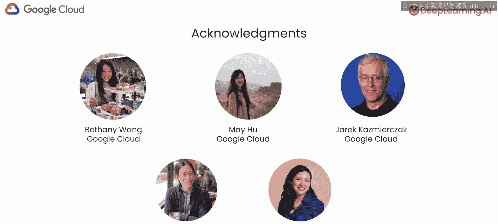
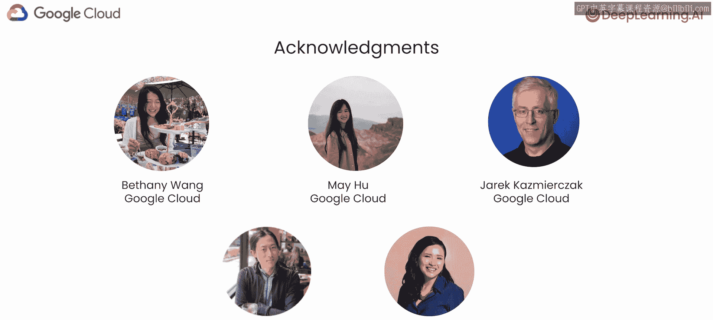

# 吴恩达《从人类反馈中进行强化学习RLHF, Reinforcement Learning from Human Feedback》（中英字幕） - P1：L0_Course_Intro.zh - GPT中英字幕课程资源 - BV1R94y1P7QX

Welcome to Reinforment Learning from Human Feedback or ROHF， built in partnership with Google Cloud。

An OEM M trained from public Internet data would mirror the tone of the Internet so it can generate information that is harmful。

 false or unhelpful。ROHF is an important tuning technique that has been critical to align an LM's output with human preferences and values。

 This algorithm is， I think， a big deal and has been a central part to the rise of LMs。

And it turns out that ROHF can be useful to you， even if you're not training an LM from scratch。

 but instead building an application whose values you want to set。

 while fine tuning could be one way to do this as you learn in this course， for many cases。

 ROHF can be more efficient。For example， there are many valid ways in which an OEMM can respond to prompt such as what is the capital of France。

 it could reply with Paris is the capital of France。

 or it could even more simply reply Paris Some of these responses will feel more natural than others。

 and so ROHF is a method for gathering human feedback on which responses they prefer in order to train the model to generate more responses that humans prefer。

In this process， you start off with an OM that's already been trained with instruction tunings so it's already learned to follow instructions。

 you then gather a data that indicates a human labelist preferences between multiple completions of the same prompt and use the data as a reward signal or to create a reward signal to fine tune and instructiontd LM。

The result is a tuned large language model that generates completions of outputs that better aligned with the preferences of the human labelers。

I am delighted to introduce the instructor， Nikkita Najahi。

 who is developer advocate for Gen VI on Google Cloud。

 She is a regular speaker at Gen VI developer events and has helped many people the GenI applications。

 I look forward to her sharing her deep experience。

 her deep practical experience with Gen VI and with ROHF with us here。

 Thank you Andrew I'm really excited to work with you and your team on this。

 In this course you learn about the ROHF process and also gain handson practice exploring sample data sets for RHF tuning the Lama2 model using ROHF and then also evaluating the newly tuned model。

😊，The keyto we go through these concepts using Google Cloud's machinech learning platform Vers AI What really excites me about RLHF is that it helps us to improve an LLM's ability to solve tasks where the desired output is difficult to explain or describe in other words problems where there's no single correct answer and in a lot of problems we naturally want to use LLMs for there really is no one correct answer It's such an interesting way of thinking about training machine learning models and it's different from supervised fine tuning which you may already be familiar with。

RLHF doesn't solve all of the problems of truthfulness and toxicity in large language models。

 but it's really been a key part of improving the quality of these models and I think we're going to continue to see more techniques like this in the future as the field evolves so I'm really really excited to share with you just how it works and I'm happy to say you don't need to know any reinforcement learning to get started Many people have worked to create this course I'd like to thank on the Google Cloud side Bethany Wang Mehu and Yarek Cosmeir Chuck from deep learningning AI Eddiedi Shu and Leslie Zerma had also contributed to this course so with that let's go on to the next video where thekita will present a overview of RHF so you can see all the pieces of how it works and how they fit together let's go on to the next video。

😊。

