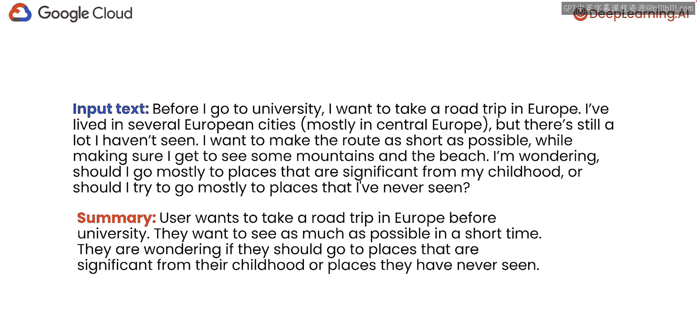
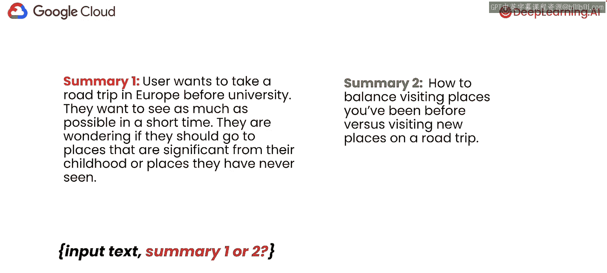
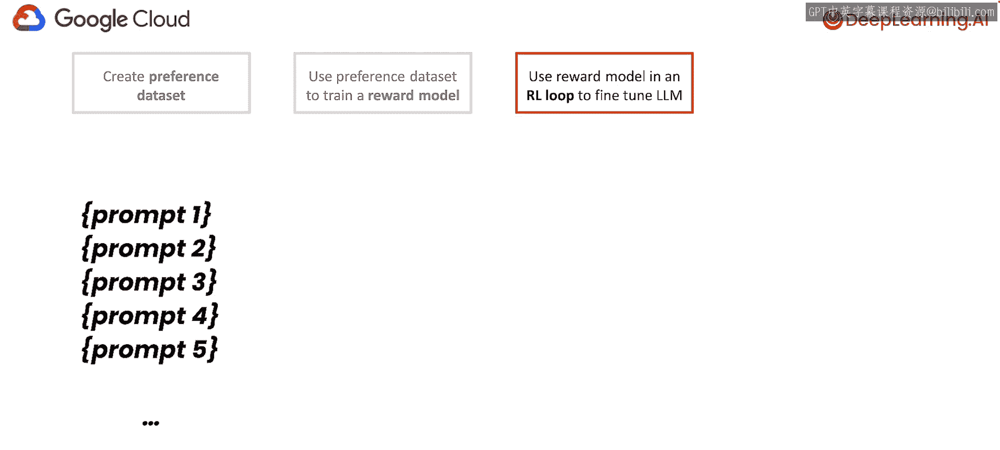
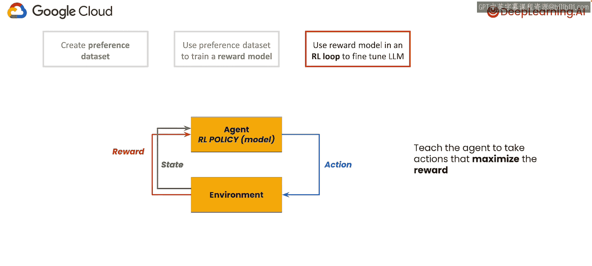
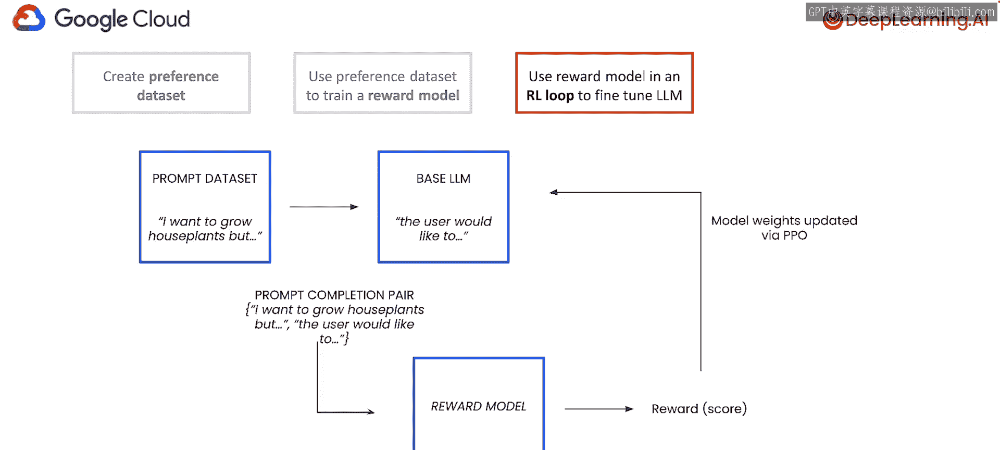
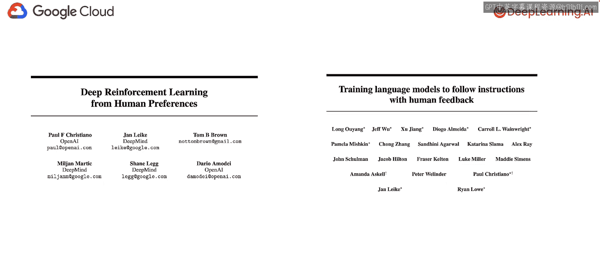

# 吴恩达《从人类反馈中进行强化学习RLHF, Reinforcement Learning from Human Feedback》（中英字幕） - P2：L1_How_Does_RLHF_Work.zh - GPT中英字幕课程资源 - BV1R94y1P7QX

RLHF is a technique we can use to try and better align an LLM's output with user intention and preference In this first lesson。

 we're going to dive into a conceptual overview of RLHF。 Let's get started。

Let's say that we want to tune a model on a summarization task。

 We might start by gathering some text samples to summarize and then have humans produce a summary for each input。

 So for example， here we have the input text before I go to university。

 I want to take a road trip in Europe。 I've lived in several European cities。

 but there's still a lot I haven't seen etc。 and then we have a corresponding summary of that text。

 the user wants to take a road trip in Europe before university。

 they want to see as much as possible in a short time and they're wondering if they should go to places that are significant from their childhood or places they have never seen。

 We can use these humangenerated summaries to create pairs of input text and summary and we could train a model directly on a bunch of these pairs。

 But the thing is there's no one correct way to summarize a piece of text。

 Natural language is flexible and there are often many ways to say the same thing。 For example。

 here's an equally valid summary。😊。

And in fact， there are many more valid summaries we could write Each summary might be technically correct。

 but different people， different groups of people， different audiences will all have a preference and preferences are hard to quantify Some problems like entity extraction or classification have correct answers but sometimes a task we want to teach the model doesn't have a clear objective best answer So instead of trying to find the best summary for a particular piece of input text。

 we're going to frame this problem a little differently we're going to gather information on human preferences and to do that we'll provide a human labeler with two candidate summaries and ask the labeler to pick which one they prefer and instead of the standard supervised tuning process where we tune the model to map an input to a single correct answer We'll use reinforcement learning to tune the model to produce responses that are aligned with human preferences So how does all this work Well it's an evolving area of research and there are。

Of variations and how we might implement RHF specifically。 But the high levelvel themes are the same。

 RHF consists of three stages。 First， we create a preference data set。

 Then we use this preference data set to train a reward model with supervised learning。

 and then we use the reward model in a reinforcement learning loop to fine tune our base large language model。

 Let's look at each of these steps in detail。 and don't worry if you're totally new to reinforcement learning。

 you don't need any background for this course。 First things first。

 we're going to start with the large language model that we want to tune In other words。

 the base LLM。 In this course， we're going to be tuning the open source Lama2 model and you'll get to see how that works in a later lesson。

 But before we actually do any model tuning， we're going to use this base LLM to generate completions for a set of prompts。

 So for example， we might send the input prompt， summarize the following text。

 I want to start gardening。 but etc ceter。 and we would get the model to generate multiple output。😊。

Complets for the same prompt。 and then we have human labelers rate these completions。

 Now the first way you might think to do this is to have the human labelers indicate on some absolute scale how good the completion is。

 but this doesn't yield the best results and practice because scales like this are subjective and they tend to vary across people。

 Instead， one way of doing this that's worked pretty well is to have the human labeler compare two different output completions for the same input prompt。

 and then specify which one they prefer。 This is the data that we talked about earlier。

 and it's called a preference data。 In the next lesson you'll get a chance to take a look at one of these datas in detail。

 but for now， the key takeaway is that the preference data indicates a human labeler' preference between two possible model outputs for the same input。

 Now it's important to note that this data captures the preferences of the human labelers but not human preference in general。

Creating a preference dataset can be one of the trickiest parts of this process， because first。

 you need to define your alignment criteria。 What are you trying to achieve by tuning。

 Do you want to make the model more useful， less toxic， more positive， etc。

 You'll need to be clear on this so that you can provide specific instructions and choose the correct labelers for the task。

 But once you've done that step 1 is complete Next， we move on to step 2。

 and we take this preference data， and we use it to train something called a reward model General with RHF and LLms。

 this reward model is itself， another LLM。 at inference time。

 we want this reward model to take in a prompt and a completion。

 and return a scalar value that indicates how good that completion is for the given prompt。

 So the reward model is essentially a regression model。 It outputs numbers。😊。

The reward model is trained on the preference dataset set using the triplets of prompt and two completions。

 the winning candidate and the losing candidate for each candidate completion。

 we get the model to produce a score and the loss function is a combination of these scores intuitively。

 you can think of this as trying to maximize the difference in score between the winning candidate and the losing candidate。

And once we've trained this model， we can now pass in a prompt and completion and get back a score indicating how good the completion is。

The measure of how good a completion is is subjective。

 but you can think of this as the higher the number。

 the better this completion aligns with the preferences of the people who labeled the data。

 Once we've completed training this reward model well use this model in the final step of this process where the Rl of RHF comes into play Our goal here is to tune the base large language model to produce completions that will maximize the reward given by the reward model。

 So if the base Ln produces completions that better align with the preferences of the people who labeled the data then it will receive higher rewards from the reward model to do this。

 we introduce a second data set or prompt data。 This is just as the name implies a data set of prompts。

 no completions。 Now before we talk about how this data set is used。

 I'm going give you a super quick primer on reinforcement learning I'm not going go into all the details here but just the key pieces needed to understand the RHF process at a high level R。

😊，fulWhen you want to train a model to learn how to solve a task that involves a complex and fairly openended objective。

 You may not know in advance what the optimal solution is。

 but you can give the model rewards to guide it towards an optimal series of steps。

 The way we frame problems in reinforcement learning is as an agent learning to solve a task by interacting with an environment。

 This agent performs actions on the environment。 and as a result。

 it changes the state of the environment and receives a reward that helps it to learn the rules of that environment。

 For example， you might have heard about alpha go， which was a model trained with reinforcement learning。

 It learn the rules for the board game go by trying things and receiving rewards or penalties based on its actions。

 This loop of taking actions and receiving rewards repeats from many steps。

 and this is how the agent learns note that this framework differs from supervised learning because there's no supervision。

 The agent isn't shown any examples that map from input to output but instead the agent learns by interacting with。

Environment， exploring a space of possible actions and then adjusting its path The agent's learned understanding of how rewarding each possible action is given the current conditions are saved in a function this function takes as input the current state of the environment and outputs a set of possible actions that the agent can take next along with the probability that each action will lead to a higher reward this function that maps the current state to the set of actions is called a policy and the goal of reinforcement learning is to learn a policy that maximizes the reward you'll often hear people describe the policy as the brain of the agent and that's because it's what determines the decisions that the agent takes So now let's see how these terms relate back to reinforcement learning with human feedback In this scenario the policy is the base large language model that we want to tune the current state is whatever is in the context so something like the prompt and any generated text up until this point and actions are generating tokens each time the base。

LLM outputs at completion。 it receives a reward from the reward model indicating how aligned that generated text is learning the policy that maximizes the reward amounts to a large language model that produces completions with high scores from the reward model Now I'm not going to go into the details here of how this policy is actually learned but if you're curious to understand and learn a little more in RLF the policy is tuned via the policy gradient method proximal policy optimization or PPO Now I'm not going to go into all the details here of how this policy is learned。

 but if you're curious to learn a little more in RLHF the policy is learned via the policy gradient method proximal policy optimization or PPO this is a standard reinforcement learning algorithm So here's an overview of everything that happens in each step of this process a prompt is sampled from the prompt dataset。

The prompt is passed to the base large language model to produce a completion and this prompt completion pair is passed to the reward model to produce a score or reward。

 The weights of the base large language model also known as the policy are updated via PPO using the reward Each time we update the weights。

 the policy should get a little better at outputting a line text Now note that I am glossing over a little bit of detail here。

 in practice， you usually add a penalty term to ensure the tune model doesn't stray too far away from the base model。

 but we'll talk a little bit more about that in a future lesson。 This is a highlel picture。

 but if you want to learn some more detail， you can take a look at some of the original research papers。

 So just to recap everything that we've covered reinforcement learning from human feedback is made up of three main steps we create a preference data we use the preference data to train a reward model and then we use that reward model in a reinforcement learning loop to fine tune our base large language model Now before we get。

😊。

coding there's one more detail that's worth understanding when it comes to tuning a neural network。

 you might retrain the model by updating all of its weights。

 This is known as full fine tuning but because large language models are so large Up all of the many weights can take a very long time Instead we can try out parameter efficient fine tuning which is a research area that aims to reduce the challenges of fine tuning large language models by only training a small subset of model parameters these parameters might be a subset of the existing model parameters or they could be an entirely new set of parameters figuring out the optimal methodology is an active area of research but the key benefit here is that you're not having to retrain the entire model and all of its many weights Para efficient fine tuning can also make serving model simpler and comparison to fine tuning because instead of having an entirely new model that you need to serve。

 you just use the existing base model and you add on the additional tune parameters you could potentially have one base model with several distinct。

Seets of tune parameters that you swap in and out， depending on the use case or the user that your application is serving so reinforcement learning from human feedback can be implemented with either full fine tuning or parameter efficient tuning In this course。

 when we tune the Lama2 model， we're going to be using a parameter efficient implementation This means that the training job won't update all of the base large language model weights only a smaller subset of them based on a parameter efficient tuning technique Okay so now that you know the basics of how RLHF works。

 let's get to coding。

