# 吴恩达《从人类反馈中进行强化学习RLHF, Reinforcement Learning from Human Feedback》（中英字幕） - P3：L2_Datasets_for_RL_Training.zh - GPT中英字幕课程资源 - BV1R94y1P7QX

Before we can tune a large language model， we need to prepare our data RHF requires two data sets。

 a preference data set and a prompt data set In this course。

 we're going to be tuning the OSS Lama2 model on a summarization task Each example and our data set is a post from Reddit and a corresponding summary。

 so let's take a look at the data。

Let's start by taking a look at the preference dataset As a quick reminder。

 this is the dataset that's used to tune the reward model and it's often one of the trickiest parts of RLHF because it's the data that's been annotated by humans and different people have different preferences。

 there's usually a lot of work that goes into creating one of these data sets but for this course we're going to use a data set that's already been created and preprocessed So let's start by defining the path to this data。

 I've gone ahead and created a data set for you called sample preference JSON L This is a small version of the data that we're actually going to tune the model on For best results we recommend a data set of around 5000 to 10000 examples but since we're just doing a bit of data exploration we're just going to load in a tiny sample of the data into memory So first I'm going to import JSON so that way we can load this data and then we'll create an empty list called preference data The next thing we're going to do is we're going to loop over this JsonN L file and as we loop over。

This file we are going to append the data to our preference data list so let's execute the cell and then we can take a look at what the data looks like so I'm going to define sample one and that will be the first element in this preference data list so if we look at the type。

We can see that this is a dictionary and if we look at the keys。So as you can see。

 this dictionary has four keys， there's input text， candidate zero， candidate1， and choiceice。

 so let's take a look at each of these one at a time。So I will extract the key input text。

From our sample。And we can print this and this right here is our prompt so the prompt here says I live right next to a huge university I've been applying for a variety of jobs。

 etctera， etc ce you'll notice that if you get to the end of this prompt it ends with this bracket summary closed bracket colon and in fact。

 all of the samples in this data set actually end this way so if we look at a different sample in our original preference data list we can extract out the key input text。

And we'll just look at the last few characters and if we print this。

 you can see that this prompt also ends with summary colon and it's bumped this indexed one more time so we're gonna to take a look at another sample in this data and this one also ends with summary colon So all of our examples in this data all of the prompts in this way and the reason this is important is because you need your data examples to match your expected production traffic So during training this data here contains the specific formatting or specific keyword or instruction of summary and it's important that at inference time our data set should be formatted in the same way and contain the same instructions So later when we look at inference data when we actually use this tune model willll see that we include the same summary indicator there and this is so that the model can recognize the pattern All right so this is our first key here it's input text and input text is our prompt So let's take a look at the next two keys in our。

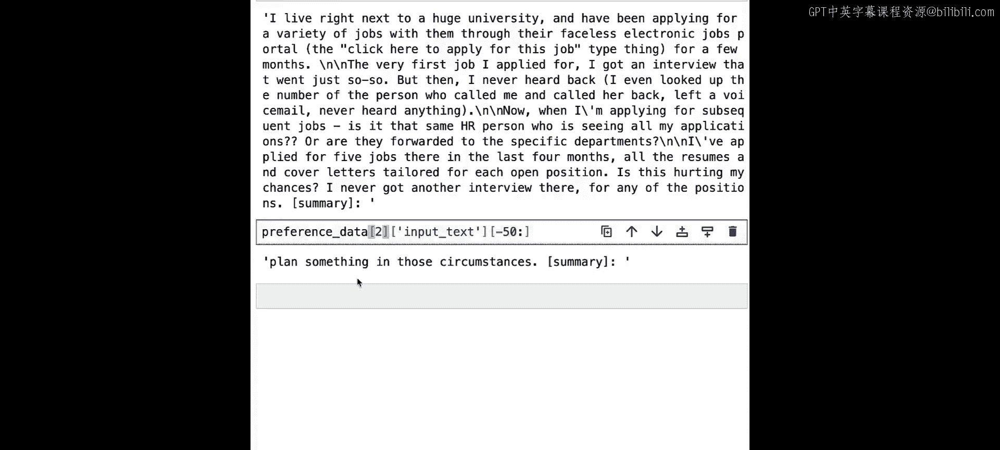

Which are candidate zero and candidate one。So I'm going to go ahead and print out both of these。

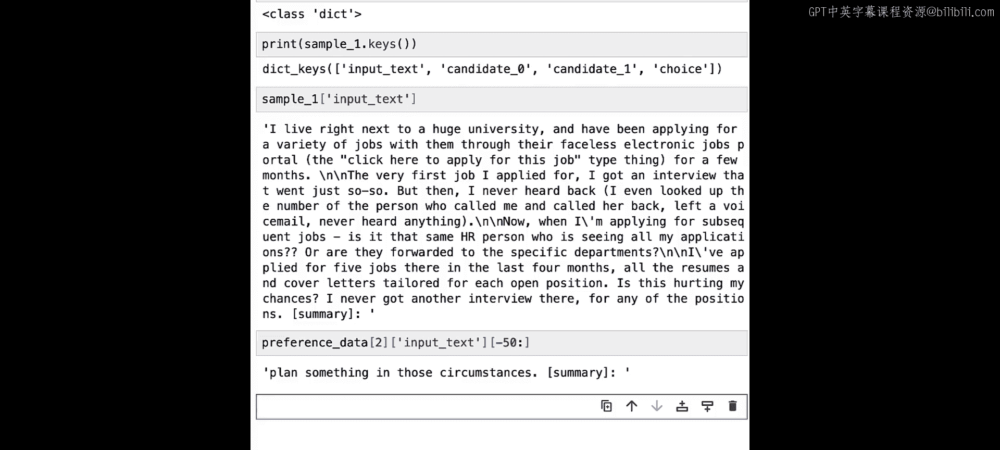

So we'll print candidate zero and candidate1 and these are two possible completions for the same prompt。

 so the task was to summarize this input text and candidate zero summary is when applying through a massive job portal。

 is it just one HR person seeing all of them and candidate one is when applying to many jobs through a single university jobs portal。

 is it just one HR person reading all my applications？

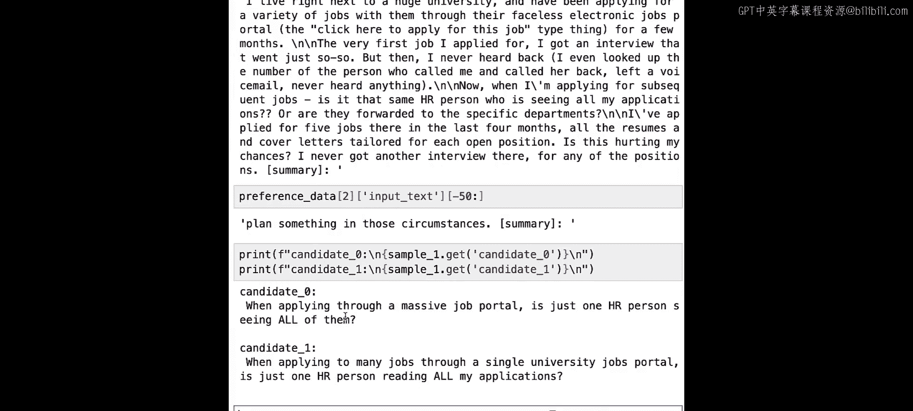

So the human labeler was shown both of these candidates and they were asked to pick which one they prefer。

 and we can see the preference in the final key of the dictionary， which is the choice。

 so let's go ahead and print out the final key， which is choice。

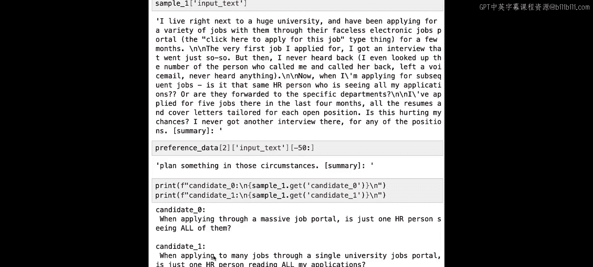

And if we do that you'll see that the value for this choice key is one so that means that the labeler preferred candidate one they thought that this summary right here was a better summary than candidate zero so in this case we would refer to candidate one as being the winning candidate and we would call candidate zero the losing candidate since candidate one was preferred by the human labeler so this is what the labeler of this particular example thought was the better summary but you might have a different preference。

 so take a minute and read through this entire input text here and see if you agree you can also take a look at the other samples in this preference data set and look at the corresponding summaries and see if you agree with the labelers and remember that it's okay if you have a different opinion picking the right labelers and making sure you provide the right criteria for your specific problem is difficult and it depends a lot on your use case but this is essentially what the preference data set looks like。

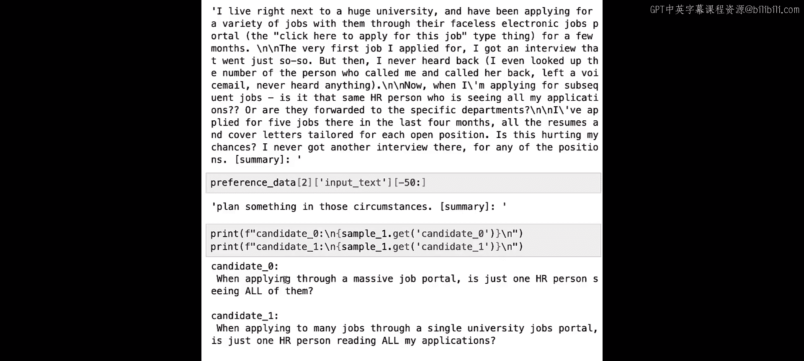

Train our reward model on these triplets of our input text。

 which again is the prompt and then the winning candidate and the losing candidate And when we do that we'll get a scalar value indicating how good the completion is but we'll look at that a little bit more deeply in the next lesson For now。

 let's take a look at the second data that we need this is the prompt data So once the reward model has been trained we're going to use it in the reinforcement learning loop to tune the base large language model this process requires a prompt data which consists of sample prompts so let's take a look at this prompt data like before I have created a smaller version of this data which we will load into memory and take a look at in this notebook So first we will define a path to this small dataset I've called this sample。

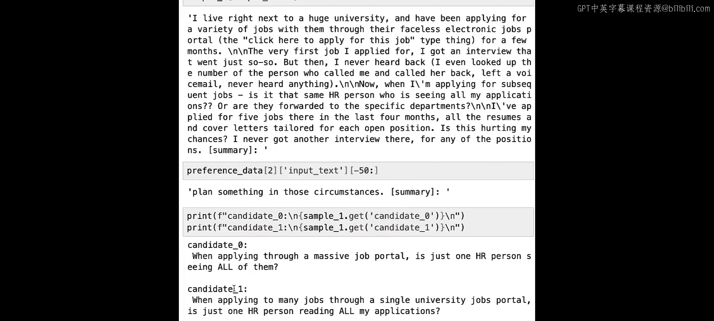

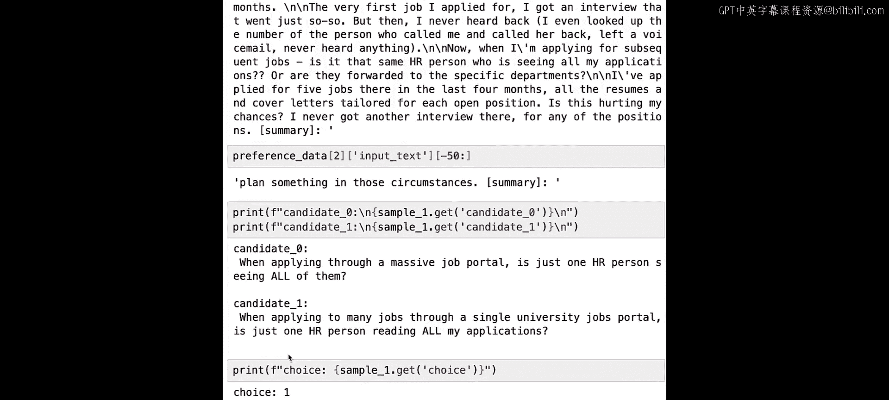

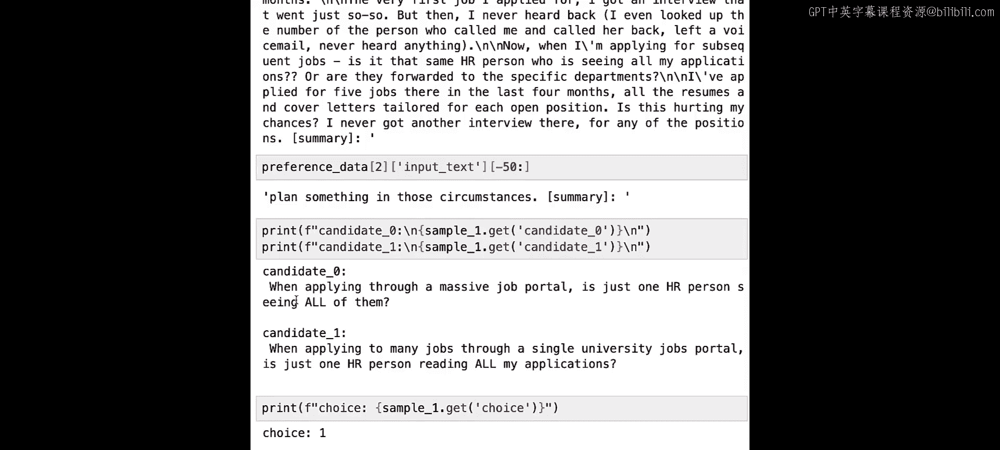

Prompt。

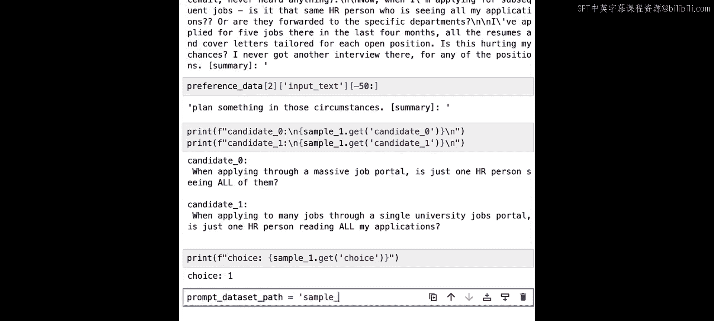

JSON L so we can create this and then again we'll make an empty list and we will then loop over this JSON L file and each time we loop。

 we will append the information to this prompt data list。

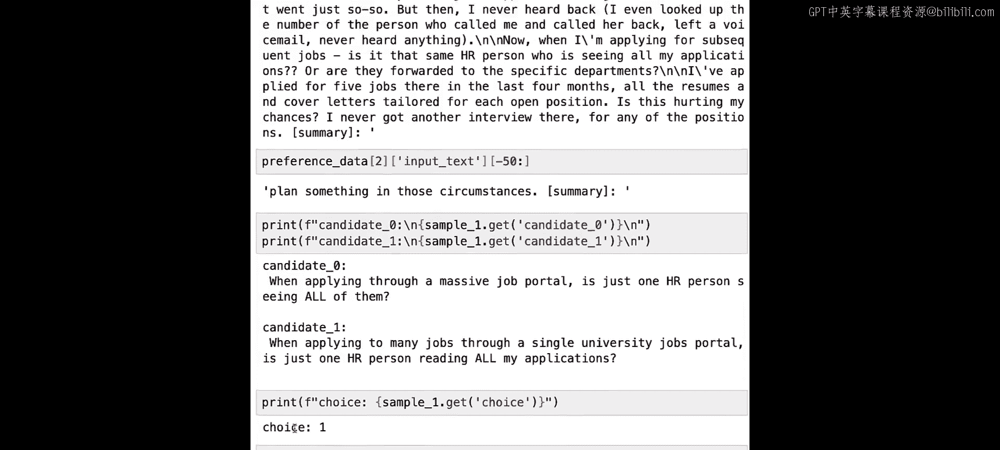

And when we do that we can actually take a look at how big this list is and you'll see that it's very tiny so we're just loading in six examples of our much larger prompt data that we'll use in the next lesson when we actually tune the base large language model Now a quick note on your prompts in this data it is important that the prompts in the preference data and this prompt data come from the same distribution in this case all the prompts are a data set of Reddit posts so they do come from the same distribution。

 so now we can take a look at some examples in this data to help us visualize this data I'm going to define this function called print D so printing the dictionary and what we'll do is we'll take the key and value and we will just print out the text key and then along with the actual key and then the text value and its corresponding value so this will just help us to visualize the information in this prompt data list a little better。

So let's define this function and then we can use print D to print out the first element in our prompt data list so we will extract the first element and we'll execute the cell and you can see here that we have the key input text and then the value is I noticed this the very first day I take a picture to see if it was one of my friends etc etc and you might notice that this ends again in the same summary colon indicator so this looks fairly similar to the preference data but we just have one single key which is the input text field Aka be prompt so if we take a look at another example in this data set we can use the same print D function。

And this time we'll just extract the second element in this list and if we print this again。

 you can see that there's only one key and that key is called input text and the corresponding value is a prompt。

 So no， I love my health class my teacher was amazing Most days we just went outside etc etc and it also ends with the summary colon so that is our prompt data it's just a data of prompts so I encourage you to take a look at the other samples in this prompt data and also again in the preference data。

 but essentially these are the two main dataset sets that we're going to need in our RLHF tuning workflow So in the next lesson we are going to use both of these data sets to actually tune our base large language model so I will see you there。

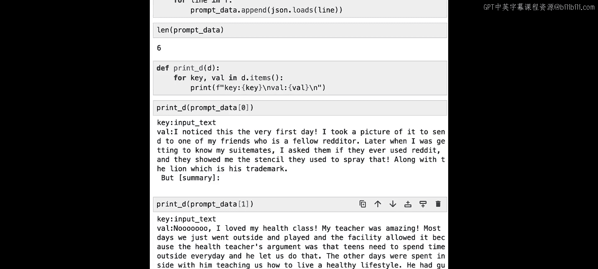