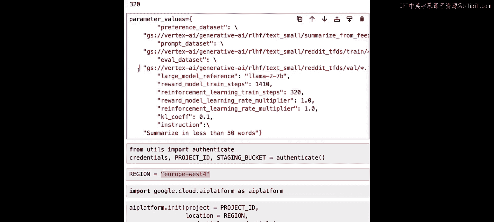
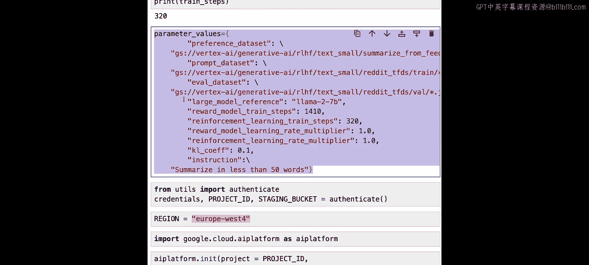
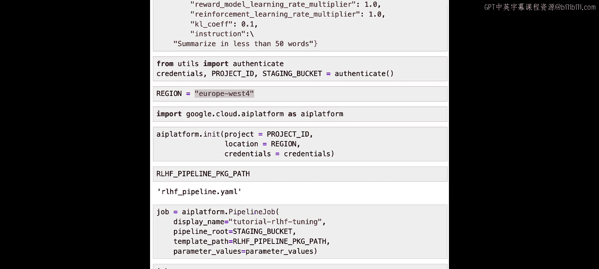

# 吴恩达《从人类反馈中进行强化学习RLHF, Reinforcement Learning from Human Feedback》（中英字幕） - P4：L3_Tune_an_LLM_with_RLHF.zh - GPT中英字幕课程资源 - BV1R94y1P7QX

Now that we've covered some of the basic concepts of RLHF and we've taken a look at the data。

 we're finally ready to kick off that RLHF workflow and tune a large language model To do all of this。

 we're going to be using Vertex AI， which is Google Cloud's machine learning platform。

 let's get started。

RLHF tuning jobs on vertex AI run as vertex AI pipelines in machine learning pipelines are portable and scalable machine learning workflows that are based on containers。

Each step of your workflow， like preparing a data set， training a model， evaluating that model。

 these are all components in your pipeline。Now as we've talked about。

 RLHF is made up of a lot of different steps， you've got more than one data set。

 you're training more than one model， and a pipeline turns out to be a convenient way of encapsulating all of these many steps into one single object to help you automate and reproduce your machine learning workflow。

Now I'm not going to spend too much time talking about pipelines here since you don't need to write your own pipeline。

 you're just using an existing pipeline but to make things a little more concrete here is a basic machine learning pipeline the orange boxes are components or steps of your machine learning workflow This is where some code is executed the blue boxes are the artifacts produced by these components by artifacts I just mean anything that's created in a step of the machine learning workflow so in this case a data and a trained model and some metrics so to run through this pipeline the first thing we do is we execute this create data step this results in a data indicated by the dark blue box and then this data is used in the trained model step which outputs a trained model and some metrics that help us to evaluate how well that model performs a reinforcement learning from human feedback pipeline is a little more complicated it might look something like this we first create a preference。

Da that preference dataset is used to train a reward model。

 the reward model is used with the prompt data to tune the base large language model with reinforcement learning and then we get a tuned large language model and some outputted training curves as well in reality。

 the pipeline that we're going to execute has a lot more steps but more on that shortly the RLHF pipeline exists in the OSS Google Cloud pipelines components library so to run this pipeline you'll first import it then you'll compile it and then execute it。

So we'll need to make sure that we have a few different libraries installed。

 these are installed for you already， but if you are in your own environment。

You'll run on PP install and then Google Cloud Pi components。

 and you'll also need to make sure that you have the Cubeflow Pipelines library installed as well。

 so that is KFP， but these are already included in the environment for you right now。

So the first thing that we're going to do is go ahead and import the pipeline from the cloud pipeline components library。

 So note that right now this exists in preview that's because RLHF is currently in preview but eventually when it moves to GaA this will probably move out of the preview folder here This pipeline has been written using the Kubflow pipelines OSS library So the next thing we need to do is import the compiler from the KfP or Kubflow pipelines library So we'll say from KfP import compiler and if this seems a little confusing don't worry we're going to use all of these different elements in just a minute So compiling a pipeline what I mean by this is we're going to create a Yaml file So before we can create that YaAml file we're just going to define a name for the YamL file So let's define the path to this file we'll call it RLHF pipeline package path。

And we're going to call this file RLhf pipeline。yl。So once we've defined this。

 we can now execute the compile function， so this uses the compiler。

 This is what we imported from CuubeF pipelines up here。

 and then we call compiler and we call the compile function so a whole lot of compiling here but what we're really doing here is we're passing in two elements to this compile function The first is ourHF pipeline and that is the pipeline that we imported earlier from the Google Cloud pipeline components library The next thing we pass in is the package path right here。

 which is the path to our Yaml file So if we execute the cell。

 what happens is compiling the pipeline creates a YamL file so we can now take a look at this new YamL file that's been created So I'm just going to take a look。

😊，At the first few lines。 But if you wanted to look at the whole thing。

 you could instead of saying head， you could say exclamation point cat and that would show you everything in this file。

 but it's pretty long。 So we're just gonna to look at the very beginning。

 What you can see here is that this Yal file includes all of the information needed to execute a pipeline。

 It's basically a really long description in natural language of this pipeline。

 It's got a name It's got a description of what it does and then it's got all of these different inputs。

 So what is this pipeline actually look like Well， vertex AI provides you with a visualization tool where you can see all of the components of your pipeline。

 and this is what the RLHF pipeline that we're going to execute actually looks at It's pretty difficult to see this all on one single slide here。

 There are a bunch of steps and it probably just looks like a bunch of small boxes and lines connecting them。

But we can zoom in on one specific part of the pipeline over here on the right And if we do that。

 we'll see that this section looks a little bit like this。

 There are these boxes with these blue cubes on them and these are component again a component is where some code is executed and then we have these other boxes with these yellow triangles and these are the artifacts。

 This is anything that is created as a result of our pipeline。

 And if you look closely you'll see that there's the word system artifact over here and the words component over here So this might start to look a little bit familiar。

 there is this component that says reward model trainer This is the step of our pipeline that trains the reward model underneath that you can see a component called reinforcer and this is the reinforcement learning loop that tunes the base large language model you can also see that the reward model trainer component outputs some metrics which are indicated here in this tensor board metrics artifact and we will take。

Look at that in the next lesson So again， this pipeline looks pretty complicated。

 but it's already been written for you So even for your own projects。

 you won't be editing this RH pipeline component or the corresponding Yaml file The pipeline has already been authored by the vertex team and it's optimized for the platform and for RH and the Yaml file is something that's auto generatedrated so you don't need to go in and edit anything in it you just need to use it as is So now that we have this Yaml file we can define a vertex AI pipeline job and I'll explain what all of that means in just a minute but at a high level this will take in the Yaml file and it will also take in all of the parameters that are specific to our use case so let's take a look at the parameters that we' going to pass to this pipeline The first thing I'm going to do is make a dictionary called parameter values Now there are a lot of different parameters that we're going to need so we will take a look at them one by one。

3 parameters here are the paths to our preference dataset。

 our prompt dataset and then also this evaluation dataset So we didn't talk about the Eval data set in the previous lesson but the vertex AI RH pipeline allows you to pass in in the optional evaluation dataset what this means is that once tuning is complete this evaluation data will be used to perform a batch inference job where a bunch of completions will be created for a bunch of prompts we will take a look at that in detail in the next lesson but for now all you need to know is that we have three datasets that we are passing into this pipeline So in the previous lesson when we took a look at these differents we were just loading in small JONL files directly into memory but for this actual pipeline our datas are much larger and they need to exist somewhere called Google Cloud storage Cloud St is Google Cloud's object storage that means that you can store images CSV。

F textext fileses， save model artifacts， JSON L files。

 just about anything and you'll notice that these are Google Cloud storage paths because they start with Gsco so anytime you see that that means that this is a path to in object stored in Google Cloud storage Cloud storage also has the concept of a bucket and this is just what holds your data。

 Everything you store in cloud storage needs to be contained in a bucket but within a bucket you can create additional folders to help you organize your data and then lastly vertex AI requires that all three of these datas be in the JSsonN lines format So if we look back at the notebook you can see that for all three of these datas they start with this Gs colon which again indicates that these are paths in Google Cloud storage and then they are all in this bucket called vertex AI This bucket has been created for you and I say publicly accessible bucket within this bucket there are additional folders for each of the different dataset sets。

For your own projects， you'll need to make sure that your three datasets are stored in a Google Cloud storage bucket and if you want some more details on how to do that you can check out the optional lab at the end of this course。

 which will show you how to create a bucket and how to upload data there as well as how to figure out what the specific path is that starts with Gs colon For now we can just use these datas that I have uploaded for you already The next parameter we're going to set is called large model reference So in this case we are going to set this to Lama 27 large model reference specifies which large language model we want to tune Again。

 in this case we are using the open source Lama2 model。But there are other supported values as well。

 including Tex bison and the T5x family of models。 So as a reminder。

 there are two different models that get trained in this RLHF process The reward model train steps sets the number of steps to use when training your reward model The value to set here depends on the size of your preference data from experimentation we found that the model ideally should train over the preference data from around 20 to 30 epochs for best results and then reinforcement learning train steps is the parameter that sets the number of reinforcement learning steps to perform when tuning the base model This depends on the size of your prompt data and from experimentation in this case we found that the model should train over the prompt data for around 10 to 20 epos Now one thing to note is that I was giving these recommendations of how many epochs to train over these different dataset sets but。

meter here takes in a number of steps so if you need a handy heuristic to help you go from epos to steps I can show you that in the notebook The first thing you'll do is set the size of your data and this could be for the preference data or the prompt data so let's say to make this a little bit easier to understand let's say that our data size is 128。

Then we'll need to set the size of our batches and again this means you sending our data in batches instead of everything all at once and reinforcement learning from human feedback on vertex AI currently uses a fixed batch size of 64 so you'll need to set this number to be 64。

 you can't actually adjust the number of batches。But once we have both of these set。

 we can determine the steps per epoC by seeing how many batches it will take to complete our full data set of 128。

 so we'll import math。And that's so we can use a rounding function and then we can say steps per epoch equals math dot seal。

 and this will just round up if these numbers don't divide evenly。

We'll take our size of our data set and we will divide it by our batch size。

And if we print this number。We'll see that that is two because 64 times 2 is 128。

 so it'll take two steps with a batch size of 64 to make it through our full data set of 128。

Once we have our steps per epoch we can then set the number of epochs that we want to train for。

 so let's say that we set this to 10， we can then determine the total number of training steps that we'll need。

By multiplying our steps per epoch by the number of epochs that we want to train for。

And if we do that。And we print out the number。We'll see that this will be two times 10 so we'll need to train for a total of 20 steps。

 You can use this handy heuristic for your own use case you'll just set the size of your preference data or your prompt data you'll set a fixed batch size of 64 and then you'll set the number of epochs to train over and you can use the guidelines that I mentioned earlier so I'm going go ahead and update the training steps here for both the reward model and the reinforcement learning loop to correspond to the size of my actual datasets here so I'm actually not using the entire Reddit data set it's a good best practice to execute the pipeline on a smaller subset of the data the first time around just to make sure that the pipeline executes correctly these pipelines run for many hours so running them first on a small amount of data is just a useful thing to do so in this case my preference data was size 3000 and the batch size is of course fixed at 64 so。

That helped me get my steps per epoch and then I decided to train over 30 epochs。 So once I had that。

 I knew that my number of training steps for the reward model was 1410。

 The size of my prompt data was 2000 and the batch size is again fixed at 64 and this helped me to determine the steps per epoch and I decided to train over 10 epochs for the reinforcement learning loop and that is how I got to 320。

 So again， this is still a smaller amount of the full Reddit data set。

 but in the next lab will take a look at results from training on all of the data So the next three parameters are the learning rate multipliers and the kL coefficients I would say that these are maybe a little bit more advanced of parameters and maybe not something you would set on your first try with this。

 you can set these to the default but as you start really tuning the pipeline for you。Use case。

 you might want to adjust these a little bit and I have the defaults set here already。

 that's one for both of the multipliers and 0。1 for the KL coefficient。

The reward model learning rate multiplier and reinforcement learning rate multipliers are constants that you can use to adjust the base learning rate when either training the reward model or during the reinforcement learning loop you can' actually adjust the learning rate itself and that's because generally you want the learning rate to match the learning rate that was used to train the base large language model and you might not know that off the top of your head so the learning rate is fixed for you by the pipeline。

 but you can adjust these multipliers So what that means is if you multiply by a number greater than one you're going to increase the magnitude of gradient updates applied at each training step but if you multiply by a number less than one you'll decrease the magnitude of these updates Next we have the KL coefficient This is a regularization term that helps to prevent something called reward hacking So for example。

 let's say that our reward model tends to give higher。

Rewards for completions that contain positive words like excellent， superb， great。

During the reinforcement learning loop， our base large language model might learn that if it generates completions that are filled with positive terms but don't actually make a whole lot of sense。

 it will still result in higher rewards so for example。

 our base large language model might start learning to produce completions that just have all these positive words in it like excellent fantastic awesome great and it doesn't really make a lot of sense to a human reading these responses but the reward model is still giving high rewards this is known as reward hacking and the Kale coefficient essentially helps to prevent reward hacking by preventing the model from diverging too far from the original model so the tuned model essentially is penalized if it starts to diverge too far from its initial distribution and break the functionality of the original large language model if you set this kale coefficient to zero there's no penalty at all and the larger you set this coefficient the more the tuned model。

Will be penalized for diverging from the original large language model Okay we are on to our final parameter and this is the instruction which I've set here to be summarized and less than 50 words the instruction lets the model know what task it needs to perform so this text is going to get prepened to each prompt in your data both the preference and prompt data sets so you only want to set this parameter if you don't already have the instruction included in your prompts so if you recall in the previous lesson when we took a look at the input text keys in our data sets none of them had an instruction that said to summarize the text in less than 50 words if we did include this instruction already in our data we wouldn't need to set this instruction parameter because these base models have been trained over a large variety of different instruction you can make this instruction parameter a simple and intuitive description of the task that you want the model to complete。

With that， we have wrapped up all of the parameter values that we need and we are ready to actually execute this pipeline。

 So in this example， we are summarizing Reddit posts but given the information that you have about RLHf Can you think of some other tasks and instructions that would be well suited to reinforcement learning from human feedback For example。

 write a response to the following text and in that case your text that you might have could be the Reddit post Now that we have all of our parameter values defined。

 we are ready to create a pipeline job。 what this means is that this reinforcement learning from human feedback pipeline is going to execute on vertex AI So it's not going run locally here in our notebook but it's going to run on some server on Google Cloud in order to do this we first need to authenticate to Google Cloud and initialize the vertex AI Python SDK for this course we've done that setup for you but if you want to learn how to do this for yourself and your own projects you can take a look。

😊，The optional lab included at the end of this course so I'm importing an authenticate function that we have already written in this ules file When I run this authenticate function。

 it's going to return the credentials which is how we communicate with vertex AI and then the name of our project where all of these services are running as well as the name of a bucket where we can store some generated artifacts from our pipeline the last variable we'll need to set is the region and this is the location of the data center where we're actually going to run this pipeline Some services are only available in a certain set of regions and this reinforcement learning from human feedback pipeline is available in this Europe West for regions so that's why I've set that here as this value Next we need to import and initialize the vertex AI pipeline SK and if you're running this in your own environment you will need to Pip installst Google Cloud AI platform but we have done that already in this environment here。

So I'm just going to import that library now， and then once I've done that。

 we can initialize AI platform， so we'll call the initialization function。

And this is just something you need to do anytime you want to use this AI platform SDK。

 so we'll set a couple of different variables here。

 we'll set the project ID which we loaded earlier in the authenticate function。

 we'll set the location to be the Europe West4 region that we just set in the previous cell。

 and then we will specify our credentials。And if we execute the cell。

 we would have initialized the Python SDK so once we've done that。

 our second to last step here is to create our pipeline job and so I'm going to call this job。

And we'll call AIplatform。pipeline job。And to this pipeline job。

 I'm going to pass in a few key parameters。The first thing we'll pass in is a display name and this is just any string name for what you want to call this pipeline job So here I'm calling it tutorial RLHF tuning but you could change this to be anything you like after we've done that we need to pass in a staging bucket and so this is the pipeline root parameter and basically what this means is that our RLHF pipeline is going to create a bunch of artifacts along the way it's going to output some different files and we just need some central location to store all of those things that are going to be created so I'm just going to store all of that in a Google cloud storage bucket that is saved in this variable staging bucket now we set the template path and if you recall at the very beginning of this lesson we created a YaAml file so if I print this this is the path to our YaAml file and that was the YamL file that defined all of the information about our pipeline that we want to execute。

The very last parameter we'll pass in is parameter values and this is that big dictionary we created up here of all of the parameters that were specific to our reinforcement learning from human feedback that were specific to our Reddit use case so once we have defined all of these parameters here we can create this job and if we take a look at that this creates this AI platform pipeline jobs object and the very last step here is to run the job and we do that by calling job。

 run Now this job is going to take several hours and it's going to require a lot of hardware so for the purposes of this online classroom you're not going actually run this pipeline but in the next lesson you'll take a look at the results of a pipeline that's been executed already So if you did want to run this in your own projects what you would do is called job run and this will create and execute a pipeline for you in the next lesson we're going take a look at the results of a pipeline。

That's already been executed for you so these were some results run by my teammate Bethany who ran an RLHF tuning job on the full giant Reddit data set and that job took over a day to finish running so I'll see you in the next lesson where we'll take a look at the results。

