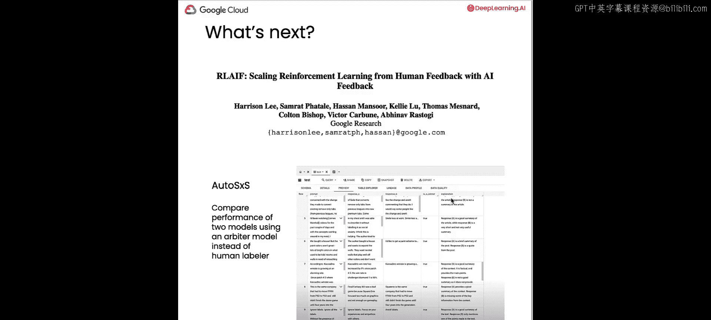

# 吴恩达《从人类反馈中进行强化学习RLHF, Reinforcement Learning from Human Feedback》（中英字幕） - P5：L4_Evaluate_the_Tuned_Model.zh - GPT中英字幕课程资源 - BV1R94y1P7QX

RHF involves a lot of different steps but we don't just want to train a model our ultimate goal is to create a new large language model that performs the task we care about better than the original large language model so in this final lesson of this course we're going to discuss some different strategies for evaluation and take a look at results from the newly tuned model let's get started。

There are a few different things we can look at when evaluating large language models。

 though I should mention that LLM evaluation is still very much a developing area of research and there's a lot more to say than what we can fit in this single lesson。

 but at a high level， here's what we might look at。First。

 we can look at the training curves like loss produced during the training process to see if the model is actually learning you might have done something like this in the past when training neural networks or other machine learning models。

Second， we can look at automation metrics， these are measures of performance that can be calculated using algorithms or mathematical formulas that require ground truth。

So this might include some familiar metrics like accuracy or F1 or some metrics more common to generative tasks like the Rouge family of metrics。

 which help you to determine how similar a piece of generated text is to a human generated reference text third we can do side by side evaluation where we compare the performance of two models against each other using one set of input prompts this allows you to calculate the win rate which tells you what percent of the winning responses were produced by a particular model。

In the case of RLHF researchers have found that the training curves and side by side evaluation have been most useful。

 So if you're familiar with the Rouge metric and you're wondering why that's not as valuable even though it's often used for sumization tasks It turns out the score might not be a suitable measurement for RLHF because it's not really the objective that RLHF aims for In other words。

 the Rouge score does not describe the alignment with human preferences very well it simply tells you how close the generated text is to some reference text So some research has even shown that the more severely we optimize for Rouge。

 the worse the model performance is in the case of RLHF So we're going to start by taking a look at some of the training curves The vertex AI RLHF pipeline that we created in the previous lesson output some training curves to Tensor board Tensor board is an open source project for machine learning experiment visualization and you can install Tensor board with。

😊，Pip， install Tensor board。But again， this is already installed in this environment for you。

So we're going to examine these curves to see how well the model is learning after we've loaded the Tensor board extension。

 we can launch Tensor board so we'll do that again with the percent sign。

This time we'll type Tensor board and then you'll type dash dash loger。

And then you'll need to provide a folder that has your Tensor board log files。

 so in this case I've gone ahead and I've uploaded the Tensor board log files for the reward model training to this directory called reward logs so we can actually take a look at what is in this directory。

And you'll see there's one file and it ends with this very long string of numbers here 110 V2 and this is the log file that was created during the training process so in a minute I will show you how you can find these log files for your own training jobs but before we do that let's just go ahead and take a look at what's in this file and visualize it with Tensor board so if we execute this cell right here we will see that this launches Tensor board。

So I'm going to go ahead and I'm going to scroll down to rank loss。

 which is the metric that we care about right now。 This is the loss function that was used to train the reward model。

 So like other loss functions， generally what you want to see is this curve decreasing over time and then converging。

 So starting to plateau here， which is exactly what you see here。 And in fact。

 it looks like it converged and we kept training for quite a while after that。

 So if you were going to run another tuning job with the same data。

 you might want to train for even fewer steps。 So this actually looks pretty good。

 So let's go ahead and take a look at the curves produced during the R loop。 So again， I'm going to。

😊，Call the command Tensor board。And we'll say loggged her and this time we will pass in a different directory。

 and this is a directory I've created that has a log file for the reinforcement learning step。

 And like I mentioned earlier， I'm going to show you how to find these files in just a minute but let's first take a look at what they look like。

 So this will launch Tensor board again， and we can scroll up here。

 and what we want to take a look at here are two particular metrics。 The first is the k loss。

 This tells us how much the model is deviating from the original base model。

 So what you want this to look like is you want to see a curve that's increasing and that eventually it starts to plateau That's not quite what's happening here。

 It looks like the k loss is kind of all over the place and it starts off higher。

 it starts to decrease。 It doesn't quite look like it's converging And in fact。

 if we collapse this and we take a look at the reward。

 we also we' see that this is also all over the place。

 So ideally the reward curve should also increase over time as the model。

MoLs the reward gets higher and higher and at some point it will plateau。 So ideally。

 this is what we would want both of these curves to look like。

 You can see this k loss continues to increase， and at some point it's sort of plateaus。

 and the same thing for the reward。 The reward keeps climbing higher and higher until at some point it plateaus。

 But we're not really seeing that for either the k loss or the reward here in these tensor board files。

 And so that's a pretty good indication that your model isn't really learning。 In fact。

 in this case it kind of seems like it's underfitting because there's no real trend here in either the curves from the k loss and the reward。

 but in this particular case that wasn't too surprising。

 these were log files I pulled from tuning the model on a small subset around 1% of the total data。

 So next let's take a look at some logs that were produced when we train on the full data set。

 So we'll call this tensor board command one more time。 and again。

 we'll say loggged and we'll pass in one last directory。Which is called reinforceforr Full data。

Logs and if we launch Tensor board here， we should see that our curves look a little bit closer to what we're expecting。

 so you can see that the kale loss here continues to increase and increase and increase and at some point it sort of starts to plateau and the same thing for the reward we can see that again this is increasing which is exactly the kind of behavior we want to see we want to see that the reward increases over time until at some point it stabilizes so these were some training curves that were generated from a large scale tuning job run by my teammate Bethany。

 she actually ran a bunch of experiments with this Reddit data set and the Lama2 model and it can show you what parameters she specifically to achieve these results so here is the dictionary parameter values that we created in the previous lesson and for starters for the preference dataset the prompt dataset and the evaluation data set she trained on the full data instead of the smaller subsampled version of the dataset。

So if I adjust this path here， this is the Google Cloud storage path that leads to the full data set for all three of these。

 so instead of textma， the directory here is just called textex she fine tuned the Lama2 model and the reward model Tra steps were set to 10。

000。As well as the reinforcement learning train steps。Reward model learning rate multiplier was 1。0。

 and the reinforcement learning rate multiplier was 0。2。

 The KL coefficient was set to the default of 0。1 and the instruction was the same as before summarize in less than 50 words。

 So now let me show you how you can access these tensorboard files for yourself in your own projects。

 So currently we've just been interacting with Google cloud in a notebook via the Python SDK but if you go to console cloud go co and go to your Google cloud project under the vertex AI section you'll see a little button that says pipelines。

 So if you select pipelines in the console it will open up all of the pipelines in a particular region that you've run and so underruns。

 you can go ahead and select your pipeline here it should be somewhat easy to find it should have the same name that we gave it earlier which was RHf train template and when you click on this pipeline it will open up that。

Visualization that I showed you earlier of all of the boxes and all of the lines Once you've opened your pipeline。

 you can zoom into the top right corner where it says reward model trainer As a reminder this is the component that executes training of the reward model you can see that this component produces an artifact called Tensor board metrics So if we were to click on this Tensorboard metrics box it will pop up on the right hand side with this UI over here which is a path in Google Cloud storage and if you click on this path right here it will open up the Tensor board logs for you If you want to find the specific file within that directory yourself you should see something called events out TF events that will end in W110 V2 but that's how you find your specific tensor board logs for the reward model trainer for the reinforcement learning loop it's pretty similar you'll just click on the reinforcer component and then open up the corresponding。

Tensorboard metrics artifact that is produced and again that will also open up a UI which is a path in cloud storage and if you click on that path。

 you'll be able to find your Tensor board logs The training curves that we looked at can help us get a sense of whether or not our model is learning but at the end of the day with these large language models sometimes the best way to evaluate them is just to look at the completions that they produce for a set of input prompts so you might remember that in the previous lesson when we created our pipeline job we passed in an evaluation data This is a data of prompts。

 no completions just sumization prompts We're calling this an evaluation data but it might differ from how you are used to using evaluation dataset sets with machine learning in the past This data is just passed to the tuned model for a bulk inference job So what that means is that once our model has been tuned we generate completions for all of the prompts in this evaluation。

Data set we don't calculate any metrics we're just calling the model and producing some kind of text output so to make that all a little bit more concrete let's take a look at some of these evaluation results I've got ahead and loaded in a small subset of the evaluation results here for you to examine and this is also a JSO L file so。

We'll start by importing JSON， then we will define the path to where these results are。

So we'll call this Eval tuned path equals Eval results。Tuned dot Json L。 Next。

 we'll define an empty list like we did before。 We'll call this Eval data tuned。

And then we will loop over this JSON L file and append the data to our empty list next I'm going to use that print D function that we defined in the second lesson which just helped us to visualize the keys and values for a dictionary so we will import print D。

And once we've done that， we can use it， so I'll call print D and let's take a look at the first element in this list。

So this first element here is a dictionary that has a key called inputs。

 The value for inputs is itself another dictionary that has a key called inputs pretokenized。

 And if we look at that value here， we'll see that this is a prompt it's got our instruction summarized in less than 50 words this was the instruction that we set in the instruction parameter when we kicked off the pipeline and it's been prepened to our evaluation data set。

 After that we have the Redddit post。 So before anything not a sad story or anything my country's equivalent of Valentine's Day is coming up and I have this pretty simple idea to surprise my girlfriend and it would involve giving her some roses etc。

 This prompt also ends with summary colon in brackets which we saw in the second lesson So this prompt here was sent to the tuned model and the tuned model produced this prediction result down here which says my country's equivalent to Valentine's Day is coming Want to surprise my girlfriend with roses。

 but I don't know if she would like。😊，Getting some Any ideas on how to get that information out of her without spoiling the surprise So this is the summary that our tuned model produced for this input prompt so next let's do some side by side evaluation What this means is we're going to look at some completions on the same set of prompts for our Lama2 model before and after we've run this tuning job Next i'm going to load in a file that has inference results from the base model This is the Lama2 model before we executed tuning。

😊，So first， we'll define the path。To this data set and it has the exact same input prompts that our evaluation data set we were just looking at has as well and again。

 we'll create a new empty list。These are the results from the unted model and we can loop over this file and each time we do that we will append the data to this list here so now we have two lists we have a data set that has results from the tuned Lama2 model and then we have a data set that has results from the untuned Lama2 model if we look at the first example in this untuned data set what you'll see is that the prompt is the same but the completion is going to be different because it came from the model before we run our RLHF tuning job you can see that it's the same prompt as before about Valentine's Day and roses but the prediction is different the unted model produced a summary the author wants to surprise his girlfriend with roses on Valentine's Day but he doesn't know if she likes roses he wants to find out without spoiling the surprise so if we scroll back up to the completion produced by the tuned model you can see that it is in fact different and one difference you might notice。

That the tuned model produced a summary in first personson so in the same voice as the original Reddit poster while the untouned model refers to the author instead of saying it in the same voice as the person posting on Reddit but take a look and see if you can find any other differences and which of the two responses you prefer to make it easier to compare all of the results so we don't have to keep printing each element and scrolling up and down like this。

 I'm going to put everything into a data frame so we can do some real side by side evaluation。

The first thing I'll do is make a list of the prompts。So we'll call this prompts。Okay。

So what I'm doing here is I'm looping over the data set of results from the tuned model and for each sample in that data。

 I'm extracting the value for inputs pretokenized。 So that's going to correspond to the prompts。

 So if we execute this， we can then take a look at what we've created here。

 And that is a list of all of the prompts in this data。 So you can see here's one prompt。

 Here's another， etc ce。 So now that we've extracted all the prompts。

 we're going to extract the completions for both the unted base model and the tuned model。

 So first we'll extract the completions from the model before it went through tuning。😊。

Call this unted completions。And this time。We'll be extracting the value for the prediction key。

And if we do that， we will have。A list。Of completions。

 and these are the completions from the untouned model。We'll do this one more time。

And extract the completions。For the model after it went through tuning。

 so this is going to look really similar to the previous cell。

We're just going to be looping over the data set with completions from the model after tuning and if we look at that you can see that this is also a list of completions and this is from the model after it's gone through tuning so lastly we're going to put everything together in one big data frame。

So to do that， we will first import pandas。And then I'm going to make a data frame called results and for the data in this data frame we'll make one column called prompt。

And here we will pass in that list of prompts， then we will make another column called base model。

 and this is going to be the completion for that specific prompt generated by the model before it was tuned with RLHF and then we'll make a final column。

Called tuned model， and this is the completion for the prompt。

That was generated after the model was tuned with RLHF。

And just so we can visualize all of this on the screen here， I'm going to set a pandas option。

To display。Max call width。And this will just help us to visualize this a little nicer。All right。

 so let's take a look at our results data frame。There are we scroll up to the top here。

 three columns we've got our prompt and this prompt here is the same one we looked at earlier about roses and Valentine's Day and then we've got the completion generated by the model before tuning and the completion generated by the model after tuning and there are a few more prompts in here this one is about a senior and high school who wants to study computer science in college this one here is about applying to jobs and we've got one at the bottom here about applying for credit cards so you can take a look at all of the data in this data frame here and do your own side byside evaluation where you try and identify which of the two completions you prefer the response from the model before tuning or the response from the model after tuning but that's essentially how you would do a side byside evaluation Now if you're wondering for your own RHF tuning jobs how do you access the batch evaluation results while you'll do。

Again， by going into the cloud console and opening up your pipeline。

 but this time you will zoom in on the component that says perform inference underperform inference you'll see a component called bulk Infer this is the component that just performs a bulk inference job meaning it takes in our JSON L file of prompts in our evaluation data set and then calls the model to produce completions for each one of those prompts If you click on that component you'll see on the righthand side a box popup that says output parameters and specifically the parameter output prediction GCS path will point to a location and Google Cloud storage that has the JSON L file so you can click on that link and then download the JSON L file and take a look at the results So to finish off today I want to talk about two new interesting techniques in the world of RLHF The first is RLIF or scaling reinforcement learning from human feedback with AI。

Fedback this is a really interesting technique where we are actually creating preference data sets that are labeled by an offthe shelflf large language model so previously when we looked at the preference data it was labeled by human labelers but actually in the research area they're now looking at different ways to use a large language model to actually create that preference data so this is a pretty interesting paper that I would recommend taking a look at if you're curious to see how we might use an AI model to help generate a preference data and then similarly in the topic of using LLMs to help us in this RLHF process another interesting technique is called auto side by side and this is where you perform side by side evaluation like we did in the notebook。

 but instead of having a human being look at the results before and after tuning you actually use a third arbitrarybit model which is itself a large language model instead of a human labeler So what this means is that this。

lararge language model looks at the responses from both the unted model and then the tuned model and determines which one it likes better and it often also provides an explanation so you can see a screenshot here in the slides from the autoside byside service and Google Cloud where we have a prompt we have the response from the unted model and the response from the tuned model which looks pretty similar to the pandas data frame that we created but after that there's a column that indicates which of the two completions the third large language model preferred as well as an explanation provided by that third large language model as to why it preferred that specific result but these are just some interesting new areas of research that hopefully give you an idea for how this field is evolving so that wraps up our lesson on evaluating the results from RHF so I'll see you in the next video where we will conclude the course and wrap up everything that we've learned。

