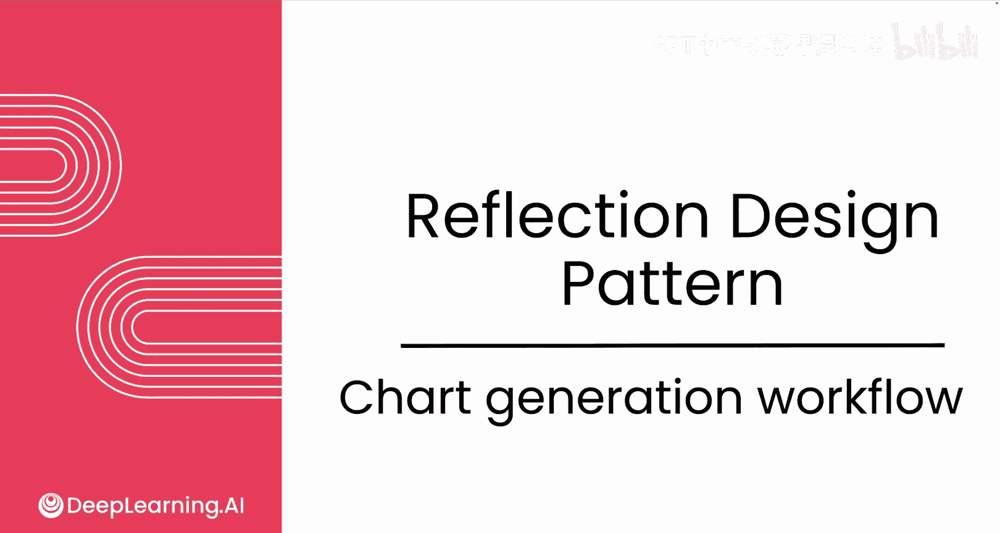
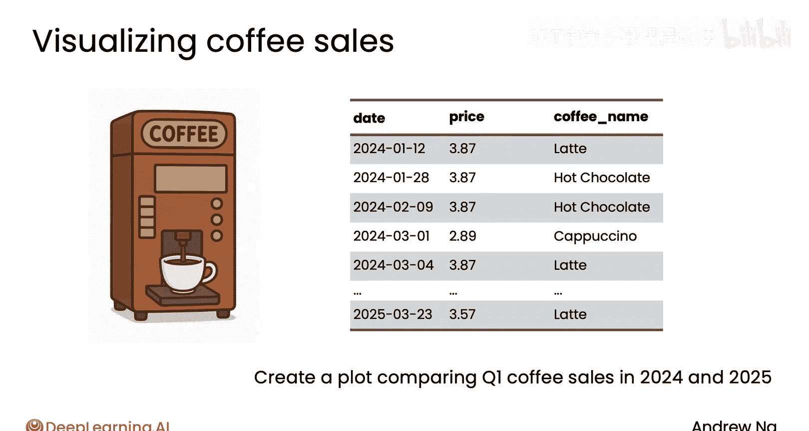
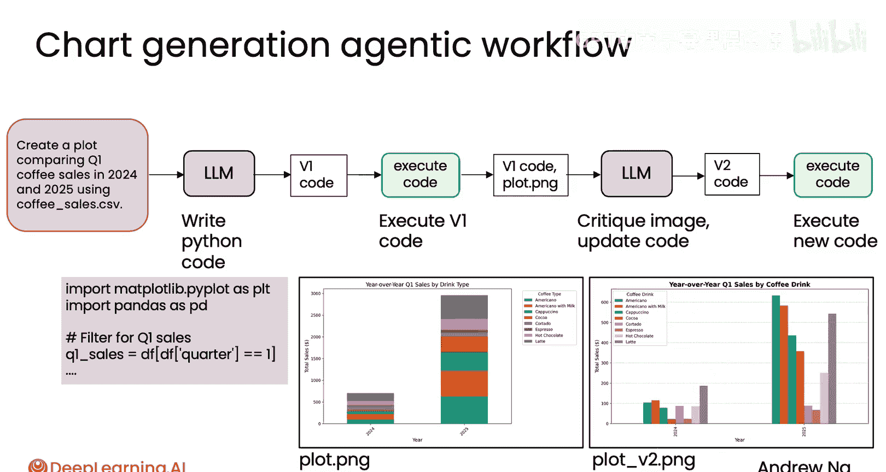
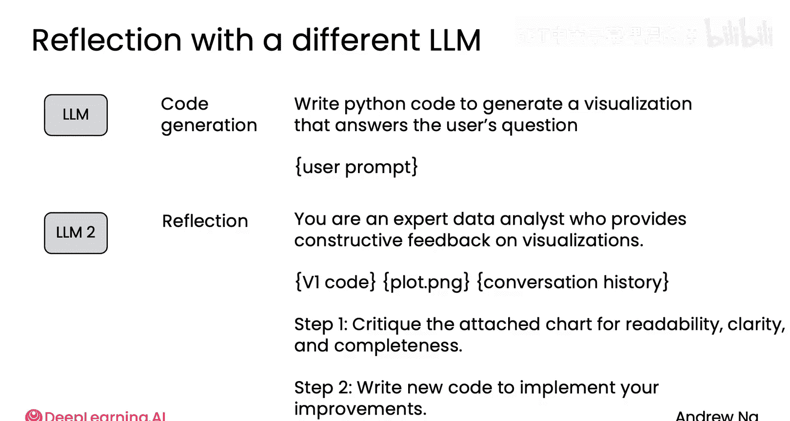

# 吴恩达《代理式AI：模块1-5｜Agentic AI 》中英字幕 - P10：3.chart-generation-workflow.zh_en - GPT中英字幕课程资源 - BV1hv4rz9EDn

In the cool lab that you see in this module， you play with a chart generation workflow where use an agent to generate nice looking diagrams。

 And it turns out reflection could significantlyly improve the quality of his output。

 Let's take a look。

In this example， I have data from a coffee machine showing when different drinks such as a latte coffee or hot chocolate or a cappuccino coffee and so on were sold and for what price。

 And we want to have an agent create a plot comparing Q1 or first quarter coffee sales in 2024 and 2025。

 So one way to do it would be to write a prompt that ask an Om to create a plot comparing Q1 coffee sales in 2024 and 25 using the data stored in a spreadsheet as a CSv file or a comma separator values there's a spreadsheet file。

 and an Om might write code like this to generate a plot And with this V1 of the code if you execute。

 it may generate a plot like this When I ran the code that the own output it actually generated this the first time。

 and this is a stacked bar plot which is not a very easy way to visualize things and it just doesn't look a very good plot。

 But what you can do is then give it V1 of the code。

As well as the plot that this code generated and feeded into a multimodal model that is an OM that can also accept image inputs and ask it to examine the image that was generated by this code and then to critique the image。

 find a way to come with with better visualization and update the code to just generate a clearer better plot。

 Multimodal OMs can use visual reasoning so can actually look visually at this figure to find ways to improve it。

 And when I did this， it actually generated a bar graph that is in this stack bar graph but the more regular bar graph that separates out the 2034 and 2035 coffee sales in what I thought was a more pleasing and clearer way when you get to the coding lab。

 feel free to mess around with the problems and see if we can get maybe even better looking at graphs in these because different Os have different strengths and weaknesses sometimes I'll use different Oms for the initial generation and for the reflection So for example you may use one O to。

The initial code， maybe openize G4 or G5 or some model like that and just prompted like a prompt like this to write Python code to generate visualization and so on。

 And then the reflection prompt might be something like this where you tell them to play the role of expert data analyst that provides constructive feedback and then give it the version one of the code the plot was generated maybe also the conversational history from how the code was generated and ask it to critique it for specific criteria remember we give it specific criteria like readability clarity and completeness it hope them better to figure out what to do and then ask it to write new code implement your improvements。

 one thing you may find is that sometimes using a reasoning model for reflection may work better than a non-reasoning model So when you're trying out different models for the initial generation and the reflection these are different configurations that you might toggle or try different combinations of So when you get to the coding lab I hope you have fun。

Visualizing coffee sales Now， when you're building an application。

 one thing you may be wondering is does reflection actually improve performance on your specific application from various studies。

 Ref improves performance by a little bit on some by a lot on some others and maybe barely any at all on some other application and so it' would be useful to understand its impact on your application and also give you guidance on how to tune either the initial generation or the reflection prompt to try to get better performance In the next video。

 let's take a look at evals or evaluations for reflection workflow。 let's go on to the next video。

