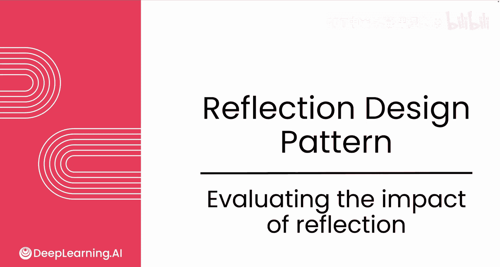
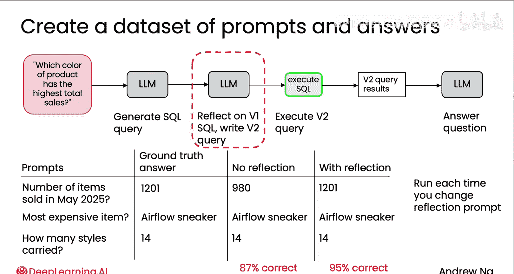
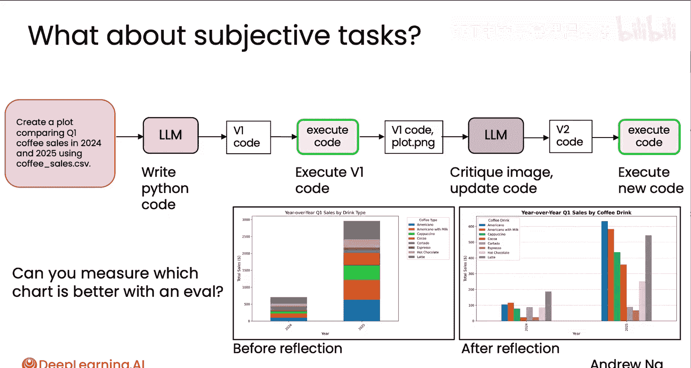
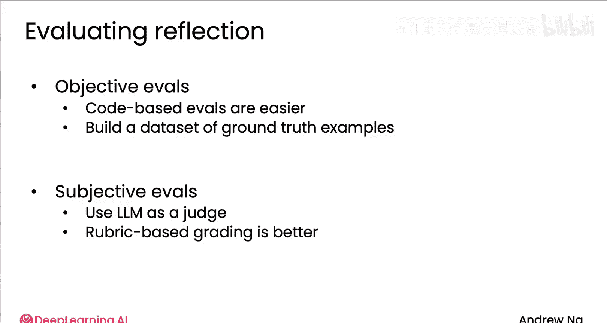

# 吴恩达《代理式AI：模块1-5｜Agentic AI 》中英字幕 - P11：4.evaluating-the-impact-of-reflection.zh_en - GPT中英字幕课程资源 - BV1hv4rz9EDn

Reffection often improves the performance in the system， but before I commit to keeping it。

 I would usually want to double checkck how much it actually improves the performance because it does slow down the system a little bit by needing to take an extra step。

 let's take a look at Evals for reflection workflows。

 Let's look at an example of using reflection to improve the database query that an Om writes to fetch data to answer questions。

 let's say you run a retail store and you may get questions like which color product has the highest total sales to answer a question like this。

 you might have an Om generate a database query if you're heard of database languages like SQL SQl it may generate a query in that double language。

 but if youre not familiar with SQL Do about it。 but after writing a database query instead of using that directly to fetch information from the database。

 you may have an OM the same or different reflect on the version1 database query and updated to maybe an improve one。

Then execute that database query against the database to fetch information to finally have an LM answer the question So the question is。

 does using a second L to reflect and improve on the database or SQL query actually improve the final output in order to evaluate this。

 I might collect a set of questions or set of prompts together with ground truth answers so maybe one would be how many items are sold in May 2025 what's the most expensive item of inventory how many styles it carry in my store and I write down for maybe a 1015 prompts the ground truth answer then you can run this workflow without reflection so without reflection would mean to take the SQL query generated by the first LM and to just see what answer it gives and with reflection would mean to take the database query generated after the second L has reflected on it to see what answer that fetches from the database and then。

Can measure the percentage of correct answers from no reflection and with reflection In this example。

 no reflection gets the answer is right 87% of the time。

 worth reflection gets it right 95% of the time， and this would suggest that。

Refection is meaningfully improving the quality of the database queries I'm able to get to pull out the correct answer。

 One thing that developers often end up doing as well is rewrite the reflection prompt。

 So for example， do you want to add the reflection prompt and instruction to make the database query run faster or make it clearer or you may just have different ideas for how to rewrite either the initial generation prompt or the reflection prompt once you put in place evals like this。

 you can quickly try out different ideas for these prompts and measure the percentage correct your system has as you change the prompts in order to get a sense of which prompts work best for your application So if you try out a lot of prompts。

 building evals is important it really helps you have a systematic way to choose between the different prompts you might be considering but this example is one of when you can use objective evals because there。

The right answer。 the number of items still was 121 and the answer is either right or wrong。

 How about applications where you'd need more subjective rather than objective evaluations in the plotting example that we saw in the laws video without reflection we had the stack bar graph with reflection we had this graph but how do we know which plots is actually better。

 I know I like the latter one better but with different graphs varying on different dimensions。

 how do we figure out which one is better。 and measuring which of these plots is better is more of a subjective criteria rather than a purely black and white objective criteria So for these most subjective criteria。

 one thing you might do is use an Om as a judge and maybe a basic approach to do this might be to feed both plots into an OM multimodal o that can accept two images of input and just ask which image is better。

 It turns out this doesn't work that well I'll share even。

Right do in a second。 but one thing you could do might be to also give it some criteria by which to evaluate the two plot such as clarity。

 how nice looking they are and so on。 But it turns out that there's some known issues of using elementss to compare two inputs to tell you which one is better first it turns out the answer are often not very good they could be sensitive to the exact wording of the prompt of theelm as a judge and sometimes the rank ordering doesn't correspond that well to human expert judgment and one manifestation of this is manyelms will have a position bias Many elementsms turns out will often pick the first option more often than a second option and in fact。

 I've worked a lot of elementss where given two choices whichever choice I present first it will say the first choice is better and maybe some elementss prefer the second option but I think mostels prefer the first option instead of asking an to compare pair of inputs gra with a rubric can give more consistent results So。

You might prompt an OM to tellw it given a single image。

 assess the attached image against the quality rubric and the rubric or grading criteria may have clear criteria life the plot have a clear title or the axis labels present is an appropriate chart type and so on with handful of criteria like this。

 And it turns out that instead of asking the OEM to grade something on a scale of one to5。

 which it tends not to be well calibrated on。 if you instead give it， say5 binary criteria。

501 criteria and have it give5 binary scores and you add up those scores to get the number from one to5 or one to 10 if you have 10 binary criteria that tends to give more consistent results。

 And so if were to gather a handful， say 1015 user queries for different visualizations that the user may one to half of the coffee machine sales。

 then you can have it generate images without reflection or generate images with reflection and use a rubric like this。

To score each of the images to then check the to which or whether or not the images generated word reflection are really better than the ones without reflection。

 And then once you built up a set of evals like this。

 if ever you want to change the initial generation prompt or you want to change the reflection prompt。

 you can also rerun this eval to see if， say updating one of your prompts allows the system to generate images that scores more points according to this rubric。

 And so this two gives you a way to keep on tuning your prompts to get better and better performance。

 What you may find when building evaluations for reflection or for other agent workflows is that when there is an objective criteria。

 code-basedase evaluation is usually easier to manage。

 And in the example that we saw with the database query。

 we built up a database of ground truth examples in ground truth outputs and just wrote code to see how often the system generated the right answer in a really。

evaluationval In contrast， for small subjective task， you might use an Elm as a judge。

 but it usually takes a little bit more tuning， such as having to think through what rubric you may want to use to get theelm as a judge to be well calibrated or to upward reliable Evals。

 So I hope that gives you a sense of how to build Evals to evaluate reflections or more generally。

 even to evaluate different agentic workflows。

Knowing how to do Evals well is really important for how you build agent workflows effectively。

 and you hear me say more about this in later videos as well。

 But now they you have a sense of how to use reflection。

 what hope to do in the next video is a deep dive into one aspect of it。

 which is when you can get additional information from outside and this turns up to make reflection work much better。

 So in the final video of this module， let's take a look at that technique for making a reflection workflows work much better。

 I'll see you in the next video。😊。