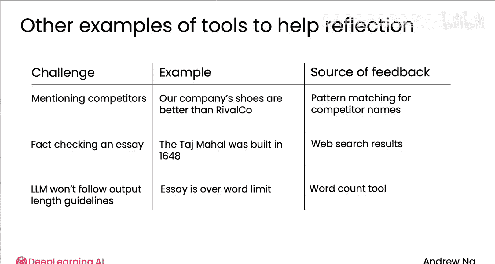

# 吴恩达《代理式AI：模块1-5｜Agentic AI 》中英字幕 - P12：5.using-external-feedback.zh_en - GPT中英字幕课程资源 - BV1hv4rz9EDn

Refection with external feedback。 if you can get it is much more powerful than reflection using the Lm as the only source of feedback。

 Let's take a look。 When I'm building an application and if I'm just prompt engineering for direct generation of zerosha prompting this is what performance might look like over time where initially。

 as I tune the prompt， the performance improves for a while， but then after a while。

 its sort of plateaus or flattens out and despite further entering the prompt it's just hard to get that much better a level of performance。

 So instead of wasting all this time on tuning the prompt， sometimes be better。

 if only earlier on in a process， I had started adding reflection and sometimes that gives a bump in performance。

 sometimes smaller， sometimes a bigger prompt。 but that as complexity。

 But if I had started adding in reflection， maybe at this point in the process and it started tuning the reflection prompt。

 then maybe I end up with a performance and looks like this。

 But it turns out that if I'm able to get external feedback so that the only source。😊。

New information isn't just an LM reflecting on the same information as it had before。

 but some new external information then sometimes as I continue to tune the prompts and tune the external feedback。

 you end up with an even much higher level of performance so something to consider if you are working on prompt engineering and you feel that your efforts are seeing diminishing returns that tuing lots of problems was just not getting that much better they maybe consider if this reflection or even better if there's some external feedback in interjector。

 bump the performance curve off this fat in our red line to maybe some higher trajectory of performance improvement just as a reminder we saw earlier one source of feedback for if you're writing code would be if you were to just execute the code and see what output is generates output or error messages and feed that output back to the LM to let have that new information to reflect and then use that information to write a new version of the code。

Here are a few more examples of when software codes or tools can create new information to help the reflection process。

 If you're using it on to write emails and it sometimes mentions competitors' names。

 then if you write code or build a software too to just carry out pattern matching maybe via regular expression pattern matching to search a competitors's names in the output。

 then whenever you find a competitor's name you just feed that back to the as a criticism as input that's very useful information to tell it to just rewrite the text without mentioning those competitors or as another example。

 you might use web search or look at other trusted sources in order to fact check an essay So if your research agent that says the Taj Mahal was built in 1648 technically the Taj Mahal was actually commissioned in 1631 and it was finished in 1648 so maybe this isn't exactly incorrect but it doesn't capture the accurate。

htory either in order to more accurately represent when this beautiful building was built。

 if you do a web search to cuddle the snippet explaining exactly the period that the Taj Mahal was built and give that as additional input to your reflection agent then it may use that to write a better version of the text on the history of the Taj Mahal。

 One last example， if you're using an Lm to write copy maybe for a blog post of a research paper abstract。

 but what it writes is sometimes over the word limitelms are still not very good at all exact word limits。

 then if you implement a word count to just write code to count the exact number of words and if it exceeds the word limits。

 then feed that word count back to the Lm and ask you to try again。

 then this hopes it to more accurately hit the design length of the output you wanted to generate so in each of these three examples you can write piece of code to help find additional。

About the initial output to then give those facts be it that you found the compile name or information web search or the exact word count to feed into the reflection O M in order to hope it do a better job thinking about how to improve the output。

 Reflections are powerful， too， And I hope you find it useful in a lot of your own work。

In the next module， we'll build on this to talk about two use where in addition to the handful of two examples you saw。

 you learn how to systematically get your own to call different functions and this would make your agent applications much more powerful。

😊，I hope you enjoyed learning about reflection。 I'm going to now reflect on what you just learned。

I hope to see you in the next video。

