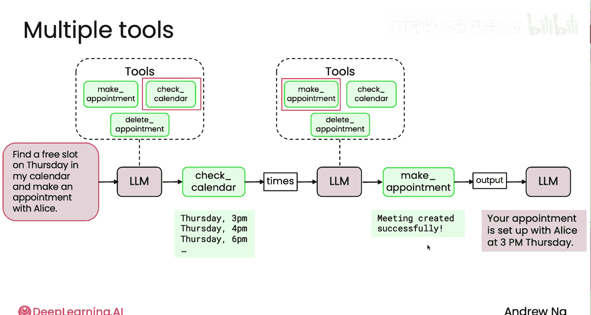

# 吴恩达《代理式AI：模块1-5｜Agentic AI 》中英字幕 - P13：1.what-are-tools.zh_en - GPT中英字幕课程资源 - BV1hv4rz9EDn

In this module， you learn about two used by Elms， and that means letting your OEMM decide when it might want to request to have a function call to take some action or give some information or do something else。

 just as we as humans can do a lot more with tools than we can with just a bare hands Elms too can also do a lot more with access to tools。

 but rather than using hammers and spanners and pers。

 when we give tools that is functions for an OM to request the call。

 that's what lets it do a lot more。Let take a look If you were to ask an LOM that's been trained maybe many months ago。

 what time is it right now while that trained model does not know exactly what time it is。

 and so hopefully a response sorry do not have access to the current time but if you were to write a function and give the LM access to this function then that lets it respond with a more useful answer when we let LOM's call functions or more precisely let an LM request to call functions that what we by two use and the tools I just functions that we provide to the LM that request to call in detail this is how to use works In this example I'm going to give the get current time function that I showed on the previous slide to the LM when you then prompted what time is it the LM can decide to call the get current time function that will return the current time which is then fed back to the LM in the conversational history and finally the LM can output is say320 pm。

The sequence of steps is does the input prompt the LM in this case looks at the set of tools which is just one two in this example but looks at the set of toolss available and it will decide in this example to call the tool the tool is a function that it returns the value that values fit back to the LM and then finally the LM generates its output Now one important aspect if two users we can leave it up to the LOM to decide whether or not to use any of the tools so for the same setup if I was asked it how much caffeine is in green tea the LM doesn't need to know the current time to answer this and so can generate an answer directly greenT debris has this much caffeine and it does so without invoking the get current time function in my slices I'm going to use this notation with this dash box on top of the LM to indicate that we're providing a set of tools to the LM for the LM to choose to use when it deem appropriate This is as opposed to some examples you saw in earlier videos。

Where I as a developer had highcoded in， for example。

 that I will always do a web search at this point in the research agent In contrast to get current time function call is not highcoded in is up to the L to decide whether or not it wants to request a call to the getcur time function and again we're going to use this dashbox notation to indicate when we're giving one or more tools to the or the Lm to decide what tools if any it wants to call Here are some examples of when tool use may help an L based app generate better answers if you ask it can you find some Italian restaurants near Mountain View California if it has a web search tool then an Lm might elect to call a web search engine requiring restaurants near Mountain View California and use the results that fetches to generate the output or if you are running a retail store and you want to be able to answer questions like show me customers who bought white sunglasses if your LM is given access to。

query database too， then it might look up the table of sales for what entries had a pair of white sunglasses sold and then use that to then generate the output。

 Finally if you wanted to do an interest rate calculation if ever were to deposit $0 and after $10 years at interest rate of 5% what would I have if you happen to have a interest calculation tool。

 then it could invoke the interest calculation function to calculate that or it turns out one thing you see later is letting an LM write code like just write a mathematical expression like this and then to evaluate it。

 that would be another way to let an Lm calculate the right answer So as a developer it would be up to you to think what are the source of things you want an application to really do and then to create the functions or the tools that are needed to make them available to the LM to let it use the appropriate tools to complete the source of tasks that may be a restaurant。

Meander or a retail question answerer or a finance assistant may want to do。

 so depending on your application， you may have to implement and make different tools available to your LOM。

 So far， mostly examples weve gone through made only one2 or one function available to the LM but there are many use cases where you want to make multiple tools or multiple functions available for the for it to choose which of any to call for example。

 if you're building a calendar assistant agent， you might then want it to be a fulfill request like please find a free slot on Thursday in my calendar and make an appointment with Alice So in this example。

 we might make available to the LM a two or a function to make an appointment that is to send a calendar invite to check the calendar to see when it might be free as well as to delete appointment if it ever wants to cancel an existing calendar entry and so given to set of instructions。

 the would first decide that of the different tools available， probably the first one it should use。

Check calendar so call the check calendar function that will return when I am free on Thursday based on that information。

 which is fed back to the LM。 It can then decide that the next step is to pick a slot。

 let's say 3 pm and then the call the make appointment function to send a calendar invite to Alice as was to add to my calendar The output of that which hopefully is a confirmation that the color entry was sent out successfully。

 It fed back to the and then lastly the LM might tell me your appointment is set up with Aliceice at 3 pm Thursday being able to give your L access to tools is a pretty big deal it will make your applications much more powerful in the next video will take a look at how to write functions how to create tools to the make them available to your Let's go on to the next video。

