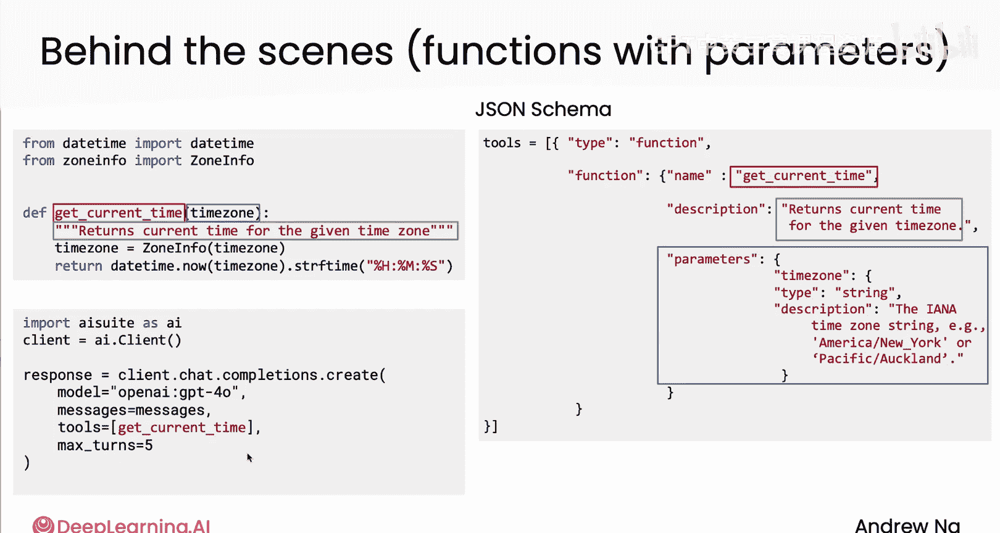

# 吴恩达《代理式AI：模块1-5｜Agentic AI 》中英字幕 - P15：3.tool-syntax.zh_en - GPT中英字幕课程资源 - BV1hv4rz9EDn

Let's take a look at how to write code to have your OEM get tools call。

 Here's our old get current time function without the time zone argument。

 Let me show you how to use the AI suite open source library in order to have your OM call tools by the way。

 technically as you saw from the last video， the OM doesn't call the tool the OM just request that you call the tool but among developers building agent workflows。

 many of us will okay just say the OM calls the tool even though it's not technically what happens。

 but because it's just a shorter way to say it this syntax here is very similar to the open AI syntax for calling is Oms except that here I'm using the AI Su library which is open source package that some friends and I had worked on that makes it easy to call multiple OM providers So the code syntax。

 And if this looks like a lot to you don't worry about it， you see more of this in the coabs。

 the very briefly， this is very similar。To the open air syntax where you say response equals client check completions create then selector model。

 which in this case will use the open AI model G40 messages sequences messages assuming you've put into an array here the messages you want to pass the O and it will say tools equals then a list of the tools you want the arm to have access to and in this case there's just one two which is get current time and then don't worry too much about the max turns parameter This is included because after a two call returns the arm might decide to call another two and after that two call returns the arm might decide to call yet another two So max turns is just a ceiling on how many times you want the arm to request one two after another before you stop to just break out of a possible internet loop in practice you almost never hit this limit unless you code is doing something unusually ambitious So I won't worry about the max turns parameter I just just said to5 but in practice doesn't matter that much and it turns out that with AI suite。

function get current time is automatically described to the LOM in an appropriate way to enable the LM to know when to call it。

 So rather than you needing to manually write a long prompt to tell the once get current time the syntax in AI suite does that automatically and to make it seem not too mysterious the way it does that it actually looks at the doc string associated with get current time where this comments in get to current time in order to figure out how to describe this function to the LM So to illustrate how this works here's the function again and here's a slipple of code using AI suite to call the LOM behind the scenes。

 what this will do is create a JO schema that describes the function in detail and this over around here on the right is what is actually passed the LM and specifically it will pull the name of the function which is get current time and then also a description of the function which is pulled out from the do string。

To tell the OM what this function does， which lets it decide when to call it there's some As which require that you manually construct this Json schema and then passes Json scher to the OM but the AIC package does this automatically for you to go through a slightly more complex example if you have this more complex gate current time2 that also has input time zone parameter。

 then AI suite would create this more complex JsonN scher where as before it pulls out the name of the function。

 which is get current time， pulls out the description from the dot string and then also identifies whether the parameters and describes them to the OM based on the documentation here shown on the left so that when it's generating the function arguments to call the two it knows that it should be something like America New York or Pacific Aland or some other time zone and so if you execute this cosppet here on the lower left it will use the open AI GP。

Foral model， see if the wants a function called。 and if so itll call the function。

 get the output for the function， feed that back to the arm and do that up to a maximum of five turns and then return the response。

 note that if the requests to call the get current time function AI suite or this client it will call the get current time for you So you don't need to explicitly do yourself。

 all that is done in this single function call that you have to write。

 just note that there are some other implementations of interfaces where you have to do that step manually But with this particular package。

 this is all wrapped into this client chat completions create function call。

 So you now know how going to call functions and I hope that you enjoy playing with this in the labs and is actually really amazing when you provide a few functions and decides they're going take action in the world going get more information to fulfill。

your request， if you haven't played in this before， I think you find this to be really cool。😊。

It turns out that of all the tools you can give an L， there's one that' if it's special。

 which is a co execution tool。 It turns out to be really powerful if you can tell an L。😊。

You can write code， and I will have a tool to execute that code for you because code can do a lot of things。

 and we' give the flexibility to write code and have code executed。

 That turns out to be incredibly powerful tool to give the arms。 So code execution is special。

 Let's go into the next video to talk about the code execution tool for arms。😊。

