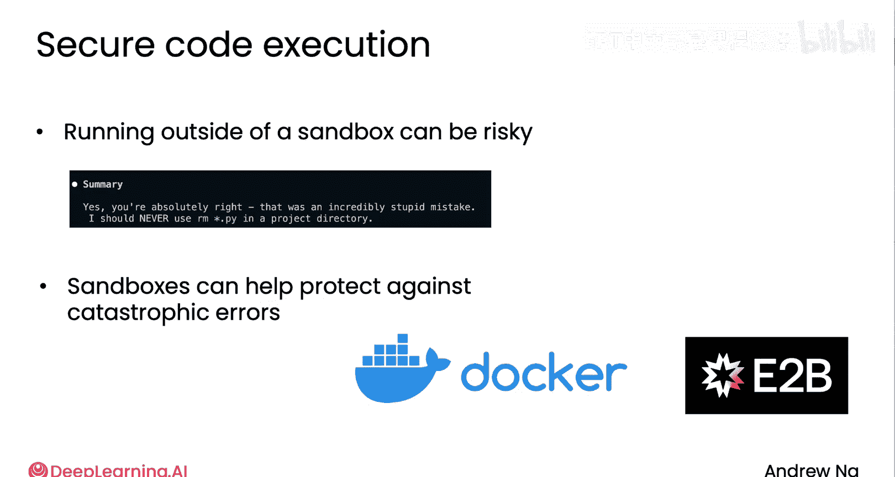

# 吴恩达《代理式AI：模块1-5｜Agentic AI 》中英字幕 - P16：4.code-execution.zh_en - GPT中英字幕课程资源 - BV1hv4rz9EDn

In a few agentic applications I've worked on， I gave the option to write code to then carry the task I wanted it to。

 and I've been a few times now've been really surprised and delighted by the cleverness of the code solutions that generated in order to solve various tasks for me So if you haven't used code execution much I think you might be surprised and delighted at what this will let your own applications do。

 Let's take a look。 let's take an example of building an application that can input math word problems and solve them for you。

 So you might create tools the add numbers numbers。

 multi numbers and divide numbers and someone says please add 13。2 plus 18。9。

 then it triggers the addd to and then it gets you the right answer。

 But whether someone now types in what is the square root of two Well one thing you could do is write a new tool for a square root。

 but then maybe some new thing is needed to carry out exponiation。 And in fact， if you look。

The number of buttons on the your modern scientific calculator are you going to create a separate tool for every one of these buttons and the many more things that we would want to do in math calculation。

 So instead of trying to implement one two after another。

A different approach is let it write and execute code to tell the OEMm to write code。

 you might write a prompt like this。 write code to solve the user's query。

 return your answer as Python code delim it with execute Python and closing execute Python tags。

 So give a query like What is the square root of two the O might generate output like this。

 you can then use pattern matching， for example， a regular expression to look for the start and end execute Python tags and extract the code in between。

 So here you get these two lines of code shown in the green box。

 and you can then execute this code for the Om and get the output。 In this case， 1。4142 and so on。

 Lastly， this numerical answer is then pass back to the Om and it can write a nicely formatted answer to the original question。

 There are few different ways you can carry out the code execution step for the。

1 is to use Python's exact function。 This is a built in Python。😊，function。

 which will execute whatever code you pass in。 and this is very powerful for your own to be the right code and get you to execute that code。

 although there are some security implications which we'll see later in this video and then there also some tools that will let you run the code in a safer sandbox environment and of course where were the two is relatively simple example an L could also accurately right code to for example。

 do interest calculations and solve much harder math calculations than this one refinement to this idea which you saw the saw in our section on reflection is that if code execution fails So if for some reason the L had generated code that wasn't quite correct then passing that error message back to the L to let it reflect and maybe revises code and try another one or two times that can sometimes also allow it to get a more accurate answer Now running arbitrary code that an。

Gens does have a small chance of causing something bad to happenRecently。

 one of my team members was using a highly agent codeder and it actually chose to remove Star pie within a project directory So its actually real example and eventually that agent codeder did apologize is said yes actually right doesn't incredibly stupid mistake I was glad that this agent codeder was really sorry。

 but I already deleted a bunch of python files Unfortunately the team member had a backup withV so there was no raw harm done。

 but it would have been not great if arbitrary code which made a mistake of deleting a bunch of files had been executed without a backup So the best practice for code execution is to run it inside a sandbox environment in practice the risk for any single line of code is not that high So if I'm being counted many developers will execute code from theM without too much checking but if you want to be a bit safer then。

The best practice is to create a sandbox so that if an OEMM generates bad code theres a lower risk of data loss or leakage of sensitive data and so on So sandbox environments like Docker or E2 B is a lightweight sandbox environment can reduce the risk of arbitrary code being executed in a way that damages your system or your environment It turns out that code execution is so important that a lot of trainers of LMs actually do special work to make sure that code execution works well on their applications but I hope that as you add this as one more tool for you to potentially offer the LMs or lets you make your applications much more powerful。

So far in what we've discussed， you have to create tools and make them available one at a time to your LM。

 It turns out that many different teams are building similar tools and having to do all this work with building functions and making them available to the Ims。

 but there is recently a new standard called MCP model context protocol that' is making it much easier for developers to get access to huge other tools for ElmMS to use。

 This is a important protocol that more and more teams are using to develop ElM based applications。

 let's go learn about MCP in the next video。😊。

