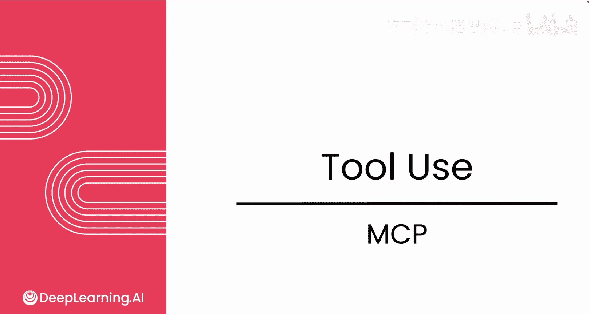
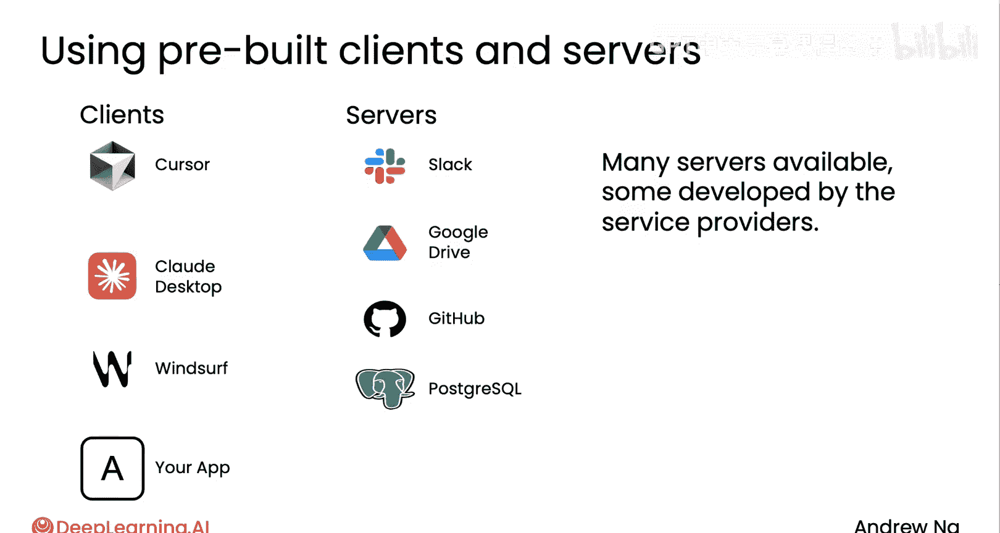
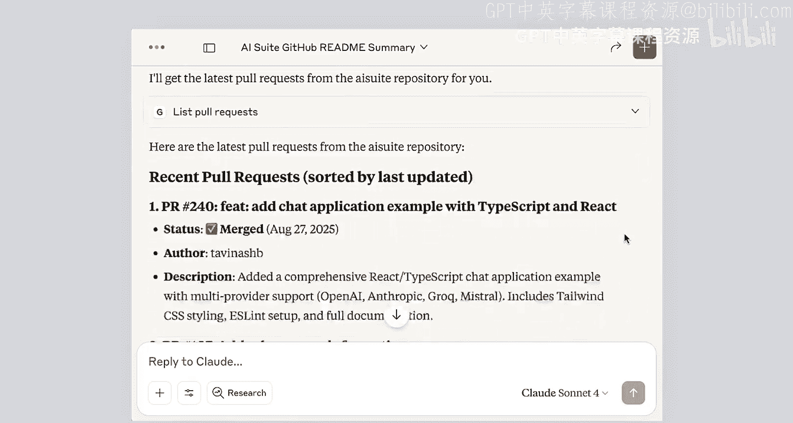

# 吴恩达《代理式AI：模块1-5｜Agentic AI 》中英字幕 - P17：5.mcp.zh_en - GPT中英字幕课程资源 - BV1hv4rz9EDn

MCP， the model context protocol， was a standard proposed by Anthropic。

 but now adopted by many of the companies and by many developers as a way to give an L M access to more context and to more tools。

 There are a lot of developers developing around the MCP ecosystem。

 And so learning about this will give you a lot more access to resources for your applications。

 Let's take a look。

This is the pain points that MCP attempts to solve if one developer is writing an application that wants to integrate with data from Slack in Google Drive and Github or access data from a Postgres database then they meant the right code to wrap around Slack APIs to have functions to provide to the application right code to wrap around Google Drive APIs to Po application and similarly for these other tools or data sources then what has been happening in the developer community is if a different team is building a different application。

 then day two will integrate by themselves with Slack in Google Drive and Github and so on so many developers were all building custom rappers around these types of data sources and so if there are M applications being developed and there are N tools out there the total amount of work done by the community was M times N What MCP did was proposed a standard for applications。

To get access to tools and data sources so that the total work that needs to be done by the community is now m plus n rather than m times n。

 The initial design of MCP focuses a lot on how to give more context to an LOm or how to fetch data a lot the initial tools where ones that would just fetch data。

 And if you read the MCP documentation that refers to these as resources。

 but MCP gives access to both data as well the more general functions that an application may want to call And it turns out that there are many MCP clients。

 These are the applications that want access to tools or the data as well as service which are often the software rappers that then give access to data and slacklack or Github or Google Drive or allows you to take actions at these different types of resources。

 So today there's a rapidly growing list of mP clients that consume the tools。

or the resources as well as MCP servers that provide the tools and the resources。

 and I hope that you find it useful to build your own MCP client。

 your application maybe one day will be an MCP client and if you want to provide resources other developers maybe you can build your own MCP server someday let me show you a quick example of using anP client。

 this is a cloud desktop app and it has been connected to a Github MCP server。

 So when I enter this query， summarize the Rem markdown from the Github repo this URL this is actually AI Su repo then this application which is an MCP client uses the Github MCP server with a request get Redown from repoI Su from this repo and then it gets this response which is pretty long all this is then fed back to the O context and the Om then generates the summary of the markdown file。

Now let me enter another request， which is let me enter whether the latest pull request。

 this inn causes the OM to use the MCP server to make a different request to list the pull request。

 This is another two provided by GitHub's MCP server and so mixes requests with repo AI suite sort going to update this 20 and so on。

 and then it gives this response which is fed back to the LM and the LM then you write this nice tech summary of the latest pull request for this repo MCP is an important standard。

 it want to learn more about it。 Deepender AI also has a short cause that goes much deeper into just the MCP protocol that you can check out after finishing the course if you're interested Let hope this video gives you a brief overview of why is useful and also why many developers are now building to this standard。

This brings us a last video on two use， and I hope that by giving your OEM access to tools。

 you better to build agent applications， the much more powerful。In the next module。

 we'll talk about evaluations and error analysis， it turns out that one of things I've seen that distinguishes people that can execute agent workflows really well versus teams that are not as efficient at it is your ability to drive a disciplined evaluation process in the next set of videos。

 which I think is maybe the most important module of this entire course。

 I hope to share with you some the best practices of how to use Evals to drive development of agent workflows。

 look forward to seeing you in the next module。