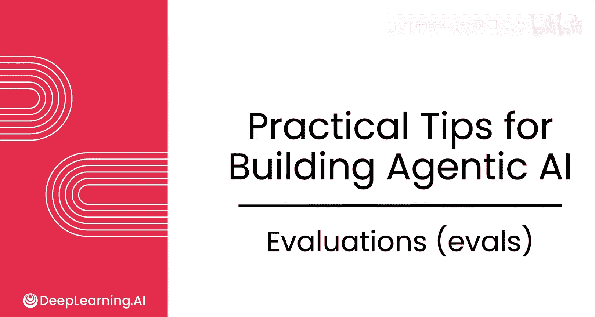
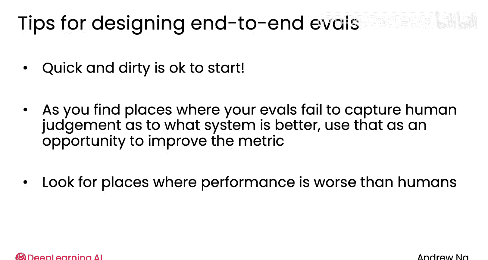

# 吴恩达《代理式AI：模块1-5｜Agentic AI 》中英字幕 - P18：1.evaluations-(evals).zh_en - GPT中英字幕课程资源 - BV1hv4rz9EDn

In this module， I'd like to share you practical tips for building agent AI workflows I hope that these steps will enable you to be much more effective than the typical developer at building these types of systems。

😊。

I find that when developing an agent AI system is difficult to know in advance where it will work and where it won't work so well and thus where you should focus your effort。

 So very common advice is to try to build even a quick and dirty system to start so you can then try it out and look at it to see where it may not yet be working as well as you wish to't have much more focused efforts to develop it even further。

 In contrast， I find it is sometimes less useful to sit around for too many weeks theorizing and hypotheizing how to build it is often better to just build a quick system in a safe。

 reasonable way that doesn't leak data kind do it in a responsible way。

 but just build something quickly so you can look at it and use that initial prototype to prioritize and try further development。

 This sort of example of what might happen after you've built a prototype。

 I want to use as a first example the invoice。Processing workflow that you'd seen previously with the tasks extract four required fields and then save it to a database record After having built such a system。

 one thing you might do is find a handful of the invoices。

 maybe 10 or 20 invoices and go through them and just take a look at their output and see what went well and if there were any mistakes So let's say look through 20 invoices you find that invoice1 is fine the output looks correct for invoice2 maybe confused the date of the invoice that is when was the invoice issued with the due date of the invoice and in this task we want to extract the due date subsequent issue payments on time。

 So then I might no doubt in a document and a spreadsheet that invoice2 the dates were mixed up maybe invoice 3 was fine Invoice 4 was fine and so on。

 but as I go through this example I find that there quite a lot of examples where had mixed up the date So it is based on going through a number of examples like this in this case you might conclude that one common。

mode is that it is struggling with the dates。 In that case。

 one thing you might consider would be to of course。

 figure out how to improve your system to make it extract due dates better。

 but also maybe write an eval to measure the accuracy with which it is extracting due dates in comparison。

 if you had found that it was extracting the biller address incorrectly。

 knows maybe you have billers with unusual sounding names and so maybe struggles with billers or especially if you have international billers whose names may not even all be English letters。

 then you might instead focus on building an eval for the biller address。

 So one of the reasons why building a quick and dirty system and looking at the output is so hopeful is it even helps you decide what do you want to put the most effort into evaluating now。

If you've decided that you want to modify your system to improve the accuracy with which it is extracting the due date to the invoice。

 then to track progress， it might be a good idea to create an evaluation or an eval to measure the accuracy of date extraction there are pretty multiple ways one might go about this。

 but let me share with how I might go about this to create a test set or an evaluation sets。

 I might find 10 to 20 invoices and manually write down what is a due date。

 So maybe one invoice is a due date of August 202025 that write it down at the standard year month date format and then to make it easy to evaluate in co laterator I would probably write the prompt of the L to try to always format the due date in this year month date format and with that I can then write code to extract out the one date to the output which is a due date because that's the one day we care about。

 So this is a regular expression pattern matching four numbers or。wo for the month。

 two for the date and extract that out and then I can just write code to test if the extract date is equal to the actual date。

 That is the ground truth annotation I had written down。

 So with an eval of say 20 or so invoices I make changes to see if the percentage of time that it gets the extracted data correct is hopefully going up as I tweak my prompts or tweak out parts of my system So just to summarize what we've seen so far。

 we've build a system， then look at outputs to discover where it may be behaving in an unsatisfactory way such as due data wrong。

 then to drive improvements to this important output put in place a small eval say just2 examples to help us track progress and it this lets me go back to two prompts try different algorithms and so on to see if I can move up this metric of due date accuracy So this is what improving a agent AI workflow will often feel like look at output see what's wrong if you know how to fix it just fix it。

 But if we need a longer。of improving and then put a place in Eval and use that to drive further development One other thing to consider is if after working here for a while。

 if you think those 20 examples you initially aren't good enough。

 maybe they don't cover all the cases you want or maybe2 examples is just too few then you could always add to the Eval set over time to make sure it better reflects your personal judgments on whether or not the systems performance is sufficiently satisfactory so's just one example for the second example。

 let's look at building a marketing copy assistant for writing captions for Instagram where to keep things su let's say a marketing team tells us that they want captions that are at most 1 words long So we would have a image of a product say a pair of sunglasses that we want to market and then have a user query like please write caption to sell these sunglasses and then have a OM or a large multimod model analyze the image and a query and generate a description of the sunglasses and there lots of different ways that a marketing copy assistant。

mayy go wrong， but let's say that you look at the output。

 you find that the copy or the text generated mostly sounds okay。

 but maybe it's just sometimes too long。 So for the sunglassess input generally 17 words。

 if you have a coffee machine is okay stylish is do share 14 words blender 11 words。

 So it looks like a another example the O is having hard time adhering to the length guideline So again there are lots of things that could have gone wrong with a marketing copy assistant。

 but if you find that is struggling with the length of the output。

 then you might build an eval to track this so that you can make improvements and makeche' getting better at adhering to the length guideline。

 So to create an eval to measure the text length， what you might do is create a set of test So market pair of sunglasses。

 a coffee machine and so on and maybe create 10 to 20 examples。

 then you would run each of them through your system and write code to measure the word count of the output。

 So if this is python code to measure the word count of。Pce of text。

 then lastly you compare the length of the generated text to the10 word target limit。

 So if we're count as as equal to10 noncorr plus equals1 one difference between this and the previous invoice processing example is that there is no per example ground truth。

 The target is just 10 same for every single example whereas in contrast for the invoice processing example we had to generate a custom target label that is the correct due date of the invoice and we're testing the outputs against that per example ground truth。

 I know I use a very simple workflow for generating these captions but these type of evals can be applied to a much more complex generation workflows as well。

 let me touch on one finalr example in which we'll revisit the research agents we've been looking at if you look at the output of the research agents on different input prompts。

 let's say that when you ask you to write an article on recent breakthroughs in black hole signs。

You find that it missed some high profile result that a loss of news coverage。

 So this is unsatisfactory result。 Or if you ask it research renting versus buying a home in Seattle seems to do a good job or robotics for harvesting fruit。

 Well it didn't mention a leading equipment company So based on this evaluation it looks like sometimes it misses a really important point that a human expert writer would have captured。

 So then I would create an eval to measure how often it captures the most important points。

 For example， you might come up with a number of example prompts on black holes robotic harvesting and so on and for each one come up with let's say three to five gold standard discussion points for each of these topics notice that here we do have a per example annotation because a goldstand talking points that is the most important talking points they are different for each of these examples with these drownt annotations you might then use an message to count how many。

The go standard talking points were mentioned and so an example prompt might be to say determine how many of the five go standard talking points are present in the provided essay。

 you have the original prompts， the essay text go standard points and so on and have it return a object with twos that scores how many of the points zero to five did the score as well as an explanation and this allows you to get a score for each prompt in your evaluation set In this example。

 I'm using all message judge to count how many of the talking points were mentioned because there's so many different ways to talk about these talking points and so a regular expression or code for simple pattern matching might not work that well。

 which is why you might use a Earl message judge and treat this as a slightly more subjective evaluation for whether or not say event horizons were adequately mentioned So this is a third example of how you might build evals in order to think about how to build evals for。

Application the avals you bill will often have to reflect whatever you see or you worried about going wrong in your application and it turns out that broadly there are two axes of evaluation on the top axis is the way you evaluate the output in some cases you evaluate by writing code with objective evals and sometimes you use an om as a judge for more subjective evals on the other axis is whether you have a per example ground truth or not so for checking invoice date extraction we were writing code to evaluate if we got the actual date and that had a per example ground truth because each invoice has a different actual date but an example where we checked marketing copy length every example had a length limits of 10 and so there was no per example ground truth for that problem。

In contrast， for counting go standard talking points there was a per example ground truth because each article had different important talking points。

 but we used an element as a judge to read the essay to see if those topics were adequately mentioned because there's so many different ways to mention the talking points and the loss of the four quas would be El message judge with no per example ground truth and one place where we saw that was if you are grading charts with a rubric。

 this is when we're looking at visualizing the coffee machine sales and if you ask it to create a chart according to a rubric such as whether'sque access labels and so on there is the same rubric for every chart and that would be using an element as a judge or with Val per example ground truth So I find this two by two grid as' maybe a useful way to think about the different types of evals you might construct for your application and by the way。

 these are sometimes also called end to end evals because one end is the inputotence such the user query problem and the other end。

Is the final output And so all of these are evals for the entire end to end systems performance。

 So just to wrap this video， I'd like to share a few final tips for designing end to end evalals first quick and dirty evals is fine to get started I feel like I see quite a lot of teams that are almost paralyzed because they think building evalals is this massive multiweek effort and so they take longer than would be ideal to get started。

 but I think just as you iterate on an agent workflow make it better over time you should plan to iterate on your evalals as well so if you put in place 101520 examples as you first cutter evals and write and code or try prompting your messageage just do something to start to get some metrics and that can complement the human eye at looking at the output and then there's a blend of the two that can drive your decision making and as the evalals become more sophisticated over time you can then shift more and more of your trust to the metricbased。

Vals rather than needing to read over hundreds of outputs every time you tweak a prompt somewhere and as you go to this process。

 you likely find ways to keep on improving your EVs as well。 So if you had 20 examples to start。

 you may then run into places where your EVs fail to capture your judgment about what system is better so maybe you update the system and you look at it and you feel like this got to work much better but your EV fails to show the new system achieving a higher score if that's the case that's often an opportunity to go maybe collect the larger evalals set or change the way you evaluate the output to make it correspond better to your judgment as to what system is actually working better and so your eVs will get better over time and lastly in terms of using EVals to in inspiration as to what to work on next motivation to workflows are being used to automate tasks that say humans can do and so I find for such applications I look for。

Places where the performance is worse than that an expert human。

 and that often gives me inspiration for where to focus my efforts or whether are the types of examples that I maybe they get my agent workflow to work better than it is currently。

 So I hope that after you built that quick and dirty system。

 you think about when it would make sense to start putting in some evals to track the potentially problematic aspects of the system and that that will then help you drive improvements of the system。

In addition to helping you drive improvements， it turns out that there's a method of Evals that helps you hold in。

Of your entire agent system， what are the components most worth focusing your attention on。

 Because agent systems often have many pieces。 So which piece is going to be most productive for you to spend time working to improve。

 turns out being to do this well is a really important skill for driving efficient development of agent workflows And the next video like the deep dive and do this topic。

 So let's go on to the next video。😊。

