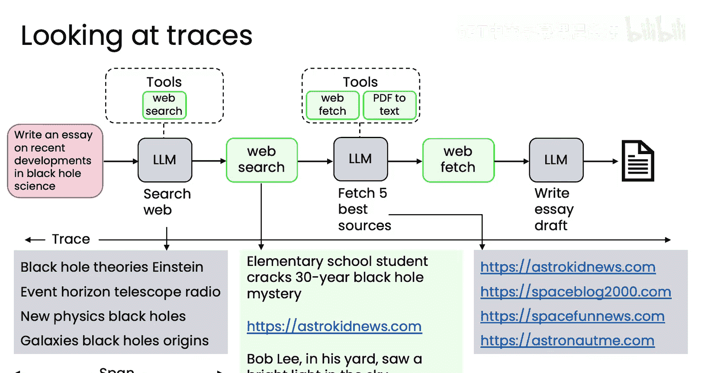
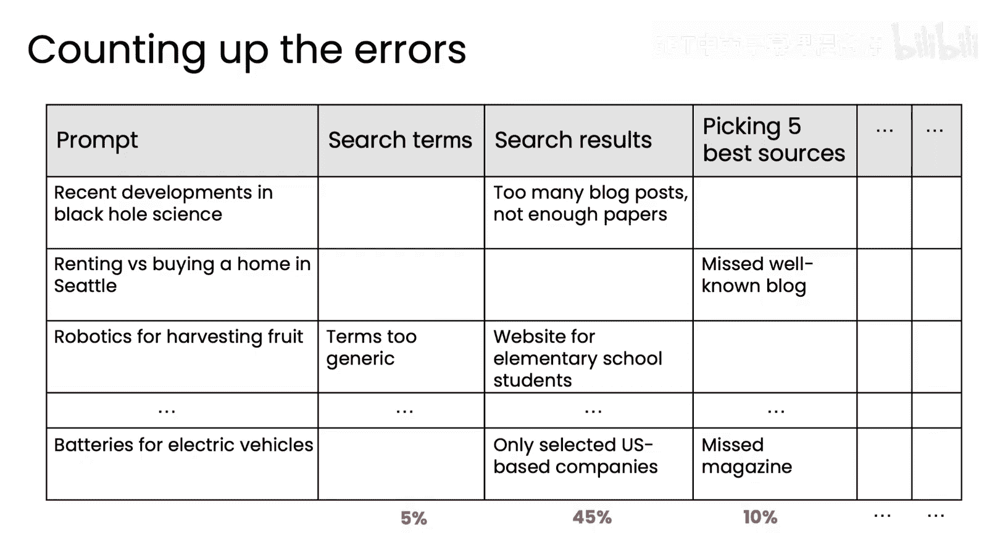
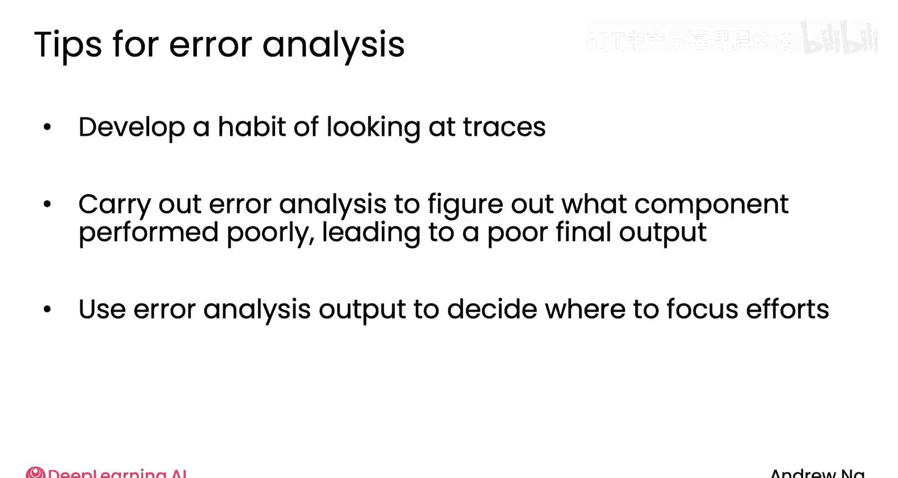

# 吴恩达《代理式AI：模块1-5｜Agentic AI 》中英字幕 - P19：2.error-analysis-and-prioritizing-next-steps.zh_en - GPT中英字幕课程资源 - BV1hv4rz9EDn

Let's say you've built an agent work though。 And if it's not yet working as well as you wish。

 And this happens to be all the time。 by the way， I'll often build a quick and dirty system and it doesn't do as well as I wish it would。

 The question is， where do you focus your efforts to make it better。

 turnss out agent workflows at many different components and working on some of the components could be much more fruitful They working on some other components。

 So your skill at choosing where to focus your efforts makes a huge difference in the speed with which you can make improvements your system And I found that one of the biggest predictors for how efficient and how good a team is is whether or not they're able to drive a disciplined error analysis process to tell you where to focus your efforts。

 So this is an important skill。 Let's take a look at how to carry out error analysis。

 In the research agent example， we had error analysis in the previous video。

 and we saw that it was often missing key points。😊。

an expert would have made inviting essays on certain topics。

 So now you spotted this problem that is sometimes missing key pointss。

 How do you know what to work on？ It turns out that of the many different steps in this work though。

 almost any of them could have contributed to this problem if missing key points for example。

 maybe the first Lm was generating search terms that weren't great。

 So it was just searching for the wrong things and did not discover the right articles or maybe use a web search engine that just wasn't very good。

 there are multiple web search engines out there In fact actually quite a few that I tend to use for my own based applications and some are better than others or maybe web search was just fine。

 but when we gave the list of web search results than Lm。

 maybe it didn't do a good job choosing the best handful to download maybe web fetchtch has fewer problems in this case assuming you can fetch web pages accurately but after dumping the web pages in LM maybe the LM is ignoring some of the points in。

Doments we had fetched so it turns out that there are teams that sometimes look at this and go by gut to pick one of these components to work on and sometimes that works and sometimes at least the many months of work with very low progress in the overall performance of the system So rather than going by gut to decide which of these many components to work on。

 I think it's much better to carry out an error analysis to better understand each step in the workflow and in particular I'll often examine the traces and that means the intermediate output after each step in order to understand which components performance is subpar meaning say much worse than what a human expert would do because that points to where there may be room for significant improvement let's look an example if we ask the research agent to write an essay about recent news in black hole signs maybe the outputs search terms like search of black hole theories Einstein Even Horizon Telescope radio。

And so on and I would then have a human expert look at these and see are these reasonable web search terms for writing about recent discoveries in black hole science and maybe in this case an expert says these web searches look okay theyre pretty similar to what I would do as a human then I look at the op of the web search and look at the urrls returned so web search would return many different web pages and maybe one webage returns is that an elementary school student claims to crack a3 year old black hole mystery from Astro kid news and this doesn't look like the most rigorous peer review article and maybe examining all of the articles that web search returns causes you to conclude that its returning too many blog or popular press types of articles and not enough scientific articles to write a research report of equality that you are looking for It'd be good to just look through the outputs of the other steps as well maybe the。

the best five sources as you can end with Astroki news。

 spaceb 2000 spacef news and so on and it is by looking at the these intermediate outputs that you can then try to get a sense of the quality of the output of each of these steps to introduce some terminology the overall set of outputs of all of the intermediate steps is often called the trace of a run of this agent and then some terminology you see in other sources as well is the output of a single step is sometimes called a span This is terminology from the computer observability literature where people try to figure out what computers are doing and in this course I use the word trace quite a bit'll use the word span a little bit less but you may see both of these terms on the internet So by reading the traces you start to get an informal sense of where might be the most problematic components In order to do this in the most systematic way it turns out to be useful to focus your attention on the cases that the system is doing。

Maybe I write some essays just fine that the output is completely satisfactory。

 so I would put those aside and try to come up with a set of examples where for whatever reason the final output of your research agent is not quite satisfactory and just focus on those examples So this one of the reasons we call error analysis because we want to focus on the cases where the system made an error and we want to go through to figure out which components were most responsible for the error in the research agent output in order to make this more rigorous rather than reading and getting an informal sense you might actually build up a spreadsheet to more explicitly count up where the errors are and by error I mean when a step output something that perform significantlyly worse than maybe what a human expert would have given a similar input as that component So I'll often do this myself in a spreadsheet so I might build a spreadsheet like this and so for the first query we look at recent developments in black hole science and I see that the search。

So says too many blog posts， popular press articles。

 not enough scientific papers and then based on this。

 it is true that the five best sources aren't great。

 but here I won't say that the five best sources did the bad job because if the inputs for selecting the five best sources were all non-vigorous articles then I can't blame this picking five best sources for not picking better articles because it did the best it could have nearly as was in human might have given the same selection to choose from and then you might go through this for different prompts renting versus buying in Seattle maybe it miss a well-known blog robot for harvesting fruit。

 maybe in this case we look at and say oh the search terms are too generic and the search results also weren't good and so on and then based on this I would count up in my spreadsheet how often I observe errors in the different components So in this example dissatisfied with the search terms 5% of the time but I'm dissatisfied the search results 45%。

And if I actually see this， I might just take a careful look at the search terms to make sure that the search terms really were okay and that portrait choices of search terms were not what led to poor search results but I really think the search terms are fine but the search results are not then I would take a careful look at the web search engine I'm using and if there any parameters of can to make it bring back more relevant or higher quality results there's this type of analysis that tells me in this example that maybe I reader should focus my attention on fixing the search results and not on the other components of this agent workflow So to wrap up this video I find that it's useful to develop a habit of looking at traces after you build an agent workflow go ahead and look at the intermediate output to get a feel for whether it's actually doing and every step so they can better understand if different steps are performing better or worse and a more systematic error analysis may be done with a spreadsheet can let you gather statistics or count up which component performs poorly most frequently and so。

Looking at what components are doing poorly as well as where I have ideas for efficiently improving different components then that would let you prioritize what component to work on So maybe a component is problematic but I don't have any ideas for improving it so that would suggest maybe not prioritizing that as high but if there is a component that is generating a lot of errors and if I have ideas for how to improve that then that would be a good reason to prioritize working on that component and I just want to emphasize that error analysis is a very helpful output for you to decide where to focus your efforts because in any complex system there' are just so things you could work on is too easy to pick something to work on and work on it for weeks or even months or to discover later that that did not result in improve performance。

 your overall system and so using error analysis to decide where to focus your effort turns out to be incredibly useful for improving your efficiency in this video we went out error analysis。

The research agent example， but I think error analysis is such an important topic I want to go over some additional examples of you。

 so let's go on to the next video where we'll look at more examples of error analysis。

