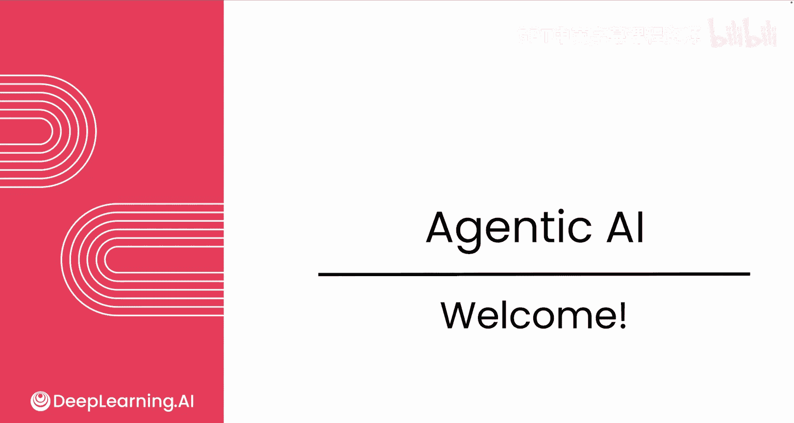
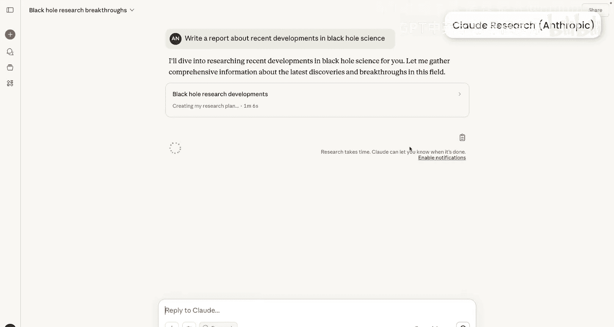
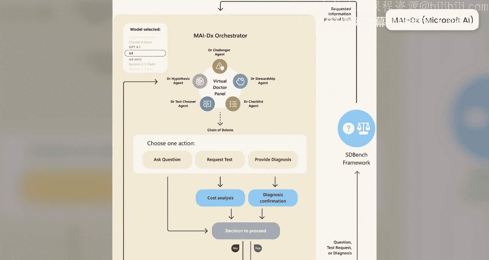

# 吴恩达《代理式AI：模块1-5｜Agentic AI 》中英字幕 - P1：1.welcome.zh_en - GPT中英字幕课程资源 - BV1hv4rz9EDn

Welcome to this course on agent Gentic AI When I coined the term agent Gentic to describe what I saw as an important and rapidly growing trend in how people were building own based applications。

 what I did not realize was that a bunch of marketers would get hold of this term and use it as a sticker and put this on almost everything in sight and that has caused hype on agenttic AI to skyrocket。

😊。

The good news though is that ignoring the hype， the number of truly valuable and useful applications built using agent AI has also grown very rapidly。

 even if not quite as rapidly as the hype and in this course。

 what I'd like to do is show you best practices for building agent AI applications and to open up a lot of new opportunities to you in terms of where you can now build today。

 agent workflows are being used to build applications like customer support agents or to do the research to help write deeply insightful research reports or to process tricky legal documents or to look at patient input and render or to suggest possible medical diagnoses on many of my teams。

 a lot of projects we build just would be impossible with agent workflows and so knowing how to build applications with them is one of the most important and valuable skills in AI today it turns out that one of the biggest differences I've seen between people that really know how to build。

flows compared to people that are less effective at it is the ability to drive a disciplined development process。

 specifically one focus on Evals and error analysis and in this course I'll tell you what that means and show you what allows you to be really good at building these agent workflows。

Be able to do this is one of the most important skills in AI today and will open up a lot more opportunities。

 be job opportunities or opportunities to just build amazing software yourself With that let's go into the next video to dive more into1R agentNic workloads。

