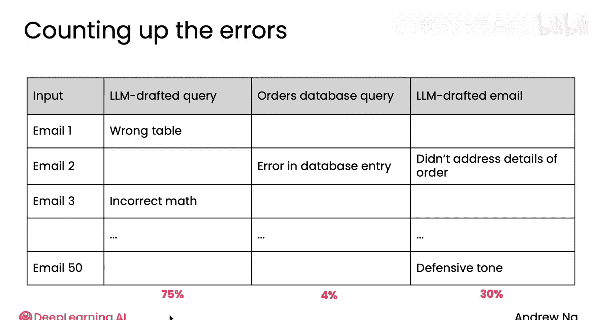

# 吴恩达《代理式AI：模块1-5｜Agentic AI 》中英字幕 - P20：3.more-error-analysis-examples.zh_en - GPT中英字幕课程资源 - BV1hv4rz9EDn

I found that for many developers is only by seeing multiple examples that you can then get practice in whole new intuitions about how to carry out error analysis so let's take a look at two more examples and we'll look at invoice processing and responding to customer emails Here's the workflow that we had for invoice processing where we had a clear process to follow an agent workflow of identifying the fourrequi fields and then recording them in a database in the example from the first video of this module we said that the system was often making a mistake in the due date of the invoice so we can carry error analysis to try to figure out which of the components it may have been due to So for example。

 the PDF to text make a mistake or the DLM extract the wrong date all of whatever was output from the PDF to text component to carry an error analysis I would try to find a number of examples where the data extractor is incorrect so same as last video is useful。

To focus on the examples where the performance is subpar to try to figure out what went wrong with those examples I ignore the examples that got the date right but try to find somewhere between 10 and 10 invoices where've got the date wrong and then I would look through to try to figure out was the cause of the problem that PDF to text got the date wrong or was it that the LOM given the PDF to text output pulled out the wrong date and so you might build up a low spreadsheet like this and go through 20 invoices and just count up how often the PDF to text extract the dates or the text incorrectly so that even a human couldn't tell whether is the due date versus the PDF to text look good enough but the LM when I support the date somehow pulled out the wrong date like maybe identifying the invoice date rather than the due date of the invoice So in this example it looks like the LM date extraction was responsible for a lot more errors so this tells me that maybe I should focus my efforts on the date extraction component rather than on PDF to text。

And this is important because if not for this error analysis。

 I can imagine some teams spending weeks or months trying to tune the Pf text only to discover after that time that it did not make much of the impact to the final systems performance or by the way。

 these percentages here at the bottom can add up not to 100% because these errors are not mutually exclusive to look at one last example。

 let's go back to the HIV workflow for responding to customer emails where the LOM。

 given a customer email like this， asking up an order would pull up the order details fetched the information or a database。

 then draft response for a human to review。 So again I would find a number of examples where for whatever a reason the final output is unsatisfactory and then try to figure out what had gone wrong and so some things that could go wrong maybe the LOM had written an incorrect database query So when the query was sent to the database。

 it just did not successfully。P up the customer info or maybe the database has corrupted data。

 So even though the OM wrote a completely appropriate database query。

 maybe in SQL or some of the query language， the database did not have the correct information or maybe given the correct information about the customer order。

 the LM wrote an email that was somehow not quite right。 So again。

 I would look through a handful of emails where the final output was unsatisfactory and trying to figure out what had gone wrong。

 So maybe an email one， we find that the OM had asked for the wrong table in the query just asked the wrong data in a way query the database in email2。

 maybe I find that the database actually has an error and maybe given that input。

 the somehow wrote sub email as well and so on。 and in this example， after going through many emails。

 maybe I find that the most common errors is in the way the Lm is writing a database query。

 say a SQL query in order to fetch the relevant information whereas the database is most。

correctect there's a little bit of data errors there and the way the write email also has some errors。

 maybe it doesn't quite where they write30% of the time。

 and this tells me that it'd be most worthwhile， maybe for me to improve the way them is writing queries second most important would be maybe improve the prompting for high write to final email that an analysis like this can tell you that 75% of the errors maybe the system gets lots of things right。

 but all the things it gets not quite right75% the problems is from the database query this is incredibly hopeful information to tell you where to focus your when I'm developing a GenI workflows。

 I often use this type of error analysis to tell me where to focus my attention in terms of what to work on when you've made that determination it turns out that to complement the end to end es that we spoke about early in this module it's often useful to evaluate not just the entire endto end system but also individual components because that can make。

More efficient in how you improve the one component that say error analysis has caused you to decide to focus your attention on。

So let's go to the next video to learn about component level Es。😊。

