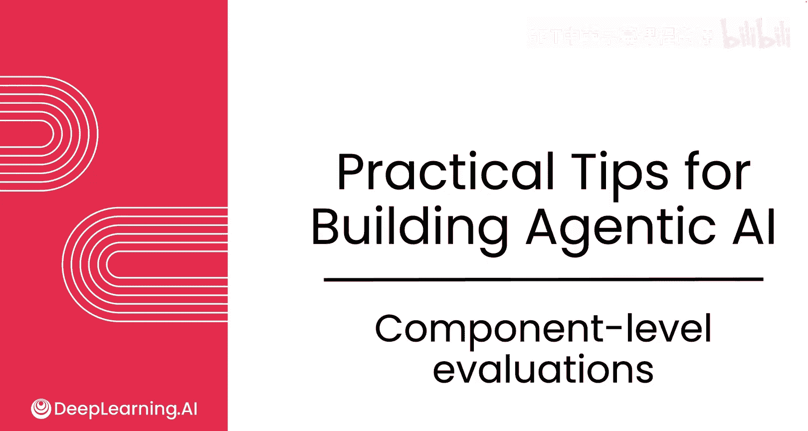
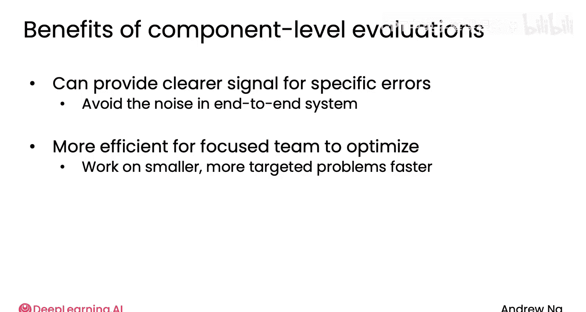

# 吴恩达《代理式AI：模块1-5｜Agentic AI 》中英字幕 - P21：4.component-level-evaluations.zh_en - GPT中英字幕课程资源 - BV1hv4rz9EDn

Let's take a look at how to build and use component levell Evals In our example of a research agent we said that the research agent was sometimes missing key points。

 but if the problem was web search if every time we change the web search engine we need to rerun the entire workflow that can give us a good metric for performance but that type of Eval is expensive more this is a pretty complicated workflow so even if web search made things a little bit better。

 maybe noise introduced by the randomness of other components would make it harder to see little improvements to the web search quality So as an alternative to only using endend Evals。

 what I would do is consider building an EV just to measure the quality of the web search component For example。

 to measure the quality of the web search results you might create a list of go standard web resources so for a handful of queries have an experts say these are the most authoritative sources that if someone was searching。

Inter， they really should find these web pages or any of these web pages would be good。

 and then you can write code to capture how many of the web search outputs correspond to the go standard web resources the standard metrics from information retrieval like F1 score don't worry about the details if you don't know what that means but there are standard metrics that allow you to measure of a list of web pages returned by web search how much does that overlap with what an expert determine are the go standard web resources with this。

 you're now armed with a way to evaluate just the quality of the web search component And so as you vary the parameters or hyperpar of how you cover web search such as if you swap in and out different web search engines So maybe try Google and Bing Dta go in T and you do common and others or as you vary the number of results or as you vary the date range that you ask web search engines to search over this can very quickly let you judge if the quality of the web search component is going up and does make。

Increment improvements and then of course before you call the job done。

 it would be good to run an end to end Evalal to make sure that after tuning your web search system for a while that you are improving the overall system performance but during that process of tuning these hyperparms one at a time you could do so much more efficiently by eval just one component rather than needing to re-run end to end Evals every single time So component level evals can provide a clearer signal for specific errors it actually lets you know if you're improving the web search component or whatever component you're working on and avoid the noise in the complexity of the overall end to end system and if youre work on a project where you have different teams focus on different components。

 it can also be more efficient for one team to just have its own very clear metric to optimize without needing to worry about all of the other components and so this less a team work on a smaller more targeted problem faster So when you've decided。

Work on improving a component， consider if it's worth putting in place a component wise eval。

 and if that would let you go faster on improving the performance of that component。😊，Now。

 the one thing you may be wondering is if you decided to improve a component。

 how do you actually go about making that one component work better。

 Let's take a look at some examples of that in the next video。😊。

