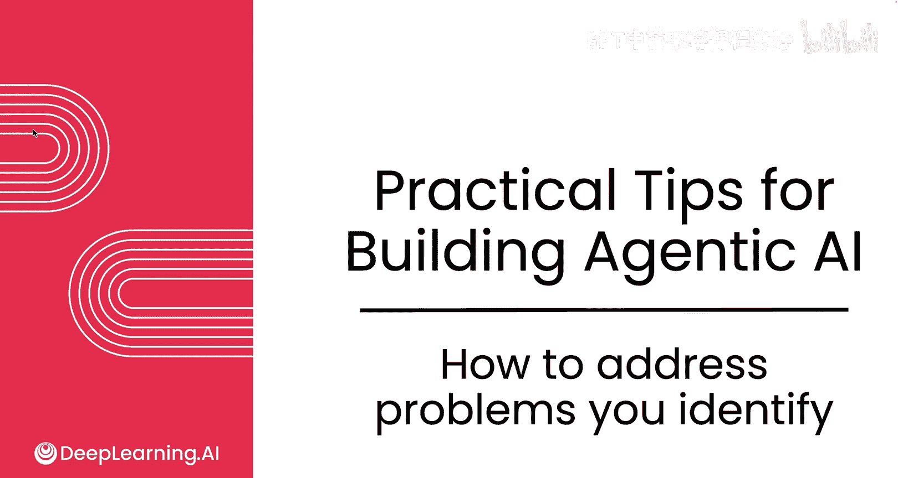
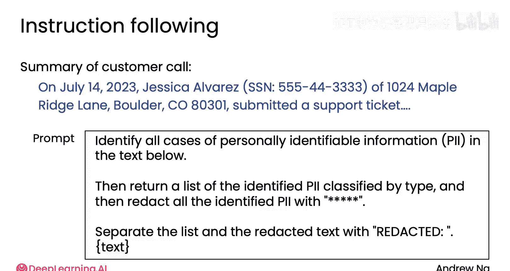
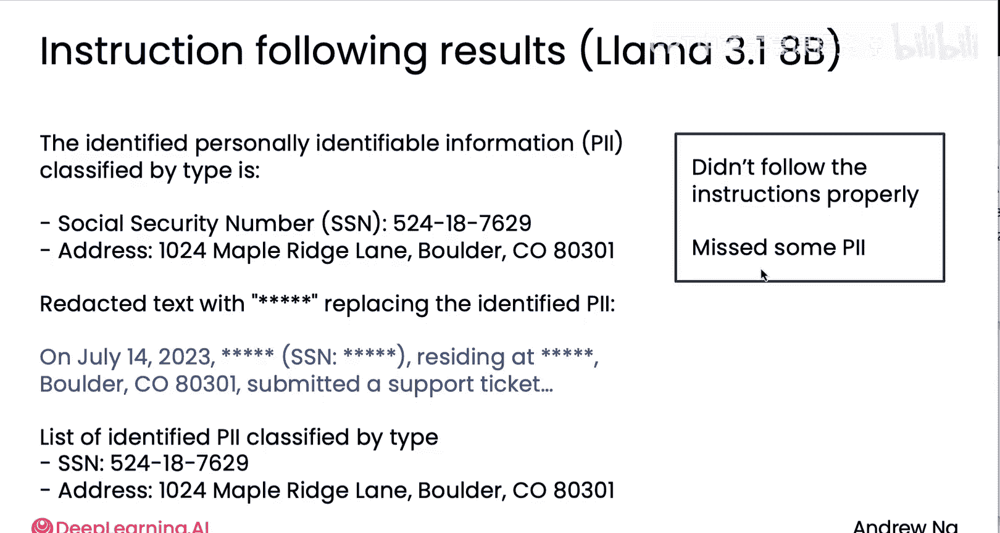
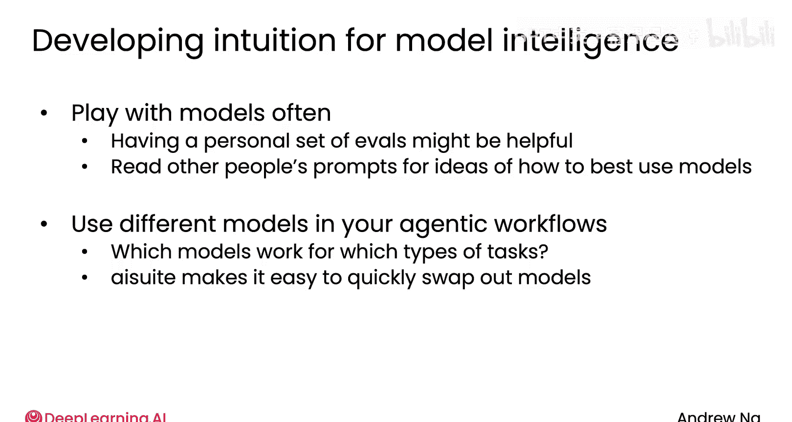

# 吴恩达《代理式AI：模块1-5｜Agentic AI 》中英字幕 - P22：5.how-to-address-problems-you-identify.zh_en - GPT中英字幕课程资源 - BV1hv4rz9EDn

An agent workflow may comprise many different types of components。

 and so your tools for improving different components will be pretty different。

 but I'd like to share with you some general patterns I've seen。 Some components。

 your agent workflow will be non O based So it may be something like a web search engine or a text retrieval components if that's part of your or retrieval of mentalgene system Some people codeex or maybe a separately trained machine learning model。

 maybe a speech recognition or detecting people pictures and so on。

 So sometimes these nono based components will have parameters or hyperpar that you can tune So the website you can tune things like the number of results or maybe the date range that you ask a web search engine to consider for a text retrieval components。

 you might change the similar official that determines what pieces of text consider similar or the chunk size often rack systems will take texting chop it up into smaller chunks for matching。

 So the many hyperpar you could use or。

For pupil detectionuction you might change the detection threshold so how sensitive it is and how likely it is to declare this found person and this would trade off the false causess in false negatives。

 If they didn follow all the details of the hyper parameterss I just discussed don't worry about it the details aren't that important but often the components where parameters that you can too and then of course you can also try to replace the component I do it a lot in my agent workflows where I'll swap in different rack search engines or swap in different rack providers and so on just to see if some other provider might work better because of the diversity of nonOMbased components。

 I think the techniques for how to improve it will be more diverse and dependent of exactly what that component is doing for an OMbased components here are some options you might consider one would be to try to improve your prompts so maybe try to add more explicit instructions or if you know what few short prompting is that refers to adding one or more concrete examples of an example of an input and the design。

Oput and so few sharp prompting， which you can learn about from some deep blend eye short courses as well is a technique that can give your OEMM some examples to hopefully help it get better performing Ops written or you can also try a different O So with AI suite or other tools it could be pretty easy to try multiple OMs and you can use evals to pick the best model for your application sometimes if a single step is too complex for one OM to do。

 you can consider if you want to decompose the tasks into smaller steps or maybe decompose it into a generation step and then a reflection step but more generally if you have instructions that are very complex all within one step。

 maybe a single OM has a hard time following all those instructions and if you break the tasks down to smaller steps that may be easier for say two or three calls an OM to carry out accurately and lastly something to try when the other methods aren't working well enough is to consider fine tuning a model this tends to be quite a bit。

More complex than the other options so it can be quite a bit more expensive as well in terms of developer time to implement。

 But if you have some data that you can use to finet an Om on that could give you much better performance than prompting alone So I tend not to fine tune model until I've really exhausted the other options because fine tuning tends to be quite complex but for applications where after trying everything else if I'm still at say 90% performance or 95 performance and I really need to e those last few percentage points of improvement and sometimes fine tuning my own custom model is a great technique to use I tend to do this only on the more mature applications because how costly it is。

 it turns out that when youre trying to choose an own to use one thing that's very hopeful for you as a developer is if you have good intuitions about how intelligence or how capable different large language models are One thing you can do is just try a lot of models and see what works best I find that as I work。

different models。 I start to hone intuitions about which models work best for what types of tasks and we hone those intuitions。

 you can be more efficient as well in writing good prompts for the model as well choosing good models for your task。

 So I'd like to share with you some thoughts on how to hone your intuition on what models will work well for your application。

 Let's illustrate this with an example of using an Lm to follow instructions to remove or to redact PI or personally identifiable information So get on to remove private sensitive information。

 For example， if you are using an Om to summarize customer calls Then maybe one summary is on July 1423 Jessica Alvarez or Social security number and certain edge of the support ticket and so on。

 So this piece of text has a lot of sensitive， personally identifiable information。 Now。

 let's say we want to remove all Pi from such summaries because we want to use the data for downstream。

sysical analysis of what customers are calling about and to protect customer information we want to strip out that PII before we do that downstream statistical analysis。

 so you might prompt an O with instructions to identify all cases of PII in the text below and then return to redacted texts with redacted colon and so on。

It turns out that the larger frontier models tend to be much better at following instructions。

 whereas the smaller models tend to be pretty good at answering simple factual questions。

 but I just not as good at following instructions If you run this prompt on the smaller model the open way long 3。

1 model with a and parameters， then it may generate an output like this。

 It says the identify PII is social security number and address and then it redacted as follows and so on。

 and that makes a few errors。 It didn't follow the instructions properly it showed the list then redacted the text then return another list which it wasn't supposed to and in this list of PII and missed the name and then I think it also didn't redact part of the address So details areim but didn't follow these instructions perfectly and maybe miss a little bit of PII In contrast。

 if you used a more intelligent model one that's better at following instructions you may get a better result like this whereas actually correctly listed all the PII and correct。

redacted all of the PI and so I find that as different OM providers specialize on different tasks。

 different models really are better for different tasks， some are better coding。

 some are better follow instructions some are better at certain niche types of facts and you can hone your intuition for what models are more or less intelligence and what instructions they're more or less able to follow。

 then you be able to make better decisions as to what models to use So to share a couple tips on how to do this。

 I encourage you to play with different models often so whenever it does a new model release。

 I'll often go try it out and try out different queries on it way proprietary models as well as open way models and I find that sometimes having a personal set of evals might also be where there's a certain things you ask a lot of different models that might help you calibrate how well they do on different types of tasks one of the thing that I do a lot that I hope would be useful to you is I spend a lot of time。

Other people's prompts。 So sometimes people publish their prompts on the Internet or often go read them to understand what best practices in prompting looks like。

 or often chat to my friends at various companies， including some of the frontier model companies and kind of share my prompts with them take a look at how they prompt。

And sometimes I'll also go to open source packages written by people I read respect and download the open source package and dig through that open source package to find the prompts the authors have written in order to read it in order to hold my intuition about how to write good prompts。

 This is one technique that encourage you to consider is by reading lots of other people's prompts that will help you get better at writing prompts yourself and I certainly do this a lot and I encourage you to do so too and this will hone your intuition about what types of instructions。

 models are good at following and when to say certain things to different models in addition to playing with models and reading other people's prompts if you try out lots of different models your agent workflows that also lets you hone your intuition。

 So you see which models where best which types of tasks and either looking at traces to get an informal sense or looking at either componentwise or and evals can help you assess how well different models are working for。

workflow and then you start to home intuitions about not just performance but maybe also price and speed trade offs for the use of different models。

 and one of the reasons I tend to develop my agent workflows of AI suite is because it then makes it easy to quickly swap out and try out different models and this makes me more efficient in terms of trying out and assessing which models work best for my workflow。

 So we've talked a lot about how to improve the performance of different components to hopefully improve the overall performance of your end to end system in addition to improving the quality of the output one of thing you might want to do in your workflows is to optimize the latency as well as cost。

 I find that for a lot of teen when you start developing usually the number one thing to worry about is just are the output sufficiently high quality。

 But then when the system is working well and you put in the production then it' often value to make it run faster as well as run at lower cost。

As well， so in the next video， let's take a look at some ideas for improving costs and latency for agentic rep bills。

