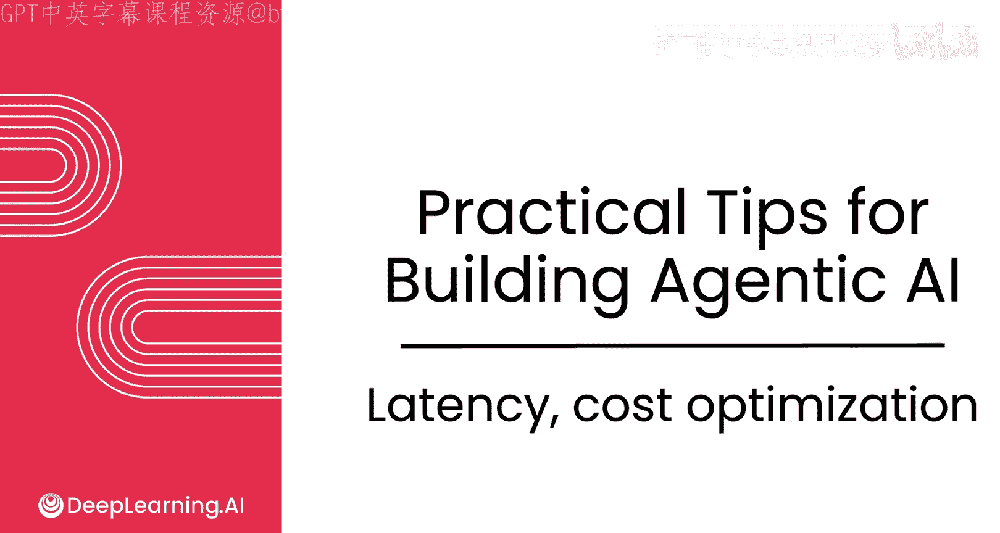
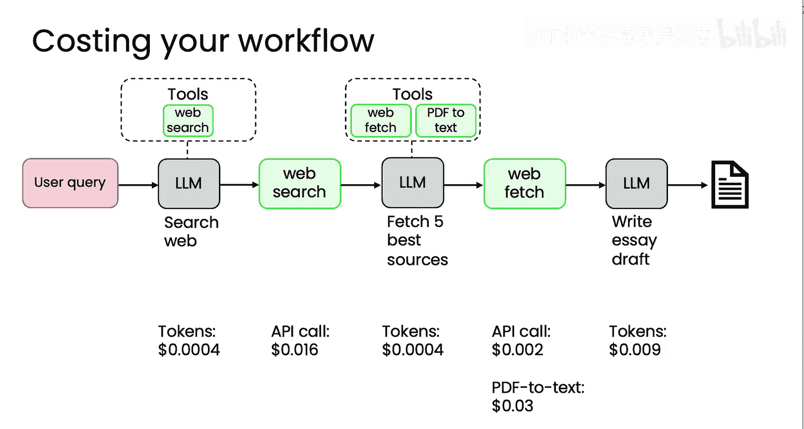

# 吴恩达《代理式AI：模块1-5｜Agentic AI 》中英字幕 - P23：6.latency,-cost-optimization.zh_en - GPT中英字幕课程资源 - BV1hv4rz9EDn

When building agent workflows are often advised teams to focus on getting high quality upwards and to optimize cost and latency only later。

 It's not that cost and latency don't matter， but I think getting the performance or the output quality to be high is usually the hardest part and then only when it's really working。

 then maybe focus on the other things。 one thing that's happened to me a few times was my team build an agent workflow and we ship to the users and then we're fortunate enough to have so many users use it that the cost actually became a problem and then we had to scramble to bring the cost back down but that's a good problem to have So I tend to worry about costs usually loss not ignore completely。

 but it's just lower down my list of things to worry about until we' have so many users really need to bring the cost down per user and then latency I tend to worry a bit about it but again not as much as just making sure the output quality is high but when。

Do get there。 It will be useful to have tools to optimize latency and cost。

 Let's take a look at some ideas on how to do that。

 If you want to optimize the latency of an agent workflow， one thing I will often do is then。

Benchmark or time the workflow。 So in this research agent， it takes a number of steps。

 And if I were to time each of the steps， maybe the takes seven seconds to generate the search them web search takes5 seconds the 63 seconds to takes11 seconds and then writing the final essay takes 18 seconds on average And it is then by looking at this overall timeline that I can get a sense of which components have the most room for making faster in this example。

 there are maybe multiple things you could try， if you haven't already taken advantage of parallelism for some steps like maybe what fetch maybe it' worth considering doing some of these operations in parallel or if you find that some of the Lm sets are taking too long。

 So if this first step takes 7 seconds， this last step takes 18 seconds。

 I might also consider trying a smaller， maybe slightly less intelligent model to see if it's still worth well enough for that or if I can find a faster OM provider。

The loss of API is online for differentM interfaces and some companies have specialized hardware to allow them to serve certain Elms much faster so sometimes it's worth trying different OEMM providers to see which ones can return tokens the fastest but at least doing this type of timing analysis can give you a sense of which components to focus on in terms of reducing latency in terms of optimizing costs a similar calculation where you calculate the cost of each step would also lets you benchmark and decide which steps to focus on many OEMM providers charge per token based on the input and output length。

 many API providers charge per API call and the computational steps may have different costs based on how you pay for server capacity and how much the service cost and so for process like this you might decide in this example that the tokens for this step on average cost 0。

004 cents each web search API maybe cost 1。6 cents tokens cost。

API costs this much Pf to text cost this much tokens for the final essay generation costs this much and this would maybe again give you a sense of are there cheaper components you could use or cheaper Os you could use to see where the biggest opportunities for optimizing costs and I found that these benchmarking exercises can be very clarifying and sometimes so clearly tell me that certain components are just not worth worrying about because they're not that material or contributor to either cost or to latency So I find that when neither costs or latency becomes an issue I simply measuring the cost and or latency of each step that often gives you a basis with which to decide which components to focus on optimizing。

So we're nearly at the end of this module， I know we've covered a lot。

 but thank you for sticking with me， let's go to the final video of this module to wrap up。😊。

