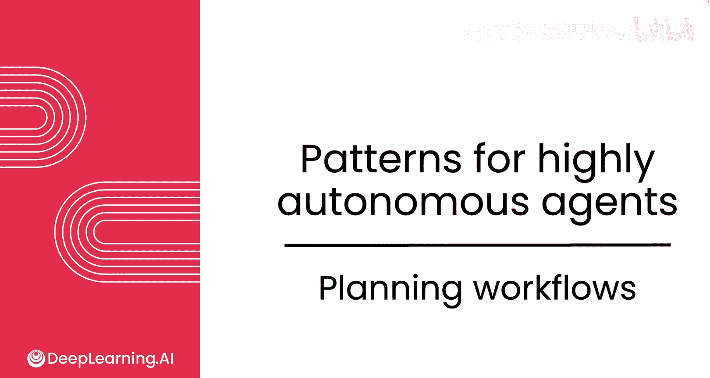
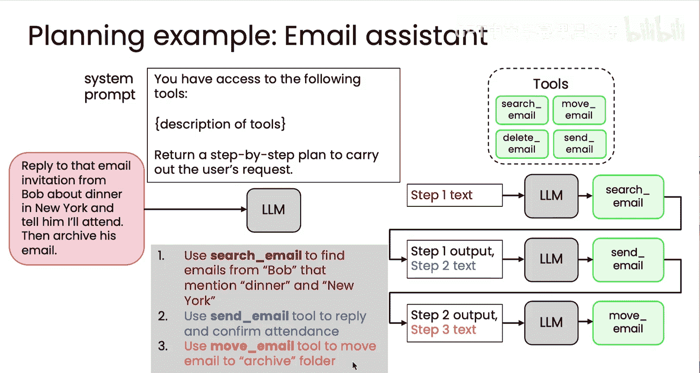

# 吴恩达《代理式AI：模块1-5｜Agentic AI 》中英字幕 - P24：1.planning-workflows.zh_en - GPT中英字幕课程资源 - BV1hv4rz9EDn

Welcome to this final module where you learn about design patterns that lets you build highly autonomous agents where you don't need to hardcode and events the sequence of steps to take that can be more flexible and decide for itself what steps it wants to take to accomplish a task or talk about the planning design pattern and then latent this module how to build multiagent systems。

 Let's dive suppose you run a sunglasses retail store and have information on what sunglasses are in your inventory stored in a database You might want a customer service agent to going answer questions like do you have any round sunglasses in stock are under $100。

 This is a fairly complex query because you have to look through the product descriptions to see what sunglasses around then look at what is in stock and then finally see what's under $100 in order to tell the customer Yes。

 we have classic sunglasses。 So how do you build an agent to answer a broad range of customer。

Quries like this and many others in order to do so。

 we're going to give the LM a set of tools to let it get item descriptions。

 such as lookup with different glasses around check inventory maybe process item returns which is not needed for this query。

 but we need it for other queries， get item price check past transactions process item sale and so on。

 in order to let an LM figure out what's the right sequence of tools to use to respond to the customer request。

 you might then write a prompt like this。 you have access to the following tools and give it the description of each of say six tools or even more tools that the LM has and to then tell it to return a step bystep plan to carry out the user' request in this case to answer this particular query。

 a reasonable plan that an Lmi output might be to first use get item descriptions to check the different descriptions to find around sunlasses and then。

Check inventory to see if you're in and use get item price to see if the in results are less than $100 After an LM outputs this plan with three steps。

 what we can do is then take the step1 text that is this text written here in red and pass that to an Lm maybe of additional context about what are the tools with the user query with additional background context and toss an Lm to carry out step1 and in this case hopefully the will choose to call the get item descriptions to get the appropriate descriptions of items and the output of that first step can let it select which are round sunglasses and that output of step1 is then pass together with the step two instructions that would be these instructions that I have here in blue to an Lm to then execute the second step of the plan hopefully it will then take the two pairs around sunglasses we found on the previous slide and check the inventory and the output of that second step is then。

To another OEMM call where you have the output of the second step as well as the instructions of what to do for step three pass the OM to have it get the item price and finally this output is fed back to the one last time to generate the final answer for the user in this slide I've simplified a lot of details a little bit the actual planically written by the OM is more detailed in these simple one line instructions but the basic workflow is to have an LM write out multiple step of a plan and then task it to execute each step of the plan in turn with some appropriate surrounding context about what is the task whether the tool is available and so on and the exciting thing about using an OM to plan this way is that we did not have to decide in advance what is the sequence in which to call tools in order to answer a fairly complex customer request if a customer were to make a different request such as I would like to return the gold frame glasses that I had purchased。

But not the metal frame ones then you can imagine an OM similarly being able to come of a different plan to figure out based on what they had purchased previously which glasses they had bought based on get item descriptions with a go frame onces they want to return and then maybe call process item return So with an agent they can plan like this you can carry out a much wider range of tasks that can require calling many different tools in many different orders one more example of planning。

 let's take a look at an email assistant if you want to be able to tell your assistant to please reply to that email invitation from Bob Wal in New York to attend an archive's email then an email assistance may be given tools like this to search email。

 move an email delete lead an email and send an email and you might write an assistant problem saying you have access the following tools and again please return the step bystep plan in this case maybe the alarm will say the steps for this are to use search email to find the email from Bob dimension dinner and New York and then generate and send an email to confirm attendance。

Lastly， move that email to the archive folder given this plan， which looks reasonable one。

 you would then again task an OM step by step to carry out this plan so the text from the first step shown here in red will be fed to thelM with additional background context and hopefully trigger search email then the output of that can be given to an L again with the step two instructions to send appropriate response and then finally assuming the email was sent successfully。

 you can take that output and have the exclude the third step of moving the email from Bob into the archive folder the plan your design pattern is already used successfully in many highly agent coding systems where if you ask it to write the piece of software to build some fairly complex application it might actually come to a plan to build this component。

 build this component， build this component to almost form a checklist and then do those steps one at a time to build decently complex piece of software for many other。

The use of planning is still maybe more experimental。

 is now than very widespread use and one of the challenges of planning is it makes the system sometimes a little bit harder to control because you as a developer。

 you don't really know and run time what plan it will come up with。

 And so I think outside highly agent coding systems where it actually works really well adoption of planning is still growing in other sectors。

 but this an exciting technology and I think it will keep getting better and well see it in more and more applications The cool thing about building agents that can plan for themselves is you don't need to hard code and advance the exact sequence of steps and may take to carry out a complex task。

 Now I know that in this video I've gone over the planning process at a fairly high level I putting a list of steps and then tasking in an LM to carry out the steps of the plan one step at a time。

 But how does this actually work and the next video will take a deeper dive to look further into。

The guts of what these plans actually look like and how the strings together to have an L plan and execute the plan for you。

 Let's take a look at that in the next video。