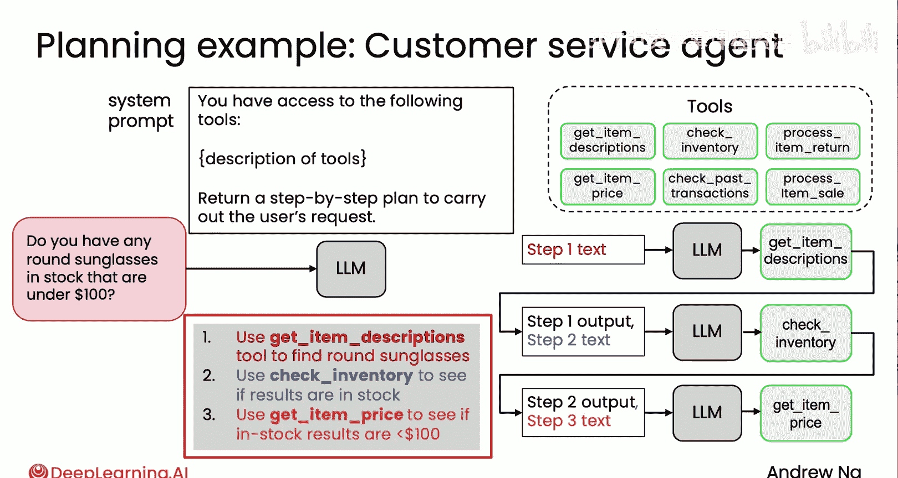
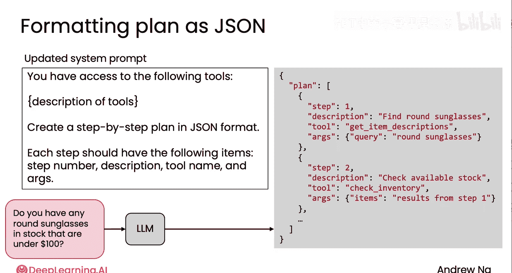

# 吴恩达《代理式AI：模块1-5｜Agentic AI 》中英字幕 - P25：2.creating-and-executing-llm-plans.zh_en - GPT中英字幕课程资源 - BV1hv4rz9EDn

In this video， we'll look in detail at how to prompt an norm to general plan and then how to read。

 interpret and execute that plan。 Let's dive in。😊。

This is a plan that you saw in the previous video for the customer service agent and I have presented this plan at a high level using simple text descriptions。

 let's take a look at how you can get an OEMm to write very clear plans that go a little bit beyond these simple highlevel text descriptions it turns out that many developers will ask an Elm to format the plan in once executed in JSON format because this allows downstream code to parse what exactly are the steps of a plan in a relatively clear and unambiguous ways and although the leading os are pretty good at generating JSON outputs at this point so the system prompt might say something like this you have access the final tools tools and then create a stepbystep plan in JSON format and you might describe the JSON format in enough detail with a go of getting it to output the plan like that shown here on the right So in this JSON output it creates a list where the first list item has clear keys and。

that say the step one of the plan has following a description and you should use the following two with the following arguments passed to that tool。

 Then after that step two， the plan is to carry out this task and then uses to and so on。

 So this JO format as opposed to writing the plan in English allows downstream code to more clearly pause all exactly whether the steps of the plan so that it can be reliably execute it one step at a time。

 instead of Jason， I also see some developers use Xml where you can use Xml delimmma or z use Xml tags to clearly specify whether the steps of the plan and what step number it is some developers I feel like fewer developers were use markdown。

 which is just sometimes slightly more ambiguous in terms of how we pause it and I think plain text is maybe the least reliable of these options but I think either JSO which I'm showing here or XM would be good options for how to author O to format a plan。

Unambiguously so that's it by opening plans in JSO。

 you can then pausesit and have downstream workflows execute different steps of the plan more systematically。

Now， in terms of giving Els a plan， it turns out there's one other really neat idea that lets an alarm output very complex plans and get them executed reliably。

 and that's an alarm write code and have code express the plan。

 Let's take a look at this in the next video。