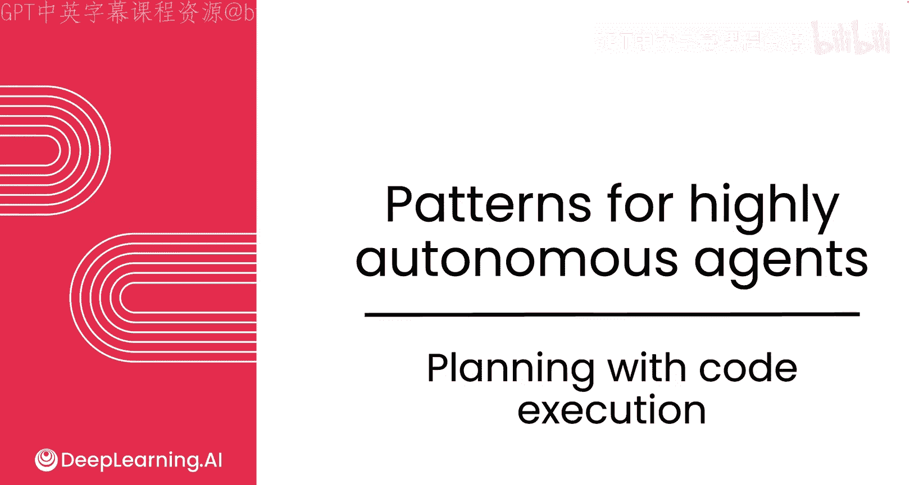
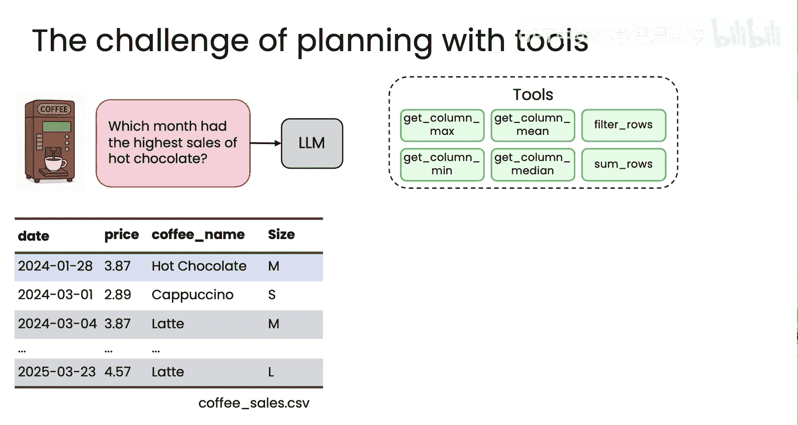
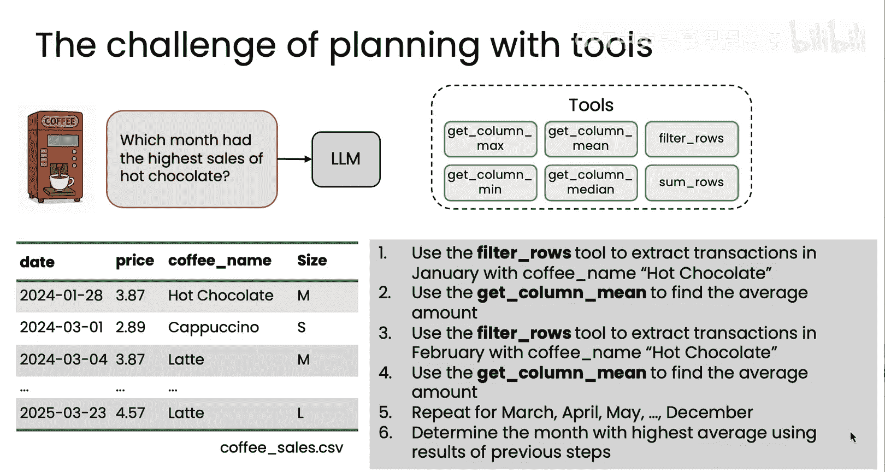
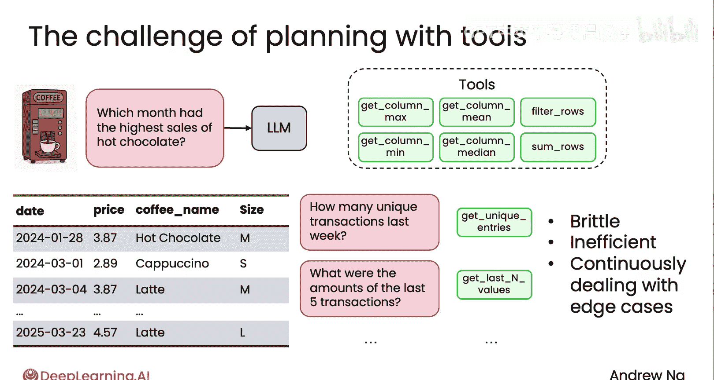
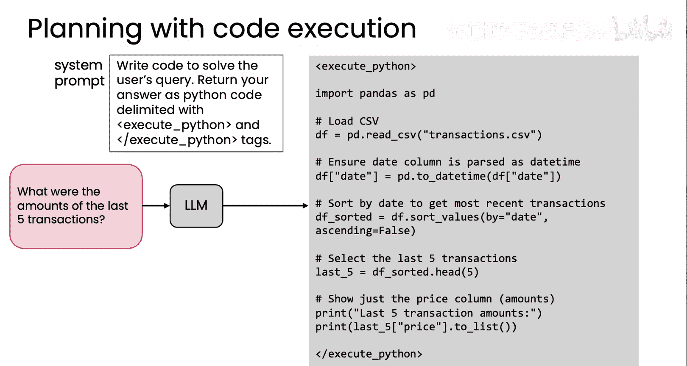
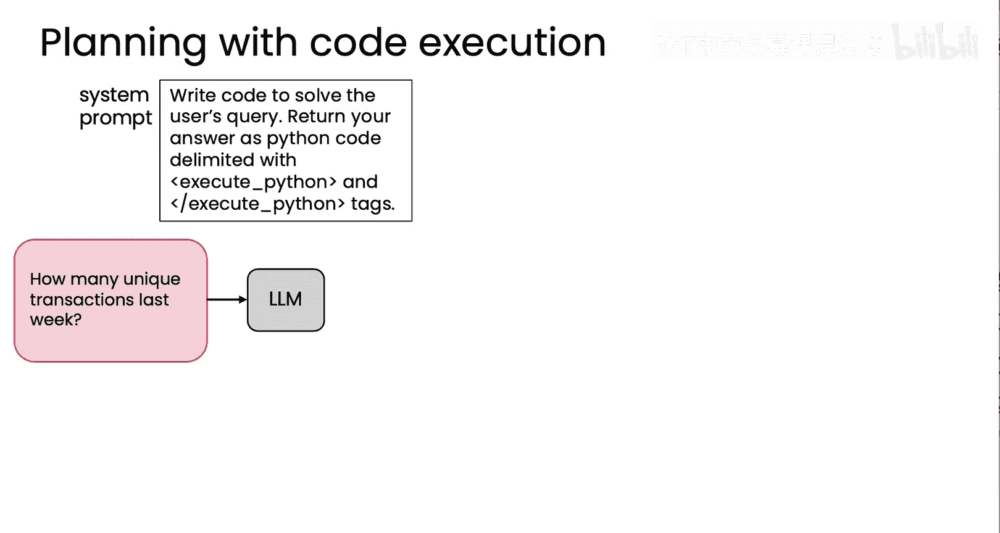
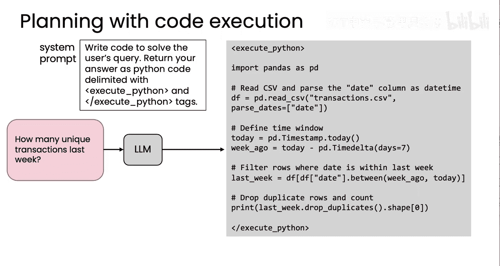
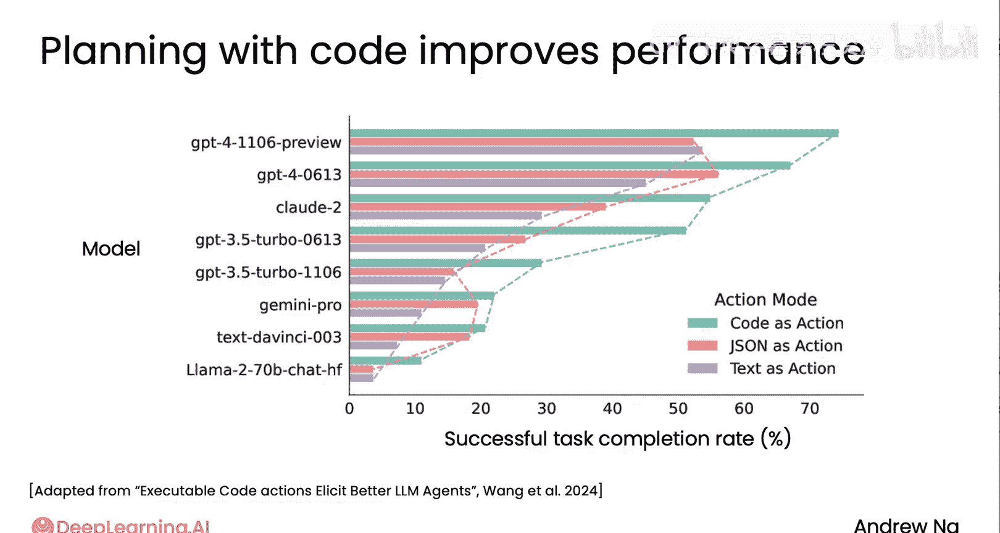

# 吴恩达《代理式AI：模块1-5｜Agentic AI 》中英字幕 - P26：3.planning-with-code-execution.zh_en - GPT中英字幕课程资源 - BV1hv4rz9EDn

Planning with code execution is the idea of that instead of asking an alarm to open a plan in say。

 Json format， execute one step at a time。

Why not have the L just try to write code and that code can capture multiple steps of the plan like call this function then call this function and call this function。

 and by executing code generated by the LM， we can actually carry out fairly complex plans。😊。

Let's take a look at when you might want to use this technique。

Let's say you want to build a system to answer questions about coffee machine sales based on a spreadsheet with data like this of previous sales。

 You might have an Lm with a set of tools like these to get column max to look at the certain column and get the maximum value so theres a whole answer what's the most expensive coffee or get column mean filter rows。

 get column in get column medium， some rows and so on。

 So these were examples of a range of tools you might give an Lm to process this spreadsheet or these rows and columns of data in different ways。

 Now if a user were to ask which month had the highest sales of hot chocolate。

 It turns out that you can answer this query using these tools， but it's pretty complicated。

 you'd have to use filter rows， extract transactions in January for hot chocolate。

 then do stats on that and every for February figure stats on that then repeat for March。

 repeat for April， repeat for May all the way through December and then take the max and so you can actually string together。

Pretty complicated process using these tools， but this is not such a great solution。

 but worse whether someone to ask how many unique transactions were they last week。 Well。

 these tools are insufficient to get that answer so you may end up creating a new tool get unique entries or you may run it in another query。

 what are the amounts the last five transactions， then you may have to create yet another two。

 to get the data to answer that query。 And in practice。

 I've seen teams when they run across more and more queries end up creating more and more and more and more tools to try to give the enough tools to cover all the range of things someone may ask about the dataset like this。

 So this approach is little inefficient and I've seen teams continuously dealing with edge cases and trying to create more tools。

 But it turns out there is a better way， which is if you were to prompt the OM to say please write code to solve the user's query and return your answer as Python code may be delim with these beginning an。

ending executeQ Python XMl tags， then theM can just write code to load the spreadsheet into a data processing library here is using the pandas library and then here it actually is coming up of a plan the plan is after loading the CSV first it has to ensure the data column is passed a certain way then sort by the date select the last five transactions show just the price column and so on。

 but these are the steps 1，2，3 and 4 and 5， say of the plan because a programming language like Python and in this example also with the pandas data processing library imported because this has many built-in functions。

 hundreds or even thousands of functions and moreover these are functions that the OM has seen a lot of data on how to call when by letting your O write code it can choose from these hundreds or thousands of relevant functions that is already seen a lot of data on when to use。

This lets it string together different choices of functions to call from this very large library in order to come up with a plan for answering a fairly complex query like this。

 Just one more example， if someone to ask how many unique transactions last week。

 Well you can come with a plan to read the CSsD file pass the day column。

 define find the time window， filter rows drop to rows in count， the details of design importance。

 but hopefully we can see is if you read the comments here。

 the Om is roughly coming up with a fourstep plan and is expressing each of the steps in code that you can then just execute and this will get the user their answer。

 So for applications where the task can plausibly be done by writing code。

 letting an LM express its plan in software code that you can just execute for the OM can be a very powerful way to let it write rich plans and of course。

 the caveat that I mentioned。

In the module to use to consider if you need to find a safe execution environment like a sandbox to run the code that also applies。

 although I know that even though it's probably not the best practice。

 I also know a lot of developers that don't use a sandbox。 Lastly。

 it turns out that planning with code works well from the sidegram adapted from a research paper by Xyao Wang and others。

 you can see that for many different models for the tasks that they examined code as action in which the OM is invited to write code and take actions through code that is superior to having it write JSson and then translate Json into action or text。

 and you also see a trend that。

Writing code outperforms having their own write a plan in JSson and writing a plan in JSsonN is also the better they're writing a plan in just plain text。

 Now， of course， there are applications where you might want to give your custom tools to an on to use and so writing code isn't for every single application but when it does apply it can be a very powerful way for an norm to express a plan。

 So that wraps out the section on planning Today， one of the most powerful users of agent AI that plans is highly agented software coders。

It turns out that if you ask one of the highly agented software coding systems tools to write a complex piece of software for you。

 it may come up with a detailed plan to build this component of the software first and build a second component and the third maybe even plan to test out the components is going along and that it forms a checklist that then goes through to execute one step at a time and so it actually works really well for building increasingly complex pieces of software for other applications I think the user of planning is still growing and developing one of the disadvantages of planning is that because the developer doesn't tell the system what exactly to do is a little bit harder to the control and you don't really know in advance will happen at runtime but giving up some of this control。

 it does significantlyly increase the range of things to the model may decide to try out So it's important technology is kind of cutting edge doesn't feel completely mature outside of maybe agent gen coding where it works。

Well， although I'm sure there's still a lot of room to grow。

 but hopefully you enjoy using it in some of your applications someday。

That wraps up planning there one last design pattern I hope to share you in this module。

 which is how to build multiag systems， we have not just one agent but many of them working in collaboration to complete the task for you let's take a over look at bat in the next video。

