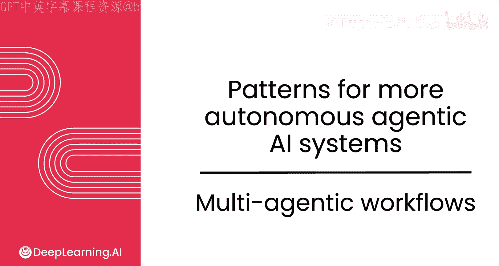
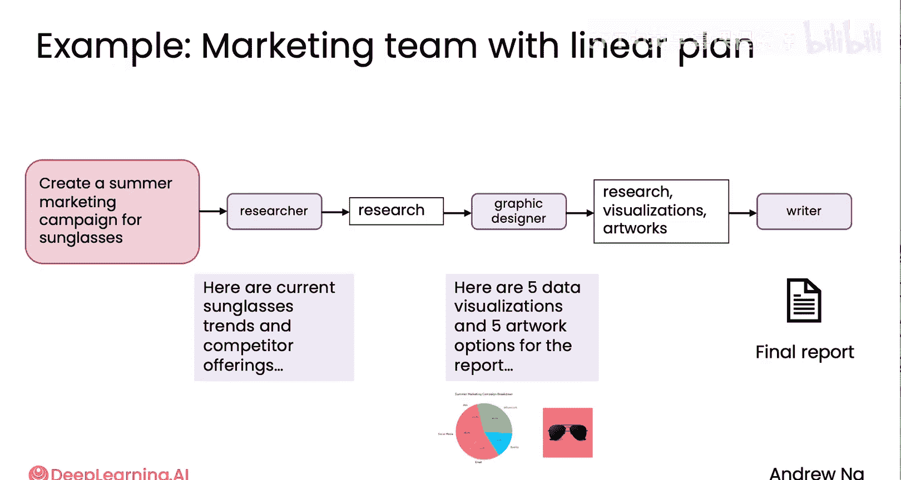
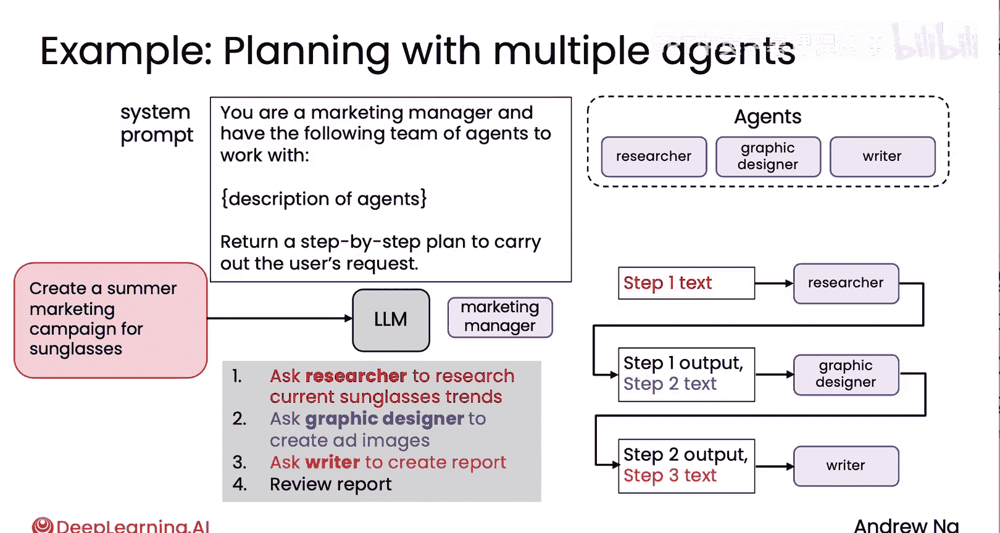

# 吴恩达《代理式AI：模块1-5｜Agentic AI 》中英字幕 - P27：4.multi-agentic-workflows.zh_en - GPT中英字幕课程资源 - BV1hv4rz9EDn

We're talking a lot about how to build a single agent to complete tasks you。

In a multi agent or multi agent workflow， we instead have a collection that multiple agents collaborate to do things for you。

When some people hear for the first time about multi agent systems。

 they wonder why do I need multiple agents is just the same LLM that I'm prompting over and over with just one computer。

 why do I need multiple agents？I find that one useful analogy is even though I may do things on a single computer。

 we do decompose work in a single computer into maybe multiple processes or multiple threads and as a developer thinking even those one CPU on a computer say thinking about how to take work and decompose it into multiple processes or multiplecomputer programs to run。

 that makes it easier for me as a developer to write code and in a similar way too。

 if you have a complex task to carry out sometimes instead of thinking about how to hire one person to do it for you。

 you might think about hiring a team of a few people to do different pieces of the task for you and so in practice I found that for many developers of agentanttic systems having this mental framework of not asking what's the one person I might hire to do something than instead but it makes sense to hire people with three or four different roles to do this overall task for me。

 that hopes。Given another way to take a complex thing and decompose it into subtask and to build for those individual subts one at a time。

 Let's take a look at some examples of how this works。 Take the task of creating marketing assets。

 say you want a market sunglasses Can you come with a marketing brochure for that。

 you might need a research on your team to look at trends and sunglasses and what competitors are offering。

 you might also have a graphic designer on your team to render charts or nice looking graphics of your sunglasses and then also writer to take the research。

 take the graphic assets and put all together into nice looking brochure or to write a research article。

 you might want a researcher to do online research， statician to calculate statistics。

 a lead writer and an editor to cover the polish report or to prepare legal case real law firms or often have associates。

 paralegals， maybe an investigator and we naturally because of the way human teams do work。

 can think of different ways that。Complex tasks can be broken down into different individuals with different roles。

 so these are examples of when a complex tasks were already naturally decomposed into subtask that different people with different skills can carry out take the example of creating marketing assets look into detail into whether researcher graphic designer and writer might do a researcher might have the task of analyzing market trends and researching competitors and when designing the research agent。

 one question to keep in mind is whether are the tools that the researcher may need in order to come up with a research report or market trends and what competitors are doing so one natural tool that a agentic researcher might need to use would be web search just as a human researcher asked to do these tasks might need to search online in order to come up with their report or for a graphic designer agents they might be tasked with creating visual。

And artwork and so what are the tools that a agent software graphic designer might need， well。

 they may need an image generation and manipulation APIs or maybe similar to what you saw with the coffee machine example。

 maybe in needs code execution to generate charts。 And lastly。

 the writer has transformed the research in the report text and marketing copy and in this case they don't need any tools other than what an LM can already do to generate text in this in the next video I'm going to use these purple boxes to denote an agent and the way you build individual agents is by prompting an LOM to play the role of a researcher or a graphic designer or writer depending on which agent it is part of So for example。

 for the research agent you might prompt it to say you are a research agent except the analyzing market trends in competitors carry out online research to analyze market trends for the sunglasses product and。

summaryumary as well of what competitors are doing so that would allow you to build a researcher agent and similarly by prompting an LM to act as a graphic designer with your appropriate tools and to act as a writer that's how you can build a graphic designer as well as a writer agent having built these three agents one way to have them work together to generate your final report would be to use a simple linear audit workflow or a linear plan in this case so if you want to create a summer marketing campaign for sunglasses。

 you might give that prompt to the research agents。

 the research agent then write a report that says here the current sunglasses trends and competitive offerings this research report can then be fed to the graphic designer that looks at the data the research is found and creates a few data visualizations and artwork options all these assets can then be passed to the writer that then takes the research and the graphic output and write。

The final marketing brochure the advantage of building a multi-agent workflow in this case is when designing a researcher or graphic designer or writer。

 you can focus on one thing at a time so I can spend some time building maybe the best graphic designer agents I can while maybe my collaborators are building research agents and write agents and then in the end we string it all together to come up with this multiagent system and in some cases I'm seeing developers start to reuse some agents as well so having built a graphic designer for marketing brochures。

 maybe I'll think about if they can build a more general graphic designer。

 they can help me write marketing brochures as well as social media pose as well as help me illustrate online web pages so by coming up with whether the agents you might hire to do a task and this will sometimes correspond to who are the types of human employees you might hire to do a task you can come up with a workflow。

Like this with maybe even building agents that you could choose to reuse in other applications as well。

 Now， what you see here is a linear plan where one agent， the researcher does this work。

 then the graphic designer and in the writer with agents you can also as an alternative to a linear plan you can also have agents interact with each other in more complex ways。

 let me illustrate an example of planning using multiple agents。

 So previously you saw how we may give an OM a set of tools that they can call to carry out different tasks in what I want to show you we will instead give an OM the option to call on different agents to ask the different agents to help complete different tasks So in detail you might write a prompt like your marketing manager and the following team of agents to work with and then give a description the agents and this is very much similar to what we're doing with planning and using tools except the tools the green boxes are replaced with agents。

 these purple boxes that the can call on。

And then we'll ask it to return the stepbystep plan to carry about the user' request and in this case。

 the may ask the researcher to research current sunglasses trends and a report back。

 then it'll ask the graphic designer to create the images and the report back and ask the writer to create a report and then maybe the will choose the review or reflect on and improve the report one final time in executing this plan you would then take the set one text so the researcher carry out research then pass that to the graphic designer。

 pass it to the writer and they maybe do one final reflection step and then you'd be done one interesting view of this workflow is as if you have these three agents up here。

 but this OEM on the left is actually like a fourth agent。

 there's a marketing manager that is a manager of a marketing team that is setting direction and then delegating task to the researcher。

 the graphic designer and the write agents so this becomes actually a collection of four agents or marketing manager agent coordinating the work of the researcher。

 the graphic designer。And the writer in this video， you saw two communication patterns。

 One was a linear one where your agents took actions one other time until you got to the end。

 And the second had the marketing manager coordinating the activity of a few other agents。

 It turns out that one of the key design decisions you may end up having to make when building multi agenttic systems is what is the communication patterns between your different agents。

 This is an area of hot research and there are multiple patterns emerging。 But in the next video。

 I want to show you what are some of the most common communication patterns for getting your agents to work with each other。

 Let's go see that in the next video。😊。

