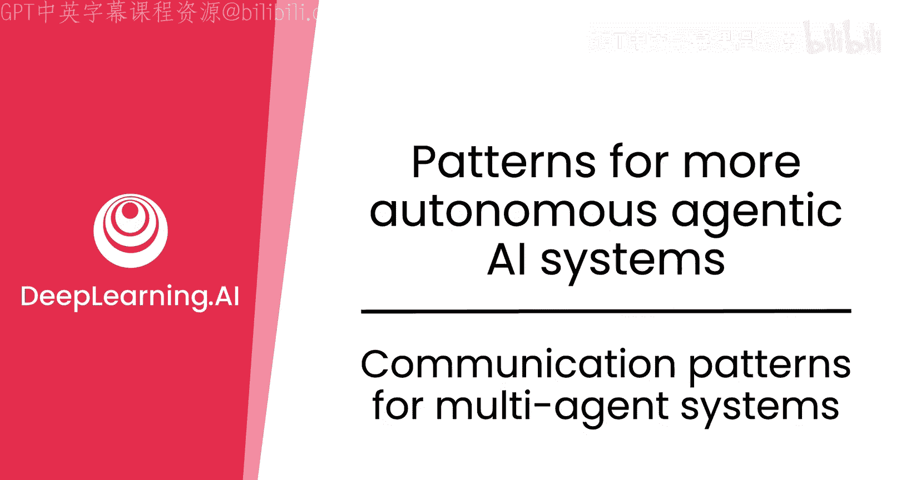
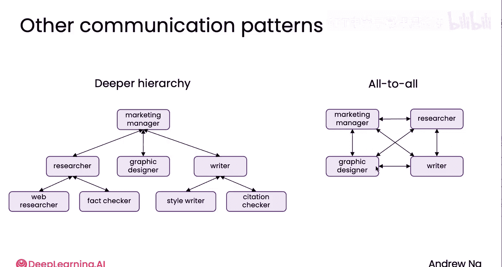

# 吴恩达《代理式AI：模块1-5｜Agentic AI 》中英字幕 - P28：5.communication-patterns-for-multi-agent-systems.zh_en - GPT中英字幕课程资源 - BV1hv4rz9EDn

When you have a team of people working together， the patterns by which they communicate can be quite complex and in fact。

 designing a organizational chart is actually pretty complex to try to figure out what's the best way for people to communicate。

 to collaborate。

It turns out designing communication patterns for multiagent systems is also quite complex。

 but let me show you some of the most common design patterns I see used by different teams today in a marketing team with a linear plan where first the researcher worked then the graphic designer then the writer the communication pattern was linear the researcher would communicate with a graphic designer and in both the research and a graphic designer maybe possibly outputs the writer and so this is very linear communication pattern this is one of the two most common communication plans that I see being use today the second of the two most common communication plans would be similar to what you saw in this example with planning using multiple agents where there is a manager that communicates with a number of team members and coordinates their work So in this example the marketing manager decides to call on the researcher to do some work then if you think of the marketing manager as getting the report back and then sending。

To the graphic designer getting a report back and saying to the writer this would be a hierarchical communication pattern if you're actually implementing a hierarchical communication pattern。

 itll probably be simpler to have the researcher pass the report back to the marketing manager rather than the researcher passed the results directly to the graphic designer and to the writer but so this type a hierarchy is also a pretty common way to plan the communication patterns where you have one manager coordinating the work of a number of other agents and just to share you some more advance and less frequently used but nonetheless sometimes used in practice communication patterns。

 one would be a deeper hierarchy where same as before if you have a marketing manager sent us a researcher graphic designer writer but maybe a researcher has themselves two other agents that they call on such as a web researcher and a fact checker maybe the graphic designer just works by themselves whereas the writer has an initial style writer and a citation checker so this would be a hierarchical organize。

Of agents in which some agents might themselves call other subagents and also see this using some applications。

 but this is much more complex than a onelel hierarchy。

 So use less often today and then one final pattern that is quite challenging to execute。

 but I see a few experimental projects use it is the all to all communication pattern。

 So in this pattern， anyone' is allowed to talk to anyone else at any time and the way you implement this is you prompt all four of your agents in this case to tell them that there are three other agents。

 it could decide to call on and whenever one of your agents decides to send a message to another agent that message gets added to the receiver agents context and then a receiver agent can think for a while and decide when to get back to that first agent and so all collaborate in a crowd and talk to each other for a while until say each of them declares that it is done with this task and then。

Talking and maybe when everyone thinks it's done or maybe when the writer concludes it' good enough。

 that's when you generate the final output。 In practice。

 I find the results of all all communication patterns a bit hard to predict。

 So some applications don't need high control you can run it and see what you get in the marketing brochure isn't good。

 Maybe that's okay you just run it again and see if you get a different result。

 but I think for applications where you're willing to tolerate a little bit of chaos and unpredictability。

 I do see some developers using this communication pattern。

 So that I hope conveys some of the richness of multiag systems。

 So there are quite a lot of software frameworks as well。

 the support easily building multi-ag systems and they also implementing some of these communication patterns relatively easy So maybe if you use your own multi-agent system you find some of these frameworks hopeful for exploring these different communication patterns as well。

And so that now brings us to the final video of this module and of this course。

Let's go on to the final video to wrap up。