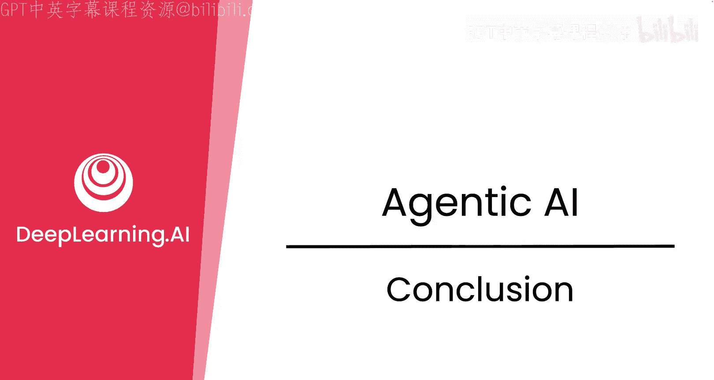
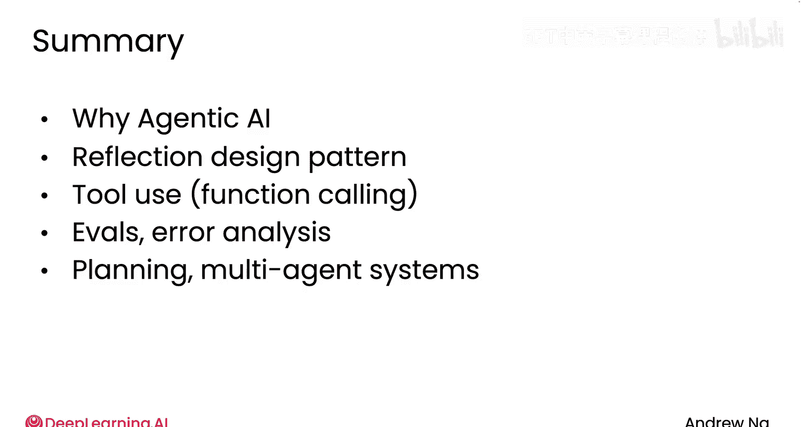

# 吴恩达《代理式AI：模块1-5｜Agentic AI 》中英字幕 - P29：6.conclusion.zh_en - GPT中英字幕课程资源 - BV1hv4rz9EDn

Welcome to the final video of this course。 It feels like we've been through a lot together just you and me and we've gone through a lot of topics in Asian takingI。

 Let's take a look。😊。

In the first module we talkeds about whether are the applications you can build with agent AI that just were not possible before。

 and we started then to look at key design patterns including the reflection design pattern which is a simple way to sometimes give your application a nice performance boost and then tool user function calling which expands what your ownM application can do with coex being one important case of that and then we spend a lot of time talking about evaluations as well as error analysis and how to drive a disciplined process of building as well as analyzing to be efficient in how you keep on improving the performance of your agent AI system。

 this fourth module is some of the material that I think you will find most useful as you keep building agent AI systems I hope for a long time and then in this module we talk about planning and multi-agent systems that can let you build much more powerful although sometimes harder to control。

And harder to predict and advance types of systems。 So with the skills you learn from this course。

 I think you now know how to build a lot of cool， exciting agent AI applications。😊。

When my team or I see other teams as well interview people for jobs。

 I find interviews often try to assess learning not candidates have pretty much the skills you're learning about in discourse。

 and so I hope that discourse will also open up new professional opportunities for you and usually we do more。

Whether you're doing these things for fun or for professional practical settings。😊。

I think you enjoy this new set of things you can now build。 so just to wrap up。

 I want to thank you again for spending all this time with me and I hope you will take these skills。

 use them responsibly and just go build Kula。