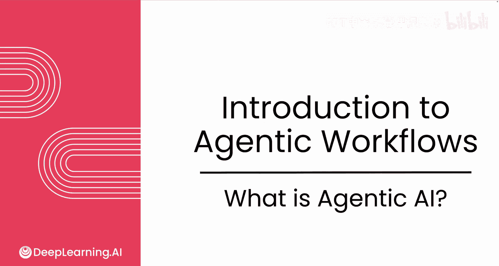
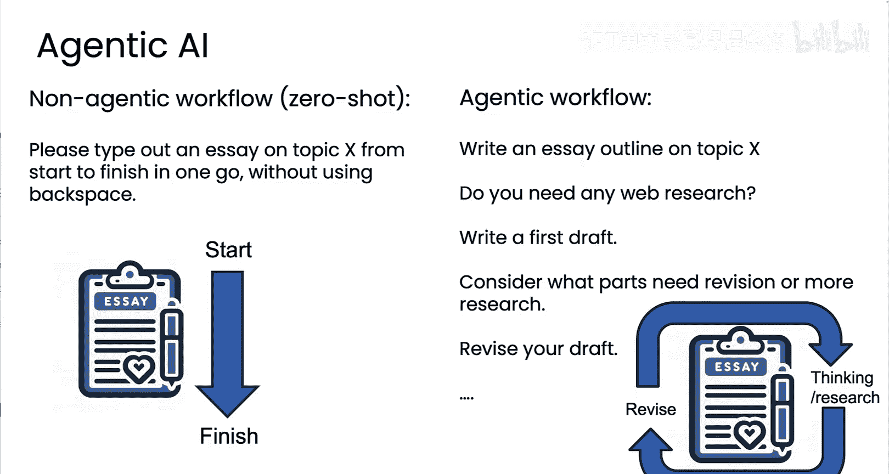
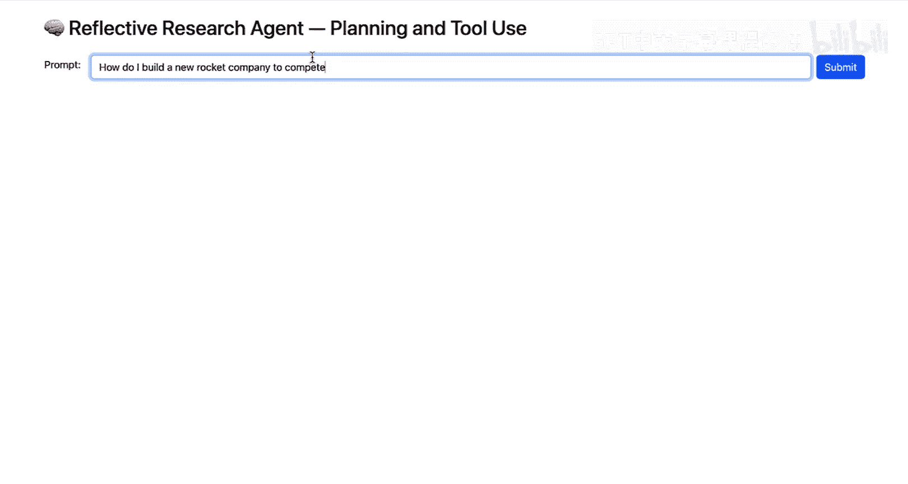
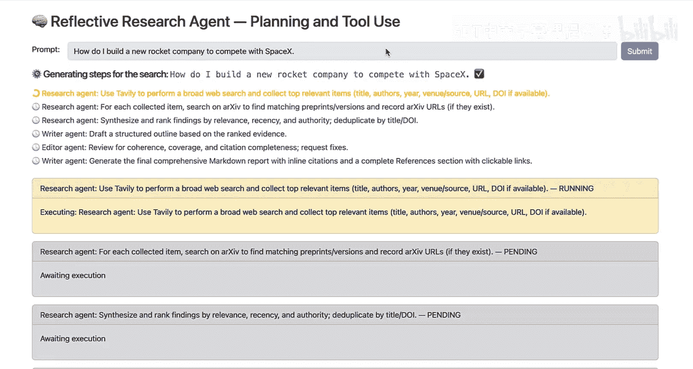
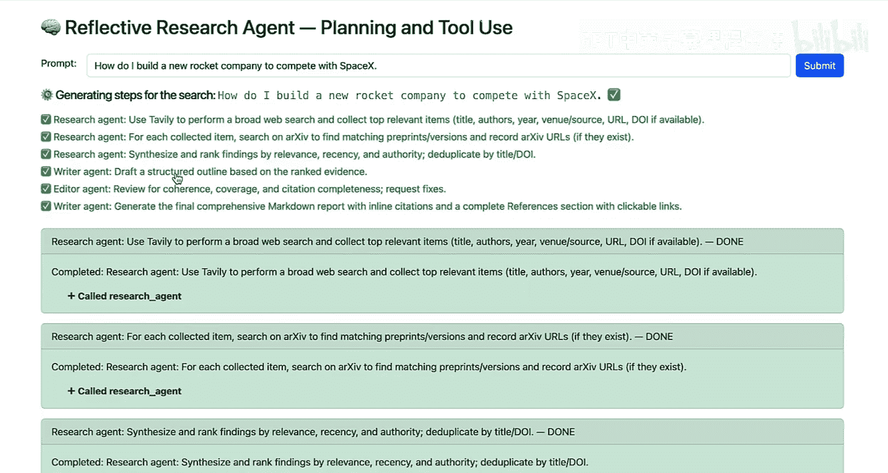
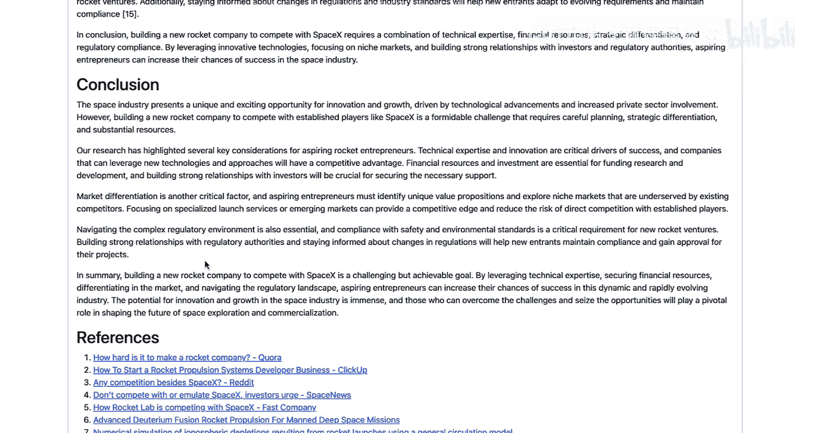

# 吴恩达《代理式AI：模块1-5｜Agentic AI 》中英字幕 - P2：2.what-is-agentic-ai.zh_en - GPT中英字幕课程资源 - BV1hv4rz9EDn

So what is agent AI and why are agent AI workflows so powerful。 Let's take a look。

 The way that many of us use large language models or as today is by prompting it to say write an essay for us on a certain topic X and I think of that as akin to going to a human or in this case going to an AI and asking it to please type out an essay for me by writing from the first word to the last word all in one go and without ever using backspace it turns out that we as people we don't do our best writing like that by being forced to write in this completely linear order and nor do AI models but despite the difficulty of being constrained to write this way our elementss do surprisingly well in contrast to an agent workflowll。

 this is what the process might look like you may ask it to first write an essay online with a certain topic then ask if it needs to do any research and after doing some web research and maybe be downloading some web pages then to write the first draft and then to read the first draft and see what positive provision or more。

And then revise the draft and so on。 and this type of workflow is more akin to doing some thinking and some research and then doing some revision and then doing some more thinking and so on。

 And with this iterative process， it turns out that an agent workflow can take longer but it delivers a much better work product So an e AI workflow is a process while an OMbased app executes multiple steps to complete a task in this example。

 you might use an OM to write the first SA outline and then you might use an OM to decide what search terms to type into web search engine or really what search terms to call a web search API with in order to get back relevant web pages based on that。

 you can feed the downloaded web pages into an OM to have a right the first draft and it may be use another OM to reflect and decide what needs more revision and then depending on how you design this workflow perhaps。

You may even add a human in the loop step where the has the option to request human review maybe of some key facts and based on that。

 it may then revise the draft and this process results in a much better work output one of the key skills you learn in this course is how to take a complex task like writing an essay and breaking it down into smaller steps for agent genetic workflow to execute one step at a time to then get the work output that you want and knowing how to decompose the task into steps and how to build the components to execute the individual steps well turns out to be a tricky but important skill that will determine your ability to build agent genetic workflows for a huge range of exciting applications In this course one example that will use and something that you build alongside me is a research agent So here's an example of what it will look like you can enter a research topic like how。

Do I build a new rocket company to。Compete with SpaceX where I don't personally want to compete with SpaceX but if you want to you can try asking a research agent to help your background research so this agent starts with planning out what research to use including calling a web search engine to download some web pages and then to synthesize and rank findings。

 draft for outline have an exit agent review for coherence and then finally generate a comprehensive markdown report which it has done here building an rocketcomp compete with SpaceX with an intro background。

Findings and so on I think it points out appropriately that this is going be a tough startup to build so I'm not personally planning to do this。

 but if you want to tackle something like this， maybe research agent like this could help you have some initial research and by finding and downloading multiple sources and deeply thinking about it this actually ends up with a much more thoughtful report then just prompting to write an essay for you would one of the reasons I'm excited about this is because in my work I've ended up building quite a few specialized research agents be it in legal documents for conflict legal compliance or for some healthcare sectors or some business product research areas and so I hope that working through this example you not only learned how to build agent workflows for many other applications but that some of the ideas in building research agents will be directly useful to you if you ever need to build a custom research。

Asian yourself。Now， one of the often discussed areas of AI agents is how autonomous are they What you just saw here was a relatively complex highly autonomous agent AI workflow。

 but there are also other simpler workflows that are incredibly valuable let's go into the next video to talk about the degree to which agent workflows can be autonomous and does give you a framework to think about how you might go about building different applications and how easy difficult they might be See in N next video。

