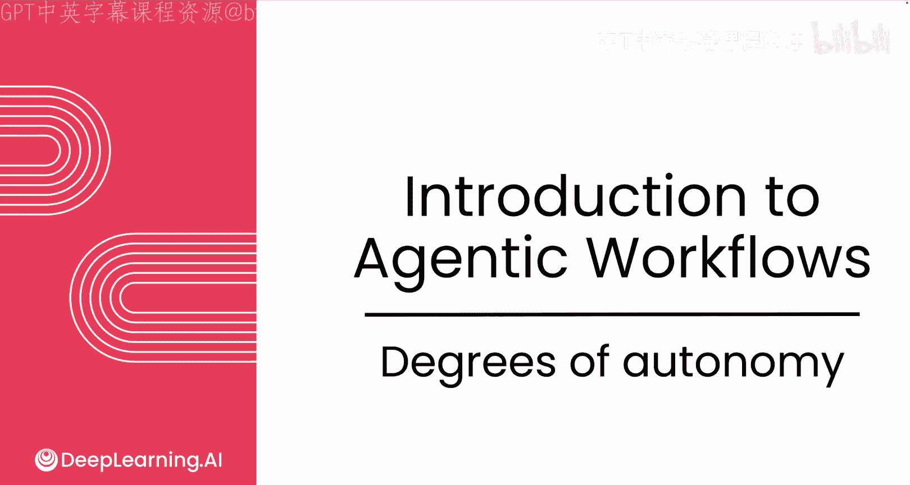
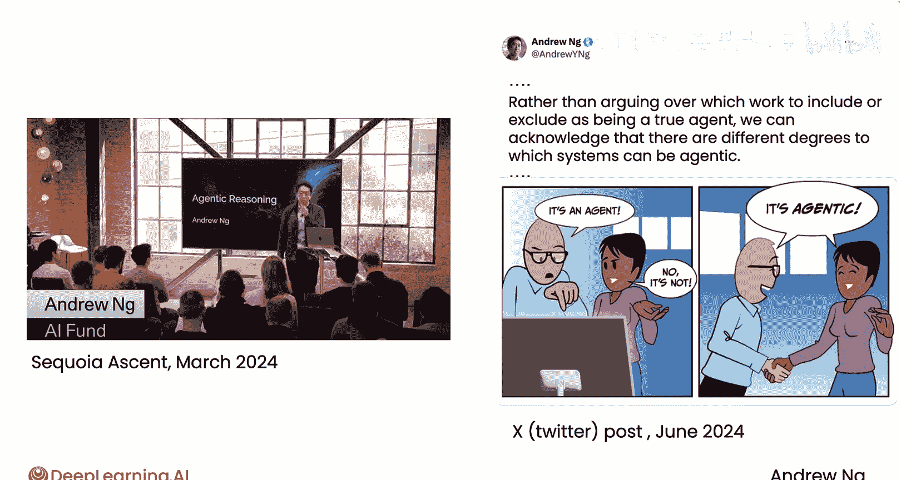
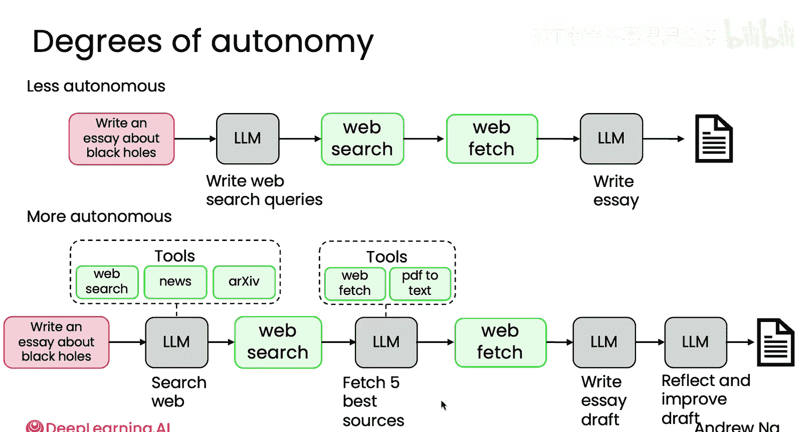
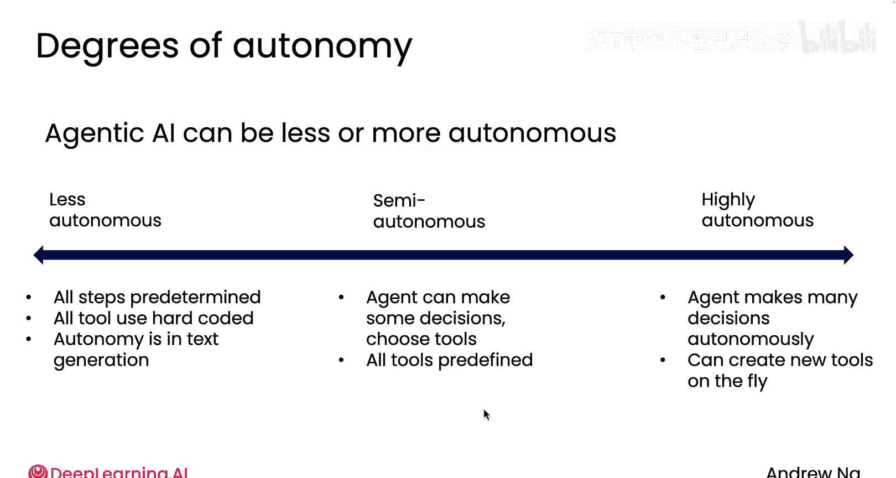

# 吴恩达《代理式AI：模块1-5｜Agentic AI 》中英字幕 - P3：3.degrees-of-autonomy.zh_en - GPT中英字幕课程资源 - BV1hv4rz9EDn

Agents can be autonomous to different degrees。 A few years ago。

 I noticed with an AI community that there was a growing controversial debate about whether is an agent。

 and some people are writing a paper saying about an agent and others say， no。

 that's not really a true agent。 And I felt this debate was unnecessary。

 which is why I started using the term agentic， because I thought if we use it as an adjective rather than a bin。

 either an agent or not， then we can have just acknowledge that systems can be agent to different degrees。

 And this is called agent and move on with the real work of building these systems rather than debating。

 is this sufficiently autonomous to be an agent or not。

 I remember when I prepared the talk on agent reasoning。

 One of my team members actually came to me and said， hey， we don't need yet another word。

 we have agent why you make have of another word agentic。 but I decided to use it anyway。

 And then later on wrote an article in Giized newsletter the batch and then also。

On social media， saying that instead of arguing over wishword include exclude as being a true agent lets acknowledged that different degrees to which systems can be agent and I think this helped move past the debate on what is a true agent and let us just focus on actually building them Some agents can be less autonomous So take the example of writing an essay about black holes。

 you can have a relatively simple agents to come up with a few web search terms or web search queries。

 then you can hard code in that you call web search engine fetch on web pages and use that to write an essay and this be an example of a less autonomous agent with a fully deterministic sequence of steps and this will work okay In terms of notational convention throughout this course I use the red color as you see here on the left to denote the user input such as a user query in this case or in later examples maybe the input document into an agent。

FThe gray boxes denote calls to an LM and the green boxes like the web search and the web fetch boxes that you see here indicate steps where other software is being used to carry out an action such as a web search API call or executing code to fetch the contents of a website then an agent can be more autonomous where given a request to write an essay about black holes。

 perhaps you let the OM decide does it want to do a website search or does it want to search recent news sources or does it want to search for recent research papers on the website archive based on that。

 maybe in this example， the Om not the human engineer。

 but the LM chooses in this case to call web search engine and then after that you may let the OM decide how many web pagess does it want to fetch or if it fetch the P does it need to call a function or also call the tool to convert the PDF to text and in this case maybe it fetches It top few web pages then it can write an essay。

out to reflect and improve and maybe even go back to fetch more web pages and then finally produce an output and so even for this example of a research agent。

 we can see that some agents can be less autonomous with a linear sequence of steps to be executed determined by a programmer and some can be more autonomous where you trust the OM to make more decisions and the exact sequence of steps that happens may be even determined by the arm rather than in advance by the programmer So for less autonomous systems you will usually have all the steps predetermined in advance and any functions it calls like web search and will call that tool use as you learn in the third module in this course might be hardcoded by the human engineer by Umi and most of the autonomy is in what text the alarm generates and the end of the spectrum would be highly autonomous agents where the agent makes many decisions autonomously including。

 for example， deciding what is the sequence of steps it will carry out in order to write the essay and there some。

Highly autonomous agents， they can even write new functions or sometimes say trade new tools that it can then execute。

 and somewhere in between are semiautonnoommizations。

 we can make some decisions choose tools but the tools are usually more predefined as you look at different examples in discourse。

 you learn how to build applications anywhere on this spectrum of less to more highly autonomous and you find that there are tons of applications in the less autonomous end of the spectrum that very valuable being built for tons of businesses today。

 And at the same time， they're also applications being worked on at the more highly autonomous end of the spectrum。

 but those are usually less easily controllable， a little bit more unpredictable and also lot of active research as well to figure out how to build these more highly autonomous agents。

And with that， let's go on to the next video to dive deeper into this and to hear about some of the benefits of using agents and why they allow us to do things that just were not possible with earlier generations of own base applications。

