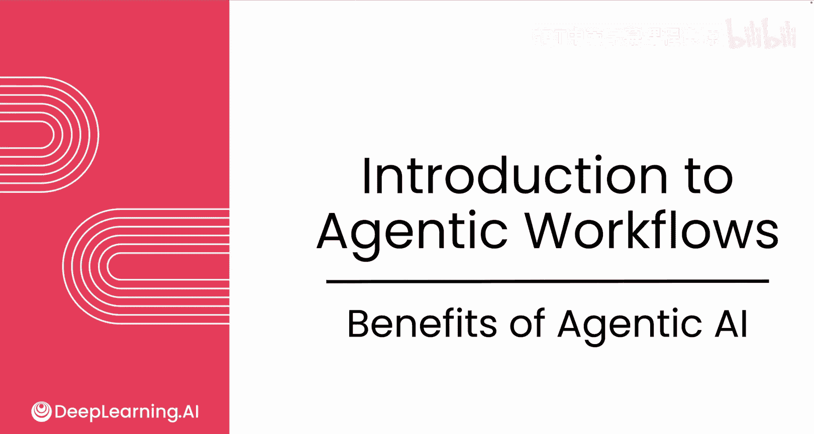
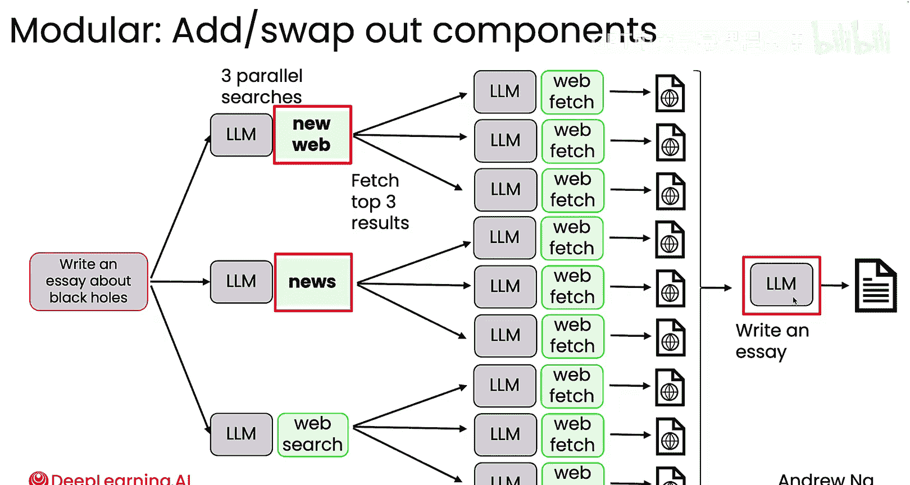
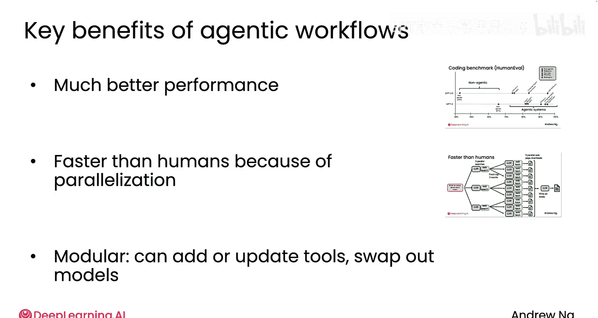

# 吴恩达《代理式AI：模块1-5｜Agentic AI 》中英字幕 - P4：4.benefits-of-agentic-ai.zh_en - GPT中英字幕课程资源 - BV1hv4rz9EDn

I think the one biggest benefit of agent workflows is that allows you to do many tasks effectively that just previously were not possible。

 but there are other benefits as well， including parallelism that lets you do certain things quite fast as well as modularity that lets you combine the best components from many different places to build an effective workflow Let's take a look My team collected some data on a coding benchmark that tests the ability of different Os to write code to carry out certain task the benchmark news in this case is called human eval and it turns out that G3。

5 does a model that the first hopefully available version of G was based on if asked to write the code directly to just type out the computer program gets 40% right on this benchmark does a passive K metric G4 is a much better model this performance leap the 67% with this also nonagic workflow but it turns out that as large as the improvement was from G。

3。5 to G4 that improvement is du by what you can achieve by wrapping G3。

5 within an agent workflow using different agent techniques which you learned about late in discourse you can prompt G3。

5 to write code and it may reflect on the code and figure out they can improve it and using techniques like that you can actually get G3。

5 to get much higher levels of performance and similarly G4 used in the context of an agent workflow also does much better so even with today's best LMs and agent workflow that you get much better performance and in fact what we saw in this example was the improvement from one generation of model to another which is huge is still not as big a difference as implementing an agent workflow on the previous generation of model another benefit of using agent workflows is that they can paralyze some tasks and does do certain things much faster than a human for example。

If you ask an agent workflow to write an essay about black holes。

 you might be able to have VOs run in parallel to generate ideas for web search terms to type into search engine based on the first web search and we identify say three top results to fetch and based on the second web search should be identify a second set of web pages to fetch and so on and it turns out that whereas a human doing those research would have to read these nine web pages sequentially or one at a time when you're using an agentic workflow。

 you can actually paralyze all nine webage downloads and then finally feed all these things into an to write an essay so even though agentic workflows do take longer than truly non-ageic workflows or by direct generation by just prompting a single time if you were to compare this type of agent workflow to how a human would have to go about the task。

 the ability to paralyze downloading loss of web pages can actually let it do certain tasks much faster。

Then the nonparalle sequential way that a singlehu might process data to build on this example。

 it turns out one of the things I often do when building agent genetic workflows is look at the individual components like the Lm and add or swap out components。

 So for example， maybe I look at the web search engine Is up here and I might decide that I want to swap in a new web search engine when building a genetic workflows。

 there's actually multiple web search engines， including Google which can access Serper as West others like Bing dogo to you do co they' are actually quite a lot of options for web search engines designed for Oms to use or maybe instead of just doing three web searches。

 maybe on this step， you can swap in a new news search engine so they can find out what's the latest news on recent breakthroughs on black hole size And lastly instead of using the same Om for all of the different steps。

 I will often try out different large language model。

And maybe try out different O providers to see which one gives the best result for different steps of this system。

 So to summarize the main reason I use agent workflows is just give much better performance on many different applications but in addition it can also paralyze some tasks that humans will otherwise have to do sequentially and the modular design of many agentic workflows also lets us add update tools and sometimes swap out models we talk a lot about the key components of building agenttic workflows Let's now take a look at a range of agentic AI applications to give you a sense of the sorts of things people are already building and the sorts of things you build to build yourself。

 Let's go on to the next video。

