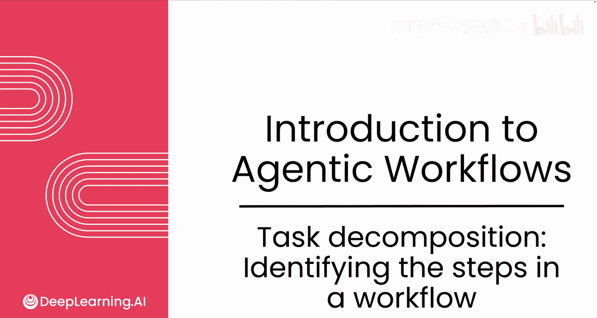
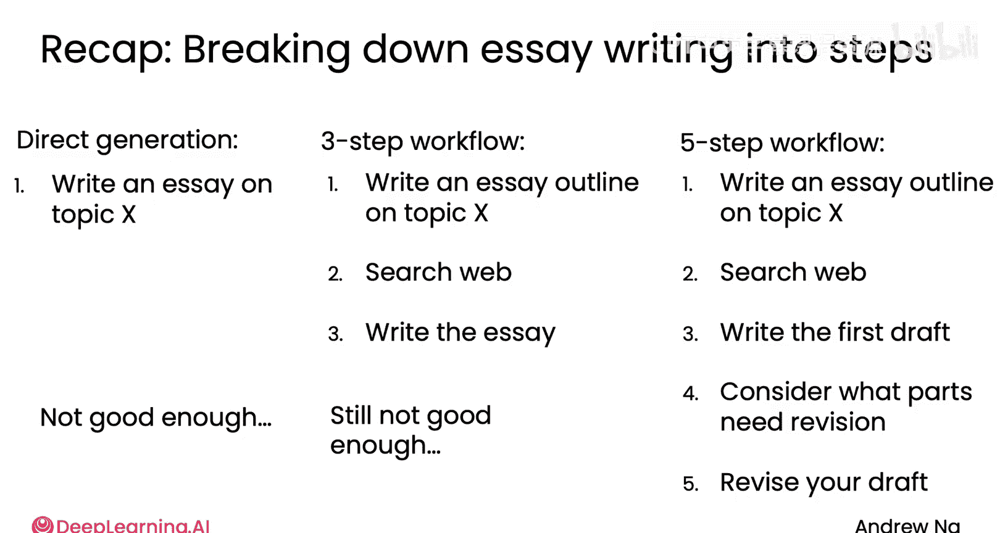
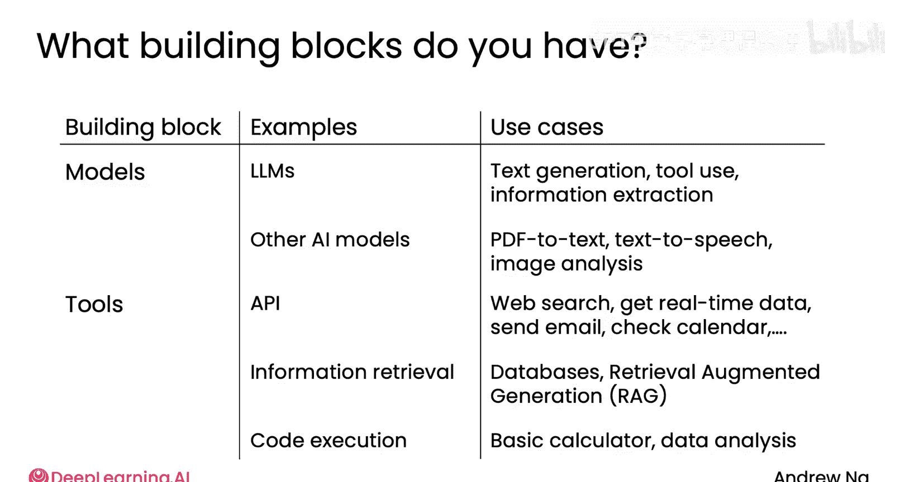
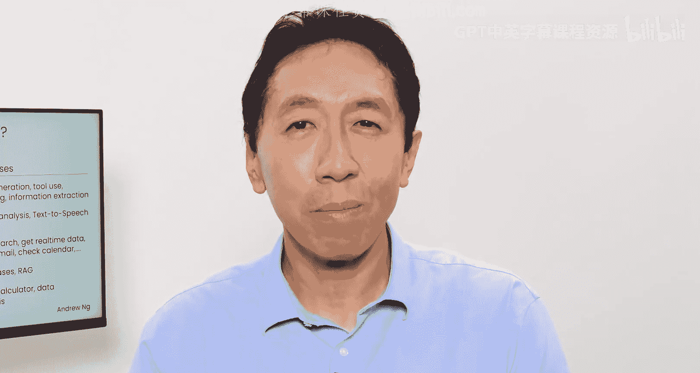

# 吴恩达《代理式AI：模块1-5｜Agentic AI 》中英字幕 - P5：6.task-decomposition-identifying-the-steps-in-a-workflow.zh_en - GPT中英字幕课程资源 - BV1hv4rz9EDn

People and businesses do a lot of stuff。 How do you take this useful stuff that we do and break it down into discrete steps for the agent workflow to follow Let's take a look。

 take the example of building a research agent if you once AI system to write an essay on a topic X one thing you could do is prompting them to have it generate an output directly。

 but if you were to do this for topics that you want deeply research。

 you may find that the all output covers only the surface level points or maybe covers only the obvious facts。

 but doesn't go as deep into the subject as you wanted to In this case。

 you might then reflect on how you as a human with write an essay on a certain topic which you just sit down and start writing or would you take multiple steps such as first write an essay outline and then search the rep and then based on the input from the web search。

 write the essay and as I take a task and decompose it into steps One question I'm always asking。

myself is if look at these sets1，2 and three can each of them be done either by an LOM or by a short piece of code or by a function call by a tool And so in this case。

 I think the an LM can maybe write a decent outline on many topics that I would wanted to help me think so say probably okay on the first step and then I know how to use an LM to generate search terms to search the web I would say the second step is also doable and then based on web search I think an LM could input the web search results and write an essay and so this would be a reasonable first attempt at an agent workflow for writing an essay that goes deeper than just direct generation but if I were to then implement this agent workflow and look at the results maybe you find that the results still aren' good enough is' still not yet as deeply thoughtful maybe the essays I feel a little bit disjointed。

 this actually happened to me once built a research agent using this workflow but whenever I read the output it fell a bit。

Djointed the start of the article didn't feel completely consistent with the middle didn't feel completely consistent with the end。

 In this case， what you might do is then reflect on how you would change the workflow。

 if you as a human found that the essays were disjointed。

 One thing you could do is take the third step and further decompose write the essay into additional steps。

 So instead of writing the essay on one go， you might instead have it write the first draft and then consider what pauses need revision and then revise the draft and this would be how I as a human might go about it to not just write the final essay and my first attempt。

 but write the first draft and then read over it which is another step is pretty decent and then based on my own critique of my own essay。

 I'll revise the draft。 So the recap I started off with direct generation just one step。

 decided it wasn't good enough and so broke it down into three steps and then maybe decide that still isn't good enough。

And took one of the steps and further broken it down or decomposed it into three more steps resulting in this more complex richer process for generating an essay and depending on how satisfy you are with the results of this process you may choose to even modify this essay generation process further let's look at the second example of how to decompose complex tasks into smallest steps take the example of responding to basic customer order inquiries。

 the first step that the human customer service agent might carry out might be to first extract the key information such as who is this email from what do they order and what is the order number and these are things that an could do so I could just say let' of alone do that the second step would be to then find the relevant customer records so to write and generate the relevant database queries to pull up the order of what the customer had order and when to shipped and so on and think an OM with the ability to call a function。

To query the orders database should be able to do that And then lastly。

 having pulled up a customer record or the customer order record。

 I might then write and send a response back to the customer and I think with the information we pulled up this third step is also doable with an if I give the option to call an API to send an email So this would be another example of taking a task of responding to customer email and break it it down into three individual steps where I can look each these steps and say。

 I think an Om1 om with the ability to call a function to query a database or send an email should be able to do that just one last example for the invoice processing after a PDF invoice has been converted to text the first step is to pull the required information。

 the name of the bill， the address， the due date amount due and so on and should be able to do that and then if I want to check that the information was extracted and save it in a new database entry。

 then I think an should be able to help me。Call a function to update a database record。

 And so to implement this implement an agent workflow to carry out basically these two steps when building agent workflows。

 I think of myself as having a number of building blocks one important building block would be large language models or maybe large multimodel models if I want to try to process images or audio as well and Os are good at generating text design what to call maybe extracting information for some party specialized tasks I might also use some other AI models such as AI model for converting a pf to text or for text to speech or for image analysis In addition to AI models I also have access to a number of software tools including different APIs that I can call to do right search to get maybe real-time weather data to send emails check calendar and so on and I might also have tools to retrieve information to pull up data from a database or。

To invent rag over shval augmented generation where I can look up a large text database and find the most relevant text。

 or I might also have tools to execute code。 And this is a tool that lets an El write code and then run the code on your computer to do a huge range of things。

 in case some these tools seem to bit foreign to you don't worry about it will go through the most important tools in much greater detail in a later module。

 But I think of a lot of my work when building an agent workflow as looking at the work that the person or business is doing and then trying to figure out with these building blocks。

 How can I sequence these building blocks together in order to carry out the task that I want my system to carry out。

 And this is why having a good understanding of what building blocks are available。

 which I hope you have a better sense of by the end of this course as well。

 will allow you to better envision what agent workflows you can build by combining these building blocks together。

 So to summarize one of the key skills in building agent gen workflows is to look at。

A bunch of stuff that maybe someone does and to identify the discrete steps that it could be implemented with And when I' looking at the individual discrete steps。

 one question I'm always asking myself is can this step be implemented with either an OM or with one of the tools such an API or a function call that I have access to And in case the answer is no。

 I'll then often ask myself how would I as a human do this step and is it possible to decompose this further or break this down into even smaller steps that then maybe its more meanable to implementation with an Om or with one of the software tools that I have So I hope this gives you a rough sense of how to think about tasky composition in case you feel that you don't fully have yet don't worry about it will go through many more examples in this course and you have a much better understanding of this by the end of this course。

 but it turns out that as you build agent rockths you find it often you build an initial。

Tosy composition， initial agent workflow and then you want to keep on iterating and improving on it quite a few times until it delivers the level of performance that you want and to drive this improvement process which are found important for many projects one of the key skills is to know how to evaluate your agent workflow So in the next video we'll talk about evaluations or evals and just key component how you can build and then also keep on improving your workflows to get the performance that you want let's talk about evals in the next video。

😊。