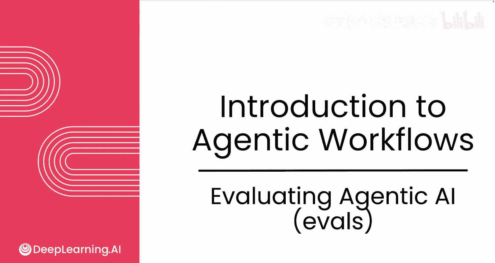
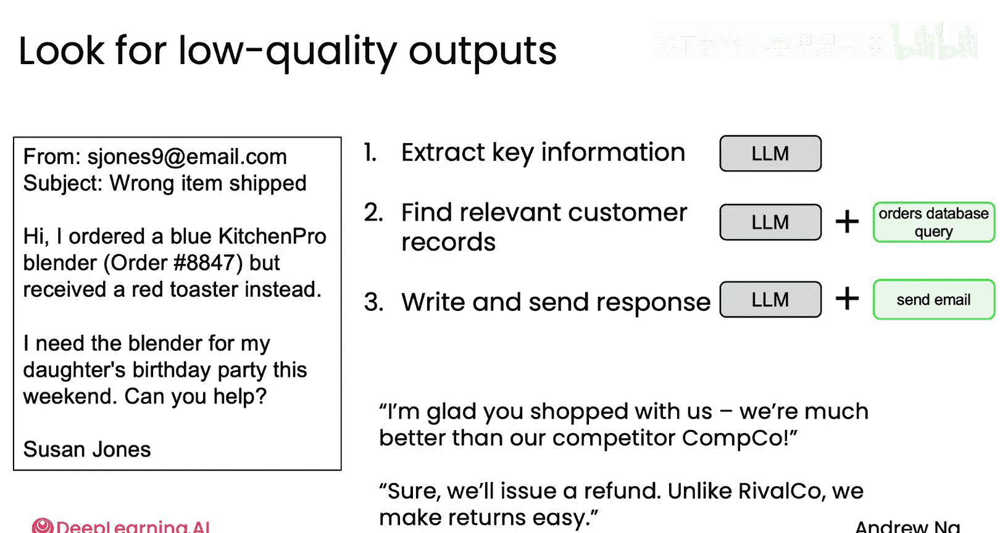
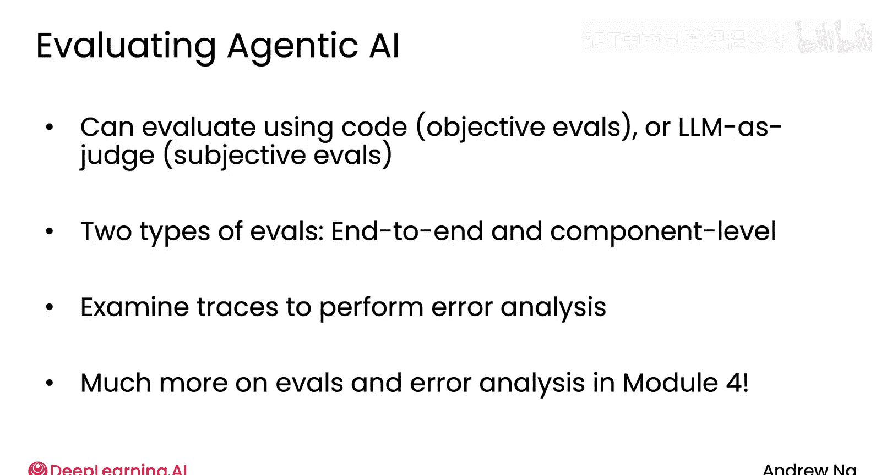

# 吴恩达《代理式AI：模块1-5｜Agentic AI 》中英字幕 - P6：7.evaluation-agentic-ai-(evals).zh_en - GPT中英字幕课程资源 - BV1hv4rz9EDn

I've worked with many different teams on building agentic workflows。

 and I found that one of the biggest predictors for whether someone is able to do it really well。

 versus be less efficient at it is whether or not theyre able to drive a really disciplined evaluation process。

 So your ability to drive evals for agentic workflow makes a huge difference in your ability to build them effectively。

 in this video will take a quick overview of how to build evals。

 And this a subject that will actually go into much deeper in a later module in the course。

 Let's take a look。😊。

After building an agent workflow like this one for responding to customer order inquiries。

 it turns out that it's very difficult to know in advance what are the things that could go wrong。

 And so rather than trying to build evaluations in advance What I recommend is you just look at the outputs and manually look for things that you wish it was doing better。

 for example， maybe you read a lot of outputs and find that it is unexpectedly mentioning your competitors more than it should maybe businesses don't want their agents to mention competitors because it just create an awkward situation and if you read some outputs。

 maybe you find that the sometimes says I'm glad you shot of us but much better than a competitors compco or maybe sometimes say it should refund unlike rival code we make returns easy and you may look at this go gee I really don't want this to mention competitors。

 This the example of a problem that it's really hard to anticipate in advance of building this agent。

so the best practice is really to build it first and then examine it to figure out where it is not yet satisfactory and then to find ways to evaluate as what's improved the system to eliminate the ways that it is still not yet satisfactory assuming your business considers it an error or mistake to mention competitors in this way。

 then as you work on eliminating these competitors mentions one way to track progress with to add an evaluation or an eval to track how often this error occurs So if you have a name list of competitors like comp code rival code。

 the other code， then you can actually write code so just search in your own output for how often it mentions these competitors by name and count up as a number as a fraction of the overall responses how frequently it mistakenly mentions competitors One nice thing about the problem of competitors mentions is is an objective metric。

 meaning either the。

That was mentioned or not。 And for objective criteria。

 you can write code to check for how often this specific error occurs。

 But because Lm's output free text they're also going to be criteria by which you want to evaluate this output that may be more subjective and whereass harder to just write code to output a black and white score。

 In this case， using a LMm as a judge is a common technique to evaluate the output。 So for example。

 if you're building a research agent to do research on different topics。

 then you can use another Om and prompt it to maybe say assign the following essay quality score between one and5 where one is the worst and five is the best essay here I'm using a Python expression to mean your copy paste to generated essay into this。

 So you can prompt the Lm to read the essay and assign it a quality score then Im ask a research agent to write a number of different research report。

For example， on recent developments in black hole science or using robots to harvest fruit。

 and then in this example， maybe the judge OM assigns the essay on black holes a score of three。

 the essay on robot harvesting the score of four and as you work on improving your research agent。

 hopefully you see these scores go up over time。 It turns out by the way。

 that ohms are actually not that good at least one to five scale ratings you can give it a sharp like Percy tend not to use this technique that much myself but in the later module you learn some better techniques to have an OM output more accurate scores than ask to output scores on a one to five scale although some people will do this maybe at an initial cut as an ohm as judge type of Eval just to give a preview of some of the agent gen type AI evals you learn about late in scores you already heard me talk about how you can write codes to evaluate objective criteria such as did it mention the competitor or not or use anelm as a judge for more sub。

ive criteria such as what's the quality of this essay。

 But later you learn about two major types of evals。

 One is end to end where you measure the output quality of the entire agent as was component level evals we might measure the quality of the output of a single step in agent workflow and turns out that these are useful for driving different positive development process and one thing I do a lot as well it is just examine the intermediate outputs or something you call these traces of the Om in order to understand where it is falling short my expectations and we call this error analysis where we just read through the intermediate outputs of every single step to try the spot opportunities for improvement and it turns out being able to do evals and error analysis is a really key skills。

 So with much more to say about this in the fourth module in the schools。

 were nearly to the end of this first module before moving on。

 I to share you what I think are the most important design patterns for building agent workflowss。

' take a look at that in the next video。