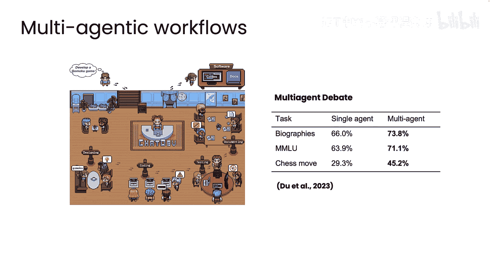
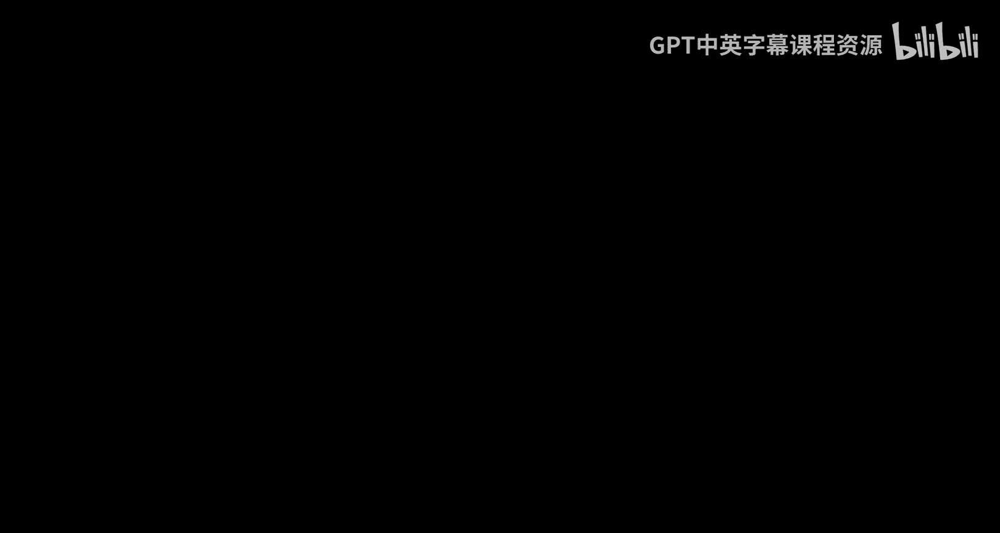

# 吴恩达《代理式AI：模块1-5｜Agentic AI 》中英字幕 - P7：8.agentic-design-patterns.zh_en - GPT中英字幕课程资源 - BV1hv4rz9EDn

We built agent workflows by taking building blocks and putting them together to sequence out these complex workflows。

In this video， I'd like to share with you a few of the key design patterns which have patterns for how you can think about combining these building blocks into more complex workflows。

 Let's take a look。 I think four key design patterns with building agent workflow are reflection to use planning and multiaging collaboration let me briefly go over what they mean and then we'll actually go through most of these in depthth between the code as well。

 The first of the major design patterns is reflection So I might go to an LM agent and ask you to write code and it turns out that an LM might then generate code like this defines here a python function to do a certain task I could then construct a prompt that looks like this。

 I can say his code intended for a certain task and then copy paste whatever the arm had just output back into this prompt and then ask it check the code carefully for correctly style efficiency and give constructor criticism and turns out that the same LM model prompted this way may be able to point out some problems with the code。

And if I then take this critique and feed it back to the model to say looks at a bug。

 could you change the code to fix it， then it may actually come over a better version of a code to give a preview of to use if you're able to run the code and see where the code fails then feeding that back to the LM can also cause it to be able iterate and generate a much better say V3 version 3 of the code。

 Soiffection is a common design pattern where you can ask the arm to examine its own output or maybe bring in some external sources of information such as run the code and see if it generates any error messages and use that as feedback to iterate again and come over a better version of its output and this design pattern is in magic。

 It does not result in everything working 100% of the time but sometimes it can be a nice bump in the performance of your system Now I've drawn this as if it was a single OM that I'm prompting。

To foreshadow multi agentent workflow， you can also imagine instead of having the same model critique itself。

 you can imagine having a critic agent and all that is is an L that's been prompted with instructions like your role a critique code。

 here's code intended for a task， check the code carefully and so on。

 and the second Cri agent maybe be a point out errors or rank unit test and like having two sd agents where each agent is just an ElM prompted to take on a certain persona。

 you gonna have them go back and forth to iterate to get a better output。

In addition to reflection pattern， a second important design pattern is to use where today OMs can be given tools meaning functions that they can call in order to get work done。

 For example if you ask an OM what's the best coffeemaker accordingary reviewers and you give it a web search to then it can actually search the internet to find much better answers or a code execution to if you ask a math question like if an invests $100 a compound interest whatever you end。

 it can then write code and execute code to compute and answer。

 Today different developers have given OM's many different tools for everything for math or data analysis to gather information by fetching things from the web with a various databases to interface with productivity apps like email calendar and so on as well as to process images and much more and the ability of an LM to decide what tools to use meaning what functions to call that let's the model get a lot more done。

 The third of the four design patterns is planning。

This is an example from a paper called Huging G in which if you ask a system to please generate an image where girls reading a book kind of poses the same as binary the image。

 then please describe the new initiative voice， then a model can automatically decide that to carry out the task it first needs to find a postdetermination model to figure out the pose of the boy。

 then do post the image the generate picture of a girl and image the text and then finally text the speech and so in planning an El decides what is the sequence of actions it needs to take in this case。

 it is a sequence of API calls so that it can then carry out the right sequence of steps in the right order in order to carry out the task So rather it into developer hard coding the sequence of steps in advance this actually lets the OEM decide whether the steps to take agents that plan today are harder to control and somewhat more experimental。

 but sometimes it can give really delightful results。And then finally， multiagent workflows。

 just as a human manager might hire a number of others to work together on a complex project。

 in some cases， it might make sense for you to hire a set of multiple agents。

 maybe each of which specializes in a different role and have them work together to accomplish a complex task。

 The picture you see here on the left is taken from a project called chat devef。

 which is a software framework created by Chen Qian and collaborators in chatt devef。

 multiple agents with different roles like chief executive officer， programmer， tester。

 designer and so on， collaborate together as if they were a virtual software company and can collaboratively complete a range of software development task。

 Let's consider another example。 if you want to write a marketing brochure。

 maybe youd think of hiring a team of three people such as a researcher to do online research。

 a marketer to write the marketing text and then finally an editor to edit。😊，Polish the text。

 And so in a similar way， you might consider building a multiagent workflow in which you have a simulated research agent a simulated marketer agent。

 and a simulated editor agent that then come together to carry out this task for you Multiagent workflows are more difficult to control since you don't always know ahead of time what the agents will do。

 but research has shown that they can result in better outcomes for many complex tasks。

 including things like writing biographies or deciding on ches movess to make a game。

 you learn more about multiag workflows later in this course as well。 As so of that。

 I hope you have a sense of what agent workflows can do。

 As well as of whether the key challenges of finding building blocks and putting them together。

 maybe by these design patterns in order that to implement an agent workflow and of course。

 also developing Eval you can see how well your system is doing and keep on improving on it。

In the next module， I'd like to share you a deep dive into the first of these design patterns that is reflection。

 and you find that is a maybe surprisingly simple to implement technique that can give the performance of your system sometimes a very nice bump。

 So let's go to the next module to learn about the reflection design pattern。😊。

