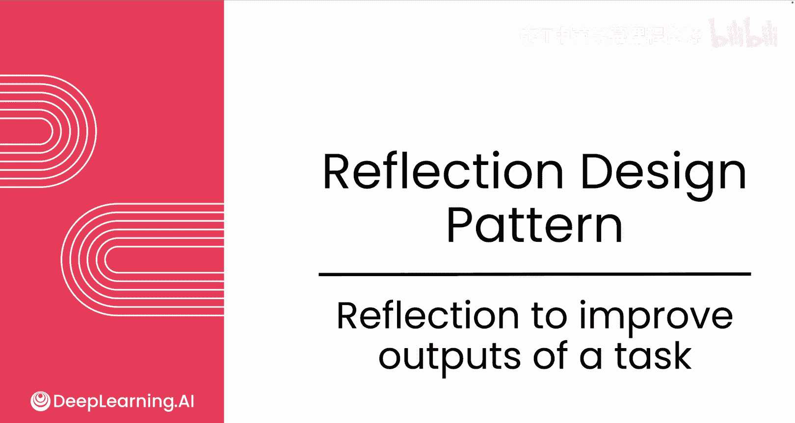
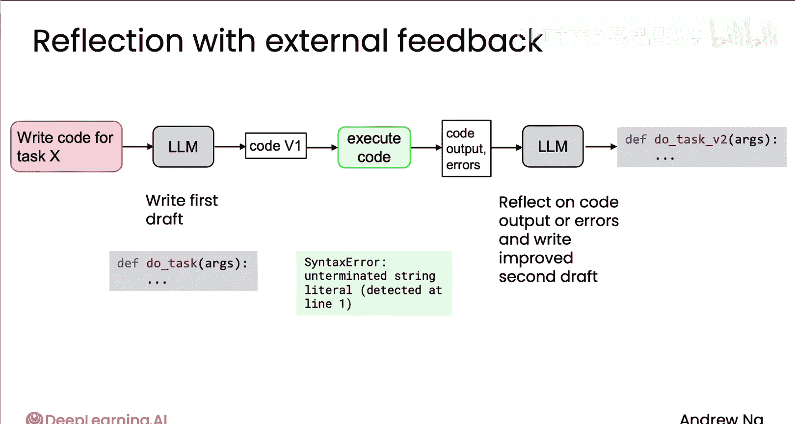

# 吴恩达《代理式AI：模块1-5｜Agentic AI 》中英字幕 - P8：1.reflection-to-improve-outputs-of-a-task.zh_en - GPT中英字幕课程资源 - BV1hv4rz9EDn

The reflection design pattern is something I've used in many applications and is surprisingly easy to implement。

 Let's take a look。

Just as humans will sometimes reflect their own output and find a way to improve it。

 So can Os for example， I might write an email like this and if I'm typing quickly。

 I might end up with a first draft that's not great And if I read over it。

 I might say next month isn't that clear for what days Tommy might be free for dinner and this is a typo that I had and also forgot to sign my name and this would let me revise a draft to be more specific in saying hey Tommy are you free for dinner on the fifth to the seventh a process let Os also improve their output you can prompt an L to write the first draft and email and give an email version1 email V1。

 you can pass it to maybe the same model， the same large language model but with a different prompt and tell it to reflect and write an improved second draft to then get you the final output email V2 here I have just hardcoded this workflow of prompting the own ones and then prompting。

m again， to reflect and improve and that gives email V2 It turns out that a similar process can be used to improve other types of output。

 For example， if you are having Lm write code， you might prompt an Lm to write code to do a certain task and it may give you V1 of the code and then pass it to the same LM or maybe a different LOm to ask it to check for bugs and write an improve second draft of the code  different OMs have different strings and so sometimes I would choose different models for writing the first draft and for reflecting and trying to improve it。

 For example， it turns out reasoning models， sometimes also called thinking models are pretty good at finding bugs and so Ill sometimes write the first draft the code by direct generation but then use a reasoning model to check for bugs Now。

 rather than just having an L reflect on the code， it turns out that if you can get external feedback。

New information from outside the LM reflection becomes much more powerful in the case of code。

 one thing you can do is just execute the code to see what the code does and by examining the output。

 including any error messages of the code， this is incredibly useful information for the LM to reflect and to find a way to improve his code。

 So in this example， the OM generated the first draft of the code， but when I run it。

 it generates a syntax error when you pass this code output and error logs back into the LM and ask it to reflect on the feedback and write a new draft。

 this gives a lot of very useful information to come up with a much better version2 of the code。

 So the reflection design pattern as a magic。 It does not an LM always get everything right 100% of the time but it can often give it maybe a modest bump in performance。

But one design consideration to keep in mind is reflection is much more powerful when there is new additional external information that you can ingest into the reflectionction process。

 So in this example， if you can run the code and have that code output or error messages as an additional input to the reflection step that really lets the own reflect much more deeply and figure out what may be going wrong。

 if anything and results in a much better second version of the code than if there wasn't this external information that you can ingest。

 So one thing to keep in mind， whenever reflection has an opportunity to get additional information that makes it much more powerful。

😊，Now with that， let's go to the next video where it want to share with you a more systematic comparison of using reflection versus direct generation or something we sometimes call。

😊，0ero shot prompting。 Let's go on to the next video。

