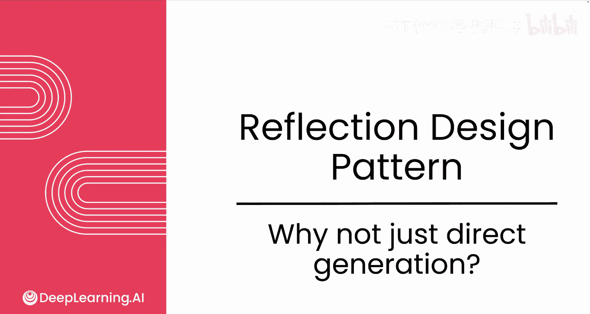
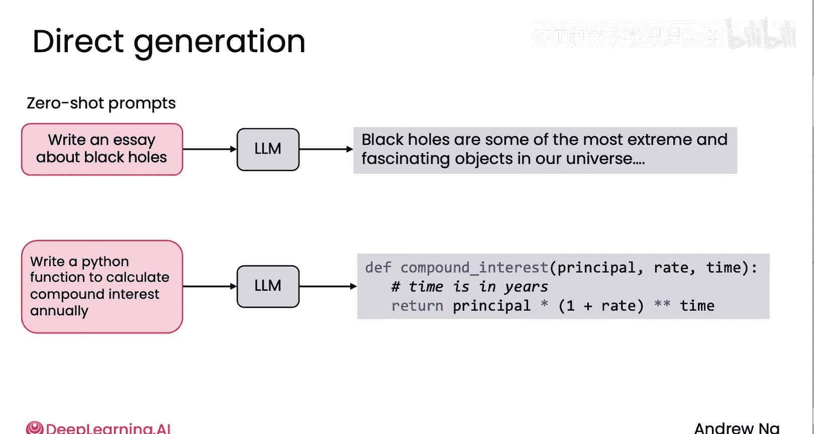
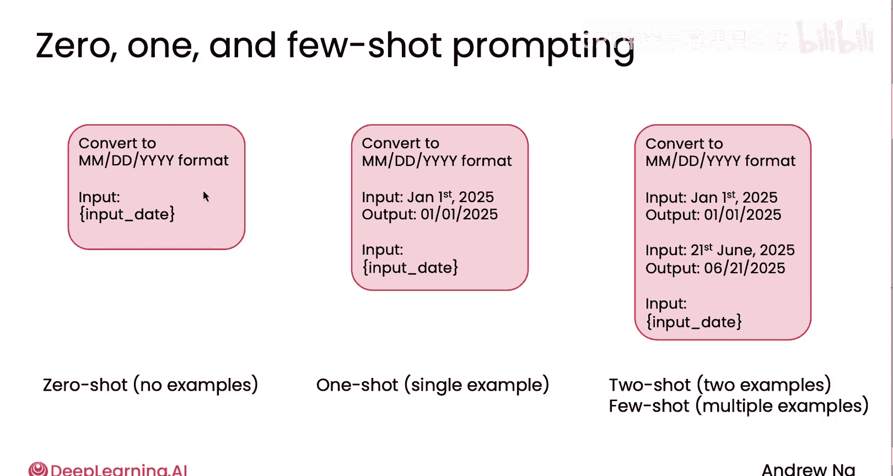
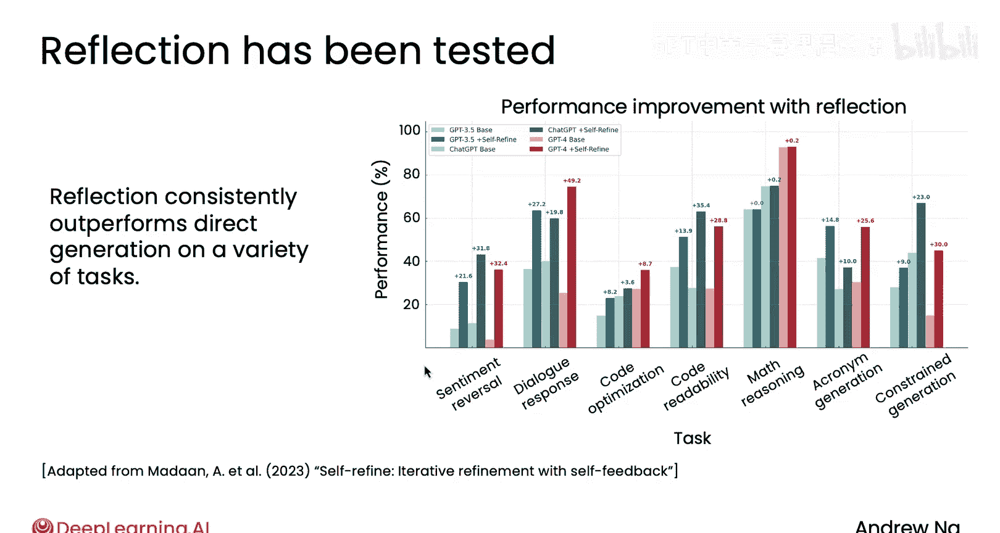
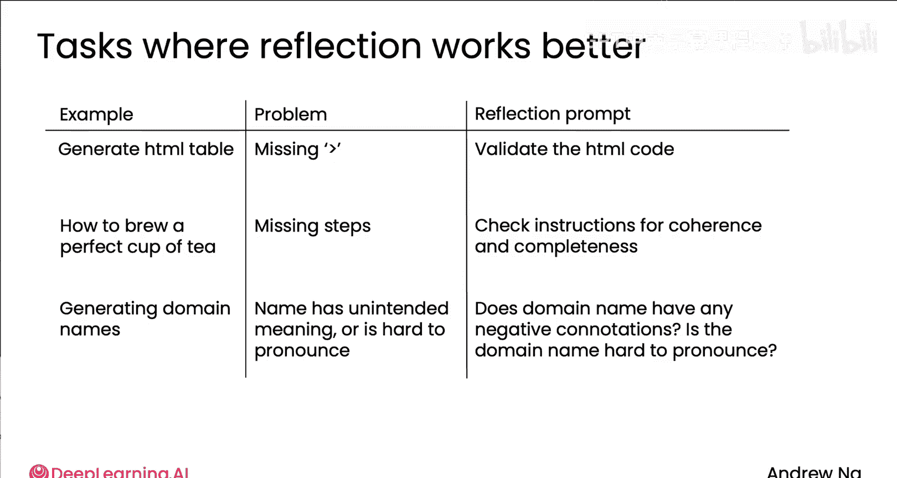
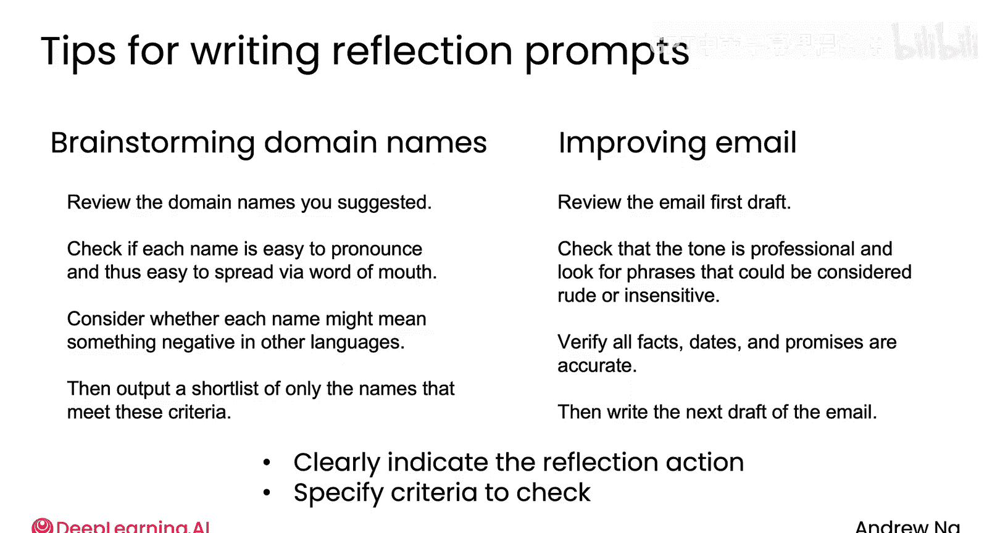

# 吴恩达《代理式AI：模块1-5｜Agentic AI 》中英字幕 - P9：2.why-not-just-direct-generation.zh_en - GPT中英字幕课程资源 - BV1hv4rz9EDn

Let's take a look at why we might prefer to use a reflection work though rather than just prompting an amount once in having it directly generate the answer and be done with it with direct generation。

 you just prompt the Om with an instruction and let it generate an answer So you are asking an O to write an essay about black holes and have it just generate a text or have it write the python functions to calculate compound interest and have you just write the code directly。

 The prompt examples you see here are also called zero shot prompting。

 Let me explain what zero shot means In contrast to zero shot prompting a related approach is include one or more examples of what you want the output to look like in your prompt and this is known as one shot prompting if in the prompt you include one example of a desired input output pair or two shot of few shot prompting depending on how many such examples you include in your prompt。

 and so zero shot prompting refers to if you include zero examples if you don't include any examples of the desired outputs。

That you want。 But don't worry if you't yet familiar with these terms。

 The important thing is that in the examples you see here。

 you're just prompting the arm to directly generate an answer in one go。

 which I'm also calling zeroshot prompting because we include zero examples。

 It turns out that multiple studies have shown that reflection improves on the performance of direct generation on a variety of tasks。

 This diagram is adapted from the research paper by Madan and others。

 and this shows a range of different tasks being implemented with different models and with and without reflection。

 The way to read this diagram is to look at these pairs of adjacent light followed by dark colored bars where the light bar shows zero shot prompting and the dark bar shows the same model but with reflection and the colors blue。

 green and red show experiments run with different models such as Gp3。5 and Gp4。

 And what you see is for many。

Aplications， the dark bar that is worth reflection is quite a bit higher than the light bar。

 but of course your knowledge may vary depending on your specific application。

 Here are some more examples where reflection might be helpful if you are generating structured data such as an HTML table sometimes it may have incorrect formatting of the output so a reflection problem to validate the HTMLl code could be helpful if it's basic HTML this may not hope that much sinces are pretty good at basic HTML。

 but especially if you have more complex structured outputs like maybe adjacent data structure with a lot of nesting their reflection may be more likely to spot bugs or if you ask an arm to generate a sequence of steps to comprise of certain instructions to do something such as how to brew a perfect cover of T sometimes the arm made missteps and reflection prompt to ask to check instructions of coherence and completeness might help spot errors or something that I've actually worked on was using an L to generate domain names。

Sometimes the names it generates has an unintended meaning or may be really hard to pronounce and so I've used reflection prompts to double check of the domain name has any problematic connotations or problematic meanings or if the name is hard to pronounce and we actually users at one of my team's AIF to help brainstorm domain names for startups that we're working on I want to show you a couple of examples of reflection prompts for brainstorming domain names you might ask it to review the domain names you suggested and then also to check of each names easy pronounce check each name might mean something negative in English or the languages and then output the shortlist of under the names that satisfy these criteria or to improve an email you can write a reflection prompt to tell it to review the email first draft。

 check the tone verify or facts date and promises are accurate this would make sense in the context of theM having been fed a number of facts and date and so on in order to write the email drafts orders would be provided as part the LM context and then based on any problems it may find。

Write the next draft of the email。 So some tips to writing reflection prompts it hope to clearly indicate that you wanted to review or to reflect on the first draft of the output。

 and if you can specify clearly the criteria such as whether the domain name is easily pronounce and whether it may have negative connotations or for email。

 check the tone and verify the facts then that guide the El better in reflecting and critiquing on the criteria that you cared the most about。

 I found that one of the ways I've learned to write better prompts is to read a lot of other prompts that other people have written。

 Sometimes Ill actually download open source software and go and find the prompts in a piece of software that I think is especially well done to just go and read the prompts that the authors had written so that I hope you have a sense of how to write a basic reflection prompt and that maybe you even try out in your own work to see it helps give you better performance。

In the next video， I'd like to share you a fun example where we'll start to look at multimodal inputs in opPs where have an algorithm reflect on an image being generated or chart being generated。

😊，Let's go take a look。