# 吴恩达《代理通信协议｜ACP： Agent Communication Protocol》中英字幕 - P10：10.adding-mcp-to-the-hospital-server.zh_en - GPT中英字幕课程资源 - BV1VfgrznEjS

So you've covered sequential calls and hierarchical calls。

 But there's one thing we haven't quite covered。P。 How can we get AP and MCP to work together。

 That's exactly what we're going do now。 We're going to convert our hospital AP server to useP as well。

 So there's a lot of talk about AP andP。 Well， remember。

 AP allows agents to communicate to each other provides an agent communication protocol。

P provides a communication protocol for mainly tools。 So we can actually use them together。

 The first thing that we're going to need is aP server。

 So what we're going to do is we're once again going to use a Jupyter notebook magic function to write out ourP server。

 Now， thisP server is going to allow users to find doctors near them。

 And we're going to use this particular capability to overwrite our hospital server。

 So how do we go about doing this。 Well， first up， you're going to use the right file function to go and write out ourP server to the my AP。

😊。

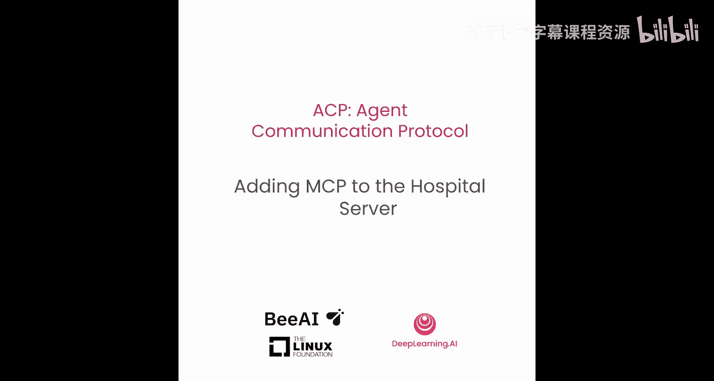

ject directory because we're eventually going to need our ACP server to communicate with our mP server file via standard input output。

 So then what we need to do is define theP server。 So first up what we're going do is import colorama and we're going to use for for some terminal formatting while we're at it we're also going to import the fastP capability from theP that's going to allow us to define ourP server we're also going to import Json to handle the data that we're going to be using and I'll come back to this in a second and we're also going need requests because the data that we're going to be returning using this particularP server is currently served via Github Now what exactly is thisP server going to do Well。

 it's going to return a list of doctors and we're going to use it to return the most relevant doctor to a particular person based on their state assuming they live in the United States。

 So let's go and define this tool So first upre。😊，ingTo create our MCP server。

 So we're going to create a new variable called MCP and set that equal to fast MCP。

 which we've just imported over here And we're going to name the server doctor server or being a little bit verbose here。

 Then what we're going to do is we're going to build up our tool。

 So we are going to use the MCP tool decorator and then create a new function called list doctors。

 This is going to take in one argument which is going to be a state as a string and it's going to return a string back。

 Then you're going to provide your doc string。 So in this case。😊。

This particular tool returns doctors that may be near you。

 It's going to take in state as we've mentioned， as a twole state code based on where you live。

 and it's going to return a list of doctors that may be near you。 So how were going to do this。 Well。

 I've currently got the data stored on Github。 And you can see that we've got a big Json document of a number of fictional doctors that we're going to be able to return back。

 So in order to bring that back via our mP server， we're going to make a request out to that URL。

 So that's the URL there。 So it's raw Github user content co For my Github， which is Nicknnack。

 And then we're looking at the ACp walkthrough repository we're looking at the refs。

 the heads main and doctors json that's where that file resides。 to bring that back via mP server。

 we're going to make a get request to that URL。 We're then going to load that response back via Json loads and we're specifically extracting the text from the response。

 and that should give us a list of doctors。 But remember。😊。

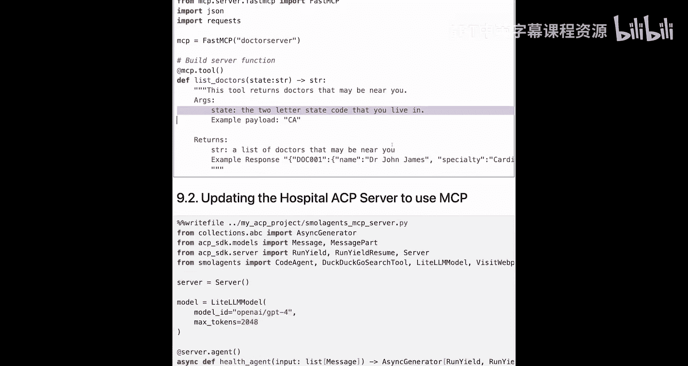

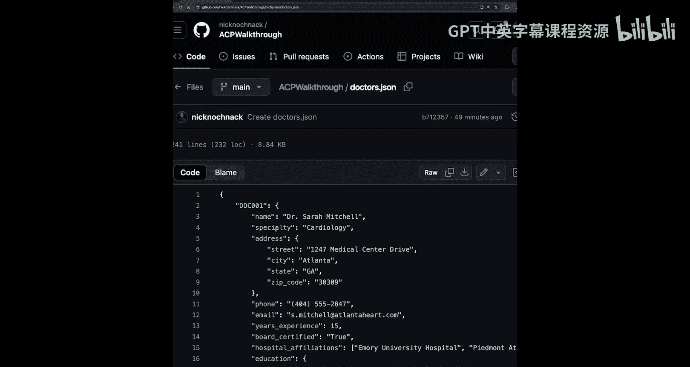

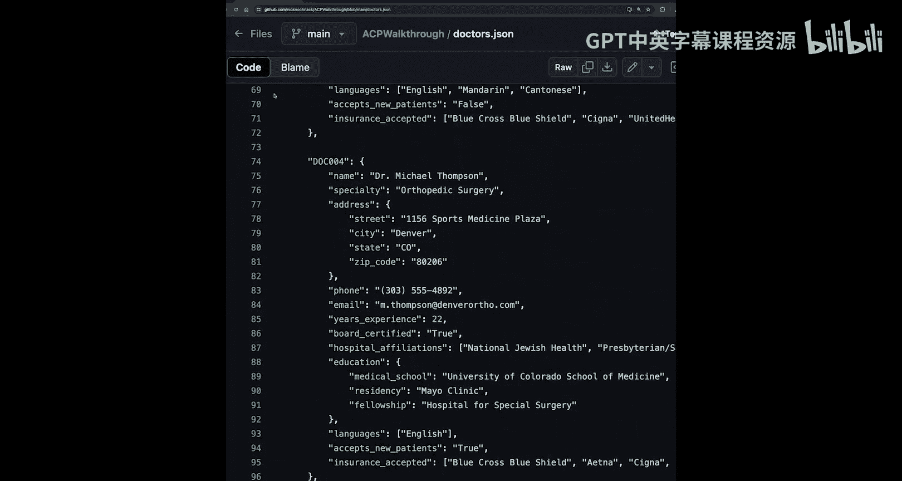

What we want to do is we want to filter through based on the user's state。

 So we're going to loop through each one of those doctors。

 Probably not the most efficient way to do this， but this gives you an example of what's possible。

 We're going to loop through each one of the doctor inside of that list so for doctor in doctors values if the doctor's address and specifically their state matches the state that we've passed through to our MCP server we're going to return that doctor back in a list and that's going to be stored inside of a variable called matches and then what we want to do is we want to return that back as a string So that's pretty much our MCP server done in terms of the core functionality Now if our ACP server calls this via standard input output we want to make sure that we run it using if name equals main。

 then we're going to use MCP do run and we're going to set the transport type to STDO So that's pretty much our MCP server now created Now if we run this cell it's going to override it inside of our my ACP project repository so that that MCP server is available to our ACP。

which we're going to update next。 Now that brings us to our ACP server。

 We're going to take our existing hospital ACP server and add in another agent。

 But this second agent is going to be leveraging mP as well So remember we define our initial small agent agent。

 which was a health agent and this was sort of there to help handle general hospital based queries。

 you can see that that was our docstream coal perspective。

 patients can use it to finances about their health and hospital treatments so on and so forth。

 Now this second agent is going to be using the MCP server that we've just gone and defined。

 So we're probably going to define a doctorbased agent。

 So how might we go about doing this because so far we've only really had one agent per ACP server。

 but you definitely can have more。 So we're gonna add a second one。

 So the first thing that we need to do in order to do that is bring a couple more dependencies。

 So from small agent so far， we've had the code agent the go search tool like L。😊。

And the visit web page well， we're also going to bring in the tool calling agent and the tool collection。

 these two are going to help facilitate working with MCP Now， whilst we're at it。

're also going to bring in anP dependency because we're going to need to connect to ourP server using STD So we're going bring that in。

 So we're going go fromP， we're going to import STD server prints。

 This is just going make it a little bit easier to help define how to connect and run against ourP server over here。

 So how exactly do we do this。 Well remember when we when an exportP server。

 we defined it asP server and it's running inside of the my underscore ACP project directory So we need to be able to connect and run ourP server。

 which the command for that would be U runP server So we can construct that command inside of the ST server。

😊，class。 So let's do exactly that。 So I'm going define a new variable called server parameters。

 and I'm going set that equal to STD server。 Then what you're going to do is create a new argument which is going be command and that is going to be equal to U。

 So that's the first part of the command that you need to be able to access theP server。

 So what are the other。 remember the full argument or the full command was Uv runP server。

 So we've got our command we now need to pass through the argument。

 So to our keyword argument're going set that as list and we're going to pass through the last which are going to be run and thenP server So this is effectively going to allow us to run and access our list tool inside of theP server Now we also want to pass through one last keyword argument and that is going to be and we're going set that equal to none because we don't have any environment parameters。

 Now what we're going do is we're going define our next。 So so far we've had our。😊，Health agent。

 which you can see over there。 we're now going to create another agent。

 but this one is going to use MCP。 So this first one is using our code agent。

 The next one is going to use the tool calling agent and the tool collection。

 So in terms of the structure， it's pretty similar we're just going to sub out the agent and get it to use MCP。

 So let's begin doing that。 first up going to define a decorator and we're going to set that equal to the server agent decorator。

 we're then going create a new function。 this is going to be an asynchronous function。

 it's going to be defined as the doctor agent。 remember when we went and discovered our agent。

 we're able to see that they pick up the name of the agent or the name of the function as the name of the agent。

 So in this particular case， if we went and rerun that hierarchical workflow。

 we'd see the doctor agent popping up with our new hospital server。 And then as usual。

 we're going pass through our same input。 this is going to be a list of messages and that is going to return an asynchronous generator。

 which is going to have parameters of run yield and run yield resume。😊。

Then we're going to define a doctoring。 This one' is going to be pretty simple。

 So this is a doctor agent， which helps users find doctors near them。 Now。

 what we need to do is start defining our tool collection。

 Now our tool collection is going to allow us to discover tools on the MCP server。 So to do that。

 we're going to create new with statement。 And this is going to connect to the tool collection using the from MCP method。

 We're going to pass through our server parameters， which we've just defined up here。

 and then we're going to set the trust remote code parameter equal to true。

 So that's going to allow us to access those tools on that server。

 And we're going to run this as the tool collections。

 We'll be able to access it using this shortened statement。

 Now what we need to do is we need to pass these tools to our tool calling agent because so far we haven't actually define an agent。

 We've defined the tool collection， but not the agent itself。 So let's do that。😊。

So we're gonna create a new agent。 and this is going to be equal to tool calling agent to that。

 we're gonna pass our first keyword argument， which is going to be tools。

 and this is going to be a list which is going to be an unpacked set of values from our tool collection tools value。

 So effectively grabbing all the tools from the tool collection over here and we're passing them to our tool calling agent over here。

 Now we also need to give our tool calling agent and L。

 So we're going set that parameter as model is equal to model that's just going take in our G for L over here。

 But again， you can go and update this to what you want。 You can use o lama。

 you can use whatsson next。 you can use a number of different providers AP is framework and provider agnostic so that is pretty much our agent now done Now we also need to go and extract our prompt。

 Now remember because we had our input we can go and grab the first prompt and then grab the first part of that prompt and then the content value and that should be our prompt。

 So let's do that So we' going grab our prompt variable and we're going set that equal to input0 and then part0 and then we're gonna grab。

😊，Content， and then we're gonna send that to our agent。 So to do that。

 we can create a new response variable。 and we're gonna set that equal to agent dot run。

 and we're gonna pass our prompt to it。 So that's pretty much the crux of our agent now using MCP。

 The last thing that we need to do is yield this back to our user when they're going and run the server。

 So we're going go yield message and that message is going to be constructed of a number of parts。

 the main message part is going to take in all of our content。

 which is going to be the response from our MCP or our toolcal agent。 So that is that there。 perfect。

 cool， that should be our MCP agent now done。 Now if we' go run this。

 that is our small agent server now update。 So now if we go and take a look at that small agents server do。

 maybe go and take a look inside of that repository now。

 So it's going be available for you to take note and play around with。😊。

So if you go to my ACP project and then go and take a look at the smallag server。t profile。

 you'll see that we now have a doctor agent so you can see that we're now running two agents on this one ACP server。

😊，Now， we need to make sure that we go and rerun the server now that we've gone and updated。

 So if we go and open up our terminal again， we're gonna make a quick update。

 Remember the environment's gonna stay for 120 minutes。

 If you go away from this lesson and come back， just make sure that you double check that the server is still up and running。

 And then we're going to render that iframe。 So remember， we're gonna to be running on terminal2。

 because that's where we've run the hospital server so far。 If we go and run this。

We're going to bring up our terminal。

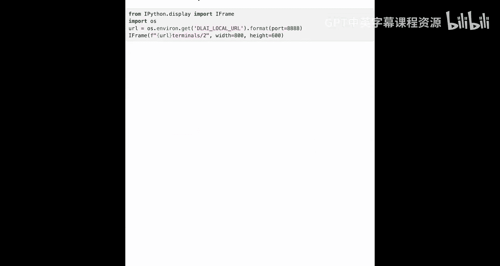

Take a look that's available there。 what we'll do is we're just going to stop that server。

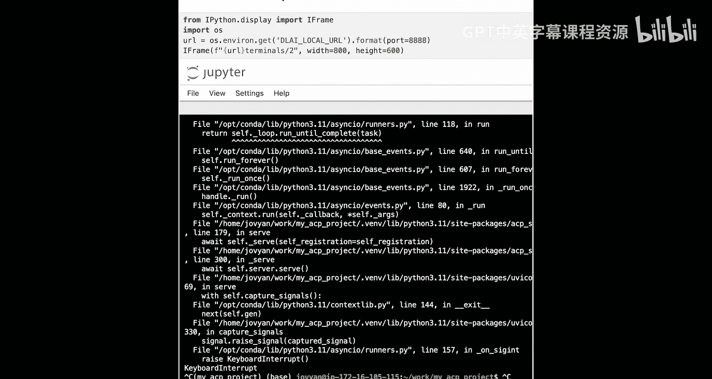

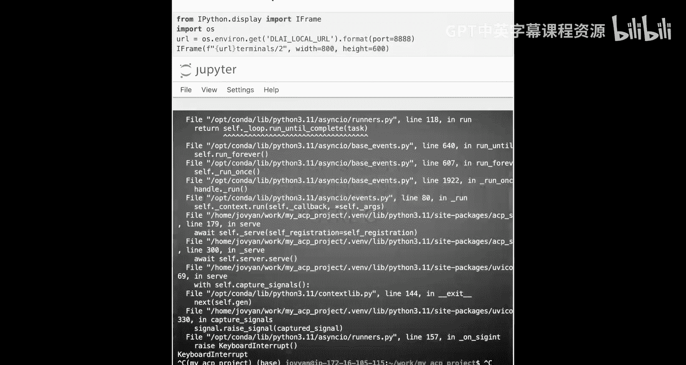

We're just going run clear to clear that terminal。 And then we're going make sure that we rerun our server。

 So remember it's been exported to small agents underscore server do Pi。

 So let's just make sure we run that particular server。 we're going U run small agents server do Pi。

 And if we go and run that， let's see if we get any errors that's looking pretty good so far So we can see that our server is now up and running and it's running up port 8000。

 All that's really left to do is actually make a call。 Now。

 remember when we've gone and connected to our MCP servers before AP servers before。

 we've gone and use the AC SDK client。 That's exactly what we're going to do here。 But remember。

 now that we've gone and to find another agent。 We're just going make sure that we target this agent rather than the health agent。

 So let's go and do that to begin with we need a couple of dependency。 So let's bring those in。

 So we're going bring ayncch to make the call。 We're gonna bring N asnc so we can nest them。

 we're gonna bring in the client from the ACP SDK。 and we're also going bring in color。

 So we can print it out using a colored output。😊。

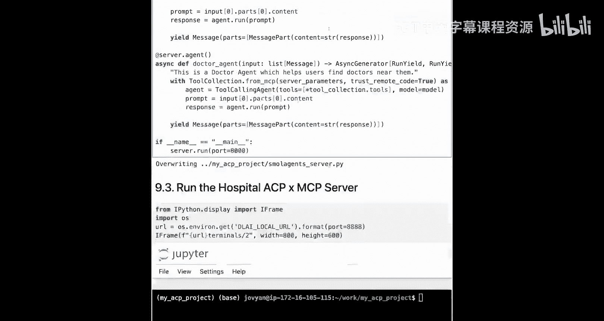

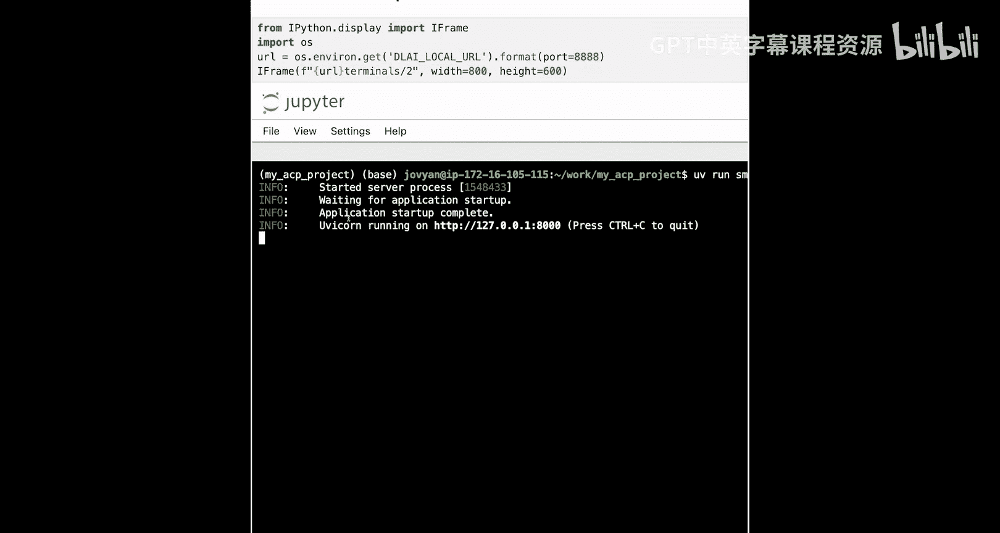

We're then going to apply N asynchio and that should be pretty much it when it comes to our dependencies。

 Now， when it comes to actually making our call， we're going to create a new client and this is going to be a new function which allows us to call out Now main differences we're going to change the agent that we use and we're going to change the prompt that we use So let's go and define this we're going create an asynchronous function called run doctor workflow This is going to return nothing and that is going to connect to our client using a with statement。

 And remember we're still running a port000 so we can connect to that there。

 but also take note that we're getting this warning cannot reach server check if running onp1270。

01 port 8333 This is occurring because when we start up our ACP server It's automatically going to try to register our agents onto the BI platform。

 This provides a register for your agent so that you can call them via Ui but also via the command line and orchestrate them all。

 We're going to start this up in the next lesson。😊。

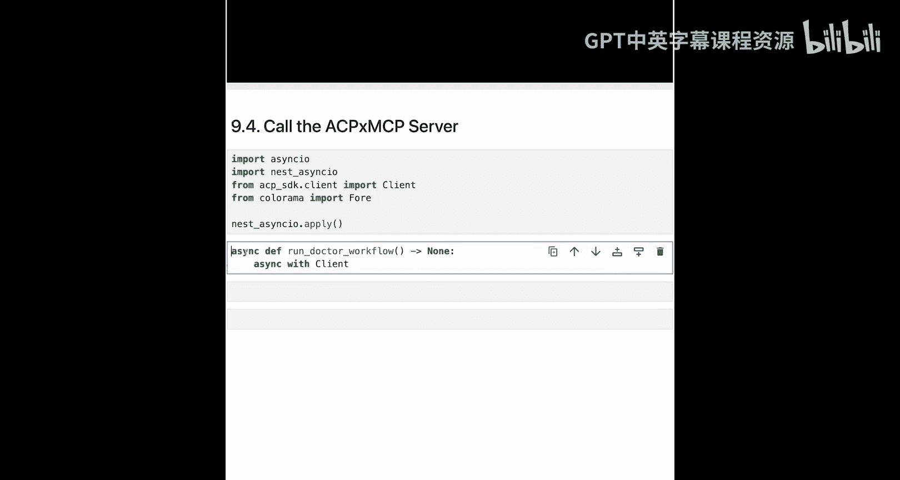

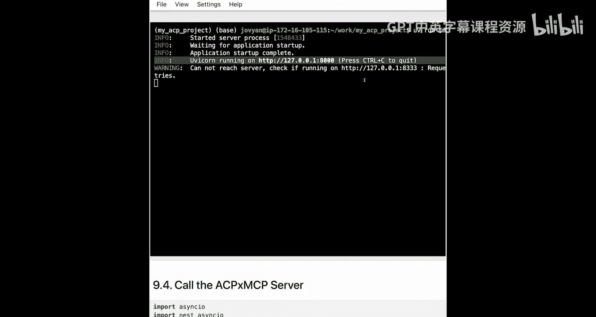

Now just be mindful of this warning。 It won't affect the running of this code。

 So let's keep going and connect to our hospital server。 So we're going to create a base URL。

 We're going to set that equal to Http colon for forward s local host 8000 and we're going to run that as the hospital client。

 Then what we're going to do is we're going make as synchronous call and call out to our hospital client。

 So this is going to be stored inside of a variable called run1 we're going to set that equal to a await hospital do run sync。

 We're then going to pass through the agent that we want to call out to which is going to be the doctor agent because remember we're going and define a second agent now we're going to call out to the doctor agent rather than the health agent So we're going to hit that agent and now we pass through our prompt。

 So our prompt is going to be。😊，I'm based in Atlanta， Georgia。Are there any cardiologists？Nmei。

Question mark。So that's going to be our prompt。 And keep in mind， this should ideally take the state。

 Georgia and go and find whether or not we've got any doctors or cardiologists that are available in that particular state。

 We haven't actually gone and done a filter of each type of doctor。

 you might go and choose to update that and see how that performs for now we' just very much focus on state So what we can go and do is then we just need to print out our content And remember when because we're getting the message parts and the messages back。

 We want to make sure that we get the result from our first prompt because we're only passing one through and the first part。

 we're only outputting everything as a single parts。 So we're just going grab everything。

 So if you're doing streaming， you'll be able to grab each one of those parts as they generated。😊。

Okay， so let's create a new variable called content。😊。

And we're going set that equal to run1 dot output。 We're gonna grab the first message。

 We're then going grab the first part and then grab the content， and then we're gonna print it out。

 So we're going to use light magenta to print it out to our terminal。

 And we're going to print out the content and reset the terminal so that we go back to our regular coloring。

 Okay， cool， Now if we go and run that。 that is our workflow now define all that's really left to do is actually go and run this workflow。

 So to do that， we can use async Io dot run and to that。

 we're going to pass through our run doctor workflow function。 And if we go and run that。😊。

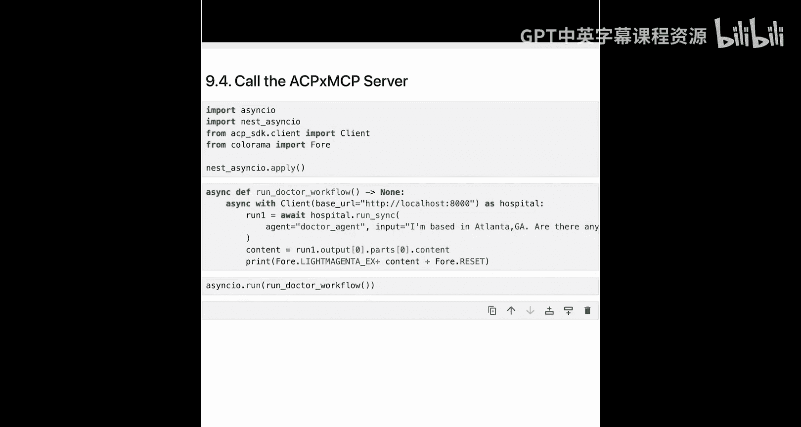

Take a look， looks like they're unstared， we're searching， it looks like we've found a doctor。

 do we get a final response？

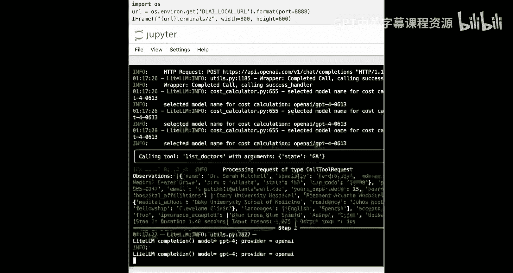

There we go。 So we've now got a final response。 Yes， there' are a cardiologist near you in Atlanta。

 Georgia。 For example， Dr。 Sarah Mitchell， who specializes in cardiology， is based at 1，2，4。

7 medical center drive Atlanta， Georgia。 She has 15 years of experience and is board certified。 Now。

 I wonder if we go back to the data。 if we can find that particular doctor and take a look。

 that's actually our first result。 So you can see that we've gone and found that first doctor and they just so happened to be a cardiologist。

 but we haven't actually focused on that。 We've filtered purely based on the state。

 So what you might go and do is try updating the prompt See if you can find a doctor in Arizona or in California or in Colorado。

 You should be able to use your doctor agent to now do that。

 but we've now demonstrated how we can use MCP and ACP together。😊。

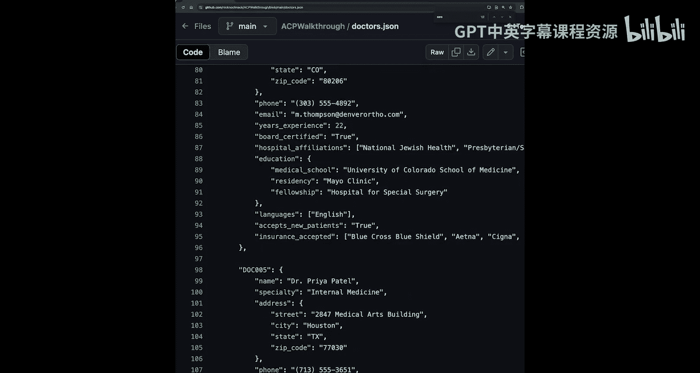

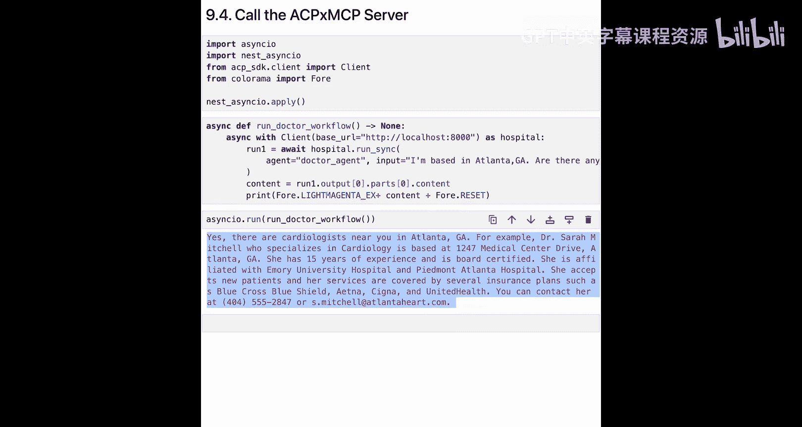