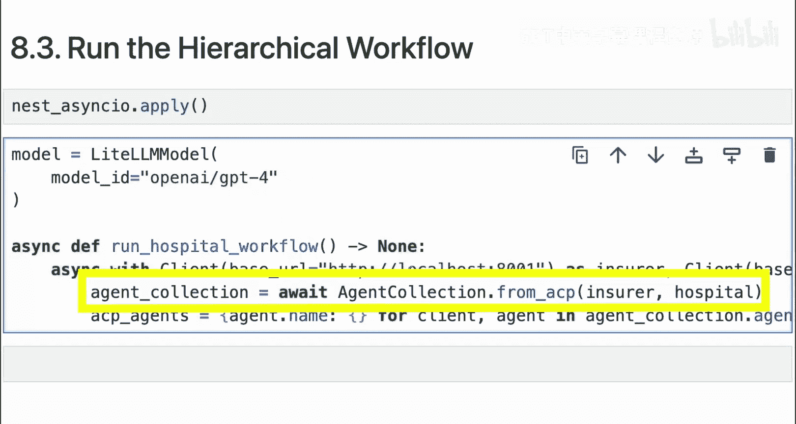
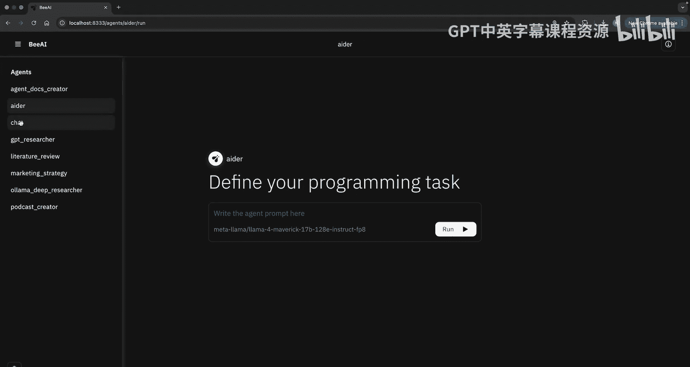
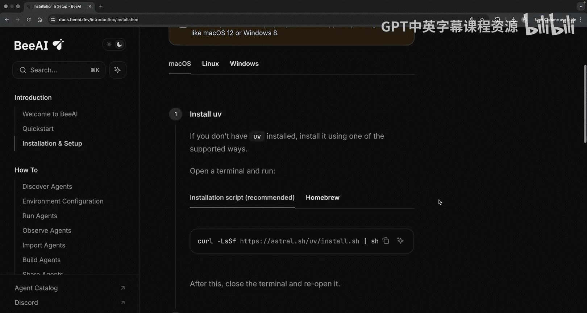
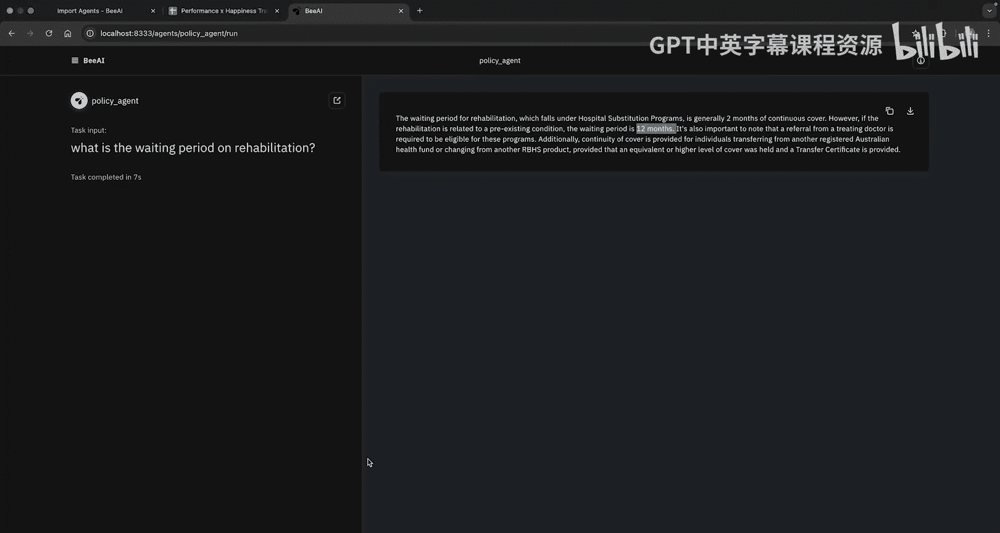

# 吴恩达《代理通信协议｜ACP： Agent Communication Protocol》中英字幕 - P11：11.managing-acp-compliant-agents.zh_en - GPT中英字幕课程资源 - BV1VfgrznEjS

Okay， so you've gone all the way。 You've built an AP server。 You've called out to it via a client。

 You've created a sequential call and even created a hierarchical call。

 We've also updated that server to be able to use MCP。

 But what if we could call those agents via Ui and have them centrally managed inside of a repository。

 Well， this is where the BI platform comes into play。

 in the last lesson you are able to discover agents on an AP server using the Python client。

 But what if there are other ways to do this。 one of these ways is via registry。

 Think of a registry as a centralized or where you can access a range of agents which may have different use cases。

 tools and capabilities。 The registry also allows you to centrally manage。

 deploy and search for agents and in the case of the registry I'm about to show you。

 you can also perform offline discovery。 This means you're able to search for agents without network connectivity。

 The registry that you'll be learning about is provided via the BI platform。

 It has its own built in registry， but also provides a user interface to run and manage agents as well as providing the ability。

😊。

ACP to have them change sequentially and hierarchically there's a few different ways to install it depending on what operating system you're running on。

 if you're running on MacOS or Linux， you can follow these instructions here or these here if you're using Windows。

 you can follow this set of instructions Now to start the BI platform you can run BI platform start and walk through the setup instructions I'm going use what's an X AI and specifically Lama for on the platform you can use whatever you'd like Now build right in。

 you've got a few popular agents right out of the box like G researcher for research AA for programming and the podcast creator agent for you guessed it creating a podcast if we choose one of them。

 let's say Ada we can pass through prompt and run it and you've got your agent run。

The thing is， you've gone to all that effort to build your own ACP compliant agents。

 So can you add them to the registry inside of the BI platform。 Sure， Ken， let's go do it。

 So we're gonna bring in our ACP agents into the BI platform to do this first up。

 I've gone and replicated the deep learning do AI environment on my local machine。

 and I've updated this to use some different LM。 So right now。

 I'm using the Watson X Lama for instance， in my small agent server and I'm doing the same inside of my crew agent server。

 you can see that here。 and you can also see that here。 Now。

 what I want to do is I want to sort of show you what's possible with BI。

 So the first thing that we're going to do or the first command that I'm going to run you through is how to go about installing it if you want to run it locally。

 So to do that， you can run B。😊，Install B AI and going ahead and run that it should run on your machine。

 and then you can go and kick it off by running B AI platform。Start。

 and that will kick the B AI server off。 Then you'll be able to run the command B AI and all of its derivative。

 So if we go and run B AI to begin with， you can see I've got a number of different options。

 I've got a number of different commands。 I've also got a number of different agent commands。

 We're gonna focus on the agent commands for this particular lesson。 So over here。

 if I go and run B AI list。 I'm able to list all of the different agents that I've got available。

 So let's go and try that。 So if I hit clear and then run B AI list。😊。

You can see that I've got a number of agents that come prepack inside of B AI。

 You can see I've got an agent documentation creator。 I've got Ada chat。

 G researcher and a bunch more。 Now we can actually go and run these by running B AI run and then the agent that you want to run here。

 but I want to focus on using the agent that you've already gone and built throughout these lessons rather than using one of these。

 So before we go and run that， let's actually go and make the ACP agents that we've already gone and created compliant with the BI platform。

 So let's go and do that。 So inside of our more agent server。

 I'm going to import the metadata capability and this is just going to allow us to define what the documentation is associated to that particular agent and how to go about running it。

 So if I bring in the metadata capability there and then we're going scroll on down to our health agent Now inside of the agent decorator。

 I'm going to set the metadata keyword argument and that's going to be equal to our metadata class and then we're going to set。

😊，What the Ui value is and I'll come back to this in a second， what that Ui is going to dictate。

 But for now stick with me the type is going to be a handsoff agent。 there's other types of agent。

 there's also chat agents and the user greeting。 this is going to be almost like the prompt greeting is going to be ask your health question Now I'm also going to set the same or a slightly similar one for our doctor agent that we created in our small agent server So I'm going to set the metadata and set that equal to metadata the Ui is again going to be a handoff agent and then what we're going to do is we're going set the user greeting for this one find a doctor past your query and state here right so we've now got our type and we've also got our user greeting set for our doctor agent now let's quickly go and do the same for our crew AI agent so we're going to again import metadata over here and then inside of our agent decorator we're going to set those same parameters so we're going to set the metadata keyword argument provide the metadata class we're then going to set the Ui type to hands off and the。

😊，Degreeting， we're gonna have a slightly different one。 Got a question about your policy。 ask here。

 Okay， so that's pretty much it when it comes to going and setting up our agents。 Now。

 the beautiful thing about this， and you might have seen it when we went and built our last agent and updated it for MCP that we weren't actually registering the agents。

 that's because B AI wasn't running on the deep learning do AI platform。

 but I've got it running locally。 So what does this actually mean。 Well。

 if I go and start up our two agent servers。 So let's go and kick off our small agent server。

 if we go U run small agents server dot Pi， we should get a server up and running and take a look。

 we are running over。😊，Yeah， you can see we're running on port 800。

 but we've got all this extra information。 We're going come back to that in a second。

 Let's go and start up our crew agent server as well。 So if we got U run crew agent server。😊。

Got a bit of a warning， but that's okay。 Looks like we're now running。

 Let's maybe zoom out so we can see that a little bit more clearly。 So we've got our server running。

😊，Right over yeah。 So we've got our server running on port 8001。

 We've got our other server running on port 8000。 Now。

 the cool thing about this is that if we go and run B， AI， let's actually create a move B。

 AI into its own separate terminal。 So if we now go and run B AI list。😊，Take a look。

 we've now got our doctor agent， our health agent and our policy agent now described or now available inside of BAI。

 so if we wanted to go and run one of these agents， for example， let's go and run our doctor agent。

 we can go and run BAI run doctor agent。😊，And take a look。 We've got a greeting。 Find a doctor。

 past U Korean state。 So let's try the the same prompt that we had within when we actually went and built as server。

 So I'm based in Atlanta。😊，Georgia， are there any cardiologists near me。 Okay。

 so if we go and take a look at our server， take a look， it's actually kicked it off。

 It looks like we've got a response。 And if we go and jump back looks like we've got a response。 Yes。

 there are several cardiologists near you in Atlanta， Georgia。 One of them is Dr。 Sarah Mitche。

 who's a board certified and has 15 years of experience。

 So you can see that we're now able to add our agent to the registry。

 but we're also able to run them。 if we went and run our policy agent， for example。

 we could go and do that。 So if we go and run B AI run policy agent。😊。

So you can see that we've got our graing there， so've got a question about your policy， ask here。

 so we might go and say what is the waiting period？😊，On physiotherapy。

And if we go and jump back to our server， you can see that that is now running。

 It's looking like it's going in searching through our knowledge base。

 I'm not actually sure whether or not we've got that inside of our vector database。

 But let's see if we get a response back。 So take a look。 We've got our agent running。😊。

Do we have a final response？Take a look。 The waiting period on physiotherapy is two months。

 Group Physiotherapy is covered with a limit of $35 per visit。

 So we've now gone and rendered a response using the B AI platform。

 but could we also use this inside of a UI， Well， if we actually go and run B AI UI。

 This is going to open up a separate Ui where you've got the ability to go and use the server here。

 And if we go and take a look all of our agents are going to render over here。

 So we've got our doctor agent， We've got our health agent and we should have our policy agent。

 So if we went and ran it over here， we can go and say what is the waiting period on what did we want to say。

 what is the waiting period on， I don't know， dental。😊，Actually。

 let's just stick with rehabilitation。😊，And if we go and run this。

 So this is going to go and kick it off， if we go and take a look at our server， take a look。

 they're running， but we're now running it inside of the UI。 and we've got our final result back。

 the waiting period for rehabilitation， which falls under the hospital substitution programs is generally two months of continuous cover unless it's preexisting condition in which case it is 12 months。

 So we've now gone and built it out and we've actually run it inside of the BAI platform and inside of the UI So you can see that you've now got the ability to assign it into the registry and run it inside of a nicely designed user interface On another note。

 definitely go check out the resource section at the end of the course。

 I'll make sure to link to the documentation， the ACP protocol。

 the BI platform and my ACP Github reer as well as a few other helpers。😊。

