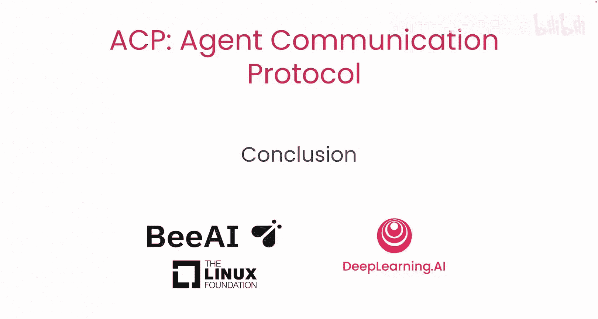
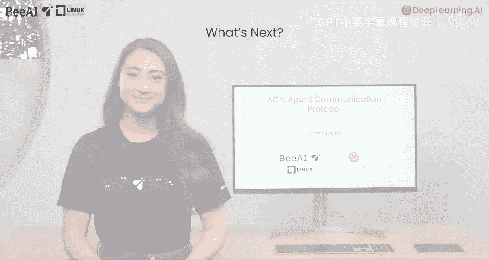
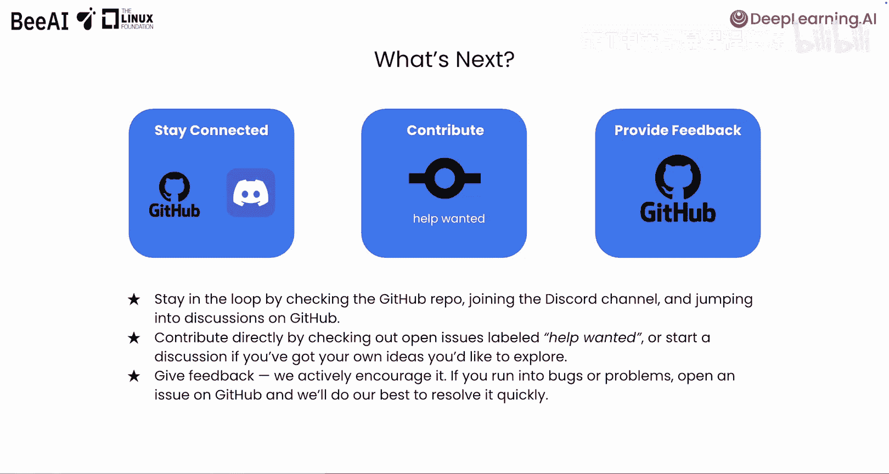
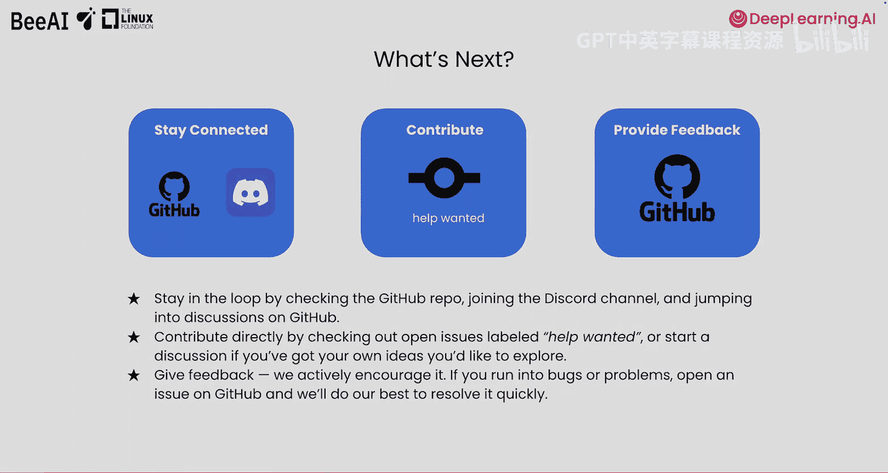

# 吴恩达《代理通信协议｜ACP： Agent Communication Protocol》中英字幕 - P12：12.conclusion.zh_en - GPT中英字幕课程资源 - BV1VfgrznEjS

We hope that getting hands on and building ACP agents has sparked your creativity and gotten you excited about what's possible when agents can collaborate effectively throughout this course。

 you've explored why Age communication protocol is valuable。

 learn some of its core principles and actually built and ran your own ACP agents。

If you're ready to take the next step and join the growing community shaping the future of ACP。

 here's how you can get involved。 Stay in the loop by checking the Github repo。

 Join the Discord channel and jump into the discussions on Github。 If you've built something cool。

 share it with us in the show and tell。 contribute directly by checking out open issues labeled help wanted。

 Or if you've got your own ideas you'd like to explore， start a discussion。😊。

Lastly， give feedback， we actively encourage it。If you run into bugs or problems。

 open an issue on Gitthub and we'll do our best to resolve it quickly。

ACP is open governed and community driven。 It's being built by the community， for the community。

So whether you're building， contributing， or just curious， there's a place for you in this ecosystem。

Thanks for learning with us。 And we can't wait to see what you build next。😊。

