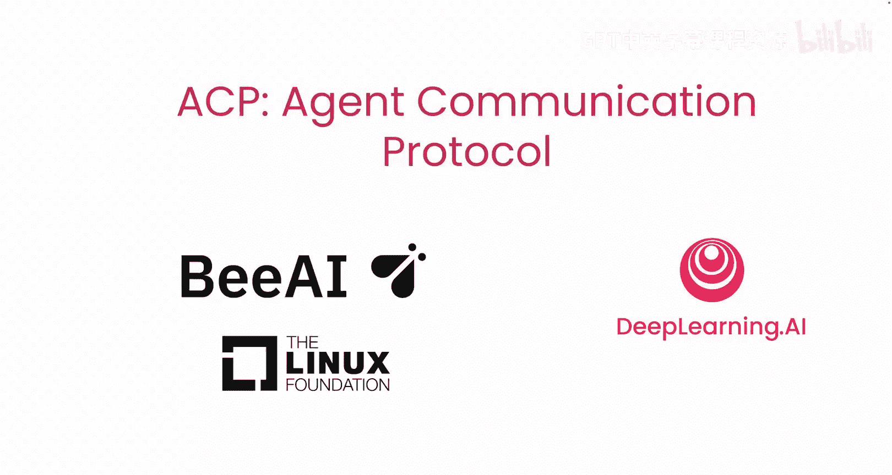
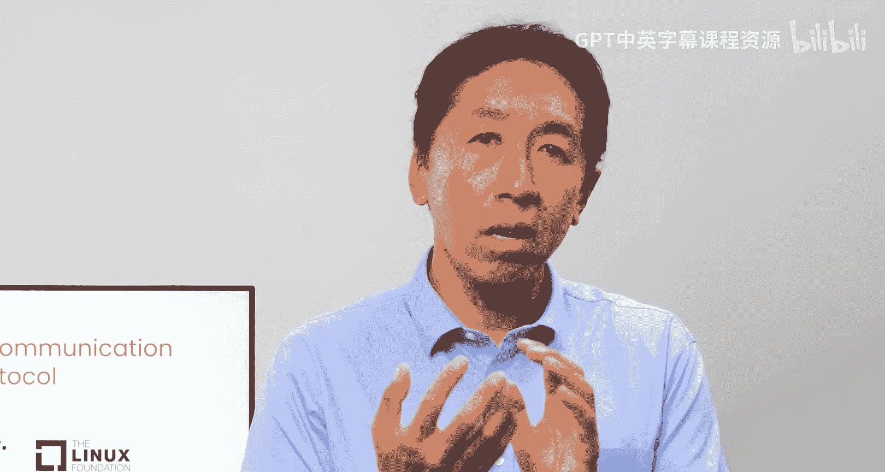
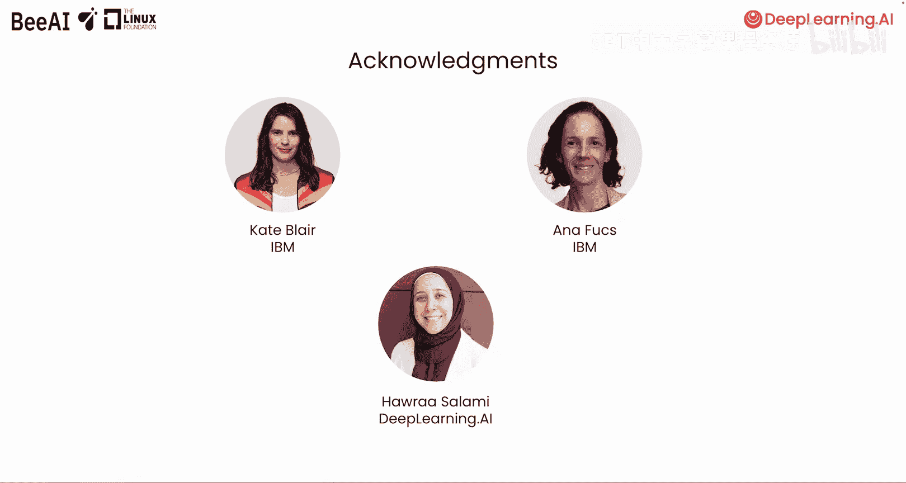
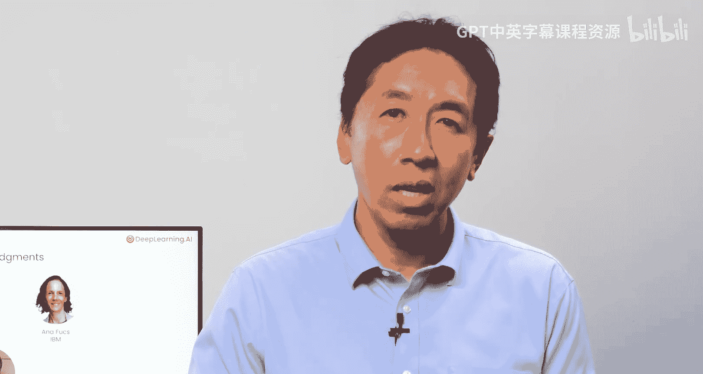

# 吴恩达《代理通信协议｜ACP： Agent Communication Protocol》中英字幕 - P1：1.intro.zh_en - GPT中英字幕课程资源 - BV1VfgrznEjS

Welcome to ACP Age Comication Procol built in partnership with IBM Researchs BAI project In this course you build and run agents that communicate through ACP or the agent communicationation protocolcol you configure sequential and hierarchical workflows of multiag that collaborate through a unified RE interface provided by ACP I'm delighted that the instructors to this course are Sandy Bessson。

 who is AI research engineer and ecosystem lead as was Nicholas Rent who is head of AI developer advocacy and IBM Thanks Andrew。

 we're excited to work with you on this course to build a team of agents that communicate and collaborate through ACP you can host an agents on an ACP server which will receive rest requests from an ACP client and for those requests to the agent to execute。

😊。

The ACP client， which can itself be an agents or any other process。

 discovers the agents using the endpoints of the ACP servers and an initiates request。

This unified client server interface hope standardize the communication between agents across teams。

Take， for example， a multi agent system for customer Savo。

One team might build a logistics agent answer questions related to all the status。

 a different team might build a different rag agent to answer general questions related to products。

 each team can make the agent available through an ACP server while yet the third agent hosts the inside the ACP client can process customer inquiries and route them to the specialized agent。

Each team can implement the agents using a totally different framework or even switch between frameworks without needing other teams to make any changes to their own code。

 because the communications happens through a standardized protocol。

 This standardization also makes it easy to integrate any existing agent into the multi agent workflow。

 You can wrap an agent in an ACP server， which enables an ACP client to discover it。

 and integrated into the workflow。 These existing agents can also be made visible in a registry or agent catalog。

 The catalog can provide centralized agent listings and simplify searching for agents。

 especially in large scale deployments or enterprise environment。

 ACP is an open source protocol that is also openly governed， meaning no single company controls it。

 Many open discussions with the community have shaped the development of this protocol and continue to shape its evolution。

 It's also worth noting that ACP and MCP can be。😊。

As complementary protocols， an ACP agent can use MCP to access tools and then use ACP to interact with other agents In this course。

 you'll first wrap a Ra agent built using the Q AI framework in an ACP server and then interact with it through an ACP client to create the sequential workflow。

 You'll wrap a second agent built using the small agents framework in another ACP server。

 In the ACP client， you'll learn how to discover the two agents and chain them sequentially after that。

 you'll build another hierarchical workflow， where instead a sequentially training the agents。

 you'll use a third routing agent coded using the small agents framework in the ACP client。

 which will route the input queries to one of the specialized agents。

 You'll then extend the small agent ACP server to use MCP to get access to tools。 And finally。

 you'll learn how you can discover and run an import ACP agents to the BAI platform。

 which is an open source registry for agent discovery。 Many people have worked to create this course。

 I like to thank from OM。😊，Kate Blair and Anna Fukes from Deep AI。

 Harra Salami also contributed to this course。 ACP standardizes communication between sets of agents that might have been developed by the same developer or team or developed by different teams within the same organization。

 but is not only intended for local development environments。

 It can also be used to connect distributed agents even across different organizations。

 and that specifically is what you learn more about in the first lesson or Sandy。

 Let's go to the next video to get started。

