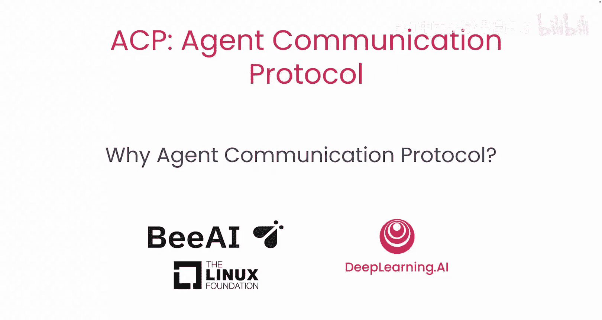
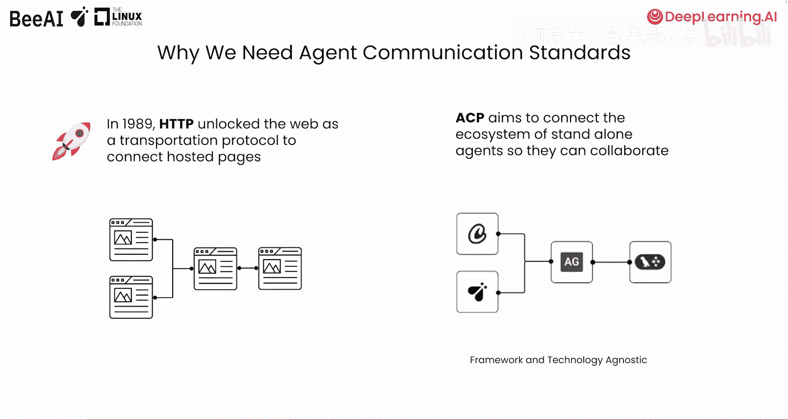
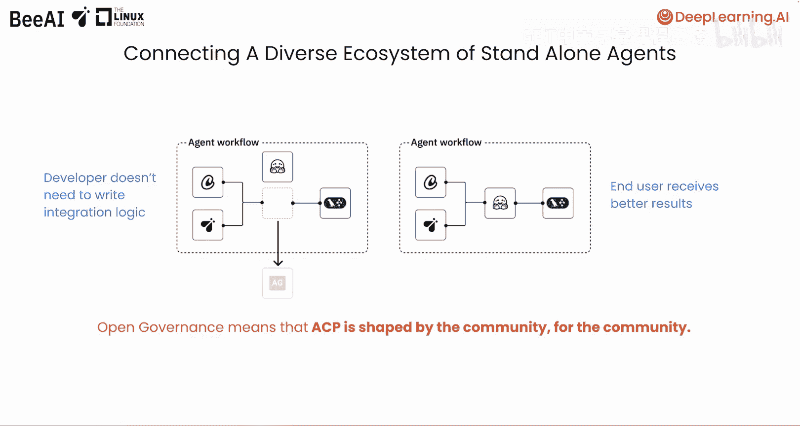
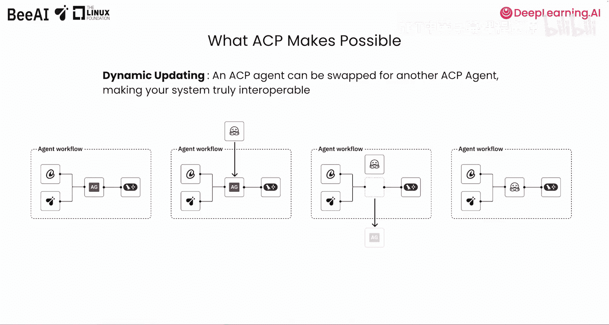
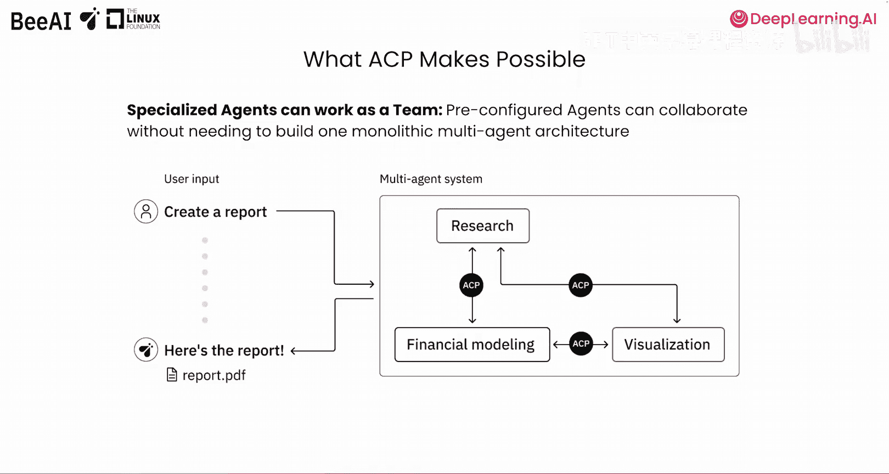
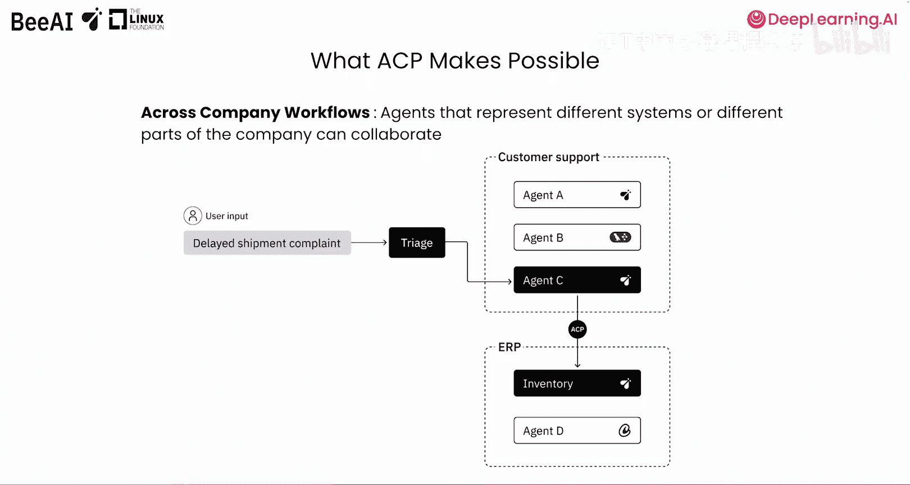
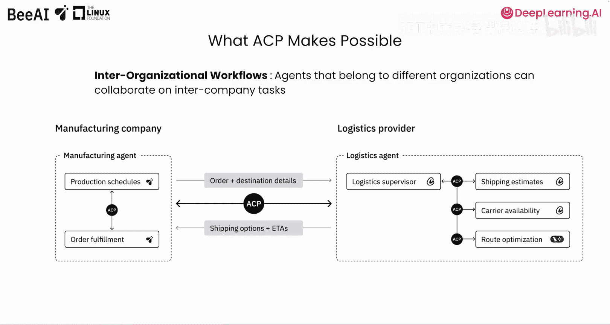

# 吴恩达《代理通信协议｜ACP： Agent Communication Protocol》中英字幕 - P2：2.why-agent-communication-protocol.zh_en - GPT中英字幕课程资源 - BV1VfgrznEjS

In this lesson， you'll learn about the importance of open standards。

 how ACP is helping to fill a gap in the evolving agent landscape and about the types of use cases that it enables。

 Let's jump in。

In 1989， Tim Bners Lee proposed the World W Web while working at Cern to enable transfer of raw data over the World wide Web。

 He developed the first version of H TTP， a transportation protocol for raw data。Before HTTP existed。

 there was a patchwork of protocols like FTP， Tnut and Gopher that each had specific use cases。

 but HTTP soon took over in popularity because it was simple and openly governed。

It was one of the catalysts that LED to the explosive growth of the Web in the same way that H TTP connected disparate hosted web pages。

 ACP or agent communication protocol uses H TTP to connect the diverse ecosystem of standalone agents。

It provides a way for agents to communicate and collaborate with one another easily。

 no matter what framework they're built on or technologies they leverage。

Building complex multi agent systems like agents performing search， writing。

 editing or tackling workflows requires collaboration with other agents to accomplish a shared goal。

 There are many frameworks that target this agent development。

 but the ability to plug and play with agents from different frameworks is an unmet need。 Today day。

 most agents lack a shared protocol for communicating with one another。

Connecting agents built using different technologies requires developers to build brittle and non repeatable integrations。

 which are also susceptible to the constant changes pushed in the frameworks。

ACP provides a unified interface for agents to communicate regardless of their framework。

One of the key values that ACP holds is open governments and community collaboration。

This means instead of just being open source where developers can look at the code and request changes。

 But decision making is made by a single or group of companies。

 ACP's open governance invites the community to shape the road map。

 So ACP becomes a protocol shaped by the community for the community。 much like H TPP。

ACP benefits not just the developer who doesn't need to constantly rewrite integration logic。

 but also the end user who will receive better results because there is more choice for the developer to choose the best agent for the task。

Now， you're going to learn some of the exciting patterns that ACP makes possible。 First。

 dynamic updating with how fast innovation is advancing in this field。

 the agent that was best last month is often not what works best this month。

 And as we just discussed， making an agent AP compatible。

 means that you can swap agents in your systems。 Even if the new agent was built using a different technology。

 This makes your system truly interoperable and can be very useful for testing what agents give you the best performance in your system。

😊。

Specialized agents can work as a team。 So instead of building one giant agent to handle everything。

 ACP allows teams of specialized agents to collaborate dynamically。

 If you had a research agent collaborating with an agent that creates a beautiful visualization and an agent that is especially configured for financial modeling。

 that when you ask for a report， the agents could hand off tasks to one another。

 just as teams do when they collaborate。 You can also create a cross company workflows。

Companies rely on many platforms like a customer relationship management platform。

 enterprise resource planning， human resources systems， project management tools and many more。

 For example， if a retail company uses a customer support platform and an ERP system to manage their inventory and logistics。

 Each system could have a dedicated agent to manage tasks。

 So if a customer submits a complaint about a delayed shipment。

 the customer support agent can recognize that it needs the assistance of an inventory agent and sends a request using ACP。

Each agent stays focused on its domain， but collaborates using ACP。

Now ACP also opens up the opportunity for interorganizational collaboration。

You'll build out an example of agents communicating from different organizations with Nick。

 But in a nutshell， ACP can enable agents from differ companies to securely collaborate。

 even when they're hosted by completely separate companies。

 This opens up a whole new world of possibilities as we move from just using agents internally to making our agents available to external providers so companies can work together。

ACP also supports human in the loop collaboration so that you can ensure that your agentic system is operating responsibly into your expectation。

In the next lesson， we'll learn more about the architectural components and core principles of ACP。

