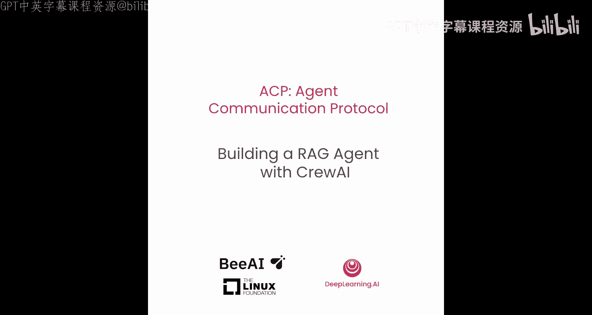
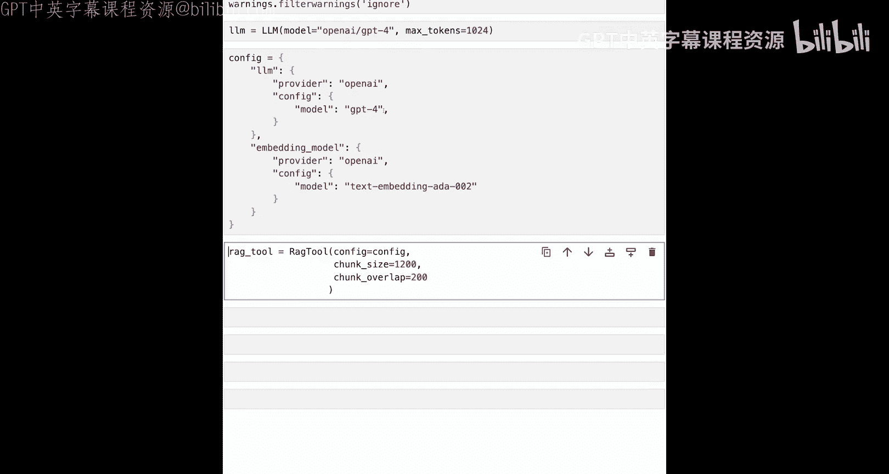
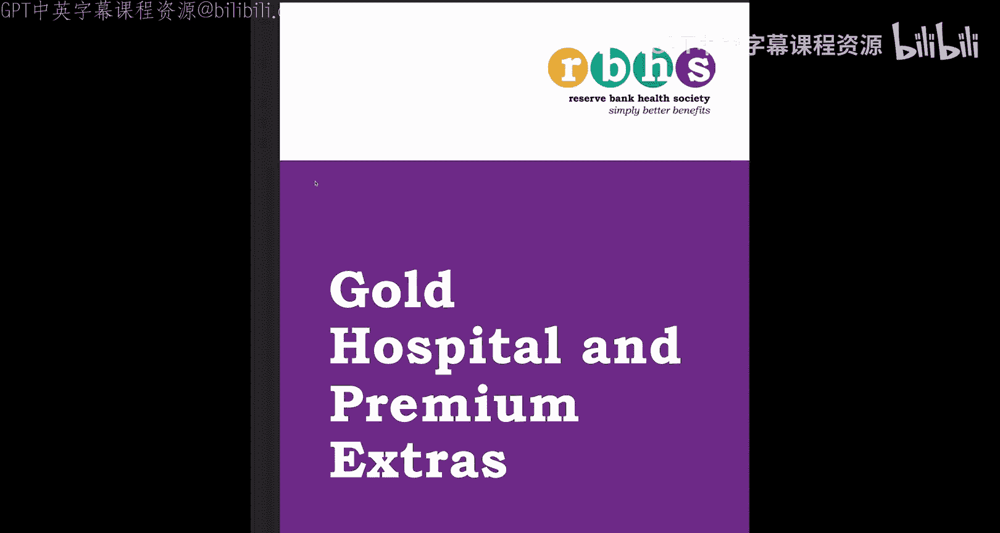
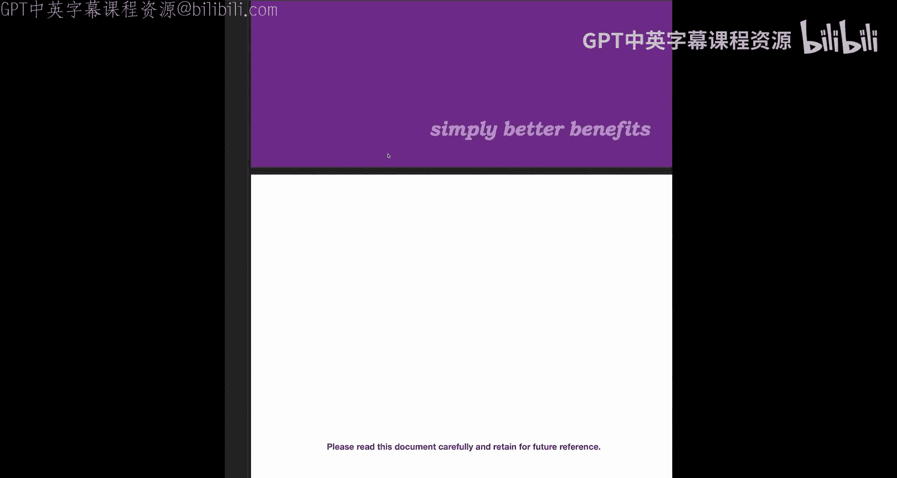
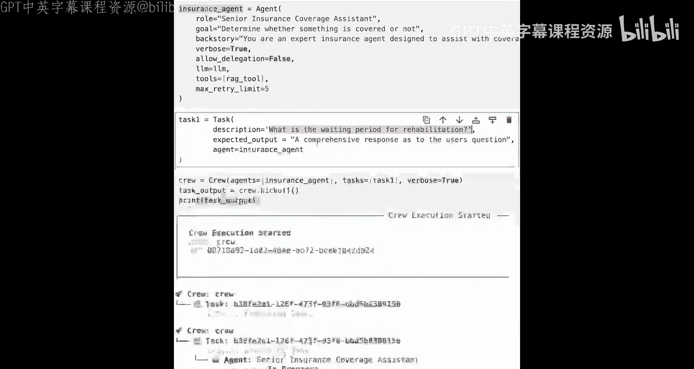

# 吴恩达《代理通信协议｜ACP： Agent Communication Protocol》中英字幕 - P4：4.building-a-rag-agent-with-crewai.zh_en - GPT中英字幕课程资源 - BV1VfgrznEjS

Welcome to lesson 3。 Now， before we get into ACP， we're gonna need an agent to create an AP compliant agent。

 So in this lesson， we're going to be building our very own retrieval augmented generation agent with a particular focus on insurance coverage。

 This is going form the basis for the agent that we eventually wrap inside of AP。

 Before we get into any ACP， we actually need an agent to convert to an AP compliant agent。

 So we're going to start out by building our very own rag agent with crew AI。

 This is pretty straightforward， but we're going to take it step by step。 nonetheless。 So first up。

 what we need to do is bring in a couple of dependencies。 So we're from crew AI。

 We are going to import a crew。 And this forms the basis for the architecture of a multiag system。

 We're going have a single agent， but we kick things off using the crew itself。

 We're then going to be able to define a task。 And this is where we're going to pass through a prompt。

 as well as our desired。😊。

So effectively， our task contains everything that we actually want to do。

 We're also going to bring in an agent， and this is going to be our LLM plus our tools。

 and that brings us to our LM。 We're going to bring that in as well。

 So we've got our LLM provider to be able to create an agent Now the nice thing about building a retrieval augmented generation system is that a number of providers have made it a lot easier to go and chunk up and vectorize your data。

 So we are going to do exactly that。 The nice thing about crew AI is that it comes with a rag tool。

 So let's bring that in。 we're going from crew AI tools we are going to import the rag tool。

 So this rag tool is going to facilitate us building up a rag system。

 So if I go and run that that is now all run successfully Now there are a couple of warnings when you go ahead and run this So we're just going to ignore them for the time being And to do that we are going to import warnings and we are going to filter warnings and ignore those。

 This means we're not going to get any unnecessary warnings that we don't necessarily。😊，Need。

The next thing that we're gonna to need is an LM So Retrieval augmented generation is all about having a vector database and  queryering that vector database。

 bringing back the context， passing it through to our LM and generating the output to generate that output。

 We're going to need an L。 So let's go ahead and bring that in。

 So I'm going to define a new variable called L And that is going to be equal to our L class that we brought in from Q AI。

 So to define that， I'm going to create a new L。 And we're going to specify the model。

 I'm going set that to open AI G4。 But you could use a range of other providers， you could use。

 you could use whats an X。 You could use a ton of other providers。

 this is just the one that we're going be using for this example。

 So if you want plug in a different one， see what actually happens。

 So the next thing that you're going need to do is define how many maximum tokens you want to allow L to generate。

 So to do that we're going to specify max tokens and set that to 1024。

 So if you'd like your L to be able to generate more or agent to be able to generate more。

 you could bump that up。 Likewise， if you want to be a little bit more。😊。

Sservative with how many tokens you're generating as part of your agent system。

 you might choose to bump that down。 Okay， so that is our L LM now created。

Now to build up our ragg tool， we first up need to define a bit of config。

 So let's go ahead and do this。 So I'm going to create a new dictionary called config。

 and this is going to contain our LLM as well as the embedding model that we want to go and use。

 And this specific config is all for our Rag tool that we imported from C AI So we need to define what LLM we're going to use to generate output and we need to define what embedding model we're going to use to embed our chunks as well。

 So let's go ahead and define this。 So we're going to define a new key called LLM and within that dictionary we are going to have two values provider and config。

 our provider is going to be equal to openaiI and keeping with the theme and the specific model that we're going to be using is going to be contained within the config key and we're going to set that equal to model and you guessed it G4 Now we've talked about our LLM but we really need an embedding model as well。

 This is what is going to take the chunks from our document and convert them into a method that we can search inside of our vector database So we are going to create。

😊，new key called embedding model。 and then we're going to specify another provider。 And again。

 we're going to set it to openaiI。 and then we need our config。 So we're going specify config。

 And this time we're going specify the embedding model that we want to use here。

 So we're going set that equal to model And then the value that we set to model is going to be text embedding Ada double02 So this is the config that you're going to use for your rag tool over here。

 but again， feel free to update this if you need to So I'm going to run this。

 that's our config now defined。 Now so far we've gone and set up our config。 we've set up our base。

 we need to go and define our rag tool now So again。

 crew AI's got our rag tool that you're able to use to be able to go and define this and build up your agent system。

 So we're going create a new variable called ragg tool and we're going set it equal to ragg tool or an instance of ragg tool and then to that we're going pass through three different values。

 So we're going pass through the config and we're going pass through the confi dictionary that we just up here。

 we're also going specify the chunk size and we're going set that into chunks of 1200 tokens。

 So this means that we're going be chunk。😊，up our document into chunks of 1200。

 And we probably want a little bit of overlap just to make sure that we're not cutting off chunks in the incorrect places or places which aren't so ideal。

 Now， that's our rag tool sort of defined， but we also need to add a document to that。

 So how do we actually go about doing that。 Well， I've got a document over here。

 And this is going to be stored inside of the same environment that you're running。

 So you'll be able to access this。 This is a Pdf document about potential insurance inclusions。 Now。

 this agent that we're going to be defining is going to be all to do with finding out what's included potential waiting periods on insurance。

 So we need to provide a document which contains that specific information。

 So it's almost like a product disclosure statement for an insurance policy。 Now。

 we want to get this into our ragg tool。 So how do we go about doing that。😊。

So the first thing that you're going to go ahead and do is define this ragg tool obviously。

 But the next thing that you want to go ahead and do is actually add that document to the vector database。

 So we are going to go and use the add method from our ragg tool and specifically add in that document。

 this is going to be contained inside of the environment that you're working in。 But again。

 if you want to do this locally you'd go and update this path to the document that you want to embed and load into your vector database A your ag tool。

 So to the ad method， we're going to pass through the file path for our document。

 this is currently stored inside of the root folder and then inside of data and then we are going to define this specific name of the file。

 which is gold hospital and premium extras do PDFdf。 So if you've got a different file name。

 you would go and update the file name for the document that you're working with right over here。😊。

We also need to define the data type。 So we're going to specify the data type。

 and we're going to set that equal to PDF file over there。 So if we go and run this。

 this should start chunking up our document and push it into our vector database。

 And that looks like it's run successfully。 So we've going to define our LLM。

 you've gone and define your config。 You've got a ragg tool Now。

 when are we going to define the agent。 Well， it just so happens， we're going to do that now。

 So in order for you to define your agent， we're first up going to define a variable which going to contain the agent。

 And then you need to go and use the agent class， which we had right up there。

 So we're going define a new agent And this is going to contain a few things。

 but this is kind of wire like crew AI because it's very verbose in how you go and build one of these agent。

 The first thing that we need to define inside of our agent is the role。

 And this is the role that that agent is going to take。

 Now keep in mind we're going and loading a product disclosure statement for an insurance policy So we are going to have a senior insurance coverage assistant here。

 So that's going to be the role for our agent now。😊，We also need to define the goal。

 so we're going to specify our goal as determine whether or not something is covered or not。

 and this is all to do with whether or not something is covered within your insurance It might also talk about waiting periods so on and so forth really it's all to do with the information contained within that P And then we want to go on ahead and define a backstory。

 This is probably my favorite key and so the backstory in this particular case is going to be you are an expert insurance agent designed to assist with coverage queries so you can see that we've now gone and find our backstory Now we also need to define a few more things So you're going to go and set verbose equal to true This means that as our agent is running we're able to see active progress。

 you're going to set a allow delegation to false。 This means that we're not going to be passing off the task to other agents you're also going to pass through your LM over here。

 So this is the LM that we defined up there It's the open AI GP for instance but we also need to pass through our rag tools because so far we've gone to defined it。

 but we haven't actually given it to our agent。😊，Here So under tools。

 we're going to create a new list。 and we are going to pass through our rag tool that we've now gone and define。

 And the last thing that we need to define in order to create our agent is the maximum retry limit。

 So we're going to define that and set that equal to5。

 This basically states that our agent is going try to get the answer at least five times。

 And if it doesn't， then it's going to error out。 So this means that it's again。

 a bit of an insurance policy that you don't go and blow out your number of API calls。

 So if we go and run that， that looks like our agent has now successfully run and we' not necessarily run。

 but we've now gone and define it。 The next thing that we need to do is define a task。

 And this is going to contain our prompt。 So inside of our prompt or our prompt is going to be encapsulated inside of our task that we've got over here。

 So let's create a new task。 So we're going create a variable called task1。

 And this is going to be an instance of the task class from crew A。

 Now task has a couple of key things inside of it。 A description， the expected output。

 and the agent that we've want to delegate。😊，Particular task to or give it to。

 So the description the first prompt that we're going to be passing through is what is the waiting period for rehabilitation。

 Now， again， you might go and try a different prompt there。

 you might choose to try something which you see in this document。

 if you go and use a different document。 This is where youd go and pass through your specific prompt。

 We then want to define the expected output。 So inside of your expected output。

 we are going to set that as a comprehensive response to the user's question。

 you might choose to change this a little bit。 it might be a summary， it might be bullet points。

 you're effectively describing the style here。 Now remember the last thing that you need to define inside of your task is the agent that you want to give this prompt to。

 So we're going to define that right over here。 So we're going to specify the agent as the insurance agent。

 remember， we define the insurance agent over there。

 It's now coming into our task down here Now if we go and run this task that cell has now completed successfully。

 So we' now define our agent， we' now define our task。

 we now need to encapsulate it all inside of a crew and then kick it off so。How do we do that？ Well。

 remember， when we went and imported our dependencies， we imported a crew。

 So we're going to define a new instance of our crew。

And we are going to pass through a few key things here。

 We need to pass through the agents themselves， the tasks。 if we had multiple tasks。

 we'd pass through multiple tasks， we also want to specify that it's going to be verbos。

 So inside of our crew， we're going to define our agents and this is going to be a list and right now we've only got one agent。

 but if you had multiple agent you'd pass multiple through I think for now we're just going to have one single agent over here we're then also going to have the tasks that we want our agent to complete for now we're just going to have task one if we had multiple tasks we'd pass them in through here as well and we're going to set verbos equal to true that way again。

 we get output progress as our agent is running。😊，Then all that's really left to do is kick off our task。

 So to do that， we are going to create a new variable called task output。

 and we are going to take our crew from over here and run the kickoff method。

 This is akin to like running the crew or actually starting things or when you hit enter in chat or hit enter inside of an LM system like O la。

 So that should get everything up and running， the last thing that we want to do is print out our final task output。

 So if we go and run this， this should hopefully kick off your rag agent and get your agent running。

 So if we go and run it， take a look， you can see crew executioner started。

 we've gone and pass through the prompt to our agent。

 you can see that we've got our chunks from our rag system。 if we scroll a little further down。

 take a look we've got our final answer displaying over here。

 So the waiting period for rehabilitation coverage under this insurance policy is two months。

 However， if the requirement for rehabilitation is due to a preexisting condition。

 the waiting period extends to 12 months。 It's important to consider this information can vary on the specific。

😊，Situation so on and so forth。 You have the idea。 The answer is now here。 So again。

 we've got a bit of metadata。 and you can see this is the output from actually printing through the actual task output from over there。

 So if we wanted to go and push this to a different system。

 if we wanted to output to a JO document or something of the sort。

 We've got the ability to work with that final output as well。 But again， keep in mind。

 you can go and change this prompt。 So you might choose to change this query over here。

 you might choose to change your insurance agent or even change the data that you pass through to your rag agent。

 But for now we've gone and define our initial rag agent。😊。

