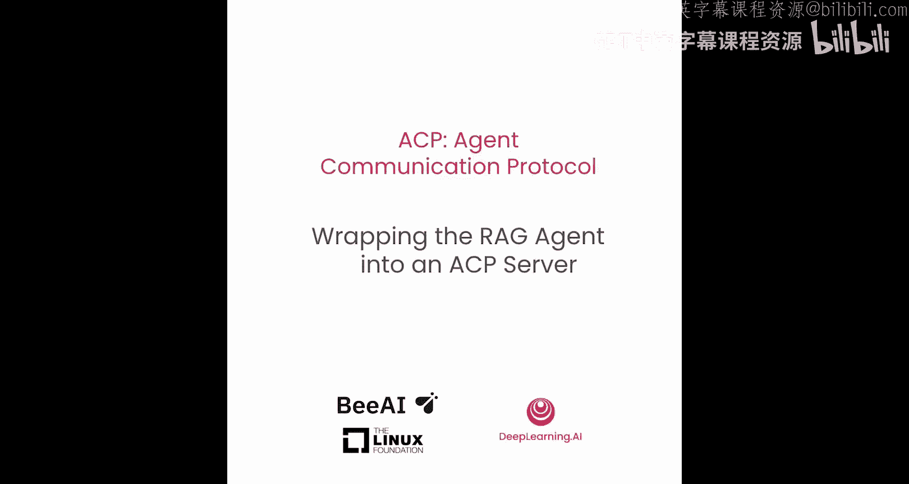
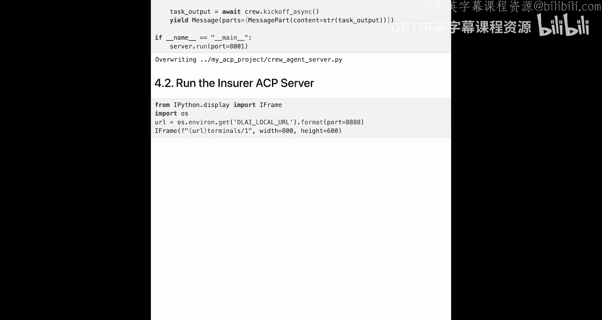
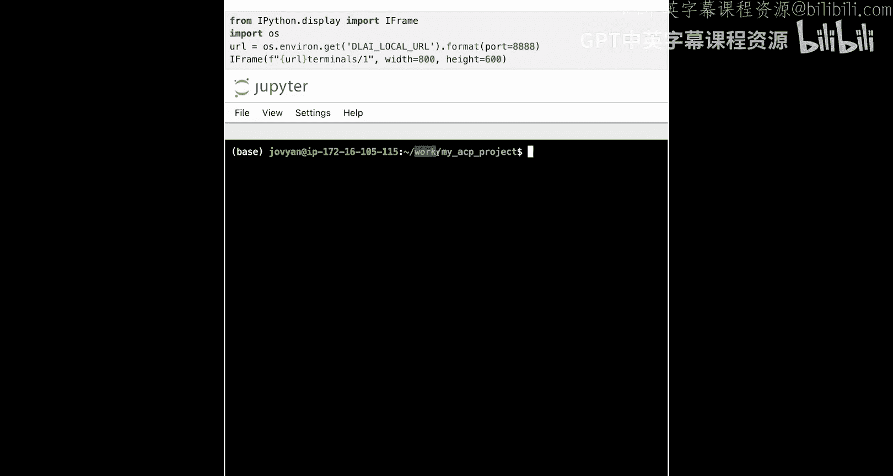
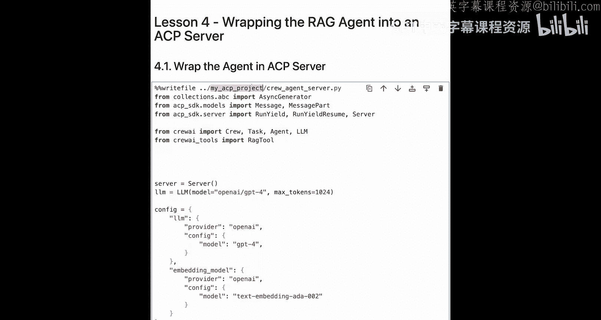
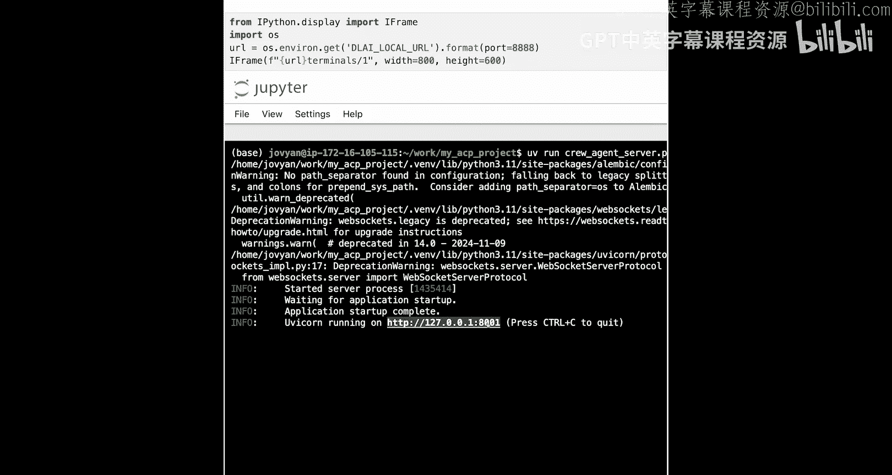
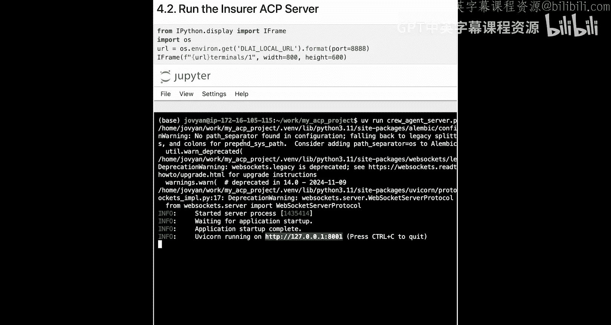
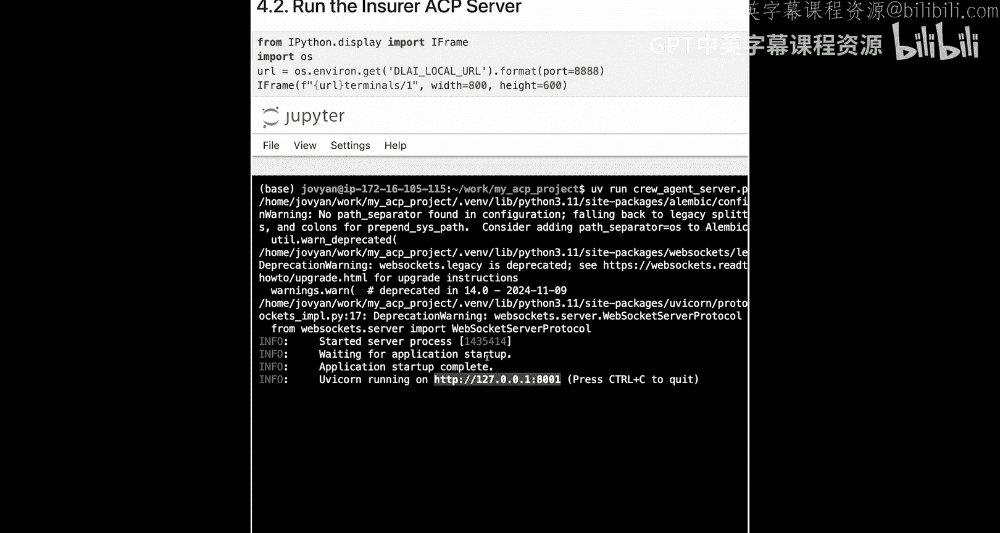

# 吴恩达《代理通信协议｜ACP： Agent Communication Protocol》中英字幕 - P5：5.wrapping-the-rag-agent-into-an-acp-server.zh_en - GPT中英字幕课程资源 - BV1VfgrznEjS

Now that you've built the rag agent， it's time to bring an AP into play because eventually what you're gonna to do is take your first insurance AP agent and connect it up to a hospital agent that way。

 imagine you've got agents communicating across different organizations。 That's the beauty of AP。

 We can define an agent once and have them called from a universal client。 In this particular case。

 we're gonna to get two organizations to talk to each other using their agents。

 But before we get to that， we first up need to wrap our existing agent， our Ra agent inside of AP。

 So you're now going to convert your existing rag agent into an AP server。 So over here。

 I've got the existing code that we wrote in lesson3。

 This is the exact same insurance rag agent that we've already built out。

 But how do we convert this into an AP compliant agent and specifically an AP server。 Well， first up。

 what we're going to need to do is run this as a standalone server。

 So we need all of this code to be output into a file。😊。

Can run using Python or U。 So how do we go about doing that。 Well， we typically use an idea。

 But for this specific learning environment， we're going use a magic function that will copy the contents of this cell into a python script。

 and we're going to export this into a file called crew underscore agent underscore server So when we going run this cell is' actually going export all of this code to that specific file there。

 Now the next thing that we're going to need is a couple of dependencies to actually convert this into an AP server。

 So we're going bring in the AP generator from collections aBc。

 This is going to form the output type for the server。

 We're also going to import message and message part from the a。

 This is going to form the format that we use to output the results of our agent while we're at it。

 we're going import run yield run yield Re and server from the AK server class run yield and run yield resume are going to form part of the asynchronous generator。

 So this effectively showcases the type of output that our AP server。😊。

Is going to be exporting The server itself is going to form the foundation of our ACP server。 Okay。

 so those are the main dependencies now imported。 Now the next thing that we need to do is create an ACP server。

 So to do that we can create a new variable called server and assign it to our ACP server that we've imported from over there。

 Then what we're going to need to do is begin wrapping our existing agent。

 So I'm going to scroll on down to where we had our agent and we're going to use the server do agent decorator。

 This is going to tell the aPS that what comes under here is an agent that we want to make available on the ACP server。

 Now the name of the agent that actually goes into the server is based on what we actually name this function。

 and we're also able to provide metadata via the doc string。

 So let's go ahead and start wrapping this。 We're going to make this an asynchronous function and we're going call it policy agent。

 Then we need to define what types of input we're going to take。

 And this is effectively where our prompt is going to be captured。

 The first variable that we're going to capture is our input。😊。

And this is going to be a list of messages。 Then we're going to return a generator。

 That means we're able to iteratively return output from our AP server。

 And that is going to be an asynchronous generator。

 And that's going to take in run yield and run yield resume from over here。

 Now one of the most critical things is also explaining what these agents are useful for。

 So AP makes this available through the do。 So all we need to do is provide a doing underneath our function。

 So our policy agent。 if you remember correctly， is specifically our insurance related agent。

 It provides us with information around our coverage periods。

 whether or not something is included or not。 Now we're able to provide this back to our users via the AP server using this specific do here。

 So we're going write it out。 So this is an agent for questions around policy coverage。

 it uses a rag pattern to find answers based on policy documentation。

 You can use it to help answer questions on coverage and waiting periods。

 So that's pretty much our doing now defined。 Now when somebody looks for metadata around this agent。

😊，The ACP server， they'll be able to return that particular bit of information。

 Now we need a table of this in。 and there's one key thing that we need a change here right now。

 we've got a fixed prompt， which has been passed through inside of our task。

 but we really want to be able to capture a dynamic prompt when a user goes and calls out to our aP server。

 and this is where our input variable from up here comes into play。

 Now we do need to unpack the values from that input because right now we're saying that we're going to be passing through a list。

 but for now we just want to take that one prompt。 So to do that。

 I'm going convert this static prompt to an input variable So we're going to grab the first value from our input and we're going grab the first part and we're going to specifically return the content。

 Now if you actually go and print this out you'll actually see that when we return that message variable we're able to actually extract all of those different components。

 So if you add multiple prompts， you've got the ability to maybe loop through and create multiple tasks。

 maybe try that out after this so that is our。😊，Ask now amended Now。

 because we are running this asynchronously， we want to kick off our agent asynchronously as well。

 So we're actually going await our crew or kickoff method。

 and we're going convert that to asynchronous。 Now， right now。

 we're not actually return anything from the server。 So we need to return something as well Now。

 rather than returning because we are producing a generator， we're actually going yield。

 So we're going to use the yield method and we're specifically going to return a message and we're going to return the different message part from our agent。

 Now this is going to take in our task output。 Now。

 let's say you had another agent and it just return back a specific text prompt。

 You'd be passing through the text prompt inside of this value here。

 Keep in mind we're formatting it as a string that way。

 we're keeping consistent when it comes to generating our outputs。 So when we go and run this now。

 after our agent gets kicked off。 It'll take in the prompt from our user over here。

 We're then going to unpack it and push it into our crew AI task。

 And then eventually we're going to return it down here。😊。

We do need to run this server because keep in mind we're going to be outputting this as the crew underscore agent underscore server p。

 So how do we go about running this Well， we're going to use a pretty common python structure。

 So if name is equal to main then what we're going do is we're actually going run this server and we're going run it on a specific port because a little bit later on you're going to spin up another server so we can build sequential ACP server calls So we are going to take our server and we're going to use the run method to kick it off and we're going to run it on port 01 Now if I go and run this cell this is going to output it into that specific folder So my underscore ACp underscore project and we're going output it to the crew underscore agent underscore server if you go and open up that file and specifically inside of that repository you'll see that we've exported this code that we've just written over here Now that we've got that code exporter though we can actually begin to run that AP server So to do that we're going create an iframe inside our Jupyter notebook that way you can start up the server as well and give it a。

So I'm going to grab this code which will open terminal1 Now we're eventually going to run multiple ACP servers。

 so we're going to run this server in terminal1 and then our later on we're going to define a hospital server and that's going to be running in terminal tube Now if we go and run this。

 we should get our terminal back。😊。

And take a look。 That's our terminal。 And right now。

 you can see that we're inside of the work folder and inside of the myACP project folder。

 Ca your mind back when we went and wrote this out。

 we were writing out our crew agent server file to the MyACP project file。 Now。

 if you're going run this locally on your own machine。

 just keep in mind that you need to be in the same folder where the crew agent server is currently running。

 So we're going to be using U to run this。 Now， if you've never use U before。

 you can install a budget Pip install。😊。

UV and if you're creating this for the first time again on your local machine。

 you're going to need to initialize a new project by running U in it and then creating a virtual environment by running U V E N V。

 We've already set this up inside of your environment。

 you've got the ability to just go and kick off the crew AI server。 So to do that。

 we can run U run crew agent server dot Pi。 And if we run this。

 hopefully we'll get an endpoint back that shows us that our server is running。😊，And take a look。

 We've got our endpoint return。 so we can now see that our server is currently running at our local host environment on port 8001。

 And remember， we specified our port up here。 Now， the thing about this is that it's going to stay up for 120 minutes。

 So if we start this server this first time， it'll run for 120 minutes。

 But if you go away and come back to this lesson， you're going to need to start it up again。

 This only applies to this environment。 if you're running it locally。

 it's obviously going to stay up for as long as you're running the Python script。

 But just keep in mind that when you're running it inside of the deep learningning do AI environment。

 youve got 120 minutes。 So now we've got the ability to call out to it via an ACP client in the next lesson。

😊。

