# 吴恩达《代理通信协议｜ACP： Agent Communication Protocol》中英字幕 - P6：6.calling-an-acp-agent-using-the-client.zh_en - GPT中英字幕课程资源 - BV1VfgrznEjS

So you've got the ACP server up and running But how do you actually make a call to it or use it Well。

 this is where the ACP client comes in using the client we're able to create a standardized set of calls out to that ACP server if we add multiple agents running on that server we can hit all of them and if we add different servers well we can use a similar style structure to call out to that ACP server which we'll do a little bit later But for now let's go and define our ACP client and make a call out to the ACP server that we've created。

😊。

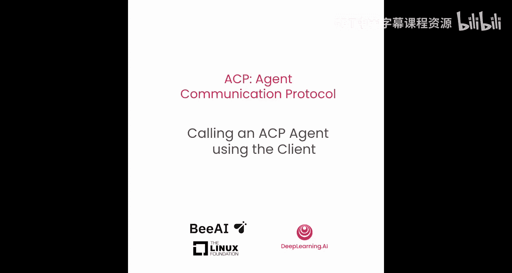

So we've come to the time actually making a call out to our AP server。 Well， first up。

 we probably want to double check that our server is still running。

 So we're gonna run through the exact same method that we did to get our server up and running。

 We're going open up the terminal。 And then what we're gonna do is we're gonna render terminal1。

 exactly as we did previously。 So that way， we can just double check to see whether or not our server is up and running because remember。

 if you're running this inside of the deep learning do AI environment。

 It's going stay up for 120 minutes。 If you're doing it locally。

 it runs for as long as you've got the server up and running or the Python script running。

 So if we go and run this， we can take a look to see what's happening with our server。😊。

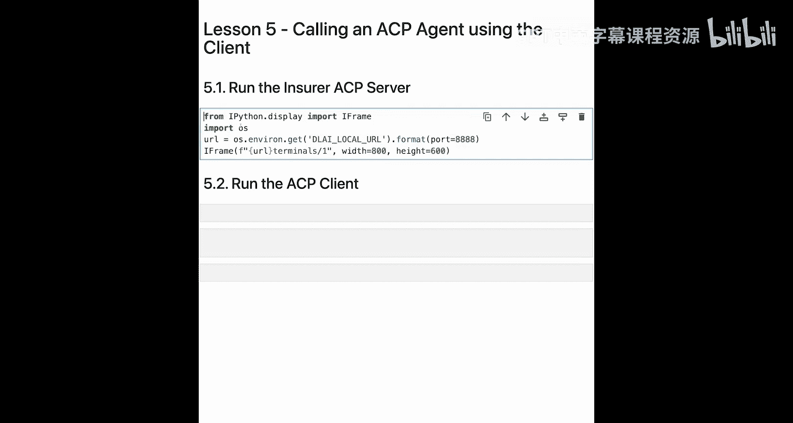

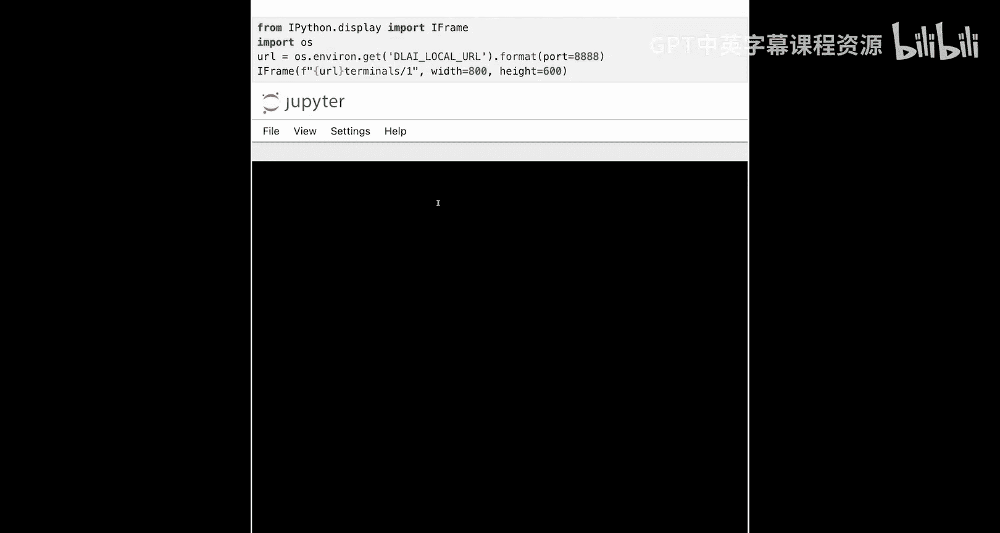

And take a look at looks like our server still up and running， you can see it right over there。😊。

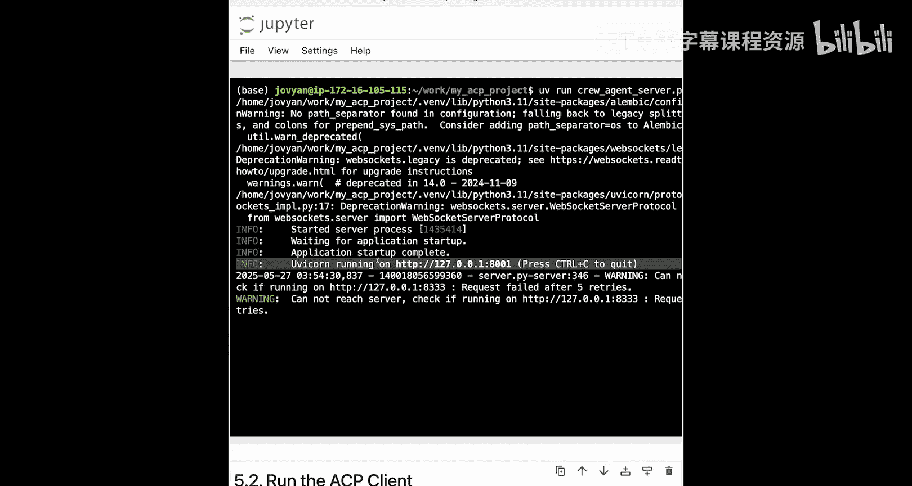

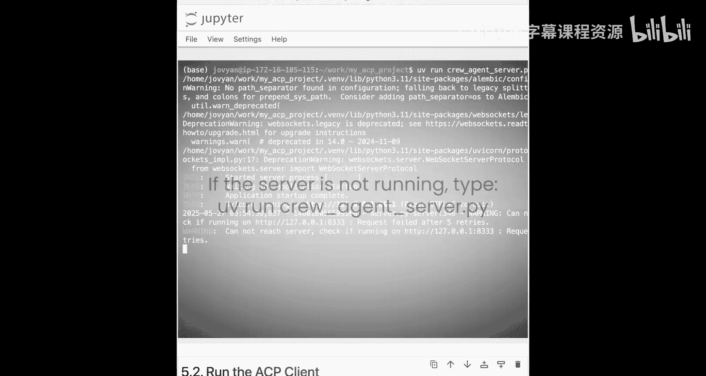

Now， what we want to do is begin making calls to our ACP server。

 And the nice thing about this is that you can have a standardized client or eventually you're gonna to be able to integrate it into different systems using a similar style pattern。

 For now what we're going do is we're going to make sure that we can nest asynchio calls or asynchO calls So we're going to import N asyncho and apply that to our environment。

 This allows us to run the AsP client from the Jupyter notebook environment And then what we're going to do is we're going to begin building up our client。

 Now within the ACP SDK you've got a client available and think of this like a way to just communicate with our AP endpoint。

 We're also going to bring an asynch IO to be able to make asynchronous calls and we're also going to import color and specifically the for library。

 this just makes it so that you can output stuff using colored terminal formatting and just looks a little bit nicer。

 You're able to see things a little bit more clearly。

 Then what we're going to do is we're going to create an asynchronous function。

 So we're going to create。😊。

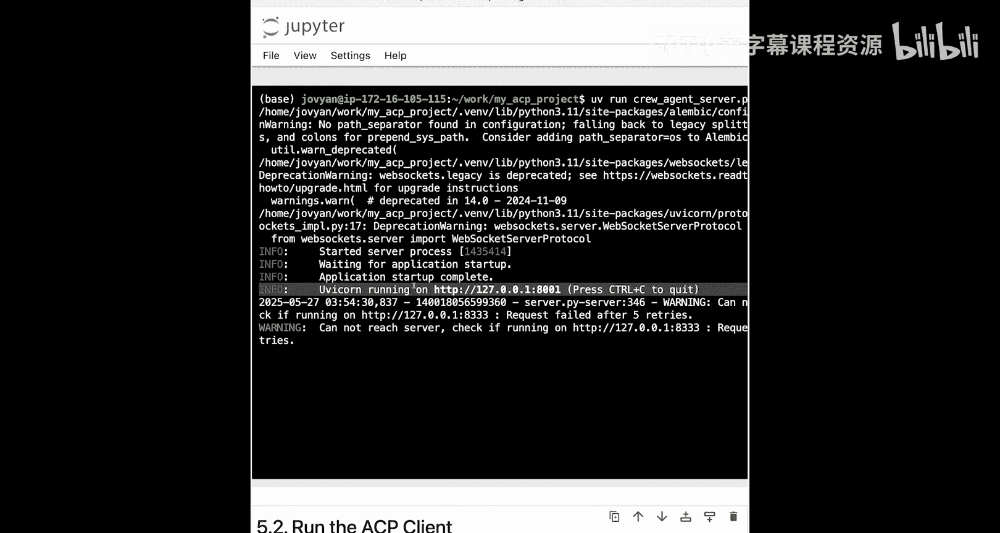

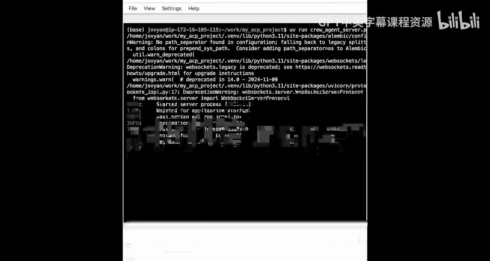

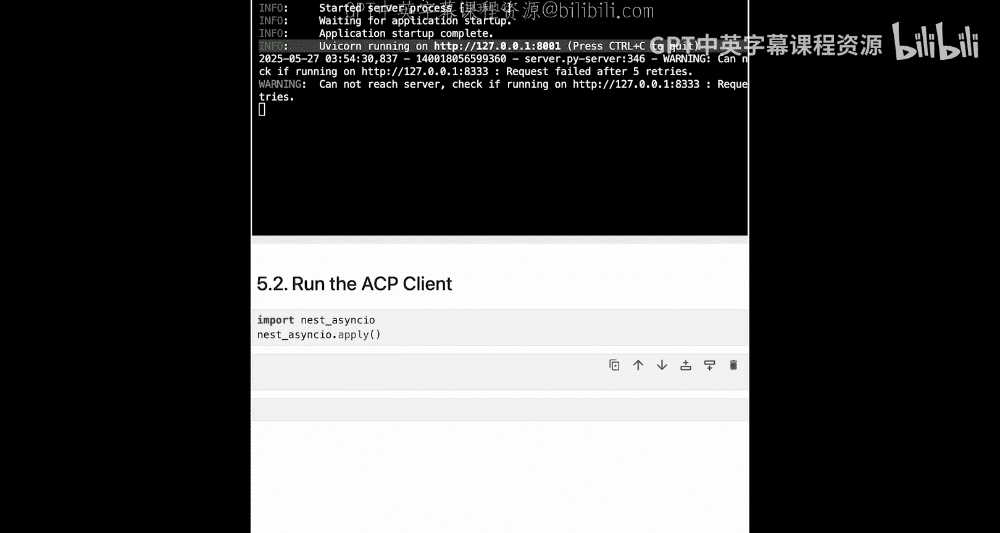

Function called example。 And that's going return nothing。

 And then we're going to connect to our client。 and our client is going to point to the URL where ACP server is running。

 So right now we're going set our base URL and set it equal to local host 8001 because if we scrolling up。

 you can see that it's running there later on， if you've got different servers running。

 And when we begin making sequential calls， we'll have to connect to two different clients because we're connecting to different servers。

 And even though we've only put one agent on this particular server， you could have multiple。

 and I'm going to show you how you might call that to different agents on a single server。

 So we're going to define that as a client and then what we're going to do is we are going to run a synchronous call to that particular server。

 and we're going to target the agent that we defined because remember the agent that we define was our policy agent the name of the function when you define the ACP server is going to be the name of the agent when it comes to calling it with the client。

 And I'll show you what I mean in a second。 So we're going to create a variable called run and this is going to await a synchronous call。

😊。

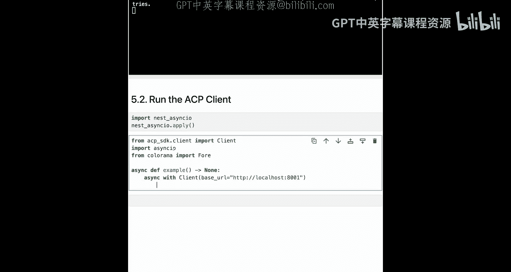

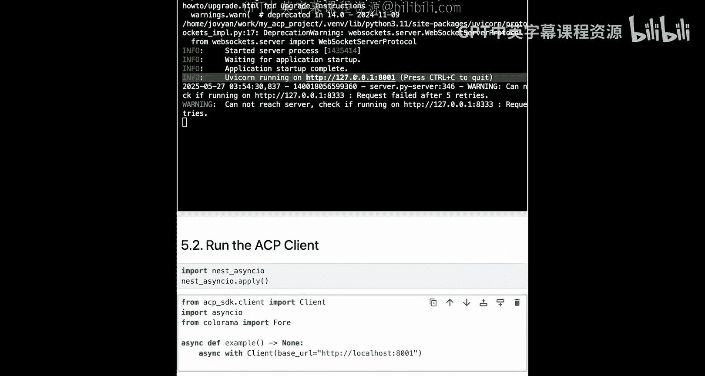

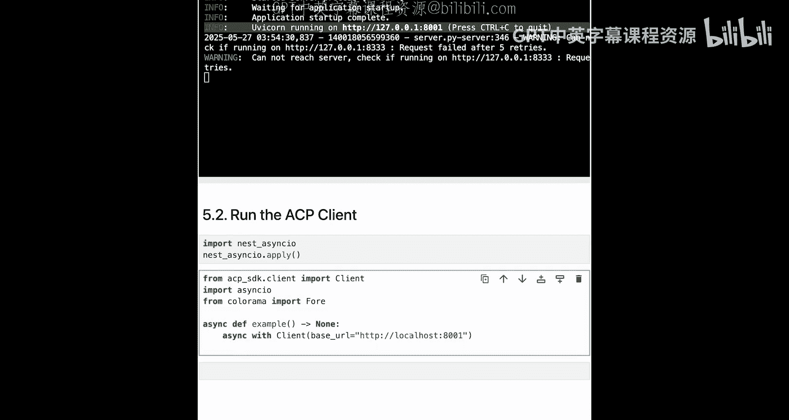

AndThen we're going to target our policy agent。 remember when we defined our agent in the ACP server。

 we named the function。 So we typed in DF policy agent。

 so policy agent was the name of the function that then becomes the name of the agent when we use ACP。

 There's one last thing that we need to pass through to our client in order to run a prompt or trigger a prompt And the cool thing is that when you go and run this you'll actually see the call kickoff in our ACP server up here。

 So inside of the input argument we're able to pass through our prompt So I'm going to pass through what is the waiting period for rehabilitation。

 Remember' asked this previously， but we had a hard coded inside of our agent So all things holding equal。

 this input should then be passed through to our agent running on the ACP server so we should be able to see that pass through and run up there Now we're also going to print it out back into our Jupyter notebook so that way we can see it a little bit more easily to do that we're going to print and we're going to use the color armor yellow color and then we're going to unpack the output from our client。

😊。

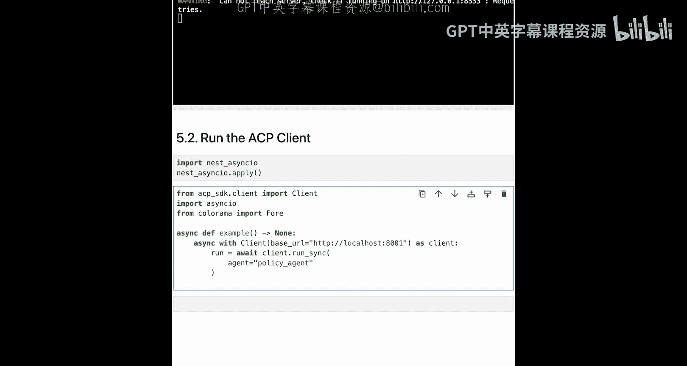

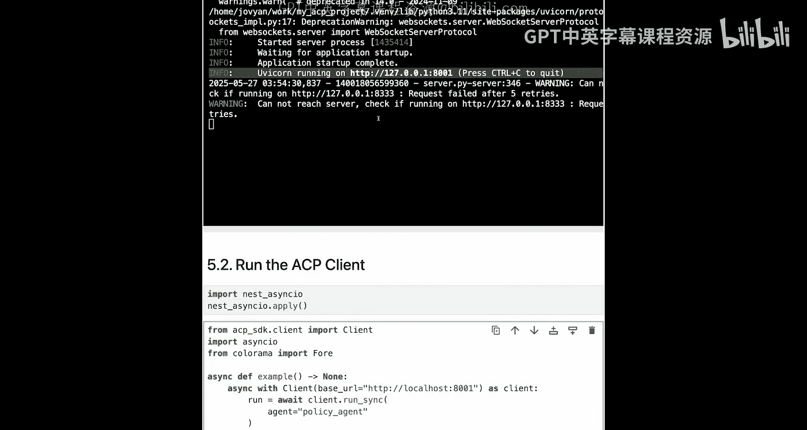

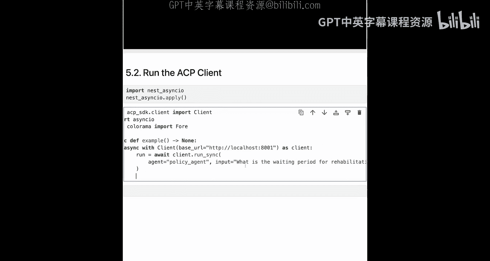

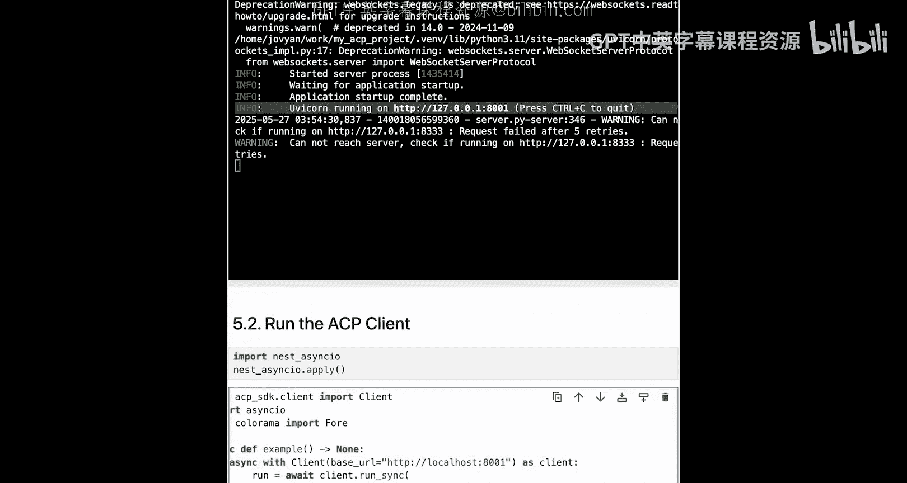

So we're going get the first value from our output。 We're gonna grab the first part。

 This is a similar way to how we actually unpack our input prompt when we went and find our server。

 and then we're gonna grab the content and then we're also going to reset the terminal coloring using color over there。

 So this should really just be our client now done Now if you wanted to。

 you could go and change the prompt here to something different。

 try running a different prompt here how the ACP server performs。

 remember it's going to be limited to what we've actually put inside of our vector database。

 but you might try uploading different documents and try different inputs different prompts as well。

 And eventually we're going to link these up to make sequential calls to multiple servers and connect multiple agents together。

 so if we run that cell that looks like we don't have any issues there。

 And then we're going to use anco and the dot run method and then run our function over here。

 which is called example。 So if we go and run this now， as soon as we trigger this。

 We'll be able to see whether or not it's running up here in our ACP server。

 So if I go and run this now。😊。

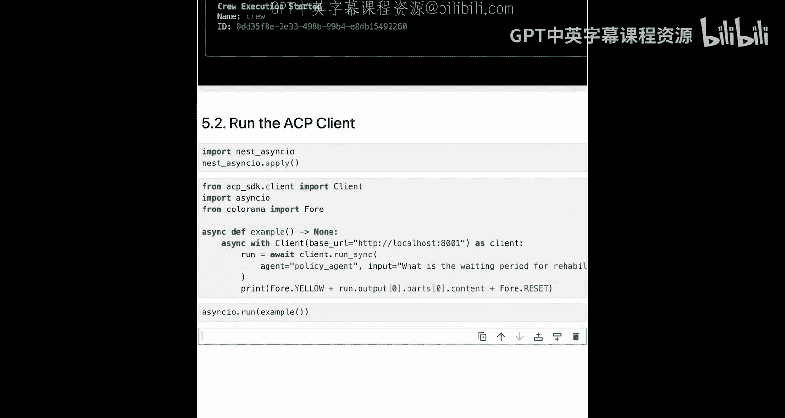

Take a look。 execution has started。 You can see though we've got our prompt pass through。

 What is the waiting period for rehabilitation looks like it's all running。

 We're getting all of our context and our prompt and all things holding equal。

 We should get a completion。 Take a look。 The waiting period for rehabilitation in the insurance policy is two months。

 We should get this printed out out here as well。 So take a look。

 We've now made a call to our ACP server using the ACP client。😊。

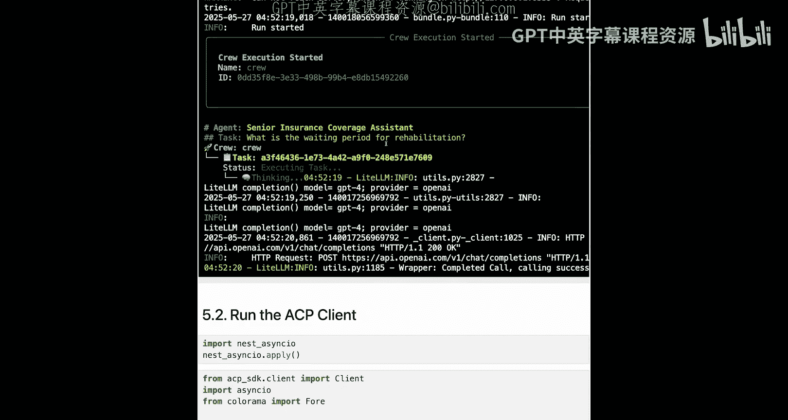

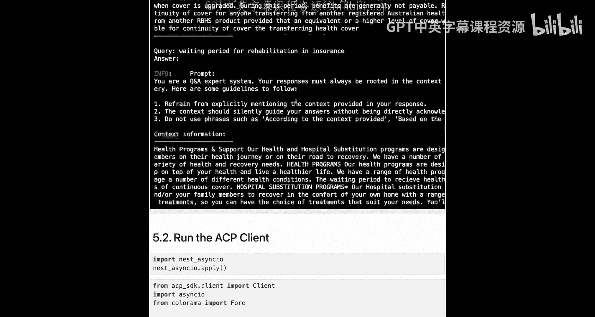

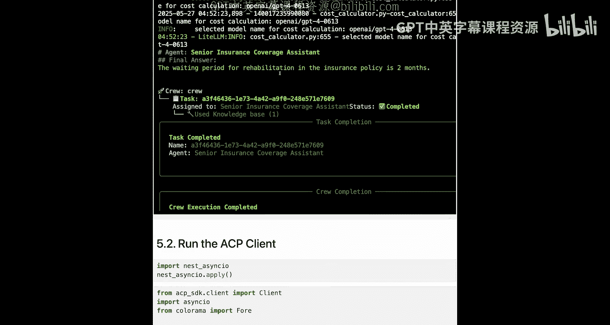

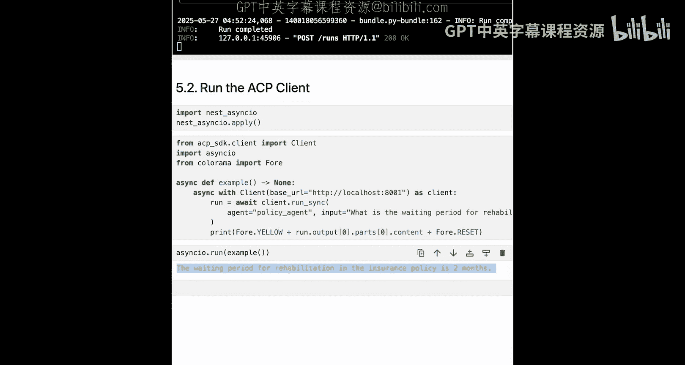